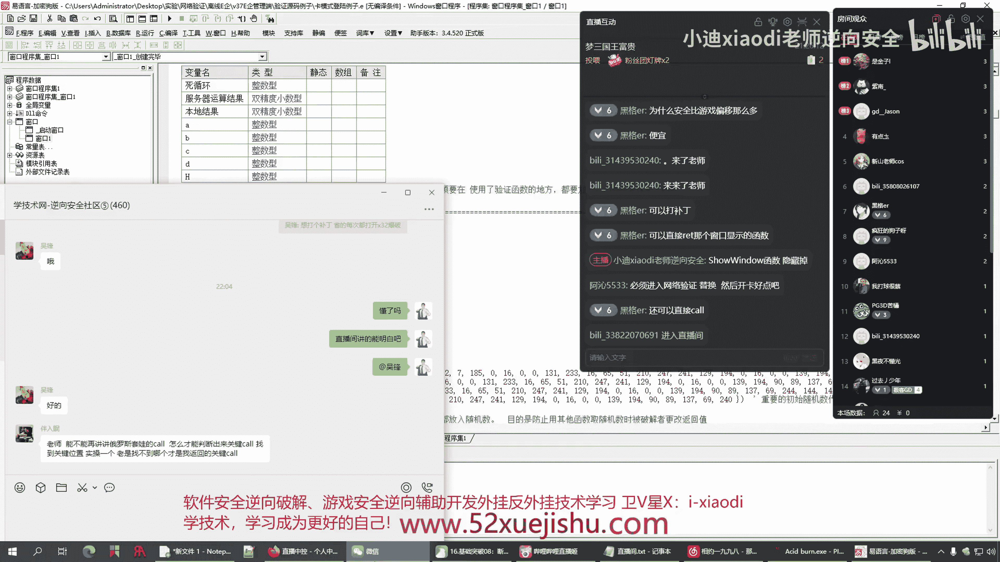

## 🧩 网络验证卡密软件破解：01：全局窗口校验与闪退现象

在本节课中，我们将要学习网络验证卡密软件破解中的一个常见问题：为什么使用 push 窗体法破解某些程序时，程序会出现闪退，以及这类程序背后的校验原理。教程会围绕全局窗口校验、启动窗口创建完毕后的判断、单个校验和多校验叠加展开，尽量用直白的方式说明初学者需要理解的关键点。

原文首先提醒注意一个全局校验：窗口校验等于 1。这里的重点不是某一个具体数字本身，而是程序会把“窗口校验”这个值保存成一个全局变量，让程序在后续多个位置都能读取和判断它。可以用下面的代码来描述这个核心概念。

```text
全局窗口校验 = 1
```

也就是说，程序先定义一个全局窗口校验变量，并给它一个初始值。这个变量可以理解成程序内部的一张“通行证”，后面启动窗口创建完毕时，程序会拿出这张通行证来检查。单校验通过可以用一个简单公式表示。

```text
校验通过 ⇔ 全局窗口校验 == 1
校验失败 ⇒ 结束程序
```

以下是这一节需要记住的几个要点。

- 程序中存在全局窗口校验，窗口校验的值等于 1。
- 这个全局窗口校验需要被定义为全局变量，方便后续读取。
- 如果程序发现校验值不等于 1，就可能直接结束程序。

这里的“直接结束”就是闪退现象的重要来源之一。使用 push 窗体法破解时，如果只修改了 push 相关流程，却没有处理程序里的校验判断，程序就可能在启动窗口创建完毕后发现校验值不符合预期，然后主动结束运行。理解这一点后，本节我们来看看启动窗口创建完毕后，程序具体如何判断。

## 🚪 网络验证卡密软件破解：02：启动窗口中的单校验判断

上一节我们介绍了全局窗口校验变量和校验通过的基本条件，本节中我们来看看这个校验在启动窗口创建完毕后是如何落地的。原文说明，在启动窗口这个窗口一创建完毕之后，程序就可以进行判断：如果条件为真，并且其中校验值不等于 1，也就是条件不成立、校验不通过时，程序就直接结束。

```text
启动窗口_创建完毕():
    如果 全局窗口校验 != 1:
        结束程序()
```


上面的代码表达了一个很直接的逻辑：启动窗口创建完成后，先检查全局窗口校验。如果它不等于 1，就说明当前状态不符合程序预期，于是程序结束。这里的“不等于 1”可以理解为“校验没有通过”，“直接结束”可以理解为程序主动退出，表现出来就是闪退。

以下是这个单校验判断需要理解的几个方面。

- 判断时机：在启动窗口创建完毕之后进行判断。
- 判断条件：检查全局窗口校验是否不等于 1。
- 失败处理：如果校验不通过，就直接结束程序。

原文还强调，搞这样一个校验的目的，是判断使用者是不是直接修改了 push。程序里可能有很多类似校验，这里只是举一个例子，说明存在这样一种校验方式。如果只处理了一个 push 点，却没有意识到程序还会检查全局变量，就可能出现程序启动后闪退的情况。理解了单个校验的写法后，本节我们进一步看看多个校验叠加时会发生什么。


## 🧱 网络验证卡密软件破解：03：多校验叠加与校验函数

上一节我们看了启动窗口创建完毕后的单校验判断，本节中我们来看看如果程序不只有一个校验，而是有多个校验函数和多组全局校验，破解难度会如何变化。原文提出一个关键问题：如果有很多个校验，那该怎么办。程序里可以再来一个校验函数，返回值可以是整数型或逻辑型，具体按程序需要选择，然后再加上全局校验变量。

```text
全局校验1 = 1
全局校验2 = 2

如果 全局校验1 != 1:
    结束程序()

如果 全局校验2 != 2:
    结束程序()
```

多校验叠加后的通过条件可以用公式表示。

```text
校验通过 ⇔ (全局校验1 == 1) ∧ (全局校验2 == 2) ∧ ...
```

原文说明，可以再定义一个全局校验 2，让它等于 2，然后再来一个全局变量，并调用这样一个函数。接着进一步判断：如果把第一个校验过掉了，程序再看第二个校验；如果第二个校验不等于 2，程序就结束。这个思路说明，程序不会只在一个地方检查，而是可能在多个位置、通过多个函数反复检查。

以下是多校验叠加中需要掌握的几个要点。

- 程序可以存在多个校验函数，分别负责不同位置的检查。
- 可以定义全局校验 2 等于 2，并配合新的全局变量使用。
- 第一个校验被绕过之后，程序还可能继续检查第二个校验。
- 只要有一个校验不通过，程序就可能结束运行。

这也是为什么有的程序用 push 窗体法破解后会闪退：修改了一个 push 点，并不代表所有校验都被处理。程序可能在启动窗口创建完毕后检查全局窗口校验，也可能在后面继续检查全局校验 2、校验函数返回值等内容。多个校验点叠加后，只改一个位置就容易触发其他校验，从而让程序主动退出。接下来我们对本节课内容做一个总结。

## 📌 网络验证卡密软件破解：04：总结与回顾

前面几节我们介绍了全局窗口校验、启动窗口中的单校验判断，以及多校验叠加的基本原理，本节中我们对整体思路进行总结。核心结论是：push 窗体法破解后出现闪退，并不一定只是 push 修改本身的问题，还可能是程序内部存在校验逻辑，发现状态不符合预期后主动结束程序。

以下是本节课的核心结论。



- 程序可以把窗口校验保存为全局变量，并通过判断它是否等于 1 来确认状态。
- 启动窗口创建完毕后可以检查全局窗口校验，不等于 1 就结束程序。
- 程序可以设置多个校验函数和多个全局校验，例如全局校验 2 等于 2。
- 第一个校验被绕过之后，还可能继续检查第二个校验，不通过就结束。
- 只修改一个 push 点，可能无法覆盖所有校验，因此会出现闪退。

本节课中我们一起学习了网络验证卡密软件破解里 push 窗体法闪退的校验原理：程序通过全局变量保存校验值，在启动窗口创建完毕后进行条件判断，并可以用多个校验函数和多组全局校验叠加检查。理解这些判断逻辑后，再分析程序为什么闪退，就有了更清晰的思路。

