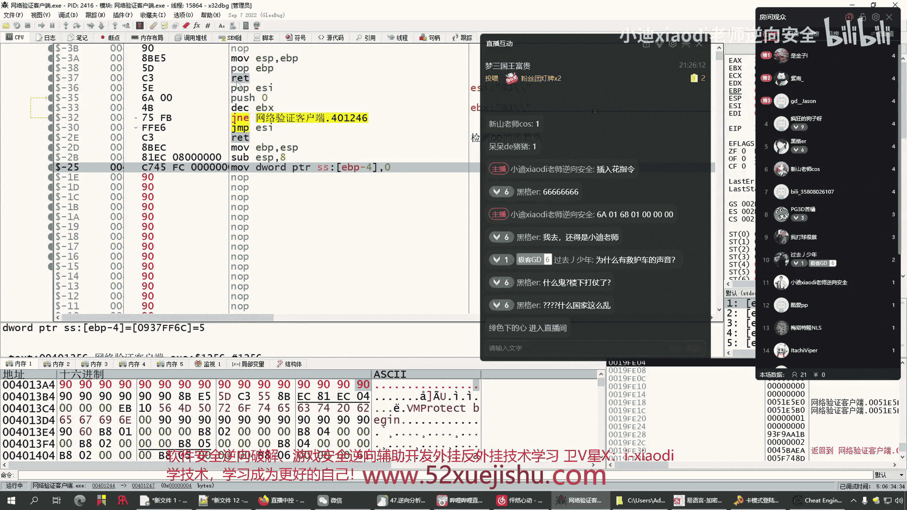

# 网络验证卡密软件破解：00：课程概述 🧭

本节教程整理自小迪老师逆向安全直播切片，视频编号是`BV1fMb1z1EGW`，主题是网络验证卡密软件破解，重点讲如何制作暴力破解特征码，以及如何还原花指令。内容会涉及游戏安全、软件安全、网络安全和CTF比赛基础，目标是把直播里的操作步骤用大白话讲清楚，让初学者也能跟上。下一节开始，我们先认识检测OD的逻辑和信息块的作用。

# 网络验证卡密软件破解：01：认识检测OD与信息块 🧩

上一节我们说明了课程范围，本节来看看网络验证客户端在点击登录时会做什么。点击登录的时候，程序会检测OD，也会处理相关事件；检测OD的代码不是神秘的，它本身会留下特征码。接下来要教的就是怎么定位这些特征码，方法很简单：准备一个信息块。

具体做法是搞一个信息块，先填`11`，再搞另一个信息框填`2222`。这两个信息块中间夹着的那段代码，就是检测OD的位置，也就是我们要找的特征码区域。可以把这理解成用两个标记把目标区域框出来，框中间的部分就是重点。

```text
信息块A：11
中间区域：检测OD相关代码
信息块B：2222
```

这个思路和原来做爆破的思路是对应的。如果要想写一款通杀的爆破工具，就要找特征码，因为特征码能把不同程序里相似的检测逻辑认出来。下面我们进入演示流程，看看信息块实际怎么用。


# 网络验证卡密软件破解：02：定位检测OD函数 🔍

上一节介绍了信息块夹检测OD代码的思路，本节实际演示怎么找检测OD的特征。先把这个程序写出来，比如写一个网络验证客户端。程序写出来之后要找到它跑在哪里，这里用离线一起的方式，程序跑起来以后附加到进程上。

附加之后直接迁过来，然后搜索刚才准备的信息块。搜索时能看到这里就是信息块，到这个位置是信息块对应的函数。继续观察，`1025`、`1245`应该是连着的区域，能看到连着`mov esi, 6`这一块。这个观察过程就是先用标记找到落脚点，再顺着代码往下看。

```asm
; 观察到的相关区域
1025
1245
mov esi, 6
```

整个这几个位置都是`111`信息块的位置。从`mov esi, 6`来到第二个信息块，中间这一段就是检测OD的代码。定位逻辑并不复杂，核心就是先找到信息块，再看两个信息块中间夹了什么。


# 网络验证卡密软件破解：03：还原插入花指令 🧹

上一节已经找到检测OD的大致区域，本节进入函数内部看代码。进到函数里面会发现这里有一个简单的混淆，这里是混淆过的，代码看起来是乱的。直播里原本会问想不想知道怎么去除、想不想学，答案是：想学，而且方法非常简单。这种混淆属于花指令，更准确说是插入花指令。

所谓“花”，可以理解成在正常代码里塞了几个无关字节。看起来像文件头部多了点东西，实际上就是加入了几个无关的字节。处理方式不复杂，关键是用二进制编辑把无用字节填成`90`。

以下是还原花指令的具体操作步骤。

1. 到`40125D`这个地址上。
2. 看到`VP protect begin`这类内容，这些都是无用内容。
3. 使用二进制编辑，用`90`填充。
4. 还有一些垃圾代码，没有关系，也一起处理。
5. `00`位置也是无关内容，给它填充掉。

```asm
; 用 NOP 填充无关字节
90
```

全部填充掉以后，代码就非常干净了。这个位置就是检测OD的函数头，继续往下看，就能看到“发现非法工具”的提示。到这里，花指令还原的基本操作就完成了。


# 网络验证卡密软件破解：04：提取暴力破解特征码 🎯

上一节把花指令清理干净，本节看看怎么从检测OD函数里提取特征码。看到“发现非法工具”之后，就要考虑怎么绕过非法工具检测。第一步不是直接改，而是先定位可以当作特征的内容。特征码可以理解成一段有辨识度的代码标记，找到它就能稳定回到目标位置。

以下是可以拿来当特征码的几类位置。

1. 这一块的`push`可以当作特征。
2. 这个跳转也可以当作特征。
3. `signature create`、`PID`这些都可以当作特征。
4. 这些位置都有工具可以辅助定位。

```text
特征码候选 = push / 跳转 / signature create / PID
```

找到特征以后，就知道该改哪里了。头部已经看过，接着看尾部，尾部是一个`ret`。中间还包括`401314`、`4013A4`这种小混淆，处理方式仍然是右键二进制编辑，用`90`填充掉。填充完就干净了，这里没有太多可说的，非常干净。特征定位好之后，拿来用就可以。

# 网络验证卡密软件破解：05：用特征码定位函数头并改写返回 🛠️

上一节提取了特征码，本节把特征码用于搜索和改写。现在就可以去搜索特征，搜索这个字节数组。如果直接搜搜不到，就把“可写”勾上再搜，这样就能搜到函数里边的内容。

例如搜索到`40127B`，一搜就搜到了。搜到之后往上看，用这个地址减去`0x2E`，就能得到函数头。这个减法关系就是定位函数头的关键公式，记住它以后遇到类似结构就可以照着算。


```text
函数头地址 = 特征地址 - 0x2E
```

这个地址减去`2E`以后，看到`558BEC`，`558BEC`就是函数头部。把函数头直接改成`ret`，也就是`C3`。这样改的意义是让检测函数直接返回，不再执行后面的非法工具检测逻辑。


```asm
; 原函数头
558BEC
; 改写为直接返回
C3
```

`C3`就是直接`ret`。这样处理以后，检测逻辑就被绕过去了。整个流程可以概括为：信息块定位检测OD区域，进入函数还原花指令，提取特征码，搜索特征码，用地址减`0x2E`找到函数头，最后把函数头改成`C3`。

> 直播过程中还出现了一段课堂插曲：楼下有救护车，讲师说明自己在国外，楼下在打仗。这段内容属于直播现场闲聊，不影响上面的技术步骤。

# 网络验证卡密软件破解：06：课程总结 🧾



本节课中我们一起学习了网络验证卡密软件破解里制作暴力破解特征码和还原花指令的流程。先通过两个信息块夹出检测OD区域，再进入函数处理插入花指令，用`90`填充无关字节，让代码恢复干净；随后从`push`、跳转、`signature create`、`PID`等位置提取特征码；最后搜索特征字节，把特征地址减去`0x2E`定位到`558BEC`函数头，并把函数头改成`C3`实现直接返回。掌握这套思路后，就可以继续研究更通用的爆破特征定位方法。

