## 🧭 网络验证卡密软件逆向破解实战教程：01：课程概述与合规边界

在本节课中我们将要学习如何把一场直播回放整理成一篇结构清晰的逆向工程学习教程。原文围绕网络验证卡密软件、辅助程序结构、调试器基础操作、内存权限、壳与反调试、网络验证识别、本地化测试、补丁制作、套壳程序分析和木马嫌疑排查展开。整理时会保留原文的技术主题、案例信息和直播现场信息，但会把具体偏移、补丁字节、卡密和可直接复现的绕过步骤做概念化处理。这样做的原因是，逆向工程应当在自有软件、书面授权和隔离环境中进行，不能把技术用于未授权破解。

```text
授权测试 = 自有软件 + 书面授权 + 隔离环境 + 可回滚快照
```

上一段说明了本教程的整理原则。本节先给出合规边界，是为了让后续概念有明确使用范围。原文涉及商业辅助软件、网络验证卡密、山寨服务端和补丁测试，这些内容只有放在授权教学和防御研究场景中才合适。以下是本节需要先建立的几个基本认识，按从学习目标到使用边界的顺序列出。

- 学习目标是理解程序模块、内存布局、调试器、网络验证和壳保护的基本概念，而不是获取可用于未授权破解的现成参数。

- 原文中的“破解成功”“登录成功”等演示，在教程中统一理解为授权环境下的功能验证和流程验证。

- 原文中的“补丁”“本地服务端”“卡密生成”等内容，在教程中只保留思路层面的说明，不提供可直接使用的地址、字节和卡密。

- 原文中的课程广告、答疑、价格和群聊信息会归并到后续章节，保留其含义，但不影响技术主线的阅读。

> 本教程仅用于授权测试、教学和防御研究。请勿将逆向分析技术用于未授权破解、盗版传播或破坏软件授权机制。

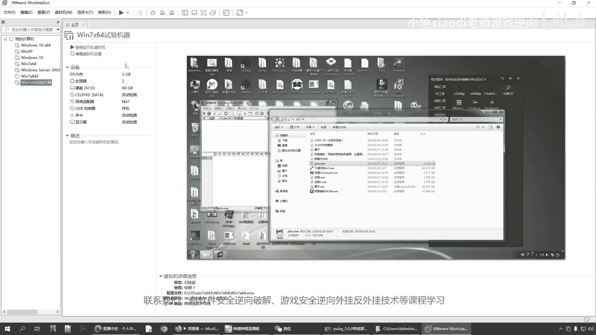

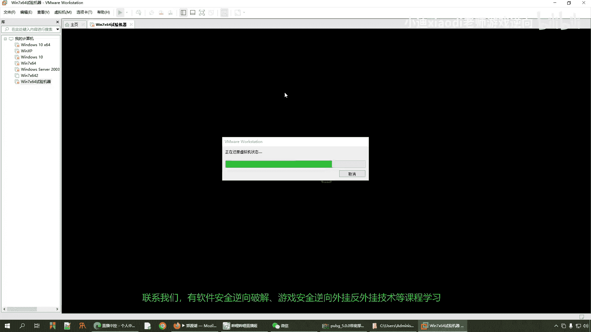

上一节我们明确了合规边界，本节我们来看看直播现场的整体信息。直播现场包含大量口语、点名、课程介绍和答疑，整理时按主题归并，保留原意。下一节会从这些现场信息过渡到技术基础。

## 🎤 网络验证卡密软件逆向破解实战教程：02：直播现场与学习目标

上一节我们建立了合规边界，本节我们来看看直播现场的整体信息。原文开场确认声音、强调准时开播，并点名直播间成员，包括B1N、JY、瑞克、fox、陈达等。直播中还多次提到B站下单、一号链接软件逆向、二号链接游戏安全、内部会员、内部视频、微信群、QQ群、答疑和课程价格。这些内容属于直播现场信息，整理时按主题归并，保留原意，不逐字复述口语。

原文的主线目标是演示网络验证卡密软件的逆向分析流程，案例包括某辅助软件的易之盾网络验证山寨实战、蝙蝠侠辅助结构分析、JY007程序分析、直播透明图合成助手分析、KK对战相关程序分析、套壳程序分析和木马嫌疑排查。直播中还穿插了游戏安全、驱动、涂色脚本、过检测、法律风险和课程答疑。以下是现场信息的主要类别，按信息类型列出。

- 直播节奏信息：开场确认声音、准时开播、点名成员、提醒扣一、提醒点赞、提醒下单、说明播到9点、说明下播后开通课程、说明明天群里通知。

- 课程与商品信息：一号链接是软件逆向，二号链接是游戏安全，基础版199，高级版249，2024专业版包含后续更新，升级高级版补50，原文还提到原价300和优惠信息。

- 学习服务信息：内部会员、内部视频、答疑、微信群、QQ群、远程指导、课程表私聊获取、直播无回放、录播太慢所以发内部视频。

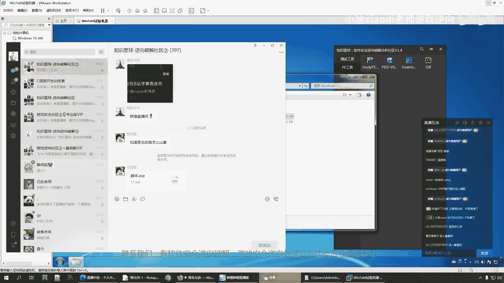

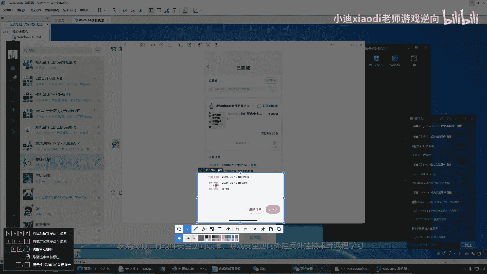

- 技术主题信息：程序模块、内存布局、CE、DBG、内存权限、反调试、VMP、网络验证、封包、补丁、本地服务端、套壳、涂色脚本、驱动、木马分析。

- 风险与法律信息：原文提到游戏安全和平衡相关视频不能发布，法律日渐完善，涉及游戏安全的实战教学受到限制。

上一节我们归并了直播现场信息，本节我们来看看最基础的程序模块概念。理解程序模块是后续查看内存、识别地址和做授权测试的前提。下一节会从程序模块过渡到内存布局。

## 🧩 网络验证卡密软件逆向破解实战教程：03：程序模块与内存布局基础

上一节我们归并了直播现场信息，本节我们来看看程序模块与内存布局。原文用调试器打开程序后点击符号，说明“程序模块”就是用户模块中与当前程序名字相同的模块。程序模块可以通过内存布局查看，也可以在调试器的模块列表中查看。原文还演示了在内存布局中右键转到内存窗口，再向下翻找大量`00`区域，并解释绿色地址通常表示静态地址。这里要强调，绿色静态地址只是调试器显示特征，不代表可以随意修改；是否可写取决于内存分页权限。

```text
程序模块 = 用户模块中与主程序同名的模块
静态地址显示特征 = 调试器中的绿色标记
可写条件 = 内存分页权限允许写入
```

原文提到一个细节：在DBG中修改某些地址时可能改不了，需要把分页内存权限从“读取执行”改成“读写”或“读写执行”。这体现的是内存权限问题，而不是程序逻辑本身。以下是本节涉及的基础概念，按从模块到权限的顺序列出。

- 程序模块：用户模块中与程序同名的模块，是定位主程序代码和数据的重要入口。

- 内存布局：调试器提供的地址空间视图，可以查看模块、地址范围、分页权限和内存内容。

- 静态地址：调试器用颜色标记的地址特征，表示该区域在模块中的位置相对稳定，但修改仍要受权限约束。

- `00`区域：内存中大量填充零的区域，原文提到这类区域可用于观察、测试或自定义代码，但实际使用必须考虑权限和程序稳定性。

- 可执行只读：表示该内存页可以执行但不能直接写入，直接修改会失败。

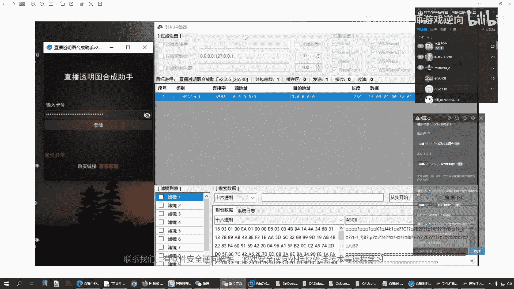

- 分页可写：表示该内存页允许写入，修改前要确认是否影响程序运行。

上一节我们介绍了程序模块和内存布局，本节我们来看看调试器中的内存权限和基础操作。原文多次提到DBG、CE、查看内存、断点和反调试，这些操作是理解后续案例的工具基础。下一节会从权限修改过渡到调试器操作。

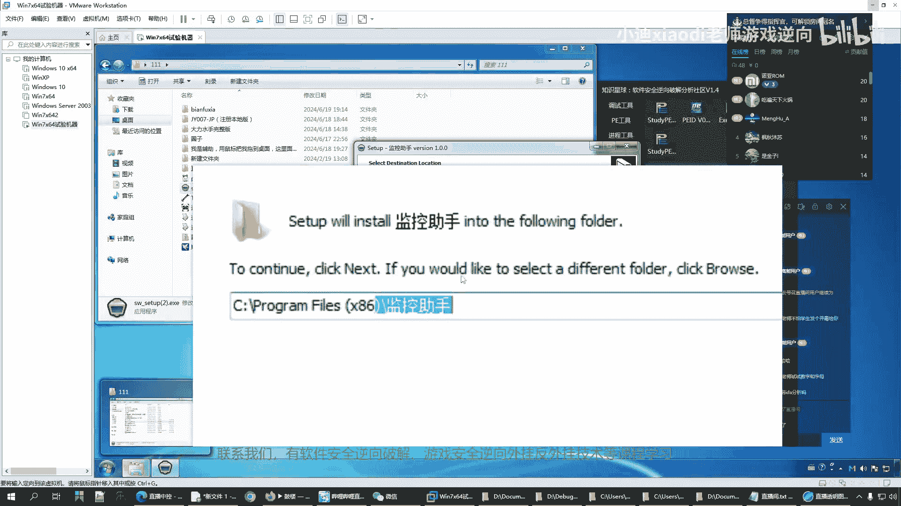

## 🛠️ 网络验证卡密软件逆向破解实战教程：04：内存权限与调试器操作

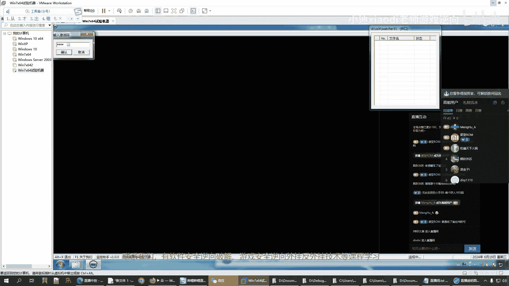

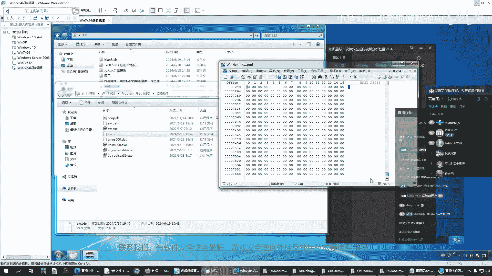

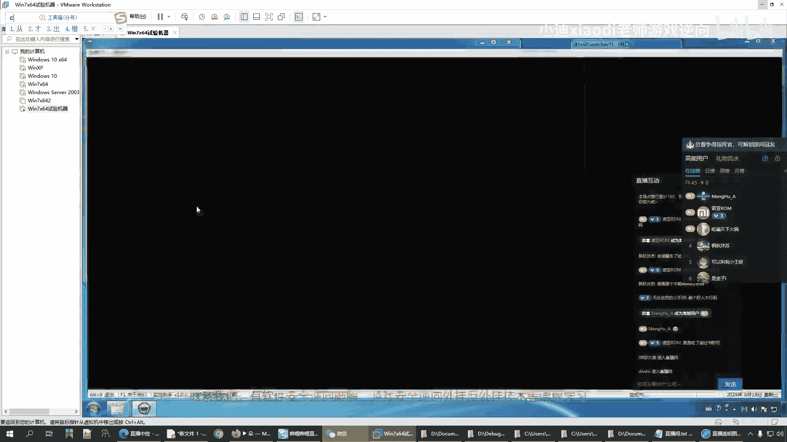

上一节我们介绍了程序模块和内存布局，本节我们来看看内存权限与调试器操作。原文演示了在DBG中双击修改内存值，提到有时可以改，有时改不了；改不了时右键选择“使分页内存可写”，把权限改成读写或读写执行。原文还提到CE可以搜索十六进制地址，右键可以调节内存权限，查看内存窗口可以通过“查看内存”打开。这里整理为概念说明：调试器的内存修改能力受页权限控制，权限不对时先检查页属性，再决定是否继续测试。

```text
内存页权限 ≈ {读取, 写入, 执行}
修改失败时先检查：页属性是否允许写入
```

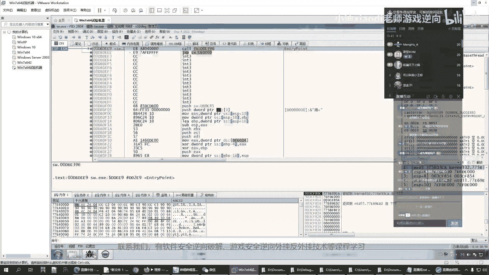

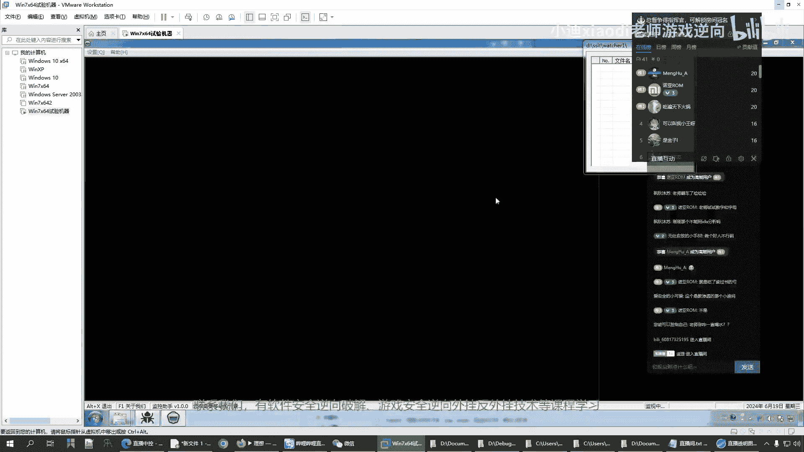

原文还提到反调试现象：程序在搜索字符串时终止，出现“机器码错误”等提示，说明程序检测了CE或调试器。原文判断这可能是某类网络验证模块中的检测，包括检测调试器、检测工具进程和检测机器码。以下是本节涉及的操作概念，按从查看到调试的顺序列出。

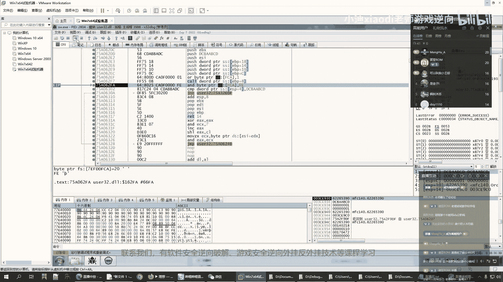

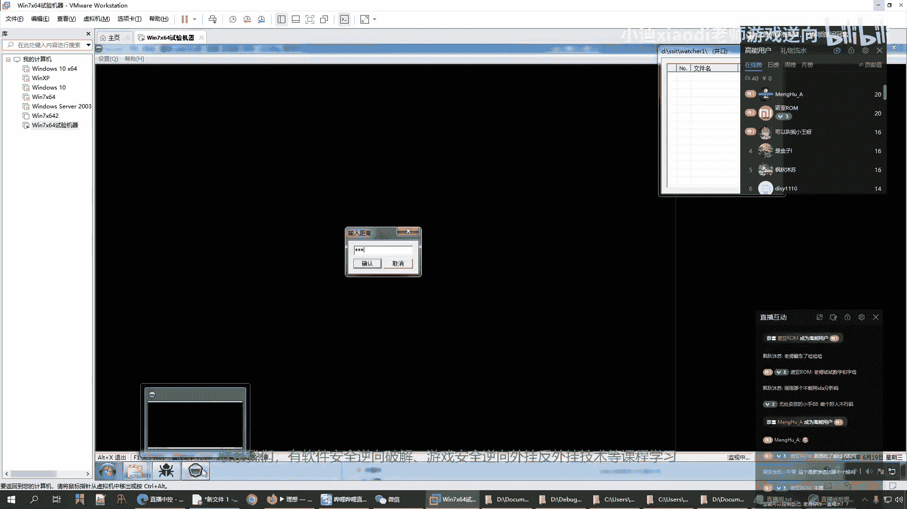

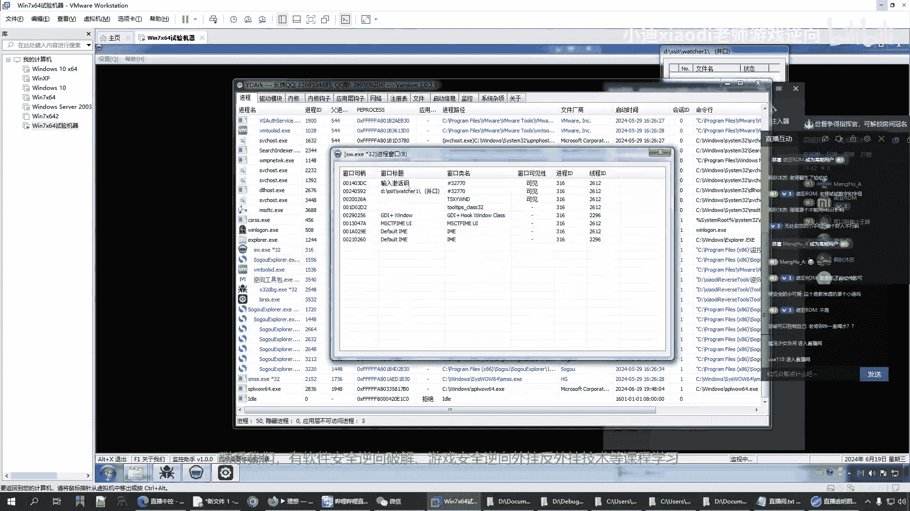

- 查看内存：通过调试器菜单打开内存窗口，观察模块地址、页权限和内容。

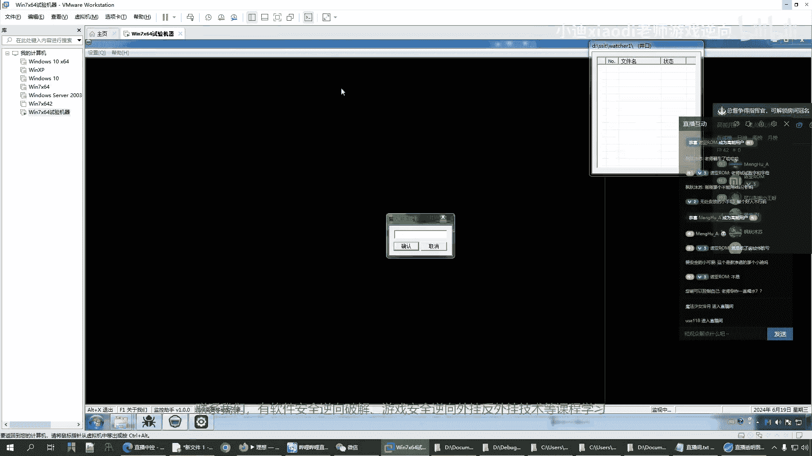

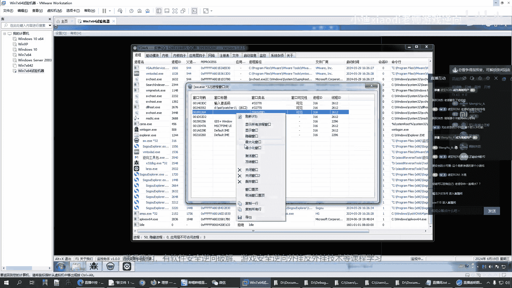

- 修改内存：先确认页权限，再测试写入；写入后要观察程序是否稳定。

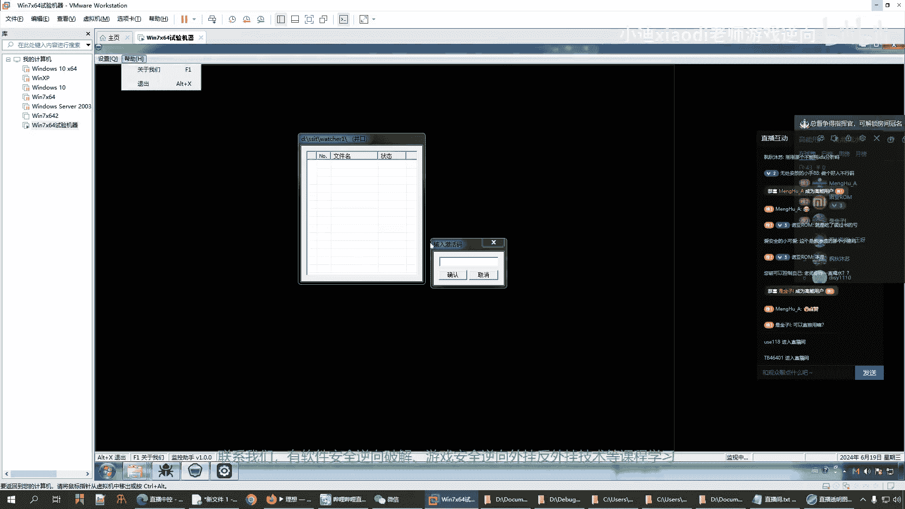

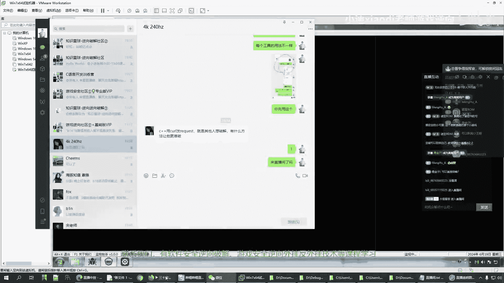

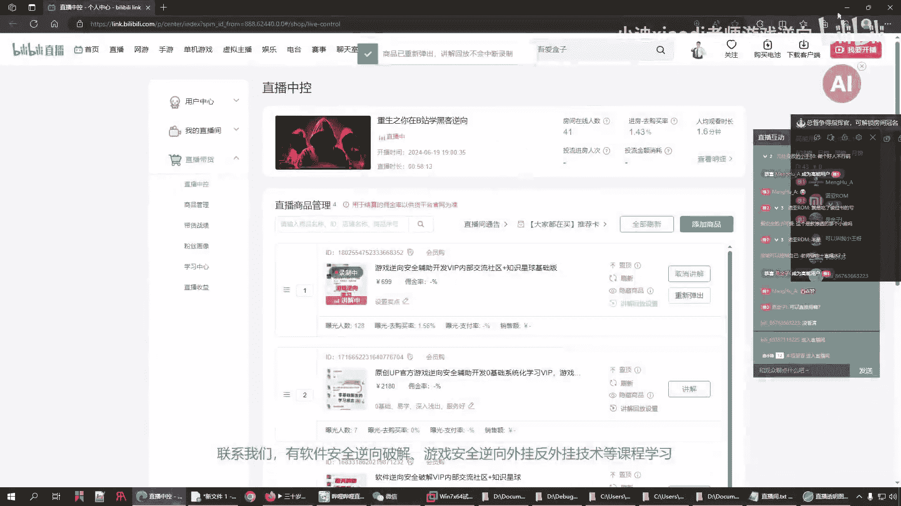

- 断点：在关键函数或关键提示附近下断点，观察程序执行路径；原文多次使用F2、F8、F9等快捷键。

- 反调试：程序可能检测调试器、CE、机器码或工具名称，触发退出、报错或黑名单。

- 调试器改名：原文提到可尝试更改调试器文件名以规避简单检测，但这类方法只应在授权环境使用。

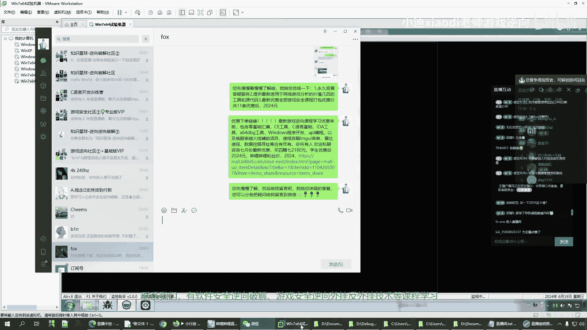

- 不联网检测：原文说明程序检查的是本机是否存在调试分析工具，不联网也可能触发检测；但不联网会影响封包分析。

上一节我们介绍了调试器基础操作，本节我们来看看辅助程序结构分析案例。原文用“蝙蝠侠”文件夹和“直播透明图合成助手”等程序演示了如何从目录、配置、图片资源和界面特征判断程序用途。下一节会从辅助结构过渡到网络验证识别。

## 🎯 网络验证卡密软件逆向破解实战教程：05：辅助程序结构分析案例

上一节我们介绍了调试器基础操作，本节我们来看看辅助程序结构分析案例。原文打开“蝙蝠侠”文件夹，查看`config`目录，判断程序可能通过涂色、图片识别和武器名称匹配来实现功能。原文提到`AIM`表示瞄准，枪械参数包括后坐力、子弹数量等，不同枪械需要不同配置。原文还提到`1080`这类数字可能是屏幕分辨率或窗口大小。这个案例说明，分析辅助程序时先看目录结构和资源文件，往往能快速判断程序的大致功能。

```text
涂色辅助 ≈ 截图/图片资源 + 识别逻辑 + 操作逻辑
枪械配置 ≈ 武器名称 + 后坐力 + 子弹数量 + 弹道参数
分辨率线索 ≈ 1080 等数字 + 窗口大小 + 图片尺寸
```

原文还用火绒对老版本程序做初步查毒，并复制到虚拟机运行。原文提到老版本VMP不一定带虚拟机校验，但仍要警惕反调试和黑名单。以下是本节案例中出现的信息点，按分析顺序列出。

- 文件夹结构：`config`、`AIM`、图片目录、分辨率相关文件，能反映程序的功能分类。

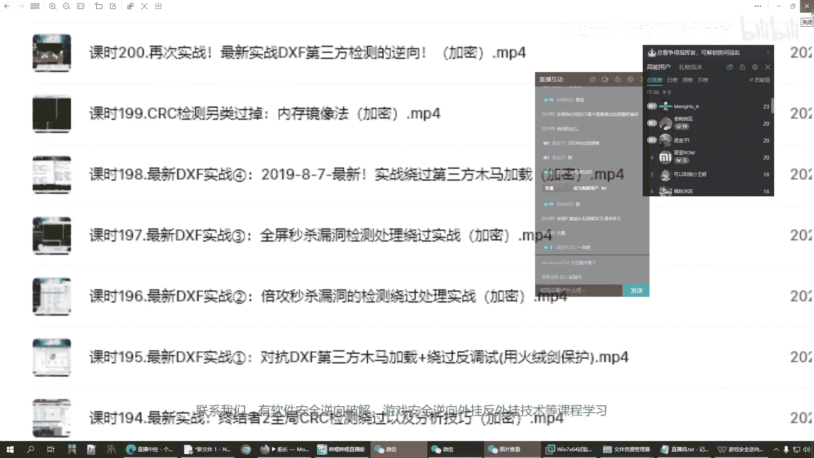

- 涂色逻辑：通过识别武器名称、图片和界面元素，再配合代码逻辑实现功能。

- 参数细节：不同枪械的后坐力、子弹数量不同，脚本作者需要做分类处理。

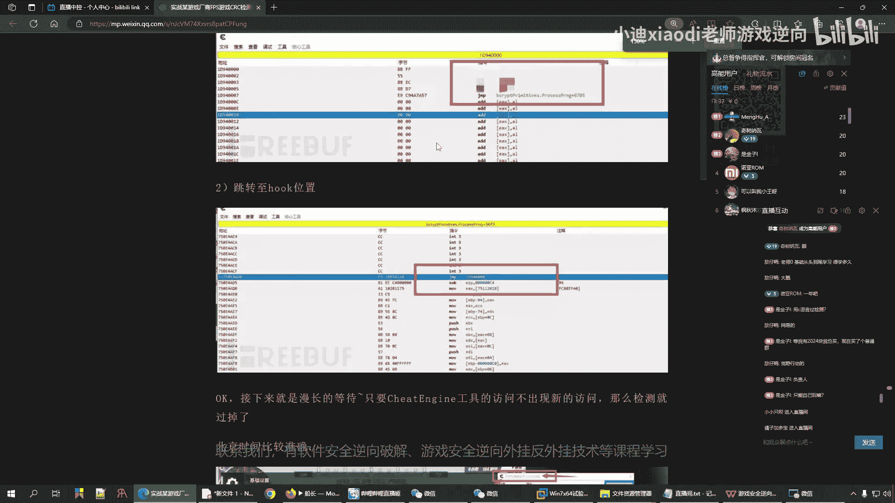

- 分辨率线索：`1080`等数字可能表示屏幕分辨率或窗口尺寸，是界面适配的重要信息。

- 初步查毒：用火绒做基础检查，再放到虚拟机运行，降低风险。

- 虚拟机测试：原文把程序复制到虚拟机运行，观察是否报错、是否反调试、是否触发黑名单。

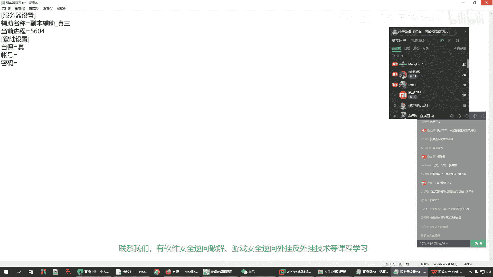

上一节我们分析了辅助程序结构，本节我们来看看网络验证识别与防护判断。原文遇到“非法使用，程序将在5秒后关闭”“机器码错误”“被列入黑名单”等提示，并判断程序带有反调试、IP检测和代码虚拟化。下一节会从验证识别过渡到一之盾山寨实战思路。

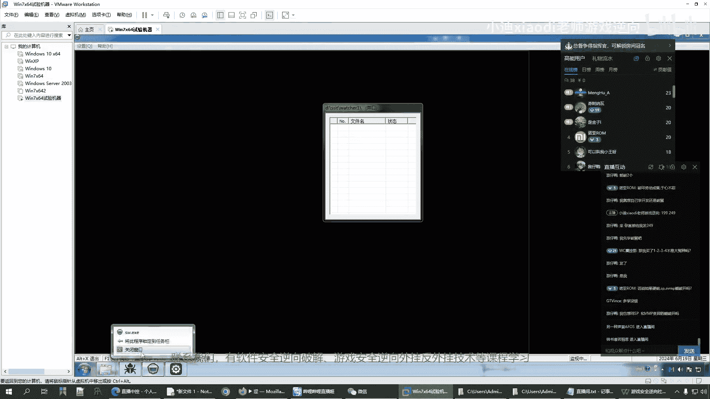

## 🛡️ 网络验证卡密软件逆向破解实战教程：06：网络验证识别与防护判断

上一节我们分析了辅助程序结构，本节我们来看看网络验证识别与防护判断。原文先看程序是否有窗口，再搜索当前模块字符串，观察是否有“登录成功”“登录失败”“非法使用”“机器码错误”等提示。程序出现反调试后终止，说明它检测了调试器或工具。原文还判断某些代码被VM，也就是被VMP壳虚拟化和混淆，关键逻辑看不懂，脱壳成本很高。原文提到SP、SVMP、玄武盾等壳或验证时，直接建议放弃或百度了解，因为难度和成本过高。

```text
网络验证客户端 ≈ 登录窗口 + 卡密输入 + 服务器通信 + 授权判断
VMP壳 ≈ 代码虚拟化 + 混淆 + 反调试
黑名单机制 ≈ 机器码/IP/环境标记 + 拒绝登录
```

原文还提到“越有弹窗越好解决，没有弹窗才不好解决”，意思是弹窗能提供字符串和调用位置线索，完全无窗口、无字符串的程序更难定位。以下是本节涉及的识别点，按从提示到防护的顺序列出。

- 提示字符串：非法使用、内部错误、机器码错误、登录成功、登录失败、请充值后再登录等，都是定位验证逻辑的线索。

- 反调试：程序检测调试器、CE、工具进程或机器码，触发退出或报错。

- 代码VM：关键代码被虚拟化后，静态阅读困难，原文多次判断“被VM了”。

- 脱壳成本：VMP壳脱壳需要长期积累，原文明确说没有几年功底很难完成。

- 黑名单：程序可能封IP、封机器，原文提到换环境分析会增加时间成本。

- 壳类型判断：原文提到SP、SVMP、玄武盾、英格玛壳、VMP等，不同壳的处理难度不同。

上一节我们识别了网络验证和防护，本节我们来看看一之盾网络验证山寨实战思路。原文的核心案例是某辅助软件的易之盾网络验证山寨，过程中遇到版本号、端口、地址、服务端配置和连接失败等问题。下一节会从验证识别过渡到本地化测试。

## 🧱 网络验证卡密软件逆向破解实战教程：07：一之盾网络验证山寨实战思路

上一节我们识别了网络验证和防护，本节我们来看看一之盾网络验证山寨实战思路。原文先判断程序可能使用一之盾网络验证，随后尝试找源码、下载服务端、查看卡模式登录示例、分析端口和版本号。原文提到验证初始化、服务器地址、端口、版本号、自定义数据等配置项。山寨的基本模型是把客户端原本指向远程验证服务器的配置，改为指向授权测试环境中的本地服务端，并保证版本号、端口、通信格式和服务端配置一致。

```text
山寨测试模型：
客户端配置 = {服务器地址, 端口, 版本号, 自定义数据}
本地服务端 = {监听端口, 版本号, 卡密数据, 返回授权结果}
连接成功条件 = 地址可达 + 端口一致 + 版本匹配 + 通信格式匹配
```

原文在补丁工具中替换内存地址和字符串，把客户端连接目标改到本地测试环境。过程中出现“连接服务器失败”，原文通过抓包、`connect`断点、搜索字符串、检查内存引用、比对版本号和自定义数据来排查。最终通过逐步修正多处配置引用，客户端连接上本地服务端，并生成测试卡完成登录验证。以下是本节的核心思路，按从识别到验证的顺序列出。

- 识别验证类型：通过登录窗口、提示字符串、端口、版本号和配置文件判断是否为一之盾或类似网络验证。

- 准备测试服务端：在授权环境中部署服务端，确认监听端口、版本号和卡密数据。

- 定位客户端配置：查找服务器地址、端口、版本号和自定义数据在客户端中的引用位置。

- 制作测试补丁：只用于授权测试环境，把客户端配置指向本地服务端，不提供具体偏移和字节。

- 排查连接失败：检查地址、端口、版本号、自定义数据、封包加密、初始化顺序和内存引用是否全部替换。

- 验证授权流程：生成测试卡，登录并观察到到期时间，确认本地测试链路完整。

上一节我们介绍了一之盾山寨思路，本节我们来看看补丁制作与本地化测试的通用方法。原文使用补丁工具、二进制编辑、字符串写入、内存权限修改和多次生成补丁，这些操作在教程中只保留方法论。下一节会从补丁过渡到套壳程序分析。

## 🩹 网络验证卡密软件逆向破解实战教程：08：补丁制作与本地化测试

上一节我们介绍了一之盾山寨思路，本节我们来看看补丁制作与本地化测试的通用方法。补丁的本质是修改目标程序中的地址、字符串或指令，使程序在授权测试环境中按预期运行。原文提到补丁工具可以写入内存地址、替换字符串、修改版本号配置，并在生成补丁后重新运行程序验证。补丁制作要注意三点：目标地址要准确，写入长度要匹配，修改后要检查程序是否稳定。原文还提到修改内存权限后才能写入，这说明补丁和内存页权限密切相关。

```text
补丁流程 ≈ 定位配置 -> 备份程序 -> 写入测试值 -> 生成补丁 -> 运行验证 -> 回滚
测试值示例 = 本地回环地址 + 测试端口 + 匹配版本号
```

原文在补丁过程中出现“补丁出问题”“连接不上”“版本号不支持小数”“自定义数据长度不明”等情况。排查方法是重新检查每一处引用，确认地址是否指向正确字符串，确认版本号和服务端配置是否匹配，确认端口是否被其他程序占用。以下是补丁测试的通用检查项，按从准备到验证的顺序列出。

- 备份原程序：修改前保留副本，测试失败可以回滚。

- 确认权限：目标内存页必须允许写入，否则先调整页权限。

- 确认长度：写入字符串或地址时要保持长度一致，避免破坏相邻数据。

- 确认引用：同一配置可能在多处被引用，只改一处可能仍然连接旧地址。

- 确认版本：客户端和服务端版本号要匹配，原文多次怀疑版本号导致连接失败。

- 确认端口：本地服务端监听端口要与客户端配置一致，并避免端口冲突。

- 确认通信：如果封包加密或存在心跳包，仅改地址和端口不一定足够。

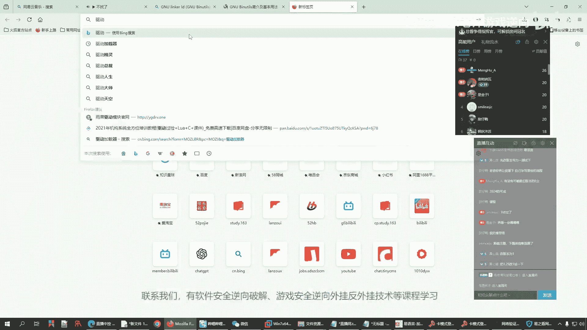

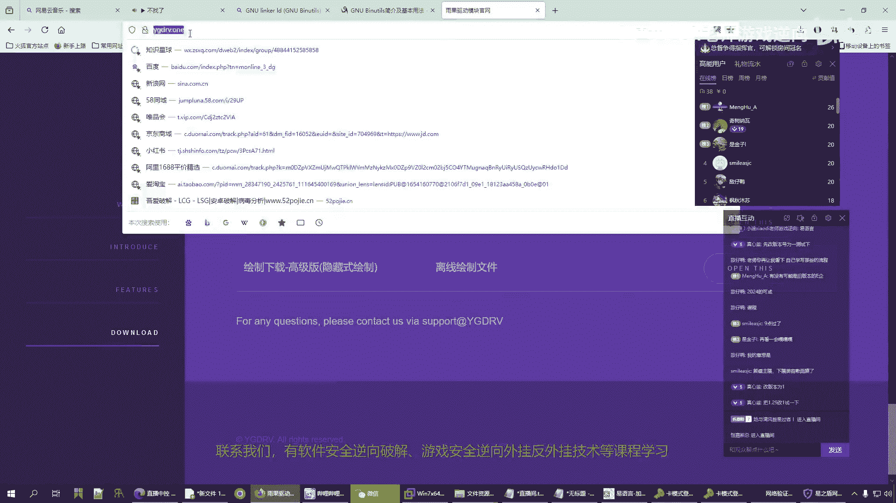

上一节我们介绍了补丁制作方法，本节我们来看看套壳程序与涂色脚本分析。原文在破解成功后生成副本，运行副本后发现它是套壳程序，外壳负责启动本体，内部还有图片资源和涂色逻辑。下一节会从套壳过渡到木马嫌疑分析。

## 🧅 网络验证卡密软件逆向破解实战教程：09：套壳程序与涂色脚本分析

上一节我们介绍了补丁制作方法，本节我们来看看套壳程序与涂色脚本分析。原文把破解后的程序复制出副本并运行，发现主目录生成了新程序，判断它可能是套壳程序。套壳的基本结构是外层程序负责启动、验证或释放内层本体，内层本体才是实际功能程序。原文搜索字符串后看到“智能换图间隔”“BMP图片文件”“背包界面”等线索，判断这是通过图片识别实现功能的涂色脚本。

```text
套壳程序 ≈ 外层壳 + 内层本体
涂色脚本 ≈ 图片资源 + 识别逻辑 + 操作逻辑
图片资源数量 ≈ 脚本复杂度的重要指标
```

原文提到涂色脚本需要大量截图，案例中有约140张图片，作者需要逐张截图并配置识别逻辑。原文还提到窗口隐藏、串口激活窗口、查看窗口等战术，这些属于界面层面试探，在教程中只作为“界面结构分析”的概念说明。以下是本节涉及的分析点，按从外壳到资源的顺序列出。

- 套壳判断：运行程序后观察是否生成新文件、是否启动另一个进程、是否有多层窗口。

- 本体定位：通过进程、目录变化和字符串判断真正执行功能的本体程序。

- 图片资源：`BMP`、`PIC`目录、背包界面图片等，都是涂色脚本识别逻辑的基础。

- 截图工作量：大量图片意味着脚本作者投入了大量截图和配置工作，破解和开发的时间成本不同。

- 窗口分析：查看窗口、隐藏窗口、串口激活窗口等，都是界面层面试探方法。

- 驱动说明：涂色脚本通常不需要驱动，FPS类辅助可能需要驱动，驱动技术门槛较高。

上一节我们分析了套壳和涂色脚本，本节我们来看看木马与远控嫌疑分析。原文在虚拟机中运行程序后观察到疑似远控行为，随后用无壳64位程序分析、字符串搜索、进程观察和网络连接检查来判断风险。下一节会从木马分析过渡到常见问题答疑。

## 🦠 网络验证卡密软件逆向破解实战教程：10：木马与远控嫌疑分析

上一节我们分析了套壳和涂色脚本，本节我们来看看木马与远控嫌疑分析。原文把可疑程序复制到虚拟机，使用查壳工具确认程序无壳，再运行并附加调试器。原文判断它可能是64位程序，可能由通用远控生成工具产生。分析时先看当前模块字符串，观察是否有获取窗口、获取包名、进程窗口站等行为，再检查是否有网络连接、文件扫描和敏感目录操作。原文最终没有发现明显恶意操作，但仍提醒来源不明的程序存在风险。

```text
木马嫌疑检查 ≈ 查壳 + 字符串 + 进程行为 + 网络连接 + 文件操作
高风险信号 = 外联地址 + 扫描目录 + 写入启动项 + 隐藏进程
```

以下是木马嫌疑分析的检查项，按从静态到动态的顺序列出。

- 查壳：先确认程序是否加壳，无壳程序可以直接搜索字符串。

- 字符串：搜索网络地址、文件路径、注册表、进程、窗口、服务等关键词。

- 进程行为：观察是否启动子进程、是否隐藏窗口、是否注入其他进程。

- 网络连接：观察是否主动连接外部地址，是否有心跳或上传行为。

- 文件操作：观察是否扫描系统目录、用户目录、浏览器目录或写入启动项。

- 虚拟机隔离：可疑程序优先在虚拟机运行，避免在物理机直接执行。

- 风险结论：没有发现明显恶意行为不代表绝对安全，来源不明的程序仍应谨慎处理。

上一节我们介绍了木马嫌疑分析，本节我们来看看常见问题与答疑汇总。原文直播中回答了大量问题，包括JY007程序、插件模式、壳类型、Python识别、C++/MFC、卡密长度、心跳包、重启验证、调试器改名、驱动获取、课程价格和法律风险。下一节会从答疑过渡到课程总结。

## ❓ 网络验证卡密软件逆向破解实战教程：11：常见问题与答疑汇总

上一节我们介绍了木马嫌疑分析，本节我们来看看常见问题与答疑汇总。原文提到JY007程序提示插件问题时，可以尝试在插件中切换模式；如果是英格玛壳，可以尝试基础模式；如果是VMP壳，则要针对VMP做设置。原文还提到Python打包程序一般会出现Python相关字符串，Qt程序一般会出现Q开头字符串，MFC程序会出现MFC特征。识别编程语言和界面库，有助于选择分析工具和判断程序结构。

```text
语言/界面识别线索：
E语言特征字符串
Python打包特征字符串
Qt界面特征字符串（常见Q开头）
MFC界面特征字符串
```

以下是直播答疑中的主要问题与结论，按主题归类列出。

- 插件与壳：JY007程序可能受插件模式影响，英格玛壳可尝试基础模式，VMP壳需要专门设置。

- 语言识别：Python程序会有Python特征，Qt程序会有Q开头特征，MFC程序会有MFC特征，原文案例中有C++/MFC程序。

- 卡密长度：原文根据经验判断某些卡密可能是32位，输入后出现心跳包；这只是一种经验判断，不是通用规则。

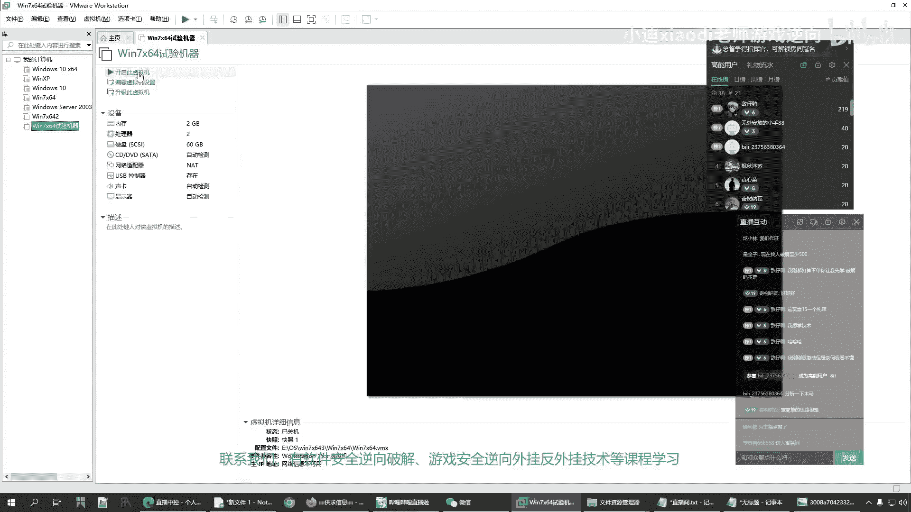

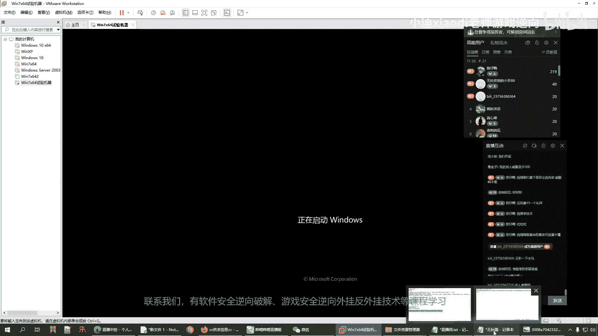

- 心跳包：网络验证程序可能有心跳通信，抓包时要观察登录包、心跳包和关闭时的包。

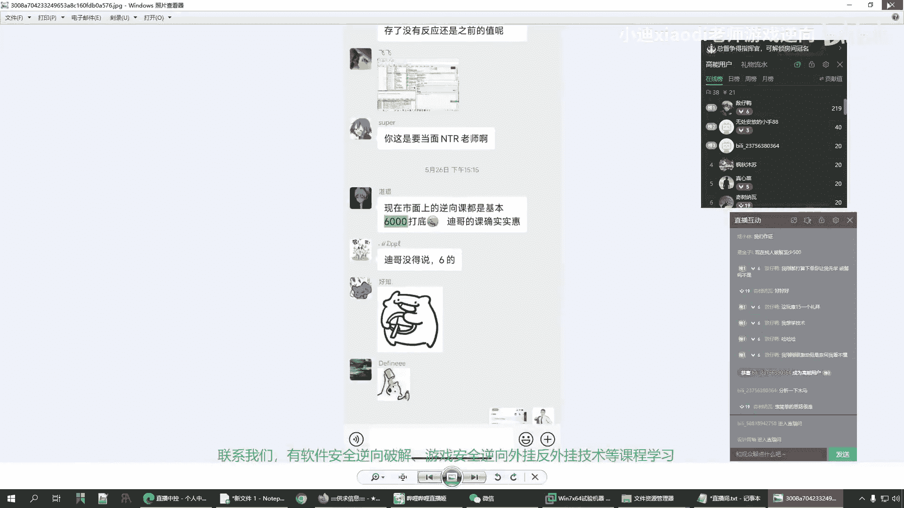

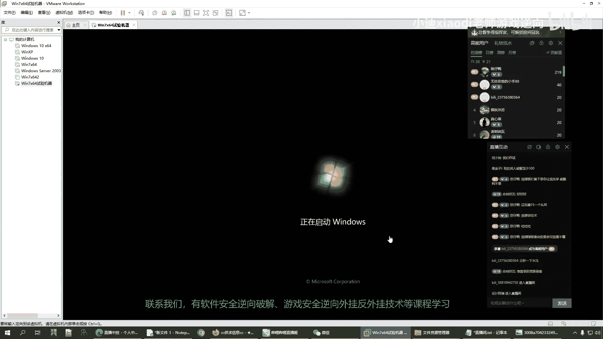

- 重启验证：重启验证逻辑复杂，需要多次运行和对比，原文建议先观察本地注册文件和配置。

- 调试器改名：原文提到可尝试更改调试器文件名以规避简单检测，但只应在授权环境使用。

- 不联网分析：不联网也可能触发工具检测，因为程序检查的是本机工具痕迹；但不联网会影响封包分析。

- 黑名单：程序可能封IP和机器，换环境分析会增加时间成本。

- 驱动：涂色脚本通常不需要驱动，FPS类辅助可能需要驱动；驱动技术门槛高，原文提醒不要低估难度。

- 过检测：原文提到CE经过重新编译可以过部分检测，但过检测专题需要单独学习，且要遵守法律和授权边界。

- 法律风险：原文明确提到游戏安全和平衡相关视频不能发布，法律日渐完善，实战教学受到限制。

- 课程信息：基础版199，高级版249，2024专业版包含后续更新，升级高级版补50，内部视频和答疑是课程服务的一部分。

上一节我们汇总了常见问题，本节我们来做课程总结。原文最后说明当天直播到9点结束，下播后给已下单成员开通课程，并提醒明天群里通知。原文还表达了对学员的祝福，包括身体健康、家庭和睦、未来越来越好、知识就是力量。教程到这里也进入收尾。

## 🧾 网络验证卡密软件逆向破解实战教程：12：课程总结与学习路线

上一节我们汇总了常见问题，本节我们来做课程总结。本节课中我们一起学习了网络验证卡密软件逆向分析的完整学习框架，包括程序模块、内存布局、内存权限、调试器操作、辅助程序结构、网络验证识别、壳与反调试、一之盾山寨思路、补丁测试、套壳程序、涂色脚本、木马嫌疑分析和常见答疑。原文的核心价值不在于某一个固定地址或某一个补丁字节，而在于遇到问题时如何观察线索、如何缩小范围、如何验证假设、如何回滚测试。

```text
学习路线 ≈ 基础工具 -> 程序结构 -> 调试分析 -> 验证识别 -> 授权测试 -> 防护评估 -> 法律合规
```

以下是建议的学习顺序，按从入门到进阶列出。

- 先学基础工具：调试器、内存查看、字符串搜索、断点、进程观察和虚拟机快照。

- 再学程序结构：程序模块、用户模块、内存布局、页权限、资源目录和配置文件。

- 然后学调试分析：断点、单步、调用栈、字符串引用、内存写入和程序稳定性观察。

- 接着学验证识别：登录窗口、提示字符串、端口、版本号、心跳包、封包和本地配置文件。

- 再进入授权测试：只在自有软件或书面授权环境中做本地化测试和补丁验证。

- 最后学防护评估：反调试、壳、代码虚拟化、封包加密、黑名单和时间成本分析。

- 全程遵守法律合规：不发布破坏游戏平衡的内容，不传播盗版，不提供未授权绕过步骤。

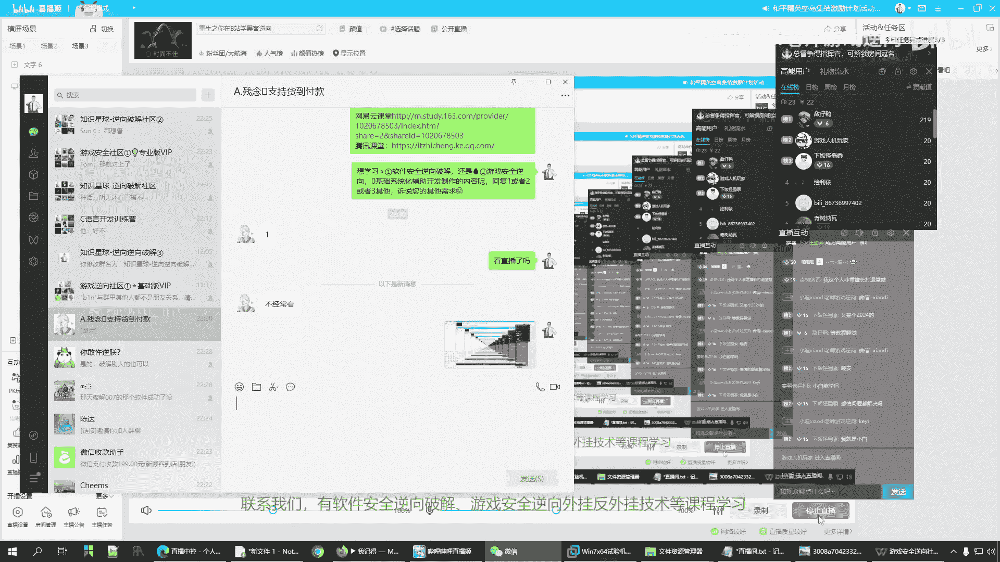

本节课中我们一起学习了如何把直播回放整理成一篇可读的逆向工程教程，也一起理解了原文中从程序模块到网络验证山寨、从补丁测试到套壳分析、从木马排查到课程答疑的主要含义。学习逆向工程要重视基础、重视实践、重视授权边界，遇到问题先备份、先隔离、先验证，再决定下一步。

