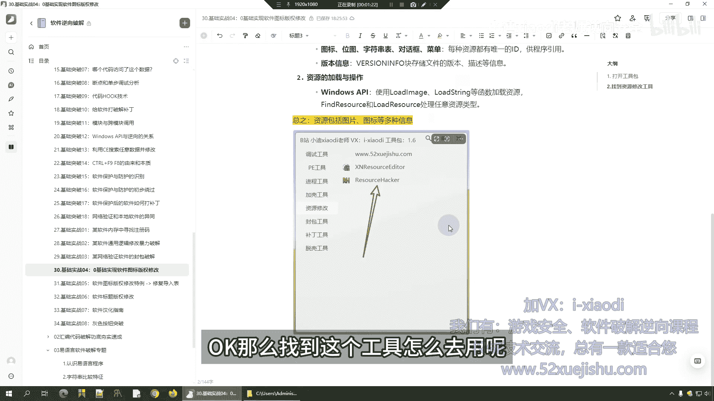
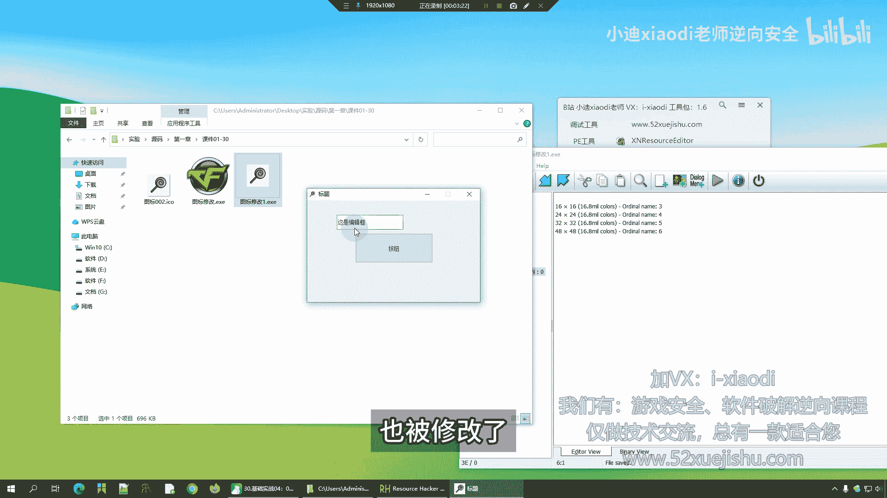
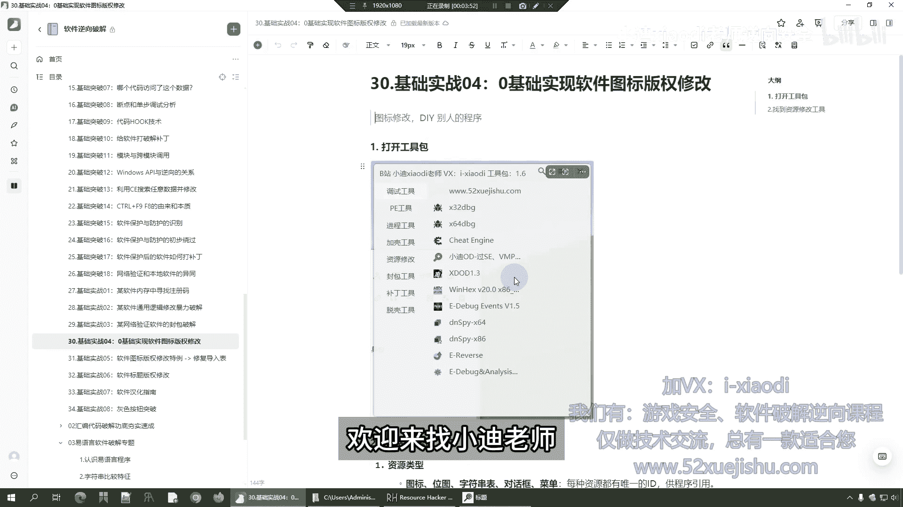

在本节课中我们将要学习零基础实现软件图标版权修改。本节先向各位问好，我是小李老师。能刷到本节内容，说明大家通常有相应需求，跟着小李老师听讲即可，零基础就可以实现。大白话来说，图标修改就是DIY别人的程序，把程序改成自己想要的模样。整个过程并不复杂，先理解程序里的资源结构，再动手替换图标，就能看到效果。下面先给出课程概述，再进入具体章节。

## 🎯 软件图标修改DIY：01：课程概述与资源结构

第一节先建立整体印象。第一步是打开工具包，工具包可以在评论区获取；运行起来后，里面有很多工具。看到眼花缭乱时，点击“资源修改”。有同学会问为什么点资源修改，因为这里要处理的是Windows操作系统，注意措辞不是手机，也不是其他设备，而是现在用的Windows系统。Windows里所有程序都有一个共同结构，叫做资源结构。

资源结构包括图标、位图、字符串、对话框、菜单等。只要看到一个程序上面有图片或者图标，它们通通都属于资源。因此要找资源修改工具。找到工具后怎么用，非常简单，跟着做即可。为了更直白地理解，可以把程序结构写成下面这个公式。

```text
程序 = 代码 + 资源
资源 = 图标 + 位图 + 字符串 + 对话框 + 菜单 + ...
```

下面用几个要点把课程目标和资源概念串起来，方便初学者先建立整体印象。

- 本节目标是零基础实现软件图标版权修改，本质是DIY别人的程序，把程序改成自己想要的模样。
- 第一步打开工具包，工具包可以在评论区获取；运行后里面有很多工具，看到眼花缭乱时点击“资源修改”。
- 有同学会问为什么点资源修改，因为这里是Windows操作系统，注意措辞不是手机也不是其他设备，而是现在用的Windows系统；所有程序都有共同结构叫资源结构。
- 资源结构包括图标、位图、字符串、对话框、菜单等；只要程序上有图片或图标，通通属于资源；因此要找资源修改工具。
- 找到工具后怎么用，非常简单，跟着做即可。

资源结构已经清楚，接下来要找到具体图标资源。上一节我们介绍了资源结构和工具选择，本节中我们来看看如何定位程序里的图标资源。

## 🧰 软件图标修改DIY：02：定位程序图标资源

第二节开始定位目标。比如这个程序是想要修改的程序。现在运行起来，可以看到这个图标和这个图标都是红色和黄色共同构成的图形。怎么修改，非常简单，先把它关掉。打开Resource Hacker，中文常称资源黑客，名字听起来很高大上；运行起来之后，直接拖入目标程序。

将目标程序拖过来之后，往下看就有Icon Group，icon就是图标的意思，这里就是图标组，所有图标都会在这里显示。可以看到，点一下就显示出来了。为了不混淆，下面把定位图标资源的操作拆成几个关键动作，照着做即可。

- 比如这个程序是我们想要修改的程序；运行起来会发现图标和图标都是红色和黄色共同构成的图形；怎么修改非常简单，先把它关掉。
- 打开Resource Hacker，中文常称资源黑客，名字听起来很高大上；运行起来之后，直接拖入目标程序。
- 将目标程序拖过来之后，往下看就有Icon Group；icon就是图标的意思，这里就是图标组，所有图标都会在这里显示。
- 点一下就显示出来，可以先观察哪个图标组与目标程序对应。

下面用一段伪代码概括定位流程，方便按顺序操作。



```text
打开 Resource Hacker
拖入目标程序
展开 Icon Group
查看图标组并点选目标图标
```

定位到图标组后，下一步就是替换。上一节我们定位到了图标组，本节中我们来看看如何替换图标并保存验证。

## 🔁 软件图标修改DIY：03：替换图标并保存验证

第三节处理替换与保存。怎么替换，首先要有图标。比如这里准备了一个图标；如果没有准备，可以去找一个图标，注意后缀是`.ico`，可以看它的属性，文件类型是Icon File，一定不要错，不要是普通图片之类。这时直接鼠标右键。要看图标跟要修改的图标刚好对得上，所以就是它；如果是其他图标，肯定不是，这个也不是。因此一定要认清到底是谁，不要打错人。

对目标图标组鼠标右键，点击Replace Icon；再点击Open file with new icon，打开新的图标，点击打开；然后直接点击Replace，也就是替换。这时还没有保存，需要做一个保存动作。点击保存为或另存为，保存为“图标修改一”，按回车。这时就修改完成。刷新一下，可以看到这个图标和这个图标不一样。运行一下，不仅程序在没有运行时图标被修改，而且运行起来之后，程序左上角的图标也被修改。这就是零基础实现软件图标版权修改。

下面是替换图标和保存验证的具体步骤，顺序不要乱。

- 怎么替换，首先要有图标；比如这里准备了一个图标；如果没有准备，可以去找一个图标，注意后缀是`.ico`，可以看属性，文件类型是Icon File，一定不要错，不要是普通图片之类。
- 这时直接鼠标右键；要看图标跟要修改的图标刚好对得上，所以就是它；如果是其他图标，肯定不是，这个也不是；一定要认清到底是谁，不要打错人。
- 对目标图标组鼠标右键，点击Replace Icon；点击Open file with new icon，打开新的图标，点击打开；直接点击Replace，也就是替换。
- 这时还没有保存，需要做保存动作；点击保存为或另存为，保存为“图标修改一”，按回车；这时修改完成。
- 刷新一下，可以看到图标不一样；运行一下，不仅程序没有运行时图标被修改，运行起来之后程序左上角的图标也被修改；这就是零基础实现软件图标版权修改。

下面用一段伪代码概括替换与保存流程，便于复习。

```text
右键目标图标组 -> Replace Icon
Open file with new icon -> 选择 .ico 文件 -> Replace
保存为 / 另存为 -> 输入“图标修改一” -> 回车
刷新图标 -> 运行程序 -> 检查左上角图标
```

> 提示：只替换图标不会改变程序代码逻辑；如果保存后程序打不开，需要学习下一节特例内容。

替换和验证完成后，还要知道修改后打不开怎么办。上一节我们完成了替换和验证，本节中我们来看看修改后运行不起来怎么办。

## 🛠️ 软件图标修改DIY：04：修改后运行不起来怎么办

第四节处理常见问题。有同学会问，我的程序修改完之后运行不起来了，怎么办。大家可以深入学习，去看下一节内容。下一节讲一个特例，就是软件修改完之后打不开了，怎么办；大家可以学一下下节课内容。遇到修改后打不开时，可以先记住以下处理方向。

- 有同学会问，我的程序修改完之后运行不起来了，怎么办。
- 大家可以深入学习，去看下一节内容。
- 下一节讲一个特例，就是软件修改完之后打不开了，怎么办；大家可以学一下下节课内容。

> 注意：本节重点是图标替换与保存验证；程序打不开属于特例问题，需要继续学习下一节内容。

常见问题处理完后，最后做课程总结。前面几节我们完成了图标替换和问题处理，本节中我们来看看课程总结与后续学习。

## 📌 软件图标修改DIY：05：课程总结与后续学习

本节课到这里就是全部内容。最后用几条内容回顾本节课的重点和后续方向。



- 本节讲的是零基础实现软件图标版权修改，本质是DIY别人的程序，把程序改成自己想要的模样。
- Windows程序有资源结构，资源包括图标、位图、字符串、对话框、菜单等；图标属于资源，因此使用资源修改工具和Resource Hacker定位Icon Group。
- 替换时先准备`.ico`图标，右键目标图标组，使用Replace Icon、Open file with new icon和Replace，再保存为“图标修改一”，刷新并运行验证。
- 修改完成后，程序未运行时图标会变化，运行后左上角图标也会变化；如果修改后程序运行不起来，需要学习下一节特例内容。
- 如果大家想学软件安全逆向，欢迎找小志老师，下期再见。



本节课中我们一起学习了零基础实现软件图标版权修改：先理解Windows程序的资源结构，再使用Resource Hacker定位Icon Group，接着用`.ico`文件替换图标并保存为“图标修改一”，最后刷新和运行验证图标变化。程序修改后如果运行不起来，属于需要继续学习的特例内容；想学软件安全逆向可以找小志老师，下期再见。
