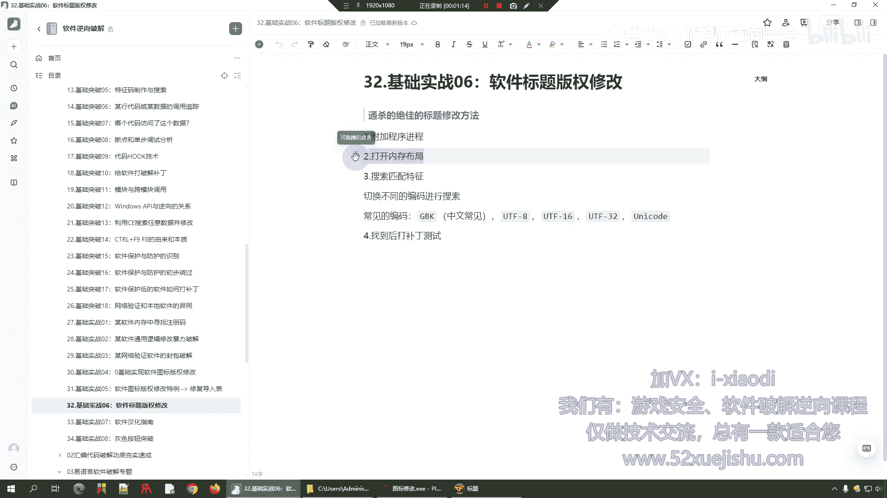
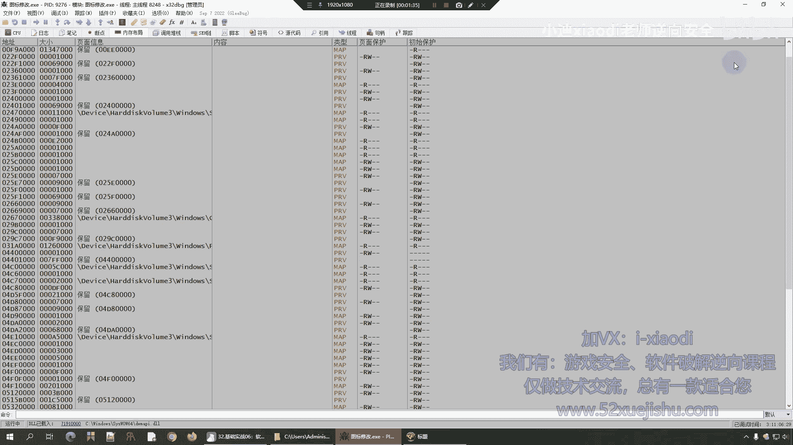
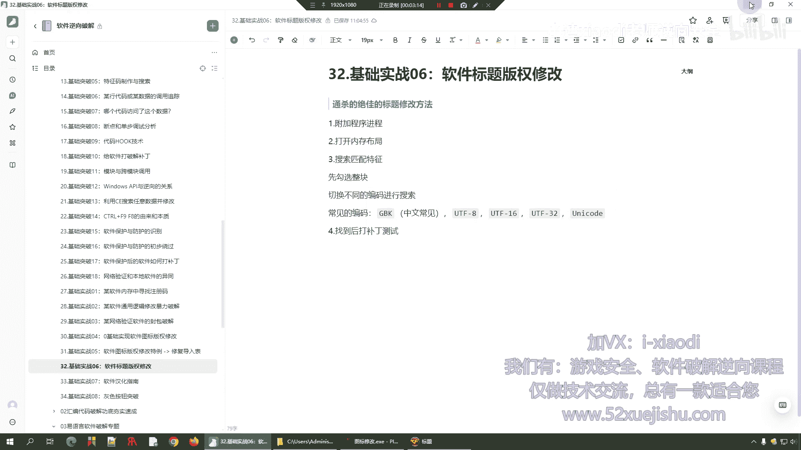
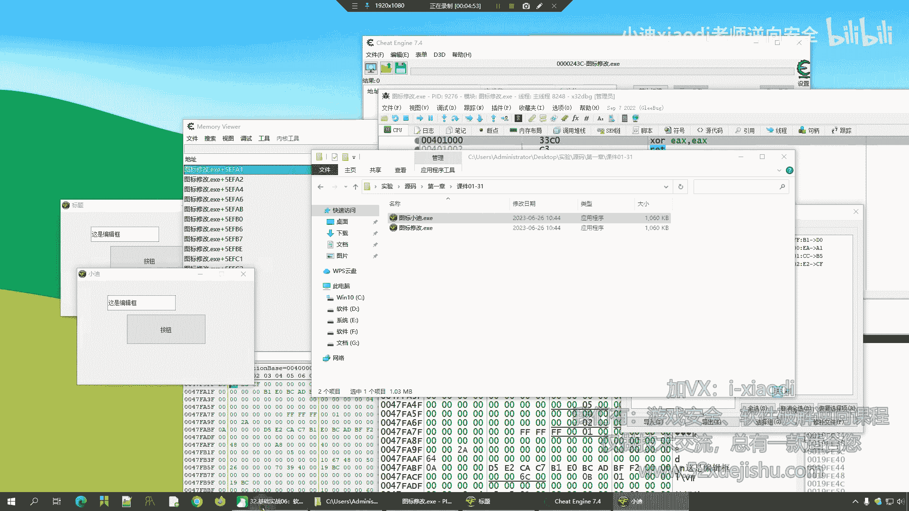
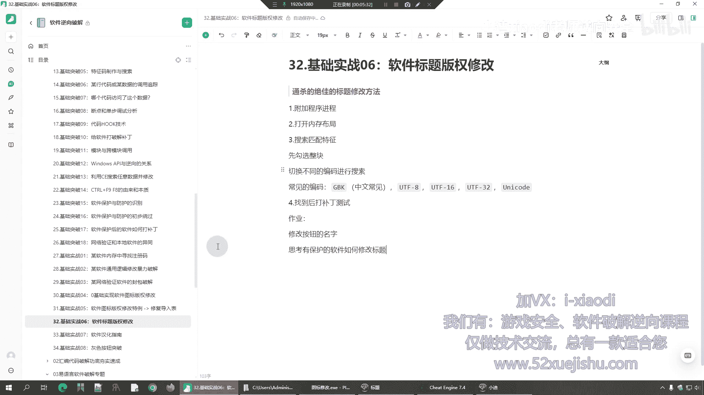

# 🧰 软件逆向入门：01：软件标题与文本修改总览

在本节课中，我们将要学习软件标题和文本内容的修改方法。举例来说，如果一款软件的标题看起来不顺眼，或者标题位置原本填的是自己的微信，想改成别人的微信；又或者按钮名字不顺眼想改掉，都可以使用今天讲的知识。这个知识不仅适用于软件标题，也适用于其他标题，例如按钮名字和编辑框里的内容，它们实际上都是一种文本性标题。

整个流程可以概括为四步：附加程序、打开内存布局、搜索匹配特征、修改并打补丁。下面从准备工作开始，逐步完成一次完整的文本修改。

```text
目标软件 + x32dbg = 建立附加/调试关系
```

上一节介绍了整体思路，本节中我们来看看如何把工具和目标程序连接起来。

# 🧩 软件逆向入门：02：附加目标程序并切换主模块

第一步是打开工具包，找到其中的 x32dbg 并运行起来。与此同时，也要把目标软件运行起来。然后点击“文件”，点击“附加”，这样程序和工具之间就建立了一种联系，再点击“附加”完成连接。

完成附加后，通常点击“符号”，然后双击模块，切换到程序的主模块。到这里第一步基本完成，但还不能马上修改文本，因为还需要进入内存层面查看数据。接下来我们进入下一步，打开内存布局。



# 🗺️ 软件逆向入门：03：打开内存布局定位文本数据



上一节我们完成了附加并切换到主模块，本节中我们来看看内存布局。点击“内存布局”，这时所有内存区域都会显示出来。文本和数据都放在内存中，整体内存就在当前界面里，目光所及的区域都是相关内存。

```text
文本/数据存放在内存区域中
```

打开内存布局后，下一步就是在内存中搜索目标文本。接下来进入搜索匹配特征的操作。

# 🔍 软件逆向入门：04：搜索匹配特征并切换编码

第三步是搜索匹配特征。这个名称是工具提供的功能，不是随意起的名字，实际作用就是搜索内存。操作时随便找一个位置，鼠标右键，点击“搜索匹配特征”。首先勾选“整块”，勾选整块后搜索范围更全，所以要先勾选整块。

界面里有字符串区域和十六进制区域。不推荐直接在字符串区域搜索，推荐在十六进制区域搜索。原因是输入内容时，标题对应的字节数据会显示在下面，便于观察和修改。

搜索时要注意，如果一次性搜不到，可以切换不同编码进行搜索。常见编码有 GBK，GBK 在中文场景中比较常见。如果文本是中文，优先搜索 GBK；如果 GBK 搜不到，再搜索 UTF-8、UTF-16、UTF-32 和 Unicode，循环测试。

```text
搜索编码顺序：GBK → UTF-8 → UTF-16 → UTF-32 → Unicode
```

例如当前目标是中文标题，先搜索 GBK。输入标题后点击确定，会搜索到几个结果。接下来需要挨个修改并测试。双击其中一个结果，可以看到这里有一个标题。选中标题，鼠标右键，选择“二进制编辑”，点击编辑，把标题改成“小迪”，点击确定。此时会发现没有修改成功。



没有修改成功时，可以找到工具包里的 CE，打开进程，点击“查看内存”，跳到地址 47F9FF。可以看到该地址的保护属性是只读，也就是只允许读、不允许写。鼠标右键，把属性改成读写，就可以写入。然后再次修改标题，把标题改成“小题”，点击确定，这时修改成功。

```text
内存保护属性：只读（R） → 读写（RW）
```

内存修改成功后，还需要把修改保存到文件里。接下来进入打补丁和验证环节。

# 🩹 软件逆向入门：06：打补丁并运行验证

修改成功后，点击补丁功能打一个补丁，点击“修补文件”。在图标修改处进行修改，修改后把图标修改为“小兵”“小弟”，应用 4 个补丁后点击 OK。然后运行程序试一下，查看图标和标题，可以看到标题已经修改完成。

```text
修改结果 = 内存修改 + 修补文件（打补丁）
```

到这里一次完整的标题修改流程就完成了。如果软件带有保护，打补丁的方法在前面已经讲过，可以自行回顾。接下来布置作业并总结本课内容。

# 📝 软件逆向入门：07：作业安排与课程总结

本节课中我们一起学习了软件标题和文本性内容的修改流程，包括附加程序、切换主模块、打开内存布局、搜索匹配特征、切换编码、修改内存、处理只读属性、打补丁和运行验证。

以下是本次课程的作业安排：

- 作业一：修改按钮的名字进行尝试，编辑框内容也可以尝试修改。
- 作业二：思考有保护的软件应该如何修改。



> 提示：完成作业后可以自己实践操作，遇到问题可以在群里或论坛社区交流讨论。



本节课的内容到这里结束，下集再见。

