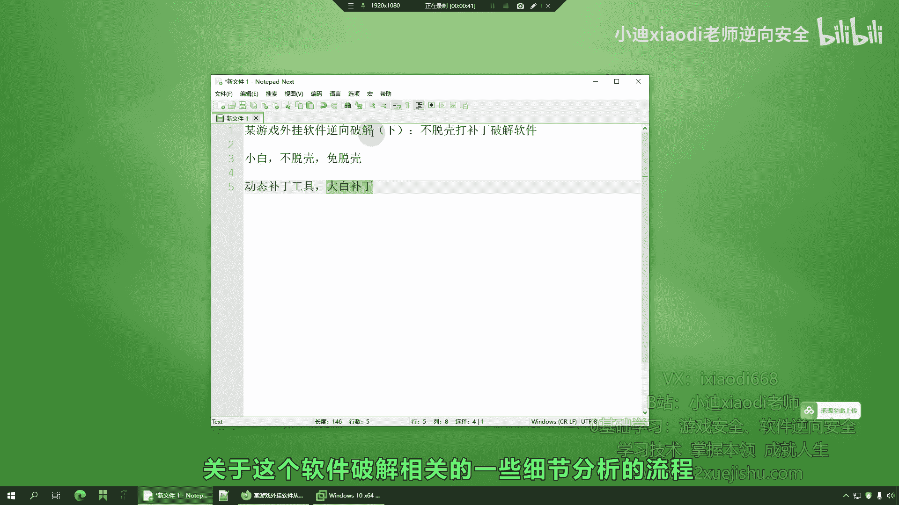
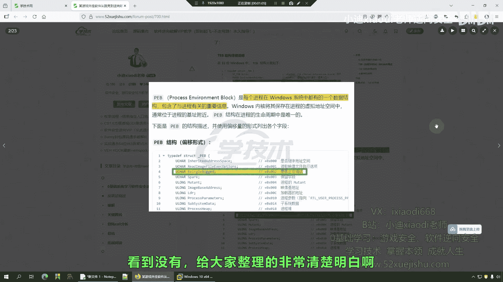
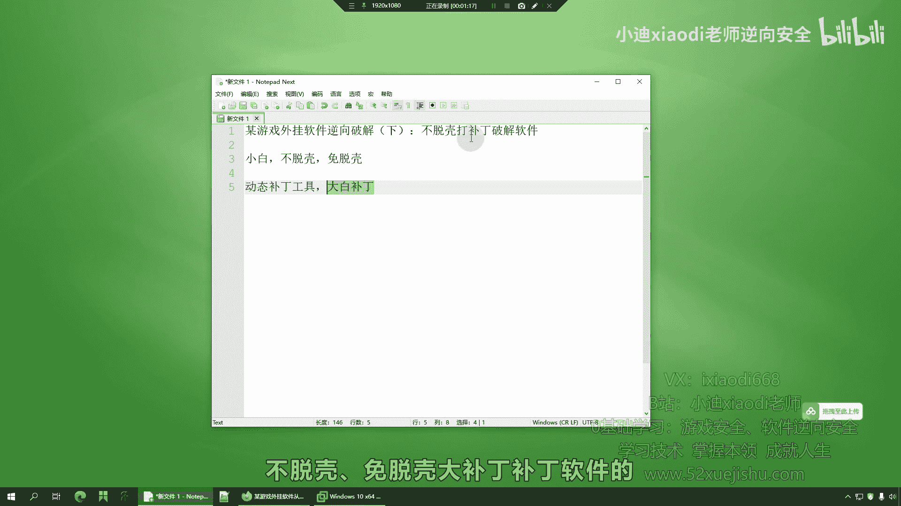
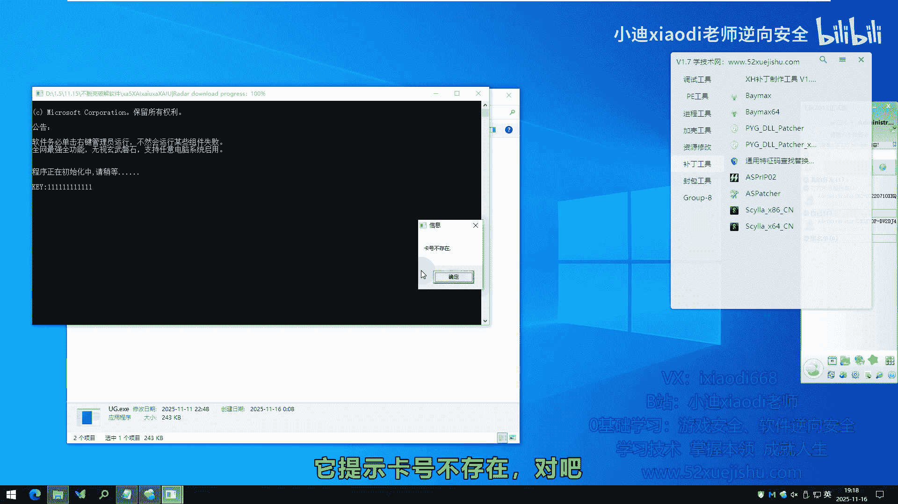
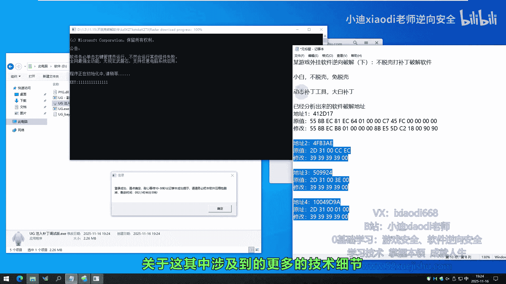

🔧 软件逆向实战：第2节：不脱壳打补丁破解软件——大白补丁的使用

大家好，我是小迪老师。今天这节课我们来讲解某游戏外挂软件的逆向破解下集：不脱壳、免脱壳地打补丁破解软件。

📖 本节概述

在本节课中，我们将要学习一种不需要脱壳就能破解软件的方法。很多刚入门的朋友对脱壳的原理和工具不太熟悉，如果非要脱壳，就需要学习很多额外知识，学习路径又长又绕。有没有绕开脱壳的办法？是有的，那就是使用动态补丁工具。最常见的就是大白补丁。通过这款工具，我们可以在不脱壳的情况下，直接对软件打补丁，完成破解。本节课中，我们会先说明为什么可以不脱壳，然后演示大白补丁的完整操作流程，最后验证破解结果。

📁 相关资源与准备工作

关于这个软件破解的细节分析流程，我们都已经发布在社区里了，大家可以自行查阅。进入我们的论坛：www.52学技术.com，然后在首页点击“综合”分类，再点击“文章”栏目，相关的文章就都放在里面了。

如果你打算从零基础开始学习这部分知识，也可以联系我们的微信。我们的课件整理得非常精细，把每个知识点都梳理得清清楚楚。文章中分析步骤也写得很详细，大家可以先自己阅读一遍。



🛠️ 为什么不需要脱壳？



首先，我们来回答一个问题：为什么要“不脱壳”？因为很多朋友还是小白，不了解脱壳的原理和理论，也不了解那些工具该怎么使用。如果选择脱壳，就需要额外学习很多工具和原理，学习路径就会变得更长、更曲折。与其这样，不如直接使用动态补丁工具来绕过脱壳环节。大白补丁就是这类工具中非常常见的一款，它可以实现不脱壳、免脱壳地破解某些软件。下面我们就来演示它的具体用法。

🧪 演示：运行目标程序



首先，我已经准备好了一个目标程序。我们双击运行它，程序会正常工作。然后，我们随意输入一个卡密，点击确认，程序会提示“卡号不存在”。这是非常正常的，因为我们的目的就是通过补丁来绕过这个校验。

接下来，我们找到大白补丁工具。它位于补丁工具目录下，我们点击运行它。大白补丁的界面打开之后，我们把目标程序直接拖拽到补丁工具的窗口中。

然后，将补丁类型选择为“搜索替换补丁”。接着，点击“添加补丁”按钮。到这里，我们需要理解一个关键点：目标程序在运行的时候，会先执行壳的代码（或者说保护的代码），执行完之后，再把原始的程序代码释放出来，最后才去执行这个释放出来的代码。这种“先执行壳代码，再释放原始代码，最后执行原始代码”的过程，就叫做“解码”。



用公式表示就是：`解码 = 执行壳代码 → 释放原始代码 → 执行原始代码`。

因此，在补丁设置中，我们需要勾选“解码后补丁”这个选项。也就是说，等程序解码完成之后，再对内存中的代码进行补丁替换。对于这类简单的软件，我们可以让它等待一段时间。等待时间是以毫秒为单位的，两秒钟就是2000毫秒，所以在设置里填上2000基本上没有问题。填写完毕后，点击“确定”。

🧩 填写补丁数据：四个关键地址

由于我们在上一节课中已经分析得到了需要破解的地址，所以现在只需要把这4个地址逐个填入补丁工具即可。这里分成了几种情况，我们先看前三个地址，它们都属于同一个模块。

第一个地址的操作如下：

- 填写“地址一”：把对应的地址填入“地址”输入框。
- 填写“模块基址”：模块基址的获取非常简单。我们运行调试器（DBG），把目标程序拖进去，点击“符号”标签，可以看到程序模块的基址是 `00400000`。把这个值记下来，然后关闭调试器。
- 将 `00400000` 填入“模块基址”输入框。
- 在“原始数据”和“补丁数据”中分别填入原始代码和修改后的代码。
- 点击“添加”完成第一个补丁。

第二个地址的操作与第一个完全一样：把地址、模块基址、原始数据和补丁数据都填好，再点击“添加”。第三个地址也同样处理。这里可以看到，前三个地址的填写方式都是相同的，非常简单。

第四个地址比较特殊，它不属于这个模块。所以我们就不能填写具体地址了，而是直接勾选“特征码搜索”选项。这样工具会通过搜索特征码来定位到需要修改的位置。然后，把原始数据填进去，再把修改后的数据填进去，点击“添加”即可。

注意，这里我们使用了一个重要的补丁逻辑，用伪代码描述如下：

```text
如果 在目标内存中找到与“原始数据”匹配的内容:
    将该内容替换为“补丁数据”
否则:
    继续等待解码完成，然后重试搜索
```

这就是为什么我们要么填地址，要么填特征码搜索的原因。

💾 保存并生成注入调试补丁

所有补丁添加完成后，点击“保存”按钮，把当前补丁配置保存起来。然后点击“工具”菜单，选择“创建注入调试补丁”选项。接着点击“保存”，弹出来的提示窗口询问是否保存，点击“是”。然后关闭当前的补丁配置窗口。这样，一个可执行的破解补丁就生成好了。

✅ 运行补丁并验证结果

接下来，我们运行刚才生成好的补丁程序。稍等片刻，等它提示“初始化完成”之后，我们再来测试破解效果。打开目标软件，输入我们之前测试过的卡密（例如 `321`），可以看到界面显示“选择加密模式一”，然后出现“世界密密模式”之类的选项（具体文字以实际显示为准）。紧接着，程序提示“登录成功”，并且显示剩余时间：`92小时46分39秒`。这说明我们的补丁已经成功生效，软件被完美破解了。

这就是大白补丁最基本的用法。通过这个操作，我们绕过了脱壳过程，直接对解码后的代码进行替换，实现了破解。

📌 总结



本节课中，我们一起学习了如何不脱壳、免脱壳地破解软件，重点掌握了大白补丁“搜索替换补丁”模式下的完整使用流程。我们首先明白了为什么要避免脱壳，然后实际操作了勾选“解码后补丁”、填写模块基址、原始数据和补丁数据，以及针对特殊地址使用“特征码搜索”。最后通过生成注入调试补丁并运行，成功验证了破解结果。希望这个思路能帮你理解动态补丁的妙处。如果要深造更多逆向破解技术细节，欢迎加入我们的内部逆向破解VIP教学，内容会更加详细和系统。以上就是今天全部的内容，下节课再见。
