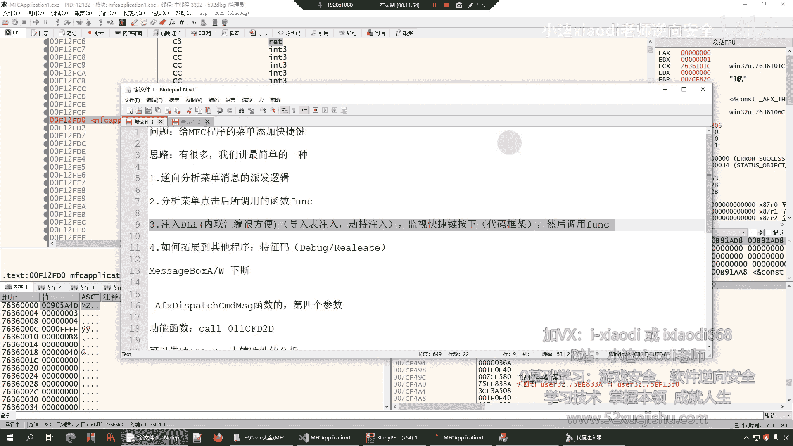

## 软件逆向实战：01：课程概述与学习目标 🎯

本课程由小迪老师继续讲解，在本节课中我们将要学习如何逆向程序功能 call，重点以 MFC 程序为例，讲解特征码技术的识别、制作和使用，并分析 Debug 版本与 Release 版本的差异。上一次课程我们讲了给 MFC 程序菜单添加快捷键，这个需求来自社区成员：他在日常工作中遇到一个 MFC 程序，希望给菜单添加快捷键，方便工作和生活中的使用。这个需求很有价值。如果今后有类似学习需求，可以联系我们，我们会从思路上做引导。上一节课讲解了一种思路，思路其实有很多，我们讲最简单的一种，并涉及特征码知识点，今天重点讲特征码。特征码分为 Debug 和 Release：Debug 版本能用，Release 版本程序实际上不能用。如果不了解 Debug 和 Release 版本区别，稍后会讲。今天内容包括：第一，如何识别特征码；第二，如何制作特征码，这两部分在软件逆向 VIP1、VIP2 版本都讲过；第三，Release 版本功能 call 如何分析。

下面进入第一个问题，先看如何识别 Debug 版本和 Release 版本。

## 软件逆向实战：02：识别Debug与Release程序 🔍

先讲第一个问题，识别版本非常简单。我们找到 Debug 版本程序做对照实验：打开 star P 工具，把程序拖过来，注意看下面有 debug 标记，这个就明确是 Debug 版本程序。它可以用特征码，而且是通杀的。再来看 Release 版本，拖过来没有显示 debug，它就是其他版本，不是 Debug 版本。这样识别就学会了，第一个问题完成。


识别版本可以用下面的公式描述。

```text
程序信息中出现 Debug 标记 → 判定为 Debug 版本
程序信息中未出现 Debug 标记 → 判定为非 Debug 版本
```

识别出 Debug 版本后，本节继续看第二个问题：如何制作特征码。


## 软件逆向实战：03：制作Dispatch派发函数特征码 🧩

上一节我们学会了识别 Debug 版本，本节来看如何制作 dispatch 消息派发函数的特征码。这个问题同样很直接。先考虑制作谁的特征码：我们要制作 dispatch 消息派发函数的特征码。以下是制作 dispatch 消息派发函数特征码的操作步骤。

1. 在目标位置打一个断点，然后运行程序。
2. 点击编辑菜单中的对应菜单项，让程序断下来。
3. 鼠标右键，转到返回边，先记录地址 10FC10。
4. 退出程序，再手动运行 Debug 版本程序，注意不要运行错版本。
5. 打开 DBG，点击文件，点击附加，切换过来，直接跳过来并拖一拖。
6. 因为当前有 PDB 符号文件，可以看到 dispatch，这能印证我们找到的位置是正确的。
7. 制作特征码要找不变的代码。这里的跳转基本不会发生大变动，短跳 741B 的跳转范围不会特别大，所以这段代码是固定的。将来作者在附近加代码可能会变，但它从这个位置跳到那个位置，基本不会有太大变动。
8. 点击插件，让插件自动化创建特征码，然后把特征码复制过来。

这样制作出的特征码就可以使用。原文强调：只要是符合这个特征码的程序就能用，属于通杀。以下是特征码的使用步骤。

1. 调试一个程序并附加进程。
2. 点击内存布局。
3. 搜索匹配特征码，粘贴特征码，勾选整块，点击确定。
4. 定位过来之后往上翻，找到函数头，在函数头下断点。
5. 在函数头下断点相当于在原位置打一个断点。

断下来之后看 1、2、3、4 四个参数，重点看第四个参数 PFN。PFN 指向将要派发给的函数位置，也就是菜单想要的函数。在示例程序中，它调用了 myfunction。核心概念可以用下面的代码描述。

```c
typedef void (AFX_MSG_CALL CCmdTarget::*AFX_PMSG)(void);
AFX_PMSG pfn; // 第四个参数，指向即将派发的菜单响应函数
```

下面进一步验证第四个参数的作用。

## 软件逆向实战：04：使用特征码定位函数并验证参数 🎯


上一节我们制作了特征码，本节来看看如何用它定位函数，并验证派发参数。以下是使用特征码定位 dispatch 函数并验证第四个参数的步骤。


1. 调试程序先附加进程，然后点击内存布局。
2. 搜索匹配特征码，粘贴特征码，勾选整块，点击确定。
3. 定位后往上翻到函数头，在函数头下断点。
4. 程序断下来后查看 1、2、3、4 四个参数，重点看第四个参数 PFN。
5. PFN 指向将要派发的函数位置，也就是菜单想要的函数；示例程序中它调用了 myfunction。
6. 验证时点击编辑让程序断下来，直接看第四个参数，依次确认第一、第二、第三、第四个参数，回车过去并拖一拖。
7. 可以看到它果然对应消息菜单响应的函数，这样就印证了 1234 中第四个参数 PFN 的作用。

第四个参数可以用下面的公式描述。


```text
第四个参数 PFN → 即将派发的菜单响应函数地址
```

第二个问题到此完成，但 Release 版本不能继续用这个特征码。

## 软件逆向实战：05：理解Release版本优化差异 ⚙️

上一节验证了 Debug 版本下特征码能定位到函数，本节分析 Release 版本为什么不能继续用特征码，核心在优化差异。先关掉当前程序，看程序属性。假如当前程序是 Debug 版本，点击属性，点击高级，其中写着全程序优化为“无全程序优化”。无全程序优化就是不优化。你写了史山一样的代码，程序编译生成之后还是史山一样的代码，不会做任何变动。以前比较丑陋但内心纯洁，程序不管这些，表面看起来还是丑陋。Release 版本点击高级，会看到全程序优化使用链接时间代码生成，按配置优化，按照程序本身的配置进行检测优化和更新。这个优化很关键，原本丑陋的程序经过优化可能变得英俊潇洒，内涵有底蕴，整个人无敌。优化和不优化差别很大，就算写了史山一样的代码，最终也可能优化成妙龄女子一样优雅。以下是 Debug 与 Release 在优化设置上的主要区别。

1. Debug 版本使用“无全程序优化”，也就是不优化，代码结构基本保持原样。
2. Release 版本使用链接时间代码生成和按配置优化，会检测、优化和更新代码。
3. 优化可能删除中间函数、改变调用结构，使程序架构与 Debug 版本完全不同。

可以用下面的代码示意优化前后的差异。


```cpp
// Debug：不优化，保留中间函数和调用结构
void Dispatch() { pfn = &MyFunction; }
void MyFunction() { /* 菜单响应逻辑 */ }

// Release：链接时代码生成与按配置优化，可能内联或删除中间层
void Dispatch() { MyFunction(); }
```


理解了优化差异后，本节继续看 Release 版本怎么调试。这里不是调戏，是调试。方法很简单，看程序行为。

## 软件逆向实战：06：通过行为与关键API回溯主模块 🕵️

上一节理解了 Release 版本优化会改变代码结构，本节看 Release 版本如何通过行为观察和关键 API 回溯到主模块。以下是 Release 版本通过行为观察和关键 API 回溯主模块的步骤。


1. 先最小化当前窗口，找到 Release 程序并运行。先不用附加，先观察程序行为，也就是听其言、观其行。
2. 点击编辑，点击修剪，程序弹出信息框。由此知道它要么调用 MessageBoxA，要么调用 MessageBoxW。
3. 找 MessageBoxW 即可，因为示例程序写的是 W；如果 A 断不下来就换 W。
4. 点击文件，点击附加，切到目标进程，直接对 MessageBoxW 打一个断点。
5. 点击编辑，点击修剪，程序直接断下来。按 Ctrl+F9，再按 S81 下来，走到对应位置。
6. 看左上角显示 MFC application.exe，说明已经来到程序模块。注意先看有没有来到程序模块；没有来到就继续返回，一直回溯到程序主模块。
7. 下段时先猜测关键 API 并下断，断下来后回溯，看程序有没有来到主模块。
8. 当前还有 PDB 调试符号文件，可以看到想要的符号信息。观察行为，少了什么：MessageBox 被直接优化掉，对应函数不存在；Debug 版本还存在这个函数，Release 版本做了美化，只留下菜单响应函数。
9. 优化和不优化确实删除了东西，以前的特征码没有用了，程序不一样，架构完全不同。


行为观察可以用下面的代码线索描述。

```c
// 菜单响应里调用了哪个消息框
MessageBoxA(...); // 先尝试 A
MessageBoxW(...); // A 断不下来就换 W
```

回溯过程可以用下面的公式描述。

```text
观察行为 → 猜测关键 API → 下断点 → 断下回溯 → 检查是否进入程序主模块 → 只在主模块分析
```

原文强调：有时程序会返回到 MFC42.dll 等 MFC 库，这些库不看，只看程序主模块。回溯到主模块后，本节看 Release 版本功能 call 如何直接调用。

## 软件逆向实战：07：在Release版本中直接调用菜单响应函数 🚀

上一节回溯到主模块后，本节看 Release 版本功能 call 如何直接调用。这时要考虑有没有参数。一般来说，菜单响应不会有参数。按 F8 出来，可以看到它是虚函数。虚函数一般没有参数。如果是特殊情况，也就是原文说的“二班的”，再进一步分析参数。实际在这里不用分析第一、第二、第三、第四个参数，没有那套东西，上来就是菜单响应，直接调用菜单响应即可。以下是 Release 版本直接调用菜单响应函数的操作步骤。

1. 打开代码注入器，先查看断点，把之前设置的断点取消掉。之前可能多出一些断点，无所谓。
2. 复制菜单响应函数地址。
3. 打开注入器，找到目标进程，执行 call 一下，直接进行 call。原文口述为“ca”，含义是执行 call。
4. 注入后看到功能弹出来，说明功能成功被调用。
5. 后期把这个调用改写成快捷键即可。

直接调用可以用下面的代码描述。

```c
typedef void (*MENU_HANDLER)(void);
MENU_HANDLER handler = (MENU_HANDLER)0x10FC10; // 示例地址，实际以调试为准
handler(); // 在目标进程内执行
```

原文强调：注入到目标进程后，可以直接调用菜单响应函数。本节补充注入 DLL 和快捷键框架思路。

## 软件逆向实战：08：注入DLL与快捷键框架思路 🧰

上一节完成了 Release 版本下的直接调用，本节补充注入 DLL 和快捷键框架思路。以下是后续实现注入和快捷键调用的思路清单。

1. 注入 DLL 可以用导入表注入，也可以采用其他 DLL 注入方式，原文此处还提到一个语音识别词，可理解为另一种注入思路，这里只说明思路。
2. 监视快捷键按下，可以提供一个代码框架，在按键触发后执行调用。
3. 原文提到远线程执行代码，这部分后面讲解怎么处理。
4. 实际上不用远线程，已经注入到 DLL 里面，就可以直接调用。
5. 最好写一个 DLL，在 DLL 里做内联汇编很方便。
6. 剩余内容后面继续分享。

快捷键框架可以用下面的代码示意。

```c
// 快捷键框架示意
if (is_hotkey_pressed()) {
    handler(); // 调用已定位的菜单响应函数
}
```

原文强调：写 DLL 后做内联汇编比较方便，直接调用也可行。到这里，本节课的主要内容已经讲完，下面做总结。

## 软件逆向实战：09：课程总结 📌



本节课中我们一起学习了软件逆向中程序功能 call 的定位与调用，以 MFC 程序为例。我们明确了特征码分为 Debug 和 Release，Debug 版本可以用特征码，Release 版本实际上不能用。识别 Debug 版本时，把程序拖进工具，看程序信息里有没有 Debug 标记。制作特征码时，针对 dispatch 消息派发函数找不变代码，用插件生成特征码，再通过内存布局搜索匹配特征，定位函数头下断，观察第四个参数 PFN 指向的菜单响应函数。理解优化差异后，我们知道 Release 版本会把中间函数优化掉，架构可能完全不同，旧特征码会失效。Release 调试时先观察行为，猜测 MessageBox 等关键 API，下断后回溯到程序主模块，只看主模块分析。定位到菜单响应函数后，可以直接 call 调用，或者注入 DLL 后调用，再配合快捷键监视框架实现快捷键。剩余内容后面继续分享，下期再见。

