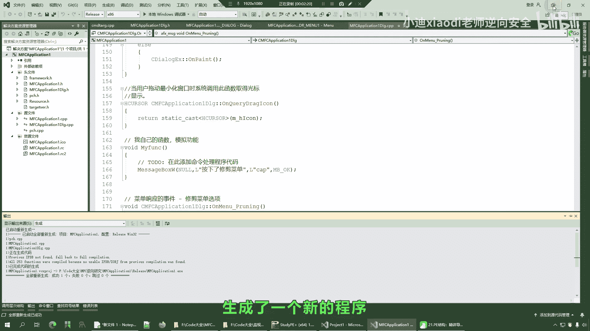
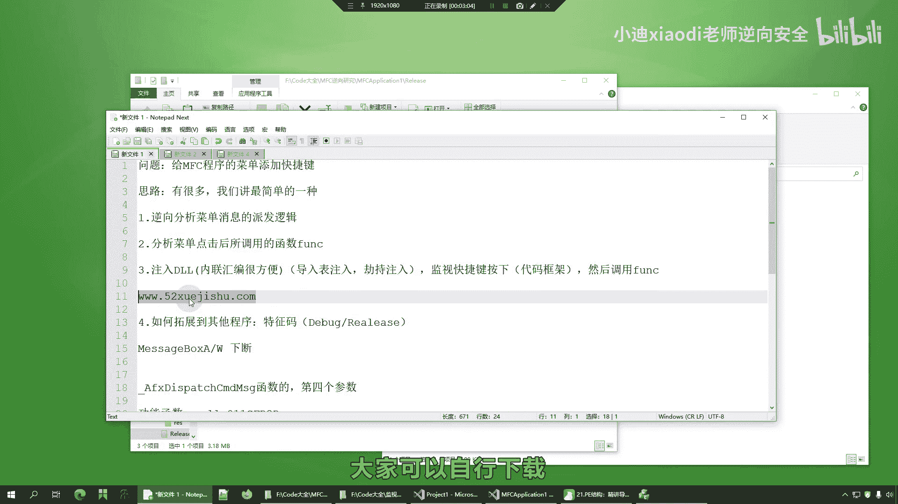
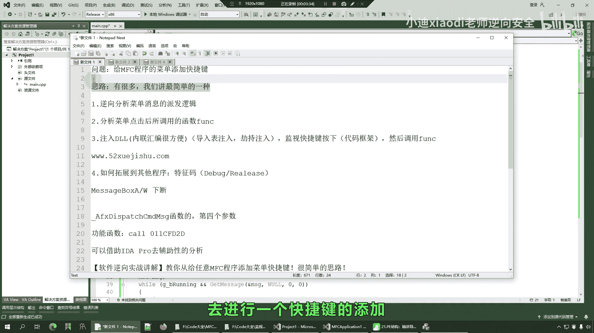

# 🔧 软件逆向实战讲解：第1章：给任意程序添加快捷键 🚀

在本节课中，我们将学习如何给MFC程序的菜单添加快捷键。这个方法并不仅仅局限于MFC程序，实际上，只要你把相关的函数分析清楚，就可以给任意程序添加快捷键。我们会重点讲解最关键的一步：注入DLL，然后监视快捷键按下。我们会把这个代码框架完整说明白，同时展示最终如何调用你的目标功能。通过一个完整示例，你会看到如何注册一个F5热键，然后直接用热键触发程序里的功能。这样，你就不用每次都在菜单里点来点去了。

## 🎬 效果演示

先来看一下最终效果。我把新程序运行起来，然后对比一下原始的操作方式和添加快捷键之后的操作方式。这样可以让大家直观地感受到这个技巧带来的便利。

### 原有操作方式

在添加任何热键之前，这个程序的原有功能是通过菜单触发的。你需要先点击“编辑”菜单，然后再点击“修剪”子菜单，最终才能调用到对应的功能代码。也就是说，原本的功能入口藏得比较深，每次都要经过两步点击才能使用。如果只是偶尔用一次还好，但如果是频繁操作，这种点击路径就显得太慢了，一点也不符合日常高效率工作的需求。

### 注册热键后的效果

现在我们给程序注册了一个F5热键。注册成功后，按下F5，程序就会立刻响应。来，按一下F5，功能马上就出来了。想再用一次，再按一下F5，又出来了。再按一下，依然灵敏。可以看到，这样一来，我们就不需要再去点击“编辑”，也不需要再点击“修剪”了。直接按一下F5，搞定。这就是我们想要的效果。

## 🧩 代码框架

现在我们来看看这个功能背后的代码框架。我们是自己编写了一个DLL，然后在这个DLL中创建了一个新线程。新线程里面放了一个循环，这个循环会不停地检测我们注册的那个热键。这里我们注册的是全局F5热键，注册成功以后，循环就开始监听F5是否被按下。一旦检测到F5按下，就立刻调用我们自己定义的函数 `myfunction`。

这个过程可以用下面的伪代码来描述：

```cpp
DWORD WINAPI MonitorThread(LPVOID lpParam) {
    // 注册全局F5热键
    RegisterHotKey(NULL, 1, 0, VK_F5);

    // 循环检测热键是否被按下
    while (true) {
        if (热键F5被按下) {
            myfunction();
        }
    }
}
```

那么 `myfunction` 这个函数内部究竟做了什么呢？很简单，它使用内联汇编去调用目标程序里的功能代码。这里的核心在于获取功能代码的地址，然后把地址放到 `EAX` 寄存器里，再通过 `call EAX` 指令去调用它。用代码写出来就是这样：



```cpp
void myfunction() {
    __asm {
        mov eax, 功能地址   // 将功能代码的地址放入 eax
        call eax             // 调用功能代码
    }
}
```

这里的“功能地址”就是你想调用的那个目标函数的入口地址，这个地址是通过分析目标程序得到的。整个注入过程，我们采用的是导入表注入的方式。既然要用导入表注入，那么DLL就必须提供一个导出函数，这样目标程序在加载DLL时才能正确建立关联。关于导入表和导出表的相关知识，以及PE结构的具体细节，VIP2课程里有非常详细的讲解。当然，VIP1中也有关于PE结构的深入说明，大家可以根据自己的学习进度选择其中一门来学习。总之，理解导入表、导出表和PE结构，是掌握这种注入方式的重要基础。

## 📦 具体操作步骤

接下来，我们实际操作一遍，把这个流程从头走一次。首先，把我们写好的DLL编译生成一下。然后，再把我们自己的MFC程序也重新生成一遍。生成之后，这个新程序里已经删掉了无关的内容，目前它是没有任何快捷键的，按F5也不会有反应。所以，我们需要把DLL注入到目标程序中，让它们之间建立联系。

下面是将DLL注入目标程序的详细步骤：



1. 打开StudyPE工具，把MFC程序文件直接拖到工具窗口中。
2. 点击窗口中的“导入”标签页。
3. 在导入页面的空白处点击鼠标右键，选择“添加导入函数”。
4. 在弹出的文件选择窗口中，选中我们刚刚生成的DLL文件。
5. 双击添加好的导入项，确认DLL已经成功出现在导入列表中。
6. 点击“文件”菜单，选择“保存”，并覆盖原始的程序文件。

完成这些步骤之后，DLL就已经被注入到目标程序的导入表里面了。保存并关闭工具，然后运行这个程序。按下F5，你看看，功能是不是立刻就被触发出来了？再按一次F5，还可以再次触发。也就是说，我们现在已经可以完全通过快捷键来调用目标功能了。

## 📚 总结与代码获取



这个代码框架其实是一个通杀的框架，你完全可以把它放到任意程序里面使用，前提是你已经分析出了你要调用的功能地址。它本质上是一个固定的框架，真正需要你自己修改的部分只有两处：一处是你想注册的快捷键按键，另一处是你需要调用的功能函数。将来你只需要分析出目标程序的功能入口地址，然后把这个地址替换到上面的代码里，再把你自己的业务逻辑写在 `myfunction` 里，就可以实现一模一样的快捷键效果。这是最简单的调用方式。这样一来，你就能给任意程序添加快捷键了。这个代码本身是一个免费的框架，我会发到论坛社区里，大家可以根据自己的需要自行下载研究。感兴趣的话，就赶紧下载下来跟着教程试一试吧。
