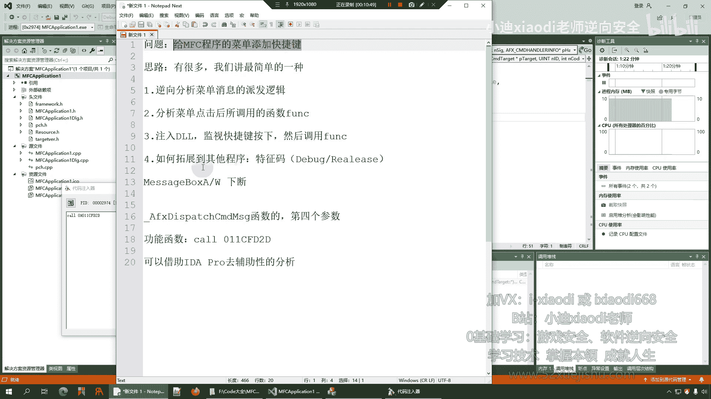

# 🧭 MFC菜单快捷键逆向实战教程：01：课程概述与整体流程

在本节课中我们将要学习如何给任意 MFC 程序的菜单添加快捷键，并整理出一套适合初学者理解的逆向实战思路。这个问题的实现方法不止一种，本教程只讲最简单、最容易落地的一种，先把整体逻辑说清楚，再逐步进入细节。整体上可以把它拆成四步：先逆向分析菜单消息的派发逻辑，弄清楚菜单消息是怎样派发的；再分析菜单点击后调用的函数；随后编写 DLL 注入目标程序，监视快捷键按下并调用功能函数；最后讨论如何通过特征码扩展到其他程序。核心流程可以写成下面这个公式：

```text
逆向菜单消息派发逻辑
    -> 分析菜单点击后的功能函数
    -> 编写 DLL 注入并监视快捷键
    -> 通过特征码扩展到其他程序
```


这里需要强调，复杂方法不是不能做，而是处理点更多。简单方法的目标是少写代码、少改原程序逻辑，把主要工作放在定位功能函数和远程调用上。完成整体流程说明后，下一节我们来看看问题背景，以及复杂路线和简单路线到底差在哪里。


## 🧩 MFC菜单快捷键逆向实战教程：02：问题背景与两条实现路线

上一节介绍了整体四步流程，本节中我们来看看为什么选择简单路线，以及复杂路线主要复杂在什么地方。原始问题是要给 MFC 程序的菜单增加快捷键。实现思路有很多，本教程选择最简单的一种。复杂方法通常是在消息派发代码里做 Hook，然后自己把消息串接起来，让快捷键消息进入原有处理链路。这种办法不是难，而是麻烦，涉及的位置多，代码量也大。下面列出两条路线的对比，方便先建立判断标准。

- 复杂路线：在消息派发代码里做 Hook，自己把消息串通起来，处理位置多，代码量大。
- 简单路线：定位功能函数，编写 DLL 注入，监视快捷键，按下后远程调用功能函数，处理点少。

用公式表示如下：


```text
复杂路线 = 在消息派发代码中 Hook + 自行串接消息
简单路线 = 定位功能函数 + DLL 注入 + 监视快捷键 + 远程调用
```

对于初学者，建议先把简单路线跑通。简单路线需要处理的地方少，出现问题时也更容易定位。理解两条路线之后，下一节我们先自己写一个测试程序，用可控的程序把菜单、事件和功能函数完整串起来。

## 🛠️ MFC菜单快捷键逆向实战教程：03：编写一个用于观察的测试程序

上一节比较了复杂路线和简单路线，本节中我们来看看如何编写一个用于观察的测试 MFC 程序。先以自己编写的程序为例，这样方便控制变量，也方便观察菜单事件是怎样被调用的。程序中添加三个菜单，其中只有一个菜单有事件，其他菜单先不添加事件。添加事件的方式是使用“添加事件处理程序”，给处理函数起一个名字，然后确认添加。添加完成后，这个处理函数就会出现在对应位置。在这个菜单响应事件里，我们让它调用 `MyFunction`。`MyFunction` 的作用很简单，只弹出一个信息框，用来模拟专业工具中的功能函数。代码示意如下：


```cpp
void CMyDlg::OnMenuTrim()
{
    MyFunction();
}

void MyFunction()
{
    MessageBox(L"按下了修剪菜单", L"提示", MB_OK);
}
```


运行程序并等待启动完成，过程可能稍慢，但不影响观察。点击“编辑”，再点击“修剪”，程序会提示“按下了修剪菜单”。这说明菜单响应事件和功能函数都已经正常工作。如果分析的是别人的程序，并且程序里有信息框，可以在 `MessageBoxA` 或 `MessageBoxW` 下断点；如果程序没有信息框，也可以通过窗口创建函数 `CreateWindowExA` 或 `CreateWindowExW` 下断点。这里先不展开陌生程序分析，因为后续会用特征码定位。这里只是拓展思路。测试程序验证完成后，下一节我们就在菜单响应位置下断点，观察 MFC 框架如何一层一层调用到菜单响应函数。

## 🔍 MFC菜单快捷键逆向实战教程：04：定位菜单响应与消息派发


上一节完成了测试程序，并验证了菜单响应和功能函数，本节中我们来看看如何定位菜单响应以及消息派发过程。先关闭程序，然后在菜单响应的位置打一个断点，观察它到底怎样一层一层被调用。运行程序，点击“编辑”，再点击“修剪”，打开调用堆栈。调用堆栈会显示从底层到菜单响应事件的调用路径。可以看到，菜单响应事件的上层是 `DispatchMessage`，也就是消息派发函数。`DispatchMessage` 的含义就是派遣、派发。如果有消息传过来，就从这个位置进行派发，例如菜单一被点击时从这里派发，菜单二被点击时也从这里派发。这个位置决定了要派发什么消息，以及消息应该如何处理。可以用下面的公式概括：


```text
消息到达 -> DispatchMessage 派发 -> 根据消息选择处理路径 -> 调用菜单响应函数
```

重新运行程序后，点击“编辑”没有反应，点击“切断”没有反应，点击“顶等分”也没有反应，因为这些菜单都没有添加事件；只有“修剪”添加了事件，所以点击“修剪”时程序会断下来。断下来之后观察局部变量，可以看到一个 `PFN`。这个值看起来很长，不容易直接看懂，因此复制它的地址，打开反汇编窗口。如果找不到反汇编窗口，可以通过“调试”菜单里的“窗口”找到“反汇编窗口”，把地址粘贴进去并回车。此时可以看到它跳到了某个位置，这个位置就是 `PFN` 将要执行的地方。如果分析的是别人的程序，也可以用类似办法，在反汇编窗口对应位置下断点。这样可以得到第一个、第二个、第三个、第四个参数，其中第四个参数就是将要执行的菜单响应函数位置。完成断点定位后，下一节我们重点看 `DispatchMessage` 的第四个参数，并说明如何从堆栈中拿到功能函数地址。

## 🧮 MFC菜单快捷键逆向实战教程：05：从DispatchMessage参数拿到功能函数

上一节通过调用堆栈和反汇编窗口定位到了菜单响应附近，本节中我们来看看如何从 `DispatchMessage` 的第四个参数拿到功能函数。在反汇编窗口里可以看到它跳转到类似 `114FD28` 这样的地址，也可能看到 `11CFD28` 这样的地址。这里要看的是 `DispatchMessage` 函数的第四个参数。将来找特征码时，就找 `DispatchMessage` 这个函数的特征码。断下来之后，第四个参数就在堆栈里，跳过去一看就能得到事件相关地址。例如看到 `114FD28`，就说明已经得到菜单响应事件的位置。核心关系可以写成下面的公式：

```text
功能函数地址 = DispatchMessage 调用中的第 4 个参数
特征码定位 = 搜索 DispatchMessage 的机器码特征
```

得到地址后继续单步执行，一直执行到菜单响应事件，再按 `F10` 单步向下走。继续走时会发现一个函数调用，此时按 `F11` 进入，再按 `F11`，继续单步观察。随后信息框提示出现，说明 `MyFunction` 就是我们要找的功能函数。继续按 `F10` 单步，先退出这个函数。此时可以确认，这个函数就是功能函数。功能函数可能是无参的，也可能有参数。无参函数直接调用即可；有参函数会在调用前通过 `push` 压入若干参数。分析起来并不复杂，也可以借助 IDA Pro 辅助分析。功能函数地址确认后，下一节我们模拟 DLL 注入后的效果，用远线程远程调用这个功能函数。

## 💉 MFC菜单快捷键逆向实战教程：06：用远线程模拟DLL注入后的调用

上一节已经分析出功能函数，本节中我们来看看如何模拟 DLL 注入后监视快捷键并调用功能函数的操作。实际实现非常简单，核心是创建远线程执行目标函数。先运行程序，确认之前的地址是否仍然有效。例如反汇编窗口里的 `114FDRD` 没有变化，就可以继续。把之前的断点放开，然后直接用代码注入器做远程调用。找到目标程序，双击选中，输入 `call`，再填入 `0x` 开头的函数地址，点击注入远程代码。此时可以看到功能被调用了，再次点击也会再次调用，这就是模拟功能函数被快捷键触发的效果。远线程调用的伪代码如下：

```cpp
// 伪代码：在目标进程中创建远线程，线程入口调用功能函数
HANDLE hThread = CreateRemoteThread(
    hProcess,
    nullptr,
    0,
    (LPTHREAD_START_ROUTINE)funcAddr,
    nullptr,
    0,
    nullptr
);
```

将来只需要实现一个代码注入模块，让远线程执行时调用功能函数即可。现在是通过软件按钮点击来触发，将来可以启动一个线程监视快捷键，快捷键按下后就去远程调用功能函数。也可以自己编写 DLL 并注入目标程序，由 DLL 辅助完成监视和调用。到这里，简单路线的核心闭环已经形成。下一节我们讨论如何把这个思路扩展到其他程序，并说明特征码和 Debug/Release 版本的差异。

## 🧷 MFC菜单快捷键逆向实战教程：07：用特征码扩展到其他程序

上一节完成了远程调用模拟，本节中我们来看看如何把方法扩展到其他程序。扩展到其他程序的关键是特征码。因为不同程序里的函数地址会变化，不能写死地址，需要先定位 `DispatchMessage` 的特征码，再在断下来后读取第四个参数，从而得到目标程序的功能函数地址。需要注意，Debug 版本和 Release 版本存在区别，本教程以 Debug 版本为例。

> 提示：Debug 版和 Release 版的函数特征可能不同，实际定位时要分别处理，不能直接套用同一个地址。


可以用下面的公式概括稳定定位过程：

```text
目标程序功能函数地址 = 特征码定位 DispatchMessage + 读取第 4 个参数
快捷键触发 = 监视按键 + CreateRemoteThread 调用功能函数地址
```

如果目标程序里有信息框，可以在 `MessageBoxA` 或 `MessageBoxW` 下断；如果没有信息框，可以在 `CreateWindowExA` 或 `CreateWindowExW` 下断。这些手段主要用于分析陌生程序，最终仍然建议用特征码做稳定定位。下面列出扩展时的几个注意点，方便实际动手时检查。

- 先确认目标程序是 Debug 版本还是 Release 版本。
- 先定位 `DispatchMessage` 的特征码，不要直接写死地址。
- 断下来后读取第四个参数，确认它就是菜单响应函数位置。
- 远程调用前再次确认地址有效，避免程序崩溃。

需要提醒的是，复杂方法要写很多代码，处理的地方也很多，一旦某个地方处理不好，程序就可能崩溃。因此初学者优先掌握简单路线，把定位、调用和注入链路跑通，再考虑更复杂的 Hook 方案。完成扩展思路后，下一节我们对整套流程做一次总结。

## ✅ MFC菜单快捷键逆向实战教程：08：课程总结与注意事项




本节课中我们一起学习了给 MFC 程序菜单添加快捷键的一套简单逆向实战思路。整套流程可以概括为：逆向分析菜单消息派发逻辑，分析菜单点击后调用的功能函数，编写 DLL 注入并监视快捷键，最后通过特征码扩展到其他程序。回顾一下关键点：先写测试程序验证菜单事件和功能函数；在菜单响应位置下断点，通过调用堆栈观察 `DispatchMessage` 的派发过程；从 `DispatchMessage` 的第四个参数读取功能函数地址；用远线程模拟注入后的调用；用特征码解决其他程序地址变化的问题。简单路线的优势是代码少、处理点少、容易调试；复杂路线是在消息派发代码里做 Hook 并串接消息，代码量大，处理不好容易导致程序崩溃。实际学习时，建议先把简单路线完整跑通，再研究复杂方案。以上就是本节课的全部内容。

