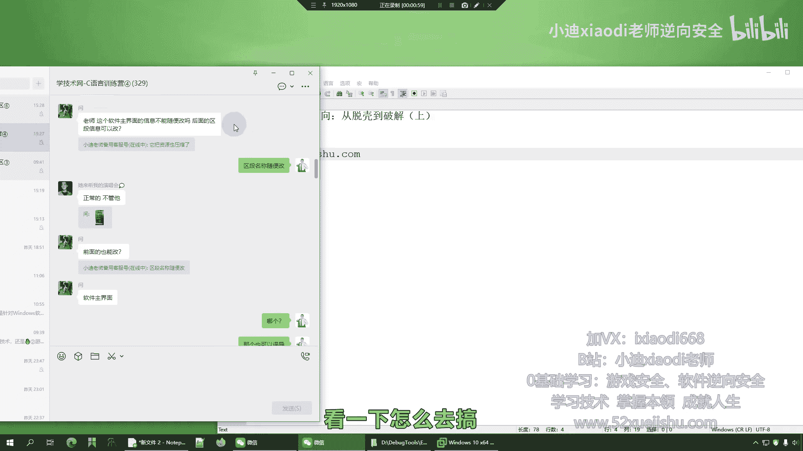
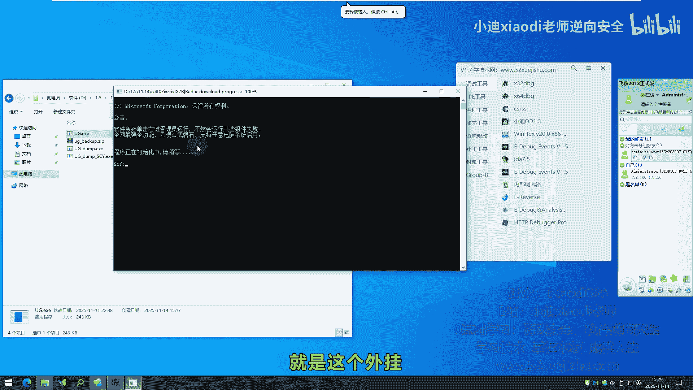
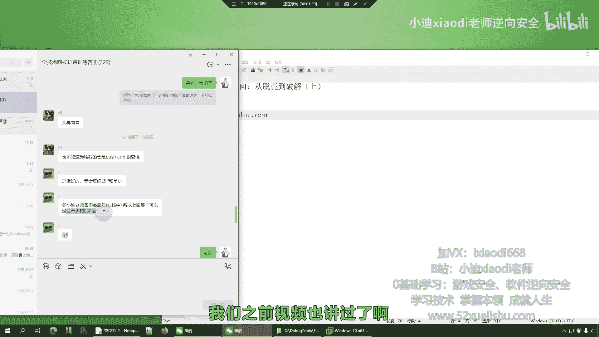
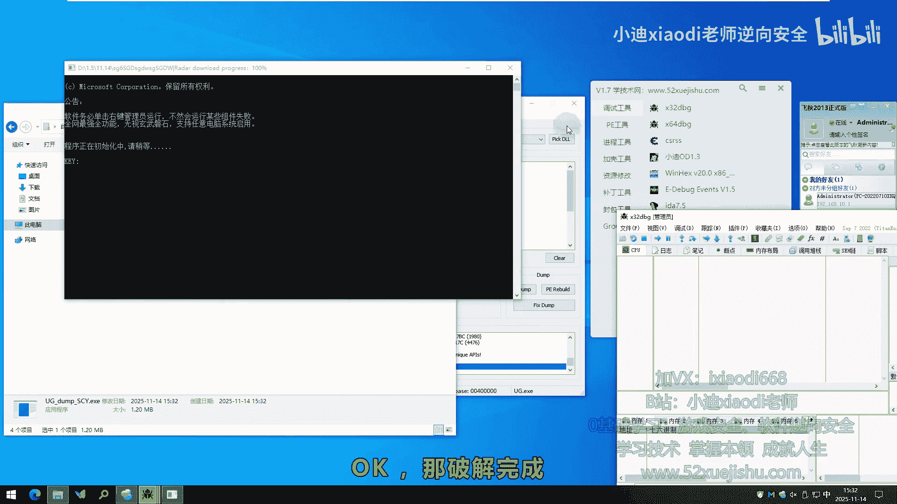
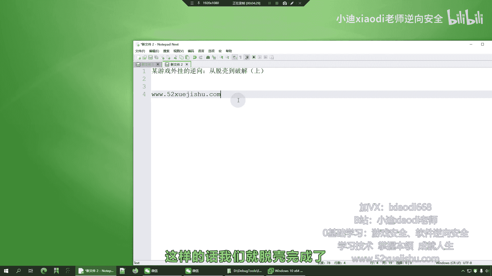
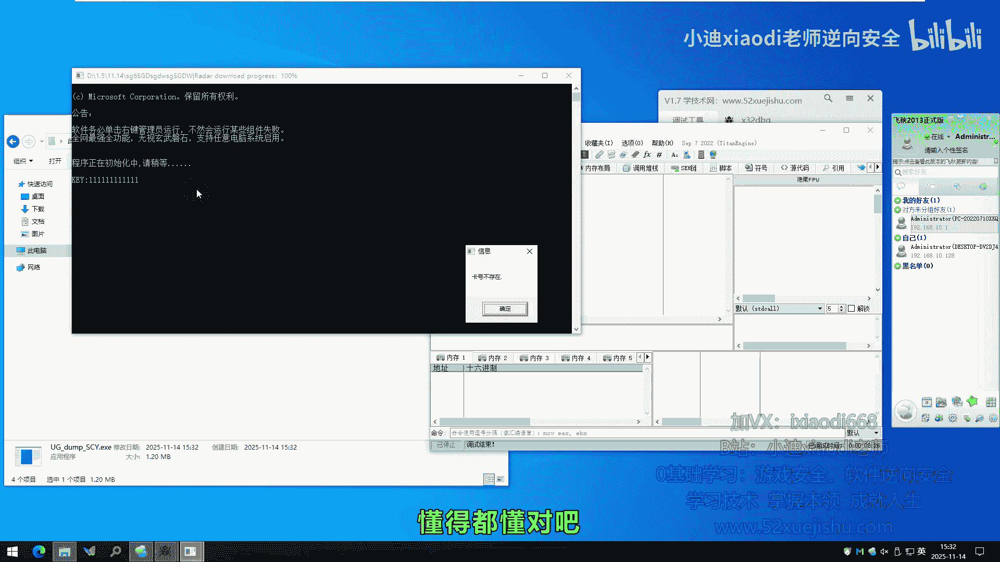
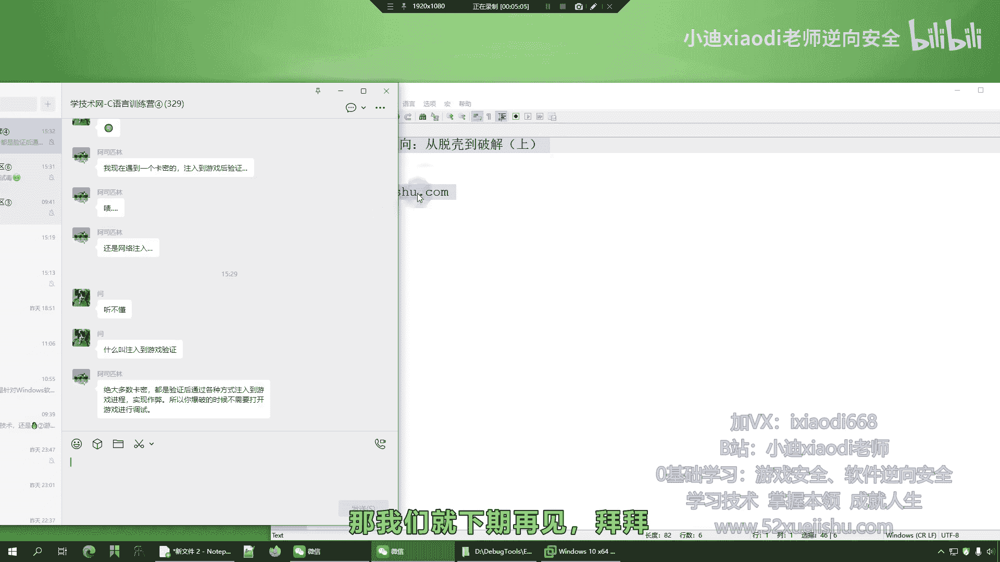

# 🧩 软件逆向实战讲解：01：某游戏外挂从脱壳到逆向破解（上）：脱壳


## 🧭 软件逆向实战讲解：01-1：课程概述

在本节课中，我们将要学习某游戏外挂软件的逆向分析，从脱壳到破解的上半部分，也就是先完成脱壳。课程开始，我是小军老师。如果想学习软件安全逆向相关内容，可以加入学习础网逆向安全社区，网址是3W点52学技术点com。在这里可以学到完整的软件安全逆向破解技术，也可以看到学习氛围非常好，群友互助，交流效果不错。这里不再展开更多介绍。

当前群里正在交流一个外挂的破解，接下来查看如何操作。本节课程会围绕一个实际案例展开，先判断壳类型，再使用ESP定律完成脱壳，最后通过dump和fix修复让程序可以正常运行。整个流程可以先用一段代码概括。

```
识别UPX壳 -> 使用ESP定律定位OEP -> dump -> fix修复 -> 验证运行
```


## 🛰️ 软件逆向实战讲解：01-2：案例背景与目标



上一节我们介绍了课程目标与学习社区，本节中我们来看看这次要处理的实际案例。这个案例是一个游戏外挂程序，运行之后会有一个K，让我们去输入K。同学遇到问题后说明情况，我先查看了一下。我判断这个东西是正常的UPX壳，可以直接脱掉。



脱壳使用单步和ESP定律，之前的视频也讲过相关方法。这里用starPE拖过来查看，可以看到这是UPX壳。之前已经拖过两个文件，先把它们删掉，避免混淆。接下来的目标很明确：把壳脱掉，让程序可以正常运行，为后续破解打基础。以下是本节要处理的对象和判断。

- 对象：某游戏外挂程序。
- 现象：启动后要求输入K。
- 壳类型：正常UPX壳。
- 方法：单步执行配合ESP定律。
- 工具：starPE、DBG、dump工具与fix修复。

从交流内容看，这个外挂涉及透视自瞄类功能，可以看到自瞄功能，自动瞄准那一行也能看到。群里交流氛围可以看到，这里不再多说。下面开始进入实际脱壳操作。




## 🧱 软件逆向实战讲解：01-3：识别UPX壳与准备脱壳

上一节我们明确了案例背景与脱壳目标，本节中我们来看看如何识别UPX壳并做好脱壳准备。先删除之前拖过的两个文件，然后打开DBG，把目标程序直接拖过来。程序运行之后非常典型，会出现pushad。pushad就是保存环境的上下文，例如寄存器等内容都会压到栈里。程序刚开始的运行环境会先保存起来，例如当前数值是2BD00，还有530A90。查看之后可以看到，寄存器环境被放入栈中。

为什么需要做这件事？因为此时程序已经加壳，也就是加了软件防护。程序刚开始运行的是壳的防护代码，而不是原程序代码。原程序代码需要等壳代码运行完成之后才能运行。因此，脱壳的关键就是找到壳代码运行结束的位置。核心概念可以用下面两行代码描述。

```
pushad：保存寄存器等运行环境到栈
popad：从栈中恢复寄存器等运行环境
```

以下是识别与准备阶段的关键点。

- 使用starPE查看，确认是UPX壳。
- 打开DBG并加载目标程序。
- 运行后观察pushad，理解壳先保存上下文。
- 删除旧文件，避免混淆。
- 准备使用ESP定律定位壳代码结束位置。

这一阶段的核心是理解壳会先保存现场，再运行自己的代码。接下来需要找到它恢复现场的位置，从而接近原程序入口。


## 🎯 软件逆向实战讲解：01-4：使用ESP定律定位OEP

上一节我们识别了UPX壳并理解了pushad的作用，本节中我们来看看如何用ESP定律定位原程序入口附近。判断壳代码是否运行完成，可以观察push和pop指令。push是放入，pop是弹出。pop操作需要对ESP进行对应还原，因此可以用ESP定律来定位。

操作方法是：在DBG中识别ESP，转到内存中的ESP位置，找到该位置后下断点。之前下过断点，所以先删掉。断点设置为访问四字节，然后运行程序。运行后会来到还原位置，可以看到popad把之前压入的内容再弹出来。放入之后恢复时再取出，这就是push和pop的对应关系。继续往下看，会看到一个非常大的跳转，这个跳转直接跳到程序原来的代码处。以下是ESP定律的操作步骤。

```
1. 在DBG中按ESP定律转到ESP内存位置
2. 对该地址下“访问四字节”断点
3. 运行程序，等待到达popad恢复位置
4. 观察下方大跳转，它指向原程序代码处（OEP附近）
```

操作中先删除旧断点，再下新断点。运行后到达还原位置时，可以看到popad把之前压入内容弹出。继续向下看大跳转，这个跳转就是壳把控制权交回原程序的信号。理解`ESP`变化，可以帮助我们判断壳何时完成现场恢复。


## 💾 软件逆向实战讲解：01-5：Dump与修复

上一节我们通过ESP定律找到了还原位置和原程序代码附近，本节中我们来看看如何dump并修复程序。先在大跳转处打一个断点，让程序运行到该处，再运行。运行到此处后跟过去，跟过去之后进行dump。点击工具，进行IAT自动扫描，然后直接dump。默认选项不要动，保存为dump.exe即可。点击保存后，程序仍然跑不起来，运行会闪退，因此需要修复。点击fix进行修复，修复完成之后再次运行即可。以下是Dump与修复流程。

```
1. 在OEP附近大跳转处下断点
2. 运行到断点后跟过去
3. 使用dump工具进行IAT自动扫描
4. 直接dump，保持默认选项，保存为dump.exe
5. 点击fix修复IAT
6. 再次运行验证
```

这里的核心是`dump + fix`。dump负责把内存中的程序镜像保存出来，fix负责修复导入表，让程序可以正常启动。验证运行时如果程序不再闪退，就说明脱壳和修复基本完成。


## ✅ 软件逆向实战讲解：01-6：脱壳结果与验证

上一节我们完成了dump与fix修复，本节中我们来看看脱壳结果。修复完成之后再次运行，程序可以正常运行。此时软件在当前阶段完成破解处理，随后说明这是脱壳完成。也就是说，当前阶段完成了可运行处理，真正的破解还要看下一节。以下是本阶段结果。



- 程序可以正常启动。
- 脱壳完成。
- 修复完成。
- 后续需要分析软件行为并继续破解。

到这里，脱壳流程已经跑通。接下来需要观察软件行为，为后续破解寻找切入点。




## 🧪 软件逆向实战讲解：01-7：软件行为观察与作业

上一节我们完成了脱壳与验证，本节中我们来看看软件行为观察与课后作业。脱壳完成之后，就要看怎么破解。这个部分给大家留作作业。先看软件有什么行为：随便输入一个卡名并回车，可以看到提示“卡号不存在”。现在应该知道怎么破解，只可意会不可言传，懂的都懂。提示“卡号不存在”后，点确定程序就退出了，这里不用管。以下是作业与观察点。

- 观察启动后的输入框和K输入要求。
- 输入任意卡名并回车。
- 记录提示“卡号不存在”。
- 点击确定后程序退出。
- 思考后续破解切入点，下节课继续讲解。



下节课会讲解如何继续破解它。今天分享的是脱壳部分，这些都是实际案例。下期再见。


## 📚 软件逆向实战讲解：01-8：课程总结



本节课中我们一起学习了某游戏外挂从脱壳到逆向破解的上半部分，也就是脱壳。我们识别了正常UPX壳，使用单步和ESP定律定位壳代码结束位置，通过大跳转找到原程序代码处，完成dump并用fix修复，最后验证程序可以运行。课程还留下了软件行为观察作业：输入卡名会出现“卡号不存在”，点击确定后程序退出。下节课将讲解如何继续破解它。今天分享的是脱壳实际案例，下期再见。

