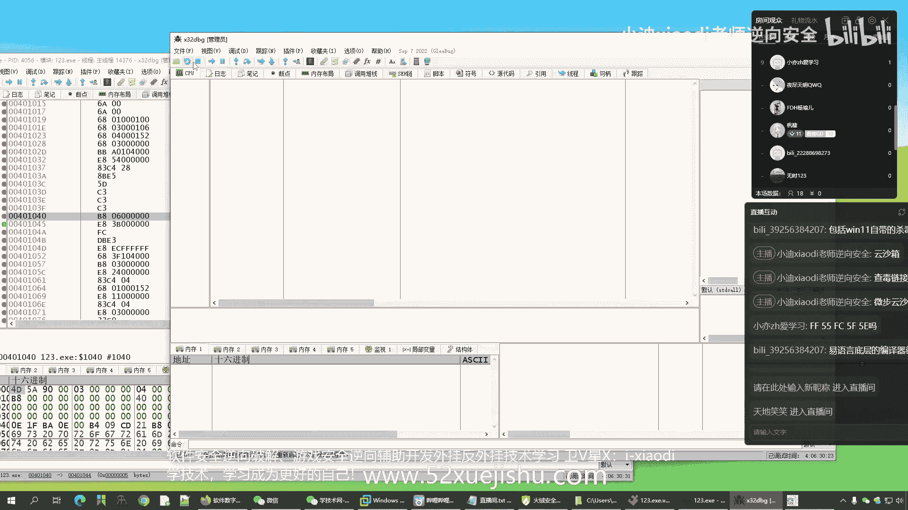
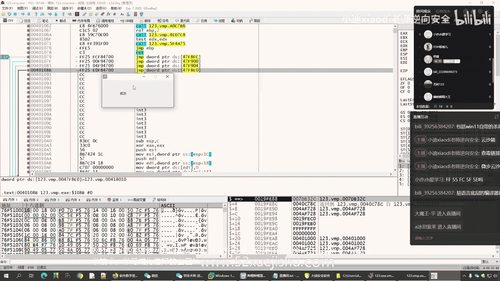

# 🔓 软件逆向破解技术：第1章：易语言启动窗口被VM的破解绕过方法（VMP）

## 📖 本节概述

这节课我们要学习一个实战技巧：当易语言程序的启动窗口被 VMP 壳虚拟化（VM）之后，怎样把它绕过去，并把启动窗口改掉。这个技巧在游戏安全、软件安全、网络安全和 CTF 比赛中都很常用。下面用大白话一步步演示，不要求你已经很懂脱壳。

在动手之前，先把几个核心概念解释清楚。

**VMP 壳是什么？** VMP 全称 VMProtect，是一种商业保护壳。它会把原始代码变成虚拟机指令，让静态分析变得很难。程序运行的时候，这些虚拟机指令又会被解码成可执行代码，所以调试时通常要等它解码完，才能看到真实逻辑。

**断点是什么？** 断点就是让程序在某个位置停下来的调试工具。我们等会儿用这个命令来下断点：



```text
bp GetVersion
```

**易语言是什么？** 易语言是一种中文编程语言，它写的窗口程序通常有一个“启动窗口”。易语言的窗口编号和组件编号很固定，框架性很强，这正是等下可以动手改窗口号的突破口。

## 🎯 第一步：在 GetVersion 上下断点

概念清楚了，现在开始实际操作。对于加了 VMP 壳的这个程序，我们首先要做的，就是处理 `GetVersion` 这个 API，比如在它上面下一个断点。

因为很多加壳程序和易语言程序在启动早期都会调用 `GetVersion` 来做系统版本检查或者初始化。以下是我们要记住的第一个操作：

```text
bp GetVersion
```

下好断点之后，运行程序。程序执行到 `GetVersion` 时，会被调试器断下来。

## 🔄 第二步：让 VMP 先解码，再放开断点

断下来之后，程序会在这个位置开始解码。`GetVersion` 附近往往是 VMP 壳还原代码的关键路口。解码完成之后，易语言下面所有的核心框架都会走这一段代码来运行。

这个流程可以写成这样：

```text
程序运行 -> 停在 GetVersion -> VMP 解码 -> 易语言核心框架 -> 启动窗口创建
```

所以这个断点不能一直占着。我们需要把 `GetVersion` 断点放开，再继续运行，让后面的核心框架跑起来。在调试器里，放开断点可以这样写：

```text
bc GetVersion
```

`bc` 就是清除断点。

## 🪟 第三步：观察启动窗口的编号

断点放开后，继续运行。这个时候窗口还没有出来。我们看一下调用堆栈，观察当前程序状态。此时 `52010001` 那个东西还没加载出来。再运行一次，还是没有。看到没有？程序继续跑一会儿之后，启动窗口就出来了，窗口号正是 `52010001`。

这里的关键观察结果如下：

- 启动窗口的窗口号是 `52010001`。
- 这个编号要等 VMP 解码完、断点放开之后才出现，所以不要急着在断点处找窗口号。

## ✏️ 第四步：把 52010001 改成 52010004

找到窗口号之后，下一步就是修改它。这个时候，这个软件还有一个窗口，你看一下 `52010004`，对不对？这里看到的是 `5201004`。好，我们动手把 `52010001` 里面的那个 `1` 改成 `4`，改完就变成 `52010004`。改完之后再运行程序。

修改关系如下：

```text
修改前：52010001
修改后：52010004
关键操作：把最后一位的 1 改成 4
```

稍等一下，我把刚才那个断点直接放开就可以了。放开断点，运行。看到没有？程序跑起来之后，启动窗口就被我们改掉了，对不对？我把刚才那个程序关掉。看到没有？启动窗口已经变成我们想要的样子了。

## 🧩 第五步：为什么能这么改

我举这个例子想表达的意思是：易语言的框架性非常强。窗口号、组件编号、启动流程都是固定套路，只要找到那个编号，改掉它，程序就会按照修改后的方式创建窗口。



易语言这个东西快捷性很强，开发效率高，但保护方式也相对固定，所以有很多方法可以绕过 VMP 保护。在这个例子里，我们并没有去硬还原 VMP 的虚拟机指令，而是利用了易语言框架的运行规律，在解码之后修改窗口编号，从而绕过 VMP。

## 📝 总结

本节课我们一起学习了 VMP 壳下易语言启动窗口的破解绕过方法。先是在 `GetVersion` 上下断点，等 VMP 解码；再放开断点，让易语言核心框架运行起来；然后观察启动窗口编号 `52010001`，把窗口号改成 `52010004`，最后成功改掉了启动窗口。整个过程可以用一条命令流概括：

```text
bp GetVersion -> 等待解码 -> 放开断点 -> 修改窗口号 -> 绕过 VMP
```

以后遇到易语言程序被 VM 的情况，不要急着逐条分析虚拟化指令，先抓住易语言框架和固定窗口编号，往往能更快找到破解入口。
