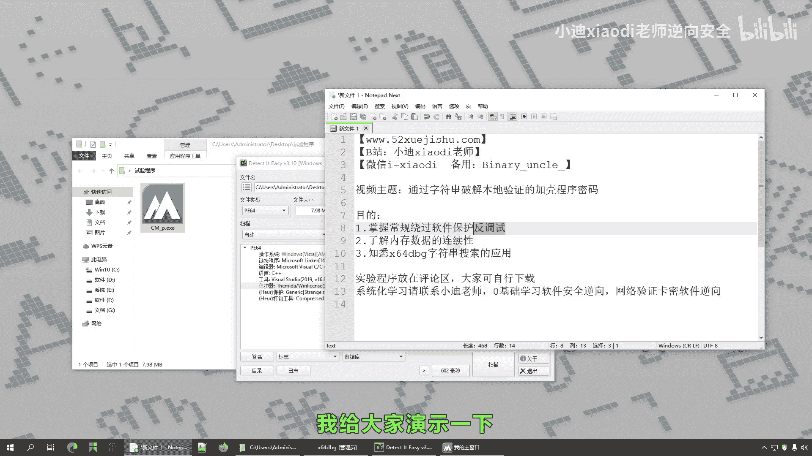
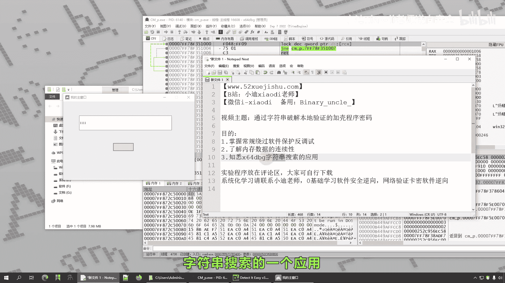
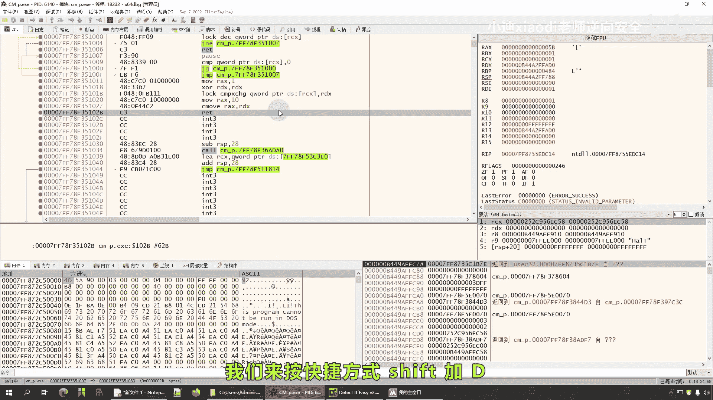
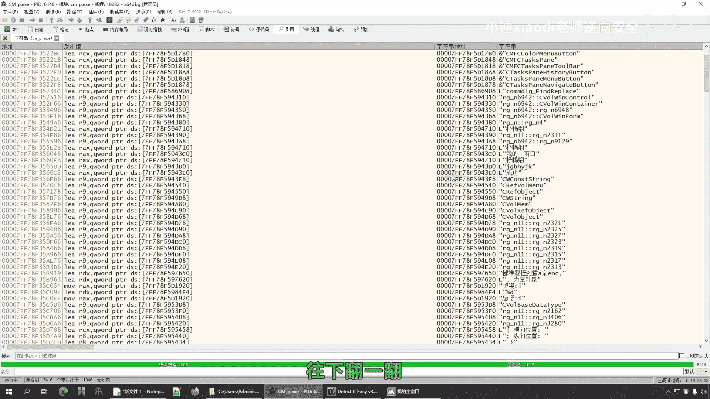
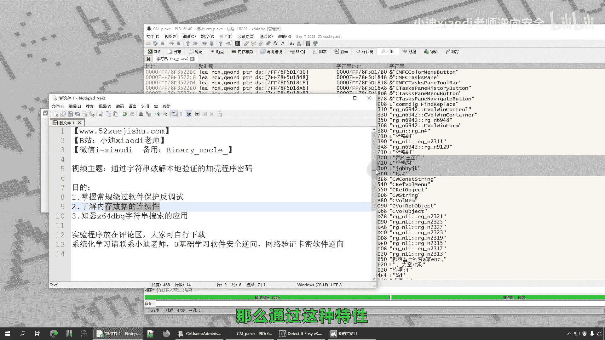
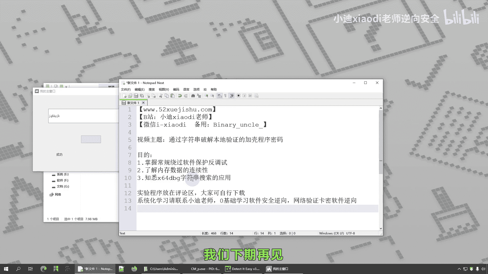

# 软件逆向破解案例：01：🧰 课程概述与目标

在本节课中我们将要学习如何通过字符串破解本地验证的加壳程序密码。课程会围绕一个本地验证小程序展开，先观察程序界面和输入密码后的反馈，再分析程序是否加壳、是否带有反调试，最后用附加进程和字符串搜索的方法完成密码验证。课程开头还说明网站、B站和小迪老师微信是联系渠道，零基础想学习相关内容可以联系小迪老师。理解这些目标后，下面先认识目标程序的界面和保护特征。

# 软件逆向破解案例：02：🧭 认识目标程序与保护特征

在明确课程目标之后，我们来看看目标程序运行后的样子。程序运行起来后会出现一个界面，界面上有一个编辑框，用来输入密码，旁边还有一个按钮。如果输入的密码正确，界面会显示密码正确相关的提示；当前输入的密码是错误的，所以界面上没有显示成功提示。一般来说，拿到一个程序后，第一步是分析程序的一些信息，使用的工具就是把程序直接拖进分析工具。把程序拖过来后，会发现这里有一个保护器，这个保护器说明该软件是加壳程序，或者说该软件带有保护。这样的保护给我们最直观的感受就是反调试。接下来演示反调试现象：把程序拖进工具后直接点击运行，程序会弹出提示，提示内容类似“bu has been found running应用”，意思是系统中发现了运行中的调试器，请关掉调试器，直接运行该程序；如果使用调试器，程序就打不开，会直接闪退。因此我们需要掌握常规的绕过软件反调试的方法。上一节我们认识了程序界面和保护特征，本节继续看反调试现象对应的绕过思路。

# 软件逆向破解案例：03：🕵️ 绕过反调试的附加分析法

在观察到程序会检测调试器并闪退之后，本节我们来看看常规的绕过方法。绕过方法非常简单：先运行程序，然后点击文件，点击附加，再点击符号切换到程序的主模块，用附加的方式去分析程序，这样就可以绕过一部分程序的反调试。这个过程可以用下面的公式概括。

\[
\text{绕过思路}=\text{先运行程序}\rightarrow\text{附加进程}\rightarrow\text{切换到主模块}
\]

以下是绕过反调试时用附加方式分析程序的操作步骤，按顺序执行即可。

1. 先正常运行目标程序，不要直接用调试器启动它。



2. 在分析工具中点击“文件”，再点击“附加”，选择目标进程进行附加。

3. 点击“符号”，切换到程序的主模块，然后继续分析程序。

完成附加操作后，我们就有了继续分析的基础。上一节通过附加方式绕过了部分反调试，本节我们继续学习如何用字符串搜索定位密码验证相关提示。

# 软件逆向破解案例：04：🔎 用字符串定位密码验证逻辑

在通过附加方式进入程序之后，本节我们来学习字符串搜索的应用。如果程序在输入密码后会有相关提示，那么这个提示信息一般会以字符串的形式存放在程序里面，因此需要知道x64dbg字符串搜索的用法。搜索字符串的方法是：点击符号切换到程序的主模块，然后鼠标右键，点击搜索当前模块的字符串；也可以使用快捷键完成搜索。快捷键可以用下面的代码表示。

```text
搜索当前模块字符串快捷键：Shift + D
```

以下是搜索字符串并查找关键提示的操作步骤，照着做即可。

1. 点击“符号”，切换到程序的主模块。



2. 鼠标右键，点击“搜索当前模块的字符串”，或者按快捷键 `Shift + D`。



3. 在字符串列表中向下翻找，观察与密码验证相关的提示文字。



向下翻找时，可以看到“成功”这个字符串，还可以看到“我的主窗口”。这里“我的主窗口”实际上就是窗口的标题，意味着这一块数据应该与窗口事件直接挂钩。这个位置有“成功”，那么“成功”上面的内容就有可能是密码。上一节找到了关键字符串线索，本节我们看看如何复制字符串并完成按钮验证。

# 软件逆向破解案例：05：🧪 验证字符串与观察内存连续性

在字符串列表中找到“成功”和窗口标题相关内容后，本节我们来进行验证。此时可以鼠标右键，点击复制，把这个字符串粘贴过来，再去掉引号，只留下字母。然后回到程序界面，在编辑框中输入这段内容，点击按钮，可以看到“成功”提示显示出来。通过这个小程序可以了解到：如果一个软件带有保护，可以通过附加的方式绕过一部分保护；同时我们也学到了x64dbg字符串搜索的应用。通过字符串搜索还可以了解到，一个程序的关键内存数据是连续的，具备一定的连续性，利用这种特性就可以发现一些关键信息。这里的关键内存连续性可以用下面的公式帮助理解。

\[
\text{关键字符串线索}\rightarrow\text{连续内存数据}\rightarrow\text{定位密码或验证逻辑}
\]

以下是实验完成后的收尾信息，方便继续练习和系统学习。

1. 实验程序已经由小迪老师放在评论区，可以自行下载练习。

2. 想系统化学习或零基础学习相关内容，可以联系小迪老师。

上一节完成了密码验证和内存连续性观察，本节对课程内容做总结。





# 软件逆向破解案例：06：📌 课程总结

本节课中我们一起学习了通过字符串破解本地验证的加壳程序密码。我们认识了目标程序的界面和密码输入反馈，观察到程序带有保护器和反调试现象，学习了先运行程序再附加进程并切换到主模块的绕过方法，掌握了x64dbg中搜索当前模块字符串的操作和 `Shift + D` 快捷键，还通过“成功”字符串和窗口标题线索完成了密码验证。课程还说明关键内存数据具有连续性，实验程序可在评论区下载，零基础想系统化学习可以联系小迪老师，课程结束语提示下期再见。

