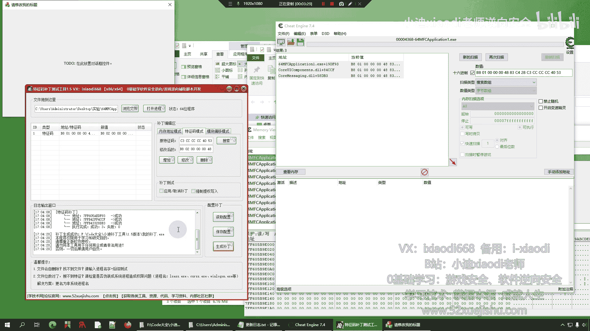
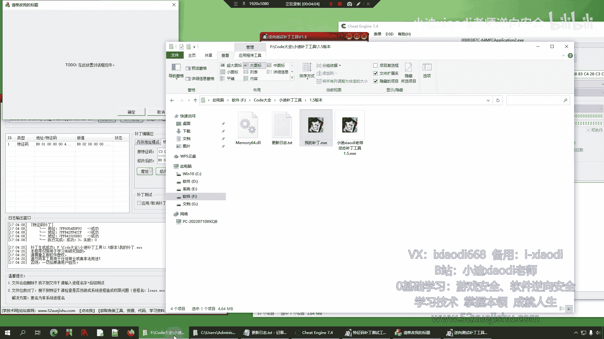
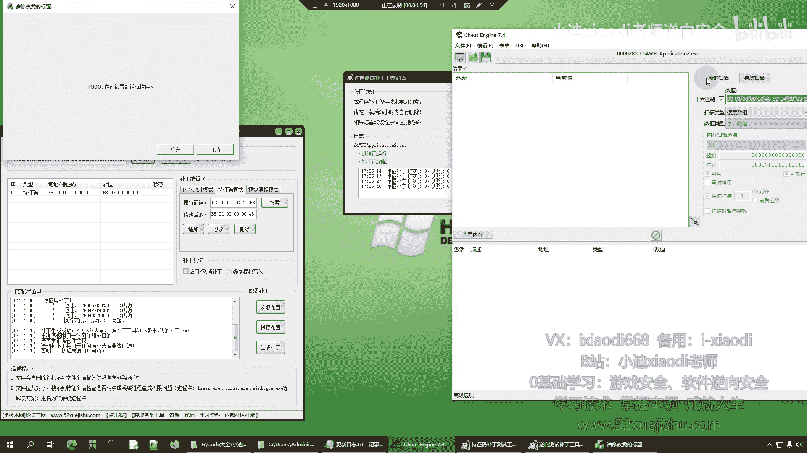
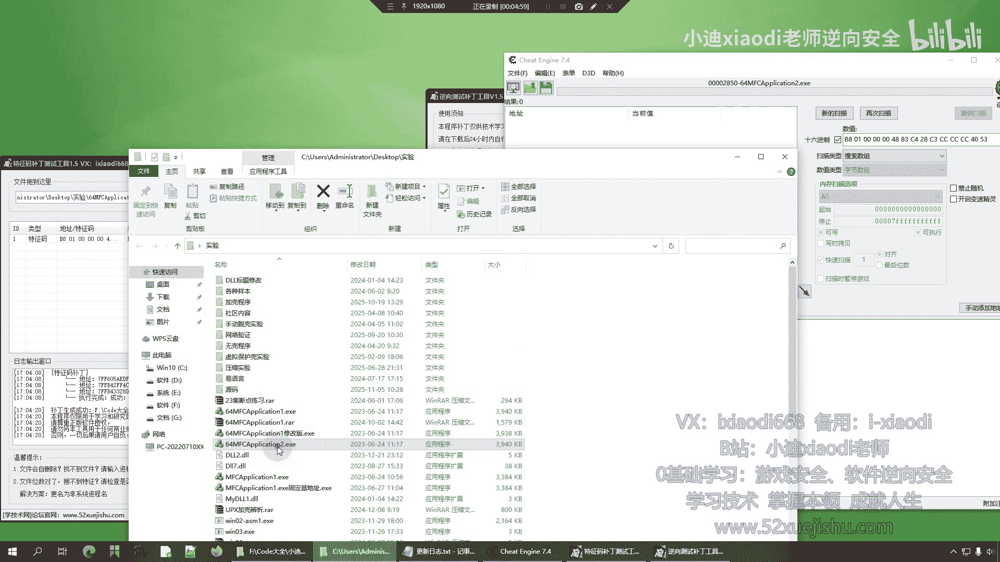
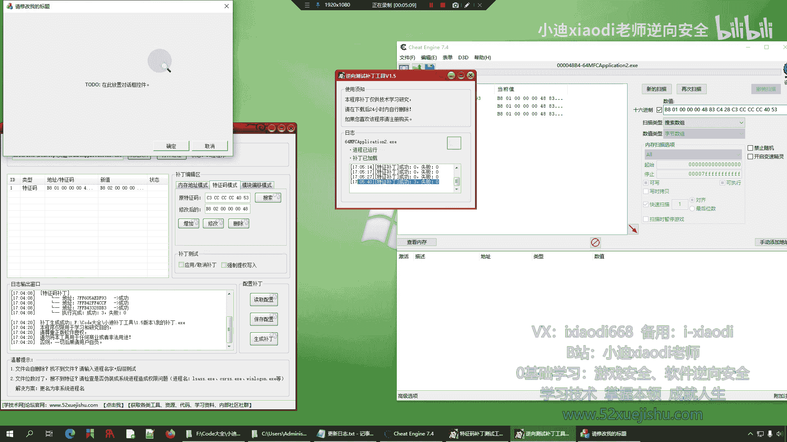
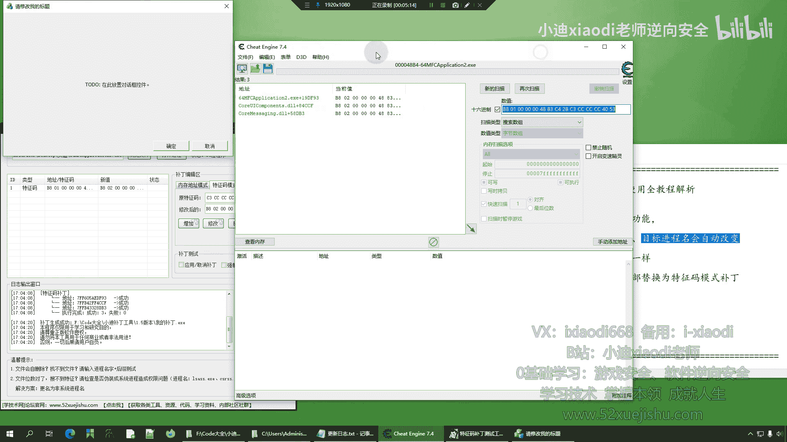
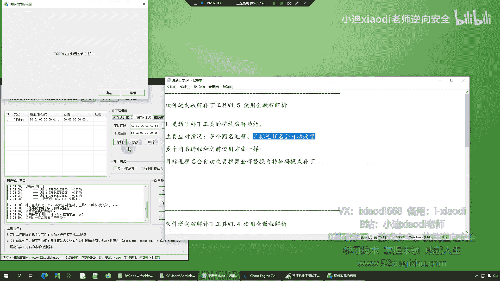
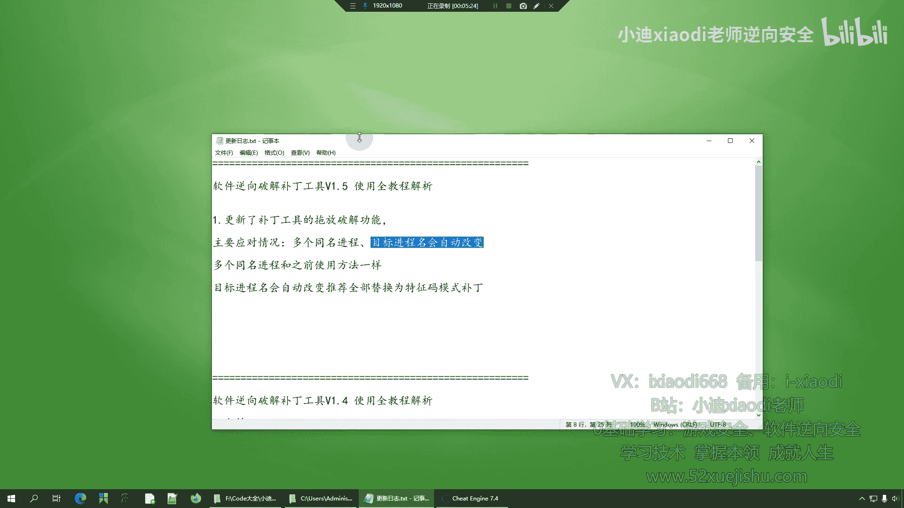

# 软件逆向破解补丁工具教程：第一章：拖放破解补丁功能详解

## 🎯 概述

在本节课中，我们将要学习软件逆向破解补丁工具V1.5版本的更新情况。这次更新主要带来了拖放破解补丁功能，这个功能是为了解决大家在实战过程中遇到的两个典型问题：多个同名进程的处理，以及目标进程名自动改变的应对。我们会通过实际演示来了解如何使用拖放功能生成自己的软件逆向破解补丁。这些内容对于从事游戏安全、软件安全、网络安全、CTF竞赛以及逆向工程（RE）的朋友们来说都很有价值。

## 📌 本次更新的背景与动机

软件逆向破解补丁工具V1.5的核心更新点在于拖放破解补丁功能。这个功能的推出源于实际实战中遇到的一些具体情况，我们来逐一分析这些问题场景。

### 🔄 多个同名进程的补丁难题

在实际实战过程中，大家可能会遇到这样一种情况：同时存在两个窗口的游戏，而这两个窗口对应着不同的进程ID。在这种情况下，之前的补丁工具只能对其中一个软件或游戏进行补丁操作，无法同时处理多个进程。

> 举个具体例子：有两个窗口的游戏，第二个进程的进程ID与第一个不同。补丁工具在操作时会出问题，它只能补丁到一个软件上。

有同学提议说直接弄个光标绑定进程，于是这个功能在今天到来了。这就是拖放破解补丁功能的核心价值所在。

### 🎲 目标进程名自动改变的情况

第二个典型场景是目标进程名会自动改变。有些程序每次运行时，进程名称可能是随机的。以前的做法是把这个名字输入到工具界面中，然后点击打开进程就可以测试。但是生成的补丁工具，用户没有办法去输入进程的名字，这就导致补丁无法正常工作。

> 用户反馈说：进程名是随机的吗？老师说：你直接把这个名字输入到这个里面，然后点击打开进程就可以测试。但是生成的补丁工具，你没有办法去输入这个进程的名字。

因此，这个版本给大家更新到拖放或拖拽的破解方式。如果你在实际实战过程中碰到相关的问题，尽量提出一些有针对性的建议，人多力量大，对吧？三个臭皮匠还顶个诸葛亮呢。

## 🛠️ 多个同名进程的使用方法

多个同名进程的操作方法和之前基本上是一样的，核心在于定位目标内存地址的模式。这里我们需要理解补丁工具的三种定位方式：内存地址、特征码和模块偏移。这三种方式各有各的适用场景。

以下是三种定位方式的说明：

- **内存地址**：如果你知道目标地址，直接填写内存地址即可
- **特征码**：如果你知道目标数据的字节特征，使用特征码模式
- **模块偏移**：如果目标位置相对某个模块有固定偏移，使用模块偏移模式

这三种方式的使用逻辑与之前完全相同，选择合适的方式填写配置，然后生成补丁即可。

## 🧩 目标进程名自动改变的应对策略

这部分功能是本次更新的重点，我们来详细了解应对进程名自动改变的策略。

### 📐 特征码模式的优先推荐

对于进程名会动态变化的情况，我们推荐全部替换为特征码模式来进行补丁。之所以推荐特征码模式，是因为存在一个核心逻辑：进程名会改变，导致模块名大概率也会变动，因为软件是死的，所以直接填写进程名生成的补丁可能无法识别目标。内存地址也有可能会发生变动，因为这些地址往往会随之变化。

当然，如果这是固定机制，内存地址不会发生改变。这个需要大家自己测试，还是要具备一定的理论知识基础才可以。

特征码模式是最傻瓜式的，因为特征码是永远不会变的。所以我推荐大家全部切换为特征码模式进行补丁。

核心公式可以表述为：

```
进程名 = 随机变化 → 模块名 = 可能变化 → 内存地址 = 可能变化
特征码 = 固定不变 → 推荐使用特征码模式
```

## 💻 实战演示：进程名会改变的情况

接下来我们演示一下进程名会改变的情况下的补丁操作流程。这里我们会完整走一遍从运行工具到生成补丁的整个流程。

### 🔍 运行工具与初始配置

首先把工具运行起来，现在我已经运行起来了。我们来模拟一下：假如一开始这个程序叫某个名字，然后我们把它拖过来运行起来，点击打开进程，读取之前的一个配置。我们把内存地址先删掉，点击内存地址，然后点击删除。



此时我们可以观察一下补丁的效果。以下是具体的操作流程：



1. 点击查看内存
2. 搜索特征码
3. 勾选字节数组
4. 扫描匹配数据

好，这个特征码是这个，然后我们勾选上字节数组，扫一下，看到没有？一共有三个数据。这个时候应用一下，改成02了，对吧？取消，OK可以了。

### 📝 生成补丁文件

配置完成后就可以生成补丁了。我们生成一个补丁，名字叫做“我的补丁”，然后点击保存。看起来一切都是没有什么问题的，对吧？

但是有一个问题：当程序下一次运行的时候，它不叫64MFC application一了，它叫二了。这时候问题来了，虽然特征码是一样的，但是生成补丁的时候进程名检测的是第一进程名，而那个进程没有运行，现在名字已经改了，所以找不到目标进程。



### 🎯 拖放补丁操作演示



这个时候我们就要用到拖放功能了。来看具体操作演示：

> 点击这个拖放按钮，按住不要松，拖到目标程序上再松开。如果你中途松手的话，就会补丁到你自己开发工具这个程序上，所以一定要按住不要松。拖到目标程序上，你再松开。

这样就能补丁上了。我们再来一遍：运行目标程序，注意按住不要松，拖到目标程序上再去松，看到没有？补丁成功。



再去看一下，重新打开扫描，这个时候是B801，按住不要松，拖到这个上面再松，看到没有？变成02了。



补丁公式可以概括为：



```
按住拖放按钮 → 不松手 → 拖拽至目标进程窗口 → 松手 → 补丁完成
```

## 📋 总结



本节课中我们一起学习了软件逆向破解补丁工具V1.5的更新情况。我们了解了两个核心问题的解决方案：多个同名进程的处理方式，以及目标进程名自动改变时的应对策略。核心要点是：特征码永远不变，所以在进程名动态变化时，推荐使用特征码模式并配合拖放功能进行补丁。

通过实际演示，大家掌握了拖放破解补丁的完整操作流程：按住拖放按钮不松手、拖拽到目标程序上再松手，即可完成补丁操作。如果在实际实战过程中碰到相关的问题，欢迎提出建议。下次见。
