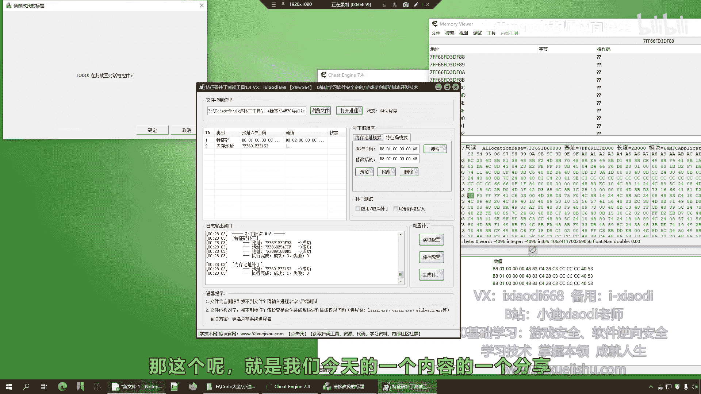

# 🛠️ 软件逆向破解补丁工具：第1章：内存破解补丁工具 V1.4 使用方法

## 📘 课程概述

本节课将介绍动态内存破解补丁工具 V1.4 的基本使用方法。该工具主要用于软件安全、游戏安全、网络安全、CTF、逆向工程以及反汇编分析等场景，可以帮助用户对目标程序的内存数据进行临时修改和测试。

本节内容会依次介绍工具支持的程序类型、特征码补丁、内存地址补丁、只读内存写入、配置保存与读取，以及实际测试流程。通过这些内容，初学者可以了解如何建立工具与目标程序之间的联系，并完成一次完整的内存补丁测试。

> 使用此类工具时，应确保目标程序属于自己或已经获得合法授权，避免对未授权的软件、游戏或系统进行修改。

---

## 🧩 一、工具支持的核心功能

上一节介绍了本课程的整体内容，下面先了解动态内存破解补丁工具 V1.4 具备哪些主要功能。掌握这些功能后，后续的实操步骤会更加容易理解。

以下是该工具支持的主要功能：

1. **支持 x86 和 x64 程序**

   工具支持 32 位程序和 64 位程序，也就是常见的 x86 程序与 x64 程序。

   可以简单表示为：

   ```text
   支持架构 = x86（32 位）+ x64（64 位）
   ```

2. **支持内存地址特征码模式补丁**

   工具可以根据一段特征码查找内存地址，然后对匹配到的内存位置进行补丁。

   特征码模式通常可以表示为：

   ```text
   特征码 → 搜索匹配地址 → 修改匹配地址中的数据
   ```

   用户既可以使用特征码模式进行补丁，也可以直接使用内存地址模式进行补丁。

3. **支持只读权限地址的提权写入**

   如果目标程序对某段内存设置了只读权限，只允许读取而不允许写入，工具可以尝试提升权限后进行写入。

   其基本逻辑可以表示为：

   ```text
   只读内存 → 提升写入权限 → 写入补丁数据
   ```

   这一功能主要用于处理目标程序存在内存保护，导致普通写入失败的情况。

4. **支持保存和读取配置**

   工具支持保存当前补丁配置，也支持重新读取以前保存的配置。这样可以方便用户进行多次破解测试，不需要每次都重新输入补丁内容。

---

## 🚀 二、准备目标程序并建立连接

了解工具的功能后，下面开始介绍具体使用方法。首先准备一个名为“6rs6”的程序，并将它运行起来。

假设我们已经在这个程序中找到了几个需要测试的破解点。所谓破解点，就是需要修改程序内存数据的位置，或者需要替换数据的特征位置。

在进行修改之前，需要先把目标程序拖入工具界面。这样，目标程序和补丁工具之间就可以建立联系。

接下来，按照以下步骤操作：

1. 运行目标程序。

2. 打开动态内存破解补丁工具。

3. 将目标程序拖入工具窗口。

4. 点击“打开进程”。

完成进程打开后，工具界面会显示相应提示，表示工具已经连接到目标程序。


---

## 🔍 三、使用特征码搜索破解点

建立进程连接后，就可以使用工具搜索特征码。假设已经找到三个需要进行测试的破解点，并且这三个位置具有相同或对应的特征。

下面是具体操作流程：

1. 将目标特征码输入工具。

2. 点击“搜索”。

3. 等待工具完成内存扫描。

工具会提示匹配到的地址数量。例如，工具可能显示：


```text
特征匹配的地址有 3 个
```

如果工具搜索到的地址与前面分析得到的地址一致，例如出现 `93CF`、`B3` 等地址信息，就说明搜索结果与预期相符。

特征码搜索的基本过程可以表示为：

```text
输入特征码
    ↓
扫描目标进程内存
    ↓
得到匹配地址
    ↓
选择需要修改的地址
```


---

## ✏️ 四、添加并应用特征码补丁

搜索到目标地址后，就可以设置新的数据。假设原来的数据是 `01`，现在需要将它修改为 `02`。

在这种情况下，可以按照以下步骤操作：

1. 找到原始特征码。

2. 将原始数据 `01` 修改为目标数据 `02`。

3. 点击“增加”。

4. 确认补丁已经显示在补丁列表中。

补丁修改可以用下面的形式表示：

```text
原数据：01
新数据：02

补丁规则：01 → 02
```

添加完成后，如果希望立即测试修改效果，可以点击“应用”或“应用补丁”。

应用补丁后，目标程序中的相关数据会从 `01` 变成 `02`。工具界面中还会显示当前补丁批次和执行结果。

例如：

```text
补丁类型：特征码补丁
执行结果：成功 3 个，失败 0 个
```

如果显示成功 3 个、失败 0 个，说明三个匹配到的地址都已经完成修改。


---

## ⚠️ 五、处理补丁写入失败的情况

如果工具显示部分补丁执行失败，通常可能存在以下原因：


以下是常见的失败原因：

- 目标内存地址已经失效。

- 目标程序重新分配了内存。


- 当前进程没有足够的写入权限。

- 目标地址属于只读内存区域。

当补丁写入失败时，可以尝试勾选工具中的提权选项，然后再次点击“应用”。

处理流程可以表示为：

```text
补丁写入失败
    ↓
检查地址是否有效
    ↓
勾选提权写入选项
    ↓
再次应用补丁
    ↓
查看执行结果
```

如果提权后仍然失败，则需要重新检查目标地址、特征码以及目标程序当前状态。

---

## 🧭 六、使用内存地址模式补丁


除了特征码模式，工具还支持直接通过内存地址进行补丁。上一节我们介绍了如何通过特征码找到多个匹配地址，本节介绍如何直接修改指定地址。

首先点击“查看内存”，然后在内存区域中选择一块需要测试的内存。

假设在某个位置发现原始数据为 `00`，并且希望将它修改为 `11`。此时需要先复制对应的内存地址，然后将地址粘贴到工具的内存地址输入框中。

内存地址补丁的基本结构如下：

```text
内存地址：0xXXXXXXXX
原始数据：00
修改数据：11
```

具体操作步骤如下：

1. 点击“查看内存”。

2. 找到需要测试的内存位置。

3. 复制该内存位置的地址。

4. 将地址粘贴到内存地址输入框。

5. 填写原始数据 `00`。

6. 填写目标数据 `11`。

7. 点击“增加”。

此时，内存地址补丁就会被加入补丁列表。

其补丁逻辑可以表示为：

```text
地址 A：00 → 11
```

---

## 🧪 七、同时测试两种补丁

在使用内存地址模式补丁时，需要注意工具中补丁类型的勾选状态。如果之前已经勾选了相关选项，可以先取消勾选，再根据当前测试需求重新勾选。

完成设置后，再次点击“应用”，工具会分别统计特征码补丁和内存地址补丁的执行结果。

例如：

```text
特征码补丁：成功 3 个
内存地址补丁：成功 1 个
```

这表示三个特征码匹配位置和一个指定内存地址都完成了修改。

工具还会记录当前补丁批次。例如：

```text
补丁批次：第 2 次测试
```

这样可以帮助用户区分不同阶段的测试结果，避免混淆之前的修改记录。

---

## 🔄 八、还原补丁与保存配置

测试完成后，可以先还原已经应用的补丁，使目标程序恢复到修改前的状态。

完成还原后，如果希望下次继续使用相同的补丁配置，可以点击“保存配置”。

保存配置时，需要选择保存位置和文件名。例如，可以将配置保存为：

```text
某程序的特征补丁
```

或者：

```text
某程序的补丁
```

保存操作的流程如下：

1. 点击“保存配置”。

2. 选择需要保存的文件夹。

3. 输入配置文件名称。

4. 点击“保存”。

5. 等待工具提示保存成功。

配置文件保存的作用是记录以下内容：


- 特征码补丁。

- 内存地址补丁。

- 原始数据。

- 修改后的数据。

- 相关补丁批次信息。

通过保存配置，可以避免每次重新查找地址和填写数据，方便后续重复测试。

---

## 📂 九、读取配置并继续测试

保存配置后，可以关闭目标程序和补丁工具，然后重新启动工具。

重新测试时，需要先将要分析的目标程序拖入工具，再点击“打开进程”。完成进程连接后，点击“读取配置”。

以 V1.4 版本为例，打开之前保存的配置文件，工具会将配置内容重新显示在补丁列表中。

重新读取后的补丁可能包括以下内容：

```text
补丁 1：00 → 11
补丁 2：01 → 02
```

读取配置后，可以继续点击“应用”进行测试。

例如，工具会将一个位置的 `00` 修改为 `11`，将另一个位置的 `01` 修改为 `02`。应用完成后，可以重新查看目标程序内存，确认数据是否已经发生变化。

验证结果可以表示为：

```text
原始状态：
00，01

应用补丁后：
11，02
```

如果内存中的数据已经从 `00` 变为 `11`，并且从 `01` 变为 `02`，说明补丁已经成功生效。

---

## 🖱️ 十、工具稳定性与问题反馈

完成配置读取后，可以根据测试需要多次点击应用按钮。工具支持较快或较慢的操作频率，整体稳定性较好。

在正常情况下，即使连续快速点击应用按钮，目标程序也不会因为工具操作而崩溃。工具的使用速度可以根据实际测试需求进行调整。

如果在测试过程中出现程序崩溃，可以向工具开发方提交 Bug。相关联系方式包括：

- 微信联系方式。

- 官方网站。

- 内部社区。

用户可以通过官方内部社区获取工具和相关信息，也可以在那里反馈使用过程中遇到的问题。

---

## ✅ 课程总结

本节课介绍了动态内存破解补丁工具 V1.4 的完整使用流程。

本节主要学习了以下内容：

- 工具支持 x86 和 x64 程序。

- 工具支持特征码模式补丁。

- 工具支持直接使用内存地址进行补丁。

- 工具支持对只读内存进行提权写入。

- 可以通过“打开进程”建立工具与目标程序之间的联系。

- 可以搜索特征码并获得匹配地址。

- 可以将原始数据 `01` 修改为 `02`。

- 可以将内存地址中的 `00` 修改为 `11`。


- 可以查看特征码补丁和内存地址补丁的执行结果。

- 可以还原已经应用的补丁。

- 可以保存补丁配置。



- 可以读取以前保存的配置并继续测试。

整体流程可以概括为：

```text
运行目标程序
    ↓
打开补丁工具
    ↓
拖入目标程序
    ↓
打开进程
    ↓
搜索特征码或填写内存地址
    ↓
设置原始数据和目标数据
    ↓
增加补丁
    ↓
应用补丁
    ↓
查看执行结果
    ↓
还原、保存或读取配置
```

通过本节内容，初学者可以掌握动态内存补丁工具的基础操作方法，并理解特征码补丁与内存地址补丁之间的区别。实际使用时，应先确认目标地址和原始数据，再进行修改和验证，同时确保相关操作符合授权范围和安全规范。

