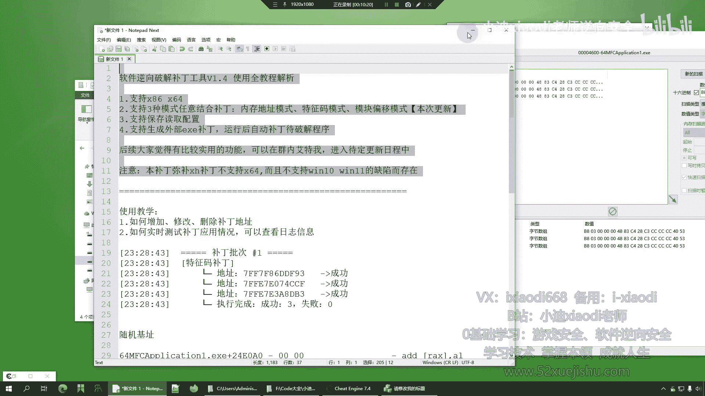

# 软件逆向破解补丁工具教程：第1章：使用全教程解析

## 软件逆向破解补丁工具教程：第1.1节：功能概述

大家好，我是小迪老师。今天我们要学习的内容，是软件逆向破解补丁工具 1.4 版本的使用全教程。这个工具是我们自己开发的补丁工具，专门用于软件逆向、破解、反汇编、安全研究等场景。与常见的补丁工具相比，它最大的特点就是同时支持 32 位和 64 位程序，并且在功能设计上加入了更多便于实时测试的选项。


在正式操作之前，我们可以先把工具的整体功能梳理一遍。这样在后续动手的时候，你会对每一步背后的设计目的有更清晰的认知。该工具主要提供以下功能：


- 支持 x86 程序与 x64 程序。
- 支持三种补丁模式，分别是内存地址模式、特征码模式、模块偏移模式。三种模式可以任意添加、组合使用。模块偏移模式是本次版本更新新加入的。
- 支持保存和读取配置。你可以把当前编辑好的补丁内容保存为配置文件，下次直接读取，不必反复手动输入。
- 支持生成外部 EXE 补丁。生成的补丁运行后，可以自动对目标程序完成补丁操作。

另外，如果你觉得还有哪些实用功能应该加入，可以在群里艾特我，我会把这些需求放到待定更新的日程里。

这里还要多说一句：这个补丁工具并不是凭空出现的。它是为了弥补“XH 补丁”（也就是大家常说的“叉H补丁”）的缺陷而开发的。XH 补丁在逆向破解圈子里有不少人知道，但它不支持 64 位程序，也不支持 Win11 和 Win10 系统，存在一定局限。我们开发的这个工具，就是为了弥补这些缺陷，朝着更兼容、更实用的方向去发展。因此，如果你正在寻找一个能够应对现代操作系统的补丁工具，这一套流程应该能帮到你。

## 软件逆向破解补丁工具教程：第1.2节：使用前的准备


在真正开始添加补丁之前，需要先做好准备工作。首先，我们要确保两个补丁文件都存在。这个工具包含两个文件，运行起来后主界面会出现。在演示过程中，我会先把工具关闭，再重新手动打开一次，这和实际使用流程一致。注意，其中的一个文件是知识库文件，它把许多底层功能都封装在了里面。因此，这两个文件缺一不可，不要随意删除或丢失。

然后，我们需要运行目标程序。比如我们要破解的程序是某个 64 位应用程序，那么先把它运行起来，然后切换到补丁工具界面，将目标程序的窗口拖入工具中。拖入之后，点击“打开进程”。此时，工具下方的日志区域会显示“已附加进程”，并列出进程的 ID 和进程名。例如，日志中会出现：


```text
附加进程成功，进程 ID: 12345，进程名: target.exe
```

到这里，我们已经完成了进程附加。接下来可以进行具体的补丁测试。如果你使用 Cheat Engine（简称 CE）来辅助分析，还需要用 CE 附加同一个目标进程。附加成功后，可以把常用的地址保存到地址列表中，方便后续查看和修改。CE 的地址列表相当于一个工作台，它可以帮助你快速定位到需要打补丁的内存区域。


## 软件逆向破解补丁工具教程：第1.3节：特征码模式的使用

我们先从特征码模式开始。特征码模式是目前非常实用的一种模式，它的核心思想是：不依赖固定地址，而是通过一段字节序列在目标程序中搜索匹配位置。只要程序中的特征码唯一，就能准确定位到要修改的位置。


在工具界面中切换到“特征码模式”，然后将你在分析中得到的一段特征码复制过来。比如，我们有一段特征码 `B8 01 00 00 00`。把它粘贴到特征码输入框中，点击“搜索”。工具会在目标进程的内存中搜索匹配该特征码的地址。搜索完成后，日志或者列表中会显示匹配结果。例如，提示“特征匹配地址有 3 个”，这 3 个地址可能会显示为 `DF93`、`CCF`、`DB3`（这里仅作示例），分别对应目标进程中的不同位置。


如果我们要修改这些位置，需要把原始字节和修改后的字节都填写好。比如我们要把原来值为 `01` 的字节改成 `02`，具体操作如下：

- 在特征码输入框中粘贴待匹配的特征码。
- 在“修改为”一栏填写 `02`。
- 点击“增加”，这条补丁就会出现在补丁列表中。

在补丁列表中，每一条补丁都有一个勾选框。勾选它，就表示应用这条补丁；取消勾选，就表示还原补丁。这也就是所谓的“实时测试补丁”功能。你可以立刻看到目标进程中的内存值是否发生了变化。同时，日志信息会记录本次测试的补丁批次，告诉你哪些成功、哪些失败，以及成功的数量是多少。可以复制这些日志内容，方便后续分析。同理，如果特征码补丁的值也要调整，比如把修改值从 `02` 调整为 `03`，修改后再应用，特征码位置会变成 `03`，其他位置的补丁仍然按自己的规则变化。

特征码模式适合那些程序每次启动后地址都会变化的情况，因为特征码是跟着代码内容走的，不依赖进程基址。对于初学者来说，只需要记住一个公式：


```text
匹配地址列表 = 在目标内存中搜索(特征码)
```

之后，对匹配到的每一个地址，都可以执行“应用补丁”或“取消补丁”的操作。

## 软件逆向破解补丁工具教程：第1.4节：内存地址模式的使用

接下来看看内存地址模式。内存地址模式比较直白，它直接指定某个内存地址，然后把它原来的值改成我们想要的值。假设我们在 CE 中找到了一个静态地址，那么就可以把这个地址添加到补丁工具中。

操作步骤是这样的：在 CE 中右键点击某个内存区域，选择“转到地址”，得到一个具体的内存地址。随后，在补丁工具中切换到“内存地址模式”，把这个地址填写进去。注意，这里有一个容易踩坑的细节：原始数据是 `00` 时，你要填写 `00`，不要只填一个 `0`。因为工具要求填写十六进制文本，而且严格使用两个字符表示一个字节。


比如，某个内存地址的原始数据是 `00`，我们希望把它改成 `01`。那么在“原始数据”栏填 `00`，在“修改为”栏填 `01`，点击“增加”。此时，补丁列表中就多了一条内存地址补丁。如果同时还存在特征码补丁，那么点击“应用补丁”后，两处内存会同时发生变化。特征码补丁所在位置的 `01` 会变成 `02`，内存地址补丁所在位置的 `00` 会变成 `01`。取消补丁后，这些值又会恢复原状。

如果发现自己填错了，也可以直接修改列表中的已有补丁。比如刚才添加的 `01` 改错了，我们希望改成 `02`，那么先选中这一条，然后点击“内存地址模式”标签（因为它是内存地址模式的补丁），把值改成 `02`，再点击“修改”。列表中就会显示更新后的值。再次应用补丁时，目标位置就会变成 `02`。同样的操作也适用于特征码模式，修改后的效果可以立刻在目标程序中看到。

删除补丁的操作也需要留意模式切换。如果一条补丁属于“内存地址模式”，那么你需要先点击“内存地址模式”标签，再选中这条记录，点击“删除”。删除后，再应用其他补丁时，这一处地址就不会再被修改，其他地址仍然会按预设定改变。例如，删除了内存地址补丁后，再应用补丁，你会发现特征码位置会改变，而内存地址位置不改变；取消应用又恢复原状。你可以通过这种勾选和取消的方式，反复验证每个补丁是否按照预期工作。

内存地址模式的核心逻辑可以表示为：

```text
应用补丁时：目标地址的字节 = 修改值
取消补丁时：目标地址的字节 = 原始值
```

这就是最直接的补丁方式，适合那些地址固定不变的场景。

## 软件逆向破解补丁工具教程：第1.5节：模块偏移模式的使用


现在来看模块偏移模式。这一种模式主要是为了解决“随机基址”问题。什么是随机基址？简单来说，某些程序出于安全机制，每次运行时都会把模块加载到不同的内存地址，导致同一个变量的地址每次都不同。如果你直接使用绝对地址，那么下一次程序运行后，这个地址就失效了。

应对随机基址，我们需要把“模块名”和“偏移量”分开处理。因为我们知道，程序运行时，模块的基址会变，但模块内部，某个变量相对于模块基址的偏移通常是固定的。因此，只要我们在运行时动态获取模块的基址，再加上固定的偏移，就能得到真实地址。这个思路用公式表示就是：

```text
真实地址 = 模块基址 + 偏移量
        = GetModuleHandle(模块名) + 偏移量
```

那么，偏移量如何获取呢？这里可以顺带教大家一个小技巧。比如在 CE 中，我们找到一个静态地址，它通常显示为绿色。右键转到该地址，你会看到它由一个模块名和一个偏移组成，比如 `模块名+2410A0`。实际上，这个模块名和偏移在 CE、DBG 等调试工具中都能看到。在 CE 中，如果默认没有显示模块地址，可以点击菜单栏的“视图”，勾选“显示模块地址”。这样一来，CE 会以“模块名+偏移”的形式显示所有地址。用 CE 来获取模块名和偏移是最方便的，如果你手动计算，需要一定的理论基础，而且容易出错。

现在回到补丁工具。在模块偏移模式下，我们需要填入模块名和偏移量。模块名这里不需要写成一个固定地址，因为每次启动程序后，模块的基址都可能变化。工具会在应用补丁时，实时获取该模块的句柄（即模块的基址），然后加上我们填写的偏移量，最终定位到目标地址。偏移量同样使用十六进制文本，例如 `2410A0`。

假设目标位置的原始数据是 `0000`，我们希望改成 `1122`，那么操作过程是：


- 在模块名栏输入模块名。
- 在偏移栏输入 `2410A0`。
- 在原始数据栏输入 `0000`。
- 在修改数据栏输入 `1122`。
- 点击“增加”。

这条补丁就会出现在补丁列表中。点击“应用补丁”时，工具会自动解析模块基址 + 偏移，并将该位置的 `0000` 改为 `1122`。取消补丁时，又还原为 `0000`。模块偏移模式让补丁不再依赖于每次都会变化的绝对地址，而是依赖于“模块名 + 偏移”的稳定关系。即使进程重启、程序重启，只要模块名和偏移不变，补丁就能继续生效。这也是三种模式中最适合对抗随机基址的一种。

## 软件逆向破解补丁工具教程：第1.6节：保存与读取配置

在测试过程中，你可能会遇到这样的情况：补丁已经调试好了，但工具一关，刚才填写的地址和数据就全没了，下一次还要重新录入一遍。为了节省时间，补丁工具提供了配置保存功能。


当你已经把特征码补丁、内存地址补丁或模块偏移补丁都添加到列表中后，可以点击“保存配置”。这时会弹出一个文件保存窗口，你可以随便起一个名字，比如“某64位程序最新补丁”，然后点击保存。工具会提示“保存成功”。这样，当前所有补丁内容都会写入到配置文件中。


之后，即使我们关闭补丁工具再重新打开，也可以通过“读取配置”功能把之前的补丁内容加载回来。你可以先拖入目标程序再读取配置，也可以不拖入程序直接读取配置。读取成功后，配置中的补丁列表会自动出现在界面上。如果还需要继续分析，再把目标程序拖入并点击“打开进程”就好。这个流程可以用简单的代码来描述：


```text
保存配置：当前补丁列表 -> 配置文件
读取配置：配置文件 -> 当前补丁列表
```

配置功能的核心价值在于“复用”。你不需要在每次测试时都手动输入一模一样的特征码和修改值。对于需要反复调试的破解工作来说，这一点非常省事。如果你是团队协作，还可以把配置文件分发给同组的人，让他们直接加载相同内容进行测试。

## 软件逆向破解补丁工具教程：第1.7节：生成外部补丁


除了在工具内部实时测试外，有时候我们希望把补丁打包成一个独立运行的 EXE，这样即使没有安装补丁工具，别人也能直接运行补丁程序来完成打补丁。生成外部补丁的入口很简单，点击工具界面上的“生成补丁”按钮。


点击后，工具会自动定位到当前目标程序所在的目录，并弹出保存窗口。你可以给补丁程序起一个名字，例如“我的补丁”，点击保存，工具会提示“补丁生成成功”。同时，工具还会弹出一段提示文字，内容大致是：本程序仅限用于学习和研究目的，请尊重正版软件授权，请勿将本工具用于任何商业或者非法用途，否则一切后果由用户自负。这里需要特别提醒一下：生成出来的补丁不能单独发给别人。你需要把两个文件放在一起打包，一个是生成的补丁 EXE，另一个是之前提到的知识库文件。也就是说，必须把这两个文件同步打包到一个压缩包里，别人拿到的压缩包并解压后，补丁才能正常工作。如果只发一个 EXE，缺少知识库文件，补丁运行时会因为找不到依赖而失败。

我们来做一个小测试。假设当前配置中有一条内存地址补丁，要把 `01` 改成 `03`；还有一条模块偏移补丁，要把 `0000` 改成 `1122`。生成补丁后，先关闭补丁工具，然后运行“我的补丁”。运行后，工具会显示提示信息，说明补丁已经成功应用，并打印目标进程的进程 ID、目标进程名称以及加载路径等信息。此时，你可以去目标程序里检查，会发现内存值已经变成了 `03` 和 `1122`。也就是说，外部补丁的工作方式与工具内部实时测试完全一致，只是把操作入口封装到了独立程序中。

外部补丁的工作流程可以概括为：

```text
启动补丁程序 -> 附加目标进程 -> 按配置应用所有补丁 -> 提示补丁成功
```

这种模式非常适合把已经调试好的补丁分发给其他环境使用，也便于保留现场记录。

## 软件逆向破解补丁工具教程：第1.8节：总结与注意事项


本节课我们一起学习了软件逆向破解补丁工具 1.4 版本的核心功能与操作方法。从整体功能来看，它支持 x86 和 x64 程序，支持特征码模式、内存地址模式、模块偏移模式这三种补丁模式的任意组合。通过保存/读取配置，我们可以反复使用同一套补丁内容；通过生成外部 EXE 补丁，我们可以把补丁独立分发给他人使用。


在实践中，我们首先需要准备好两个工具文件，然后把目标程序拖入补丁工具并附加进程。接着，根据需要选择不同的模式来添加补丁。特征码模式适合地址不固定的场景，内存地址模式适合绝对地址不变的场景，模块偏移模式则专门用于应对随机基址。测试时，可以使用勾选框实时应用/取消补丁，并通过日志确认补丁是否生效。最后，可以把调试好的补丁内容保存为配置，或者生成外部补丁并连同知识库文件一起打包分发。

需要再次强调的是，这个工具的设计初衷是弥补 XH 补丁不支持 64 位、不支持 Win11/Win10 的缺陷。如果你在逆向破解工作中遇到了地址漂移、系统兼容性等问题，可以优先考虑使用模块偏移模式和特征码模式。当然，工具仅限用于学习和研究目的，请尊重正版软件授权，不要将本工具用于商业或非法用途。



如果在使用过程中发现 bug，或者有任何疑问，可以通过哔哩哔哩主页或微信联系小迪老师，提交问题并获取最新版本的程序。我们下期再见。
