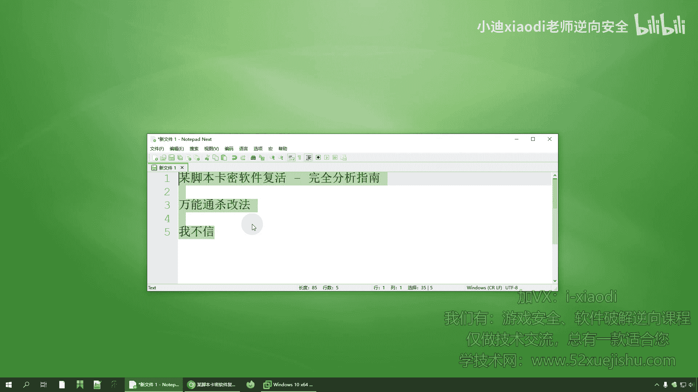

# 【软件安全分析】：第1章：授权校验与过期提示的合规分析 🛡️

## 课程概述 📘

本节课将学习如何在获得软件作者明确授权的前提下，分析桌面软件中的登录流程、授权校验、过期提示和调试信息。


原内容以“破解外挂登录加密、绕过卡密过期并恢复使用”为主题，涉及修改第三方软件运行逻辑、伪造正版授权数据以及绕过付费限制。这类行为可能侵犯软件著作权、破坏授权机制，也可能违反软件服务协议。因此，本教程不提供破解、绕过授权或伪造卡密的操作步骤。

我们将把相关内容整理为一套合规的安全分析方法，适用于自研软件、经过授权的测试样本、教学程序和开源项目。这样既能理解逆向分析的基本思路，也能避免对他人的软件造成损害。


## 一、理解逆向分析的用途 🔍

上一部分明确了学习边界，下面先了解逆向分析到底能做什么。逆向工程并不等于破解，它也可以用于安全审计、兼容性研究、故障排查、恶意代码分析和软件保护设计。

以下是逆向分析的常见合法用途：

- 分析自己开发的软件为什么出现崩溃。

- 检查程序是否存在明显的安全漏洞。

- 验证授权校验逻辑是否容易被篡改。

- 研究恶意软件的行为和通信方式。

- 对开源项目进行调试和功能改进。

- 在获得许可后，对商业软件进行安全测试。

对于付费软件，正确做法是联系软件作者、购买合法授权、申请试用延期或提交故障报告。不能因为软件停止维护、服务器关闭或卡密失效，就直接修改程序以继续使用。


## 二、授权机制的基本模型 🔐

在合规分析中，需要先理解授权验证通常由哪些部分组成。一个常见的授权流程可以抽象为：

```text
用户输入授权信息
        ↓
客户端提交验证请求
        ↓
服务器检查授权状态
        ↓
服务器返回验证结果
        ↓
客户端显示成功、失败或过期提示
```

授权结果可以用一个简单的逻辑表达：

\[
\text{Allow} =
\text{SignatureValid}
\land
\text{NotExpired}
\land
\text{DeviceAllowed}
\land
\text{ServerApproved}
\]

其中：

- `SignatureValid` 表示授权数据的签名正确。

- `NotExpired` 表示授权尚未超过有效期。

- `DeviceAllowed` 表示当前设备符合绑定条件。

- `ServerApproved` 表示服务器确认该授权仍然有效。

只要其中一个条件不满足，程序就可能显示“授权过期”“登录失败”或“设备未绑定”等提示。实际产品通常还会增加时间同步、请求重放防护、服务器随机数和完整性校验等机制。

## 三、分析登录和提示流程 🧭

上一节介绍了授权系统的基本组成，本节中我们来看如何在授权样本中观察程序流程。

调试工具可以帮助开发者查看自己程序的运行状态。使用这类工具时，应确保目标程序属于自己，或者已经获得软件作者和版权所有者的书面许可。

在测试环境中，可以按照以下思路进行观察：

1. 启动经过授权的测试程序。

2. 记录输入登录信息后出现的提示内容。

3. 观察程序是否进入网络请求、数据解析和结果判断等阶段。

4. 为自有程序中的关键函数添加断点。

5. 程序暂停后，查看调用栈和当前变量。

6. 返回上一层调用位置，确认当前函数由谁调用。

7. 记录每一层函数的输入、输出和错误处理逻辑。

断点可以理解为程序执行过程中的“暂停点”。当程序运行到断点位置时，调试器会暂停执行，让开发者检查当前状态。

在调试器中，常见的程序关系可以表示为：

```text
main()
 └── login()
      └── request_server()
           └── parse_response()
                └── show_message()
```

如果程序出现错误提示，可以从显示提示的函数开始，逐层查看调用者，直到找到负责产生判断结果的业务逻辑。这种方法适合定位软件缺陷，但不应被用于修改第三方软件的授权结果。

## 四、理解弹窗与错误处理 💬

很多程序会通过消息框向用户展示状态。例如：

```text
登录成功
授权已过期
服务器连接失败
设备未注册
数据格式错误
```

这些文字只是结果展示，不一定是产生结果的根本原因。开发者需要区分以下三个部分：

- **业务判断**：程序决定授权是否有效。

- **错误处理**：程序决定发生错误后如何继续执行。

- **界面展示**：程序把结果转换成文字、窗口或按钮。

可以使用如下抽象模型表示：

```python
result = verify_license(license_data)

if result.status == "valid":
    open_main_window()
elif result.status == "expired":
    show_message("授权已过期")
else:
    show_message("登录失败")
```

这里的重点是理解程序的控制流程，而不是把失败结果强行改成成功结果。合规调试的目标是确认判断是否符合设计，并修复自己程序中的逻辑错误。

## 五、时间校验与设备标识 ⏱️

上一节介绍了提示信息和错误处理，本节继续分析两个常见的授权要素：时间和设备标识。

### 1. 时间校验

授权系统经常需要判断当前时间是否超过有效期。最简单的判断方式如下：

\[
\text{Valid} =
\text{CurrentTime} < \text{ExpireTime}
\]

示例代码如下：

```python
from datetime import datetime, timezone

def is_not_expired(expire_time: datetime) -> bool:
    now = datetime.now(timezone.utc)
    return now < expire_time
```

实际系统不应完全信任客户端时间，因为用户可以修改本机时钟。更稳妥的做法是使用服务器时间、签名时间戳或具有防重放能力的令牌。

例如，服务器可以返回：

```json
{
  "issued_at": 1710000000,
  "expires_at": 1712592000,
  "nonce": "random-value",
  "signature": "server-signature"
}
```

客户端应验证签名和时间范围，而不是只读取一个可以被本地修改的日期字段。

### 2. 设备标识

部分软件会根据硬件信息生成设备标识，用于限制授权设备数量。设备标识可能由多个信息组合得到：

```text
设备标识 = Hash(主板信息 + 网卡信息 + 系统随机值)
```

可以抽象为：

\[
\text{DeviceID} =
\operatorname{Hash}(
\text{BoardInfo}
\Vert
\text{NetworkInfo}
\Vert
\text{RandomSalt}
)
\]

不过，硬件信息可能变化，也可能涉及隐私问题。因此，设计授权系统时应尽量减少收集内容，并向用户清楚说明用途。不要直接使用未经保护的硬件序列号，也不要把敏感信息明文发送到服务器。

## 六、登录数据与网络封包分析 📦

在授权测试中，网络数据可以帮助开发者确认请求格式、响应格式和错误处理是否正确。

分析自有程序时，可以重点关注以下内容：

- 请求是否使用 HTTPS。

- 授权信息是否在传输前加密或签名。

- 是否包含随机数或时间戳。

- 服务器是否验证请求来源。

- 响应数据是否经过完整性校验。

- 客户端是否错误信任服务器返回的敏感字段。

一个安全的请求结构可以类似于：

```json
{
  "client_id": "example-client",
  "license_id": "example-license",
  "timestamp": 1710000000,
  "nonce": "random-value",
  "signature": "client-signature"
}
```


签名可以抽象为：

\[
\text{Signature}
=
\operatorname{HMAC}(
\text{SecretKey},
\text{RequestBody}
)
\]


服务器验证签名后，再检查授权状态。需要注意的是，客户端不应单独决定“授权成功”，关键授权判断应放在服务器端完成。

## 七、如何设计更安全的授权系统 🧱

通过前面的分析可以看到，如果授权逻辑完全放在客户端，程序就更容易被篡改。因此，软件作者应采用多层防护，而不是依赖某一个弹窗或某一个布尔值。

以下是常见的防护措施：

- 将关键授权判断放在服务器端。

- 使用数字签名验证授权数据。


- 使用短期令牌减少长期凭证泄露风险。

- 为请求加入时间戳、随机数和防重放机制。


- 使用 HTTPS 保护传输过程。


- 对重要程序文件进行完整性校验。

- 对异常登录、频繁请求和设备切换进行风控。

- 在服务端记录授权使用情况。

- 对离线授权设置明确的有效期限。

- 在客户端只保存必要的信息。

一个基本的服务端验证逻辑可以写成：

```python
def verify_license(request):
    if not verify_signature(request):
        return {"status": "invalid_signature"}

    if is_replayed(request["nonce"]):
        return {"status": "replayed_request"}

    if is_expired(request["license_id"]):
        return {"status": "expired"}

    if not device_is_allowed(request["license_id"], request["device_id"]):
        return {"status": "device_not_allowed"}

    return {"status": "valid"}
```

这种设计可以降低客户端被修改后的影响，因为最终授权结果仍由服务器控制。即使客户端界面被篡改，服务器也不会因此发放有效服务权限。

## 八、遇到软件失效时的正确处理方式 ✅

如果用户购买的软件出现到期、无法登录或作者停止运营等情况，应采用合法方式处理。常见办法包括：

- 联系软件作者申请恢复服务。

- 提供订单号、授权信息和错误截图。

- 查看服务商是否发布了迁移或升级公告。

- 申请退款或按照平台规则发起售后。

- 使用官方提供的新版本或替代方案。

- 选择开源且功能相近的软件。

- 在获得授权后保存必要的配置和数据。

不要通过修改程序、伪造授权数据、替换服务器地址或绕过登录判断来继续使用第三方软件。这些行为不但可能造成法律风险，也可能导致账号封禁、数据泄露或恶意代码感染。

## 总结 📝

本节课中，我们一起学习了如何从合规角度分析软件的登录流程、授权判断、时间校验、设备标识、网络封包和错误提示。



我们还了解了断点和调用栈的基本概念，知道了如何在自有软件或获得授权的测试程序中定位问题。同时，我们用公式和代码说明了授权验证的基本逻辑，并介绍了服务器端签名、时间戳、随机数和防重放等安全设计。

逆向分析的价值在于理解程序、发现问题和改进安全性，而不是绕过第三方软件的授权限制。学习技术时，应始终确认目标、范围和权限，优先选择合法、透明、可追踪的测试方式。

