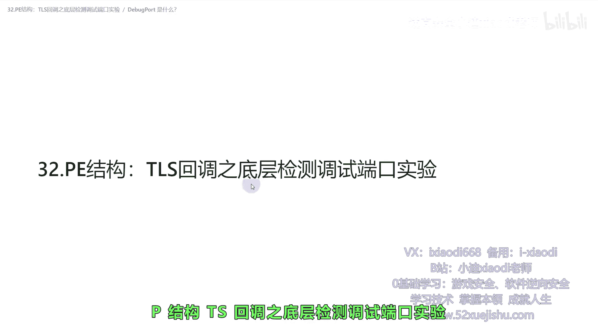
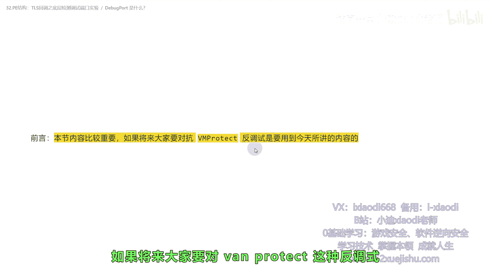
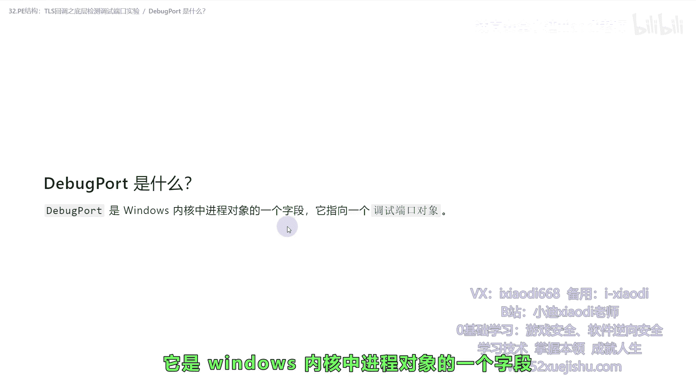
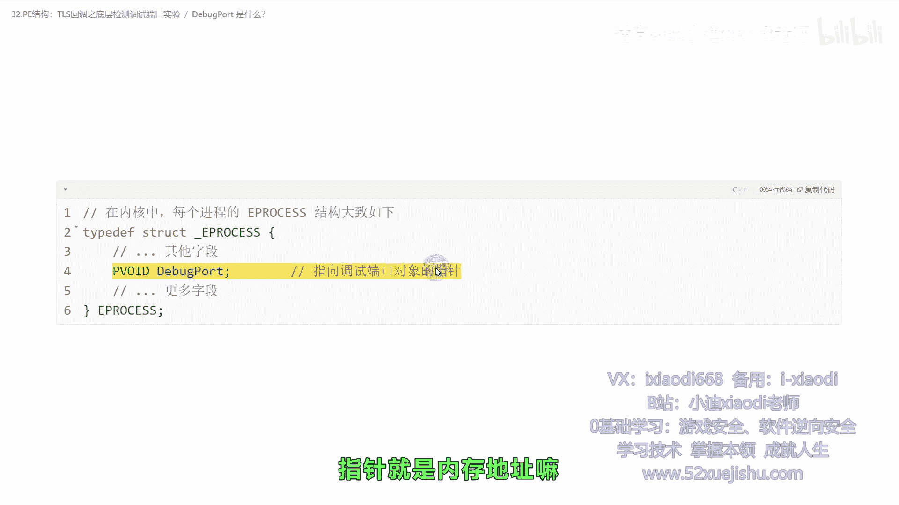
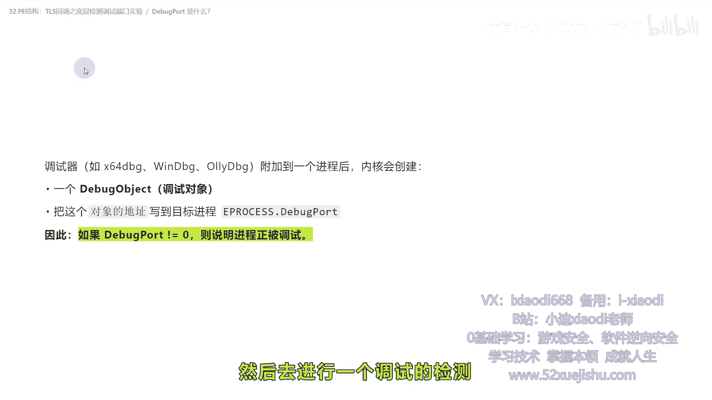
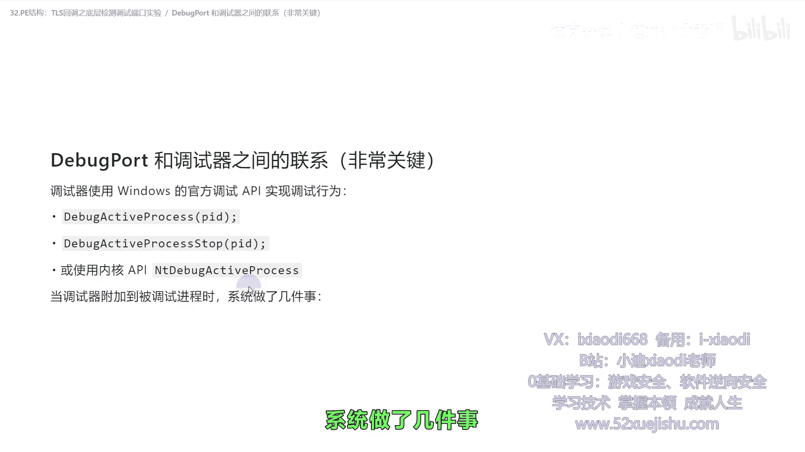
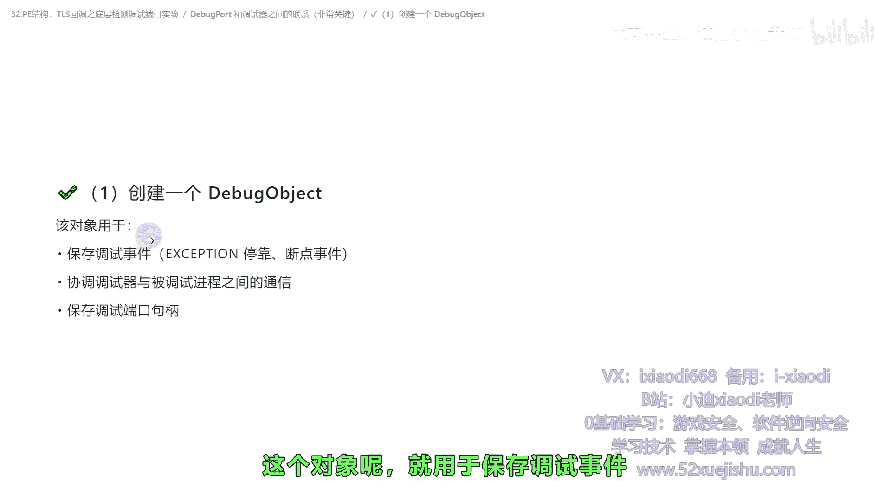
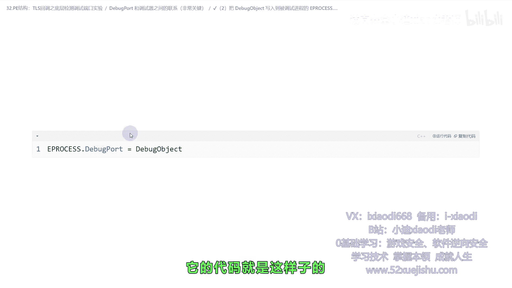
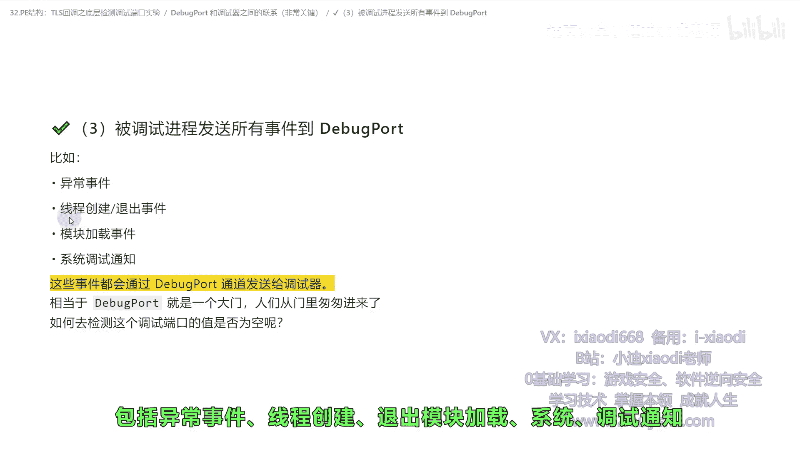
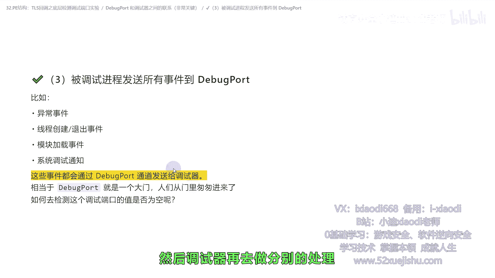

# 逆向汇编：第32讲：调试端口检测 🔍

在本节课中，我们将学习如何通过检测 Windows 内核中的**调试端口（Debug Port）**来判断当前进程是否被调试器附加。这是对抗 VMProtect 等反调试机制的基础技能，也是游戏安全、软件安全、CTF、逆向工程和病毒木马免杀中绕不开的知识点。我们首先从调试端口的概念讲起，然后分析调试器与调试端口的关系，接着介绍如何用 `NtQueryInformationProcess` 函数读取调试端口的值，最后给出完整代码示例和两个作业。本节课内容很重要，如果你将来要对抗 VMProtect 这类反调试，今天讲的内容一定会用得上。

## 什么是调试端口？⚙️

我们先来介绍一个名词——**调试端口**。这个词在上节课已经有所耳闻，它是 Windows 内核中进程对象的一个字段，指向一个调试端口对象。在 Windows 内核中，每个进程都有一个 `EPROCESS` 结构，这个结构中有一个 `DebugPort` 字段，它就是指向调试端口对象的指针。所谓指针，本质上就是一个内存地址，也就是说这个字段里存放的是一个地址值。

用代码来描述就是这样的：



```c
// Windows 内核 EPROCESS 结构中的调试端口字段
typedef struct _EPROCESS {
    ...
    HANDLE DebugPort;        // 指向 DebugObject 对象的指针
    ...
} EPROCESS;
```



当我们用调试器，比如 x64dbg 或者 OllyDbg 附加到一个进程后，内核就会创建一个调试对象 `DebugObject`，然后把这个对象的地址写到目标进程的 `DebugPort` 字段中。所以，如果这个调试端口的值**不等于零**，就说明该进程正在被调试。这正是本节课要讲解的核心内容：如何读取调试端口的值，并据此进行调试检测。





## 调试器与调试端口的关系 🔗



在讲解代码之前，我们先来做一些科普。调试端口和调试器之间到底有什么联系呢？调试器实际上是使用 Windows 官方的调试 API 去实现调试行为的。下面这几个 API 大家可以了解一下：

- `DebugActiveProcess`：调试器用它来附加到目标进程。
- `WaitForDebugEvent`：调试器等待目标进程产生的调试事件。
- `ContinueDebugEvent`：调试器让目标进程继续执行。

当调试器附加到被调试进程时，系统会做以下几件事：

第一件事，创建一个调试对象。这个对象用于保存调试事件，协调调试器与被调试进程之间的通信，同时保存调试端口的句柄。可以把它想象成一个收件箱。

第二件事，把这个调试对象写入到被调试进程的调试端口中。代码逻辑上就是直接赋值给 `DebugPort` 字段：

```c
// 系统将调试对象地址写入目标进程的 EPROCESS.DebugPort
TargetProcess->DebugPort = DebugObject;
```



第三件事，被调试进程发送所有事件到调试端口。假如我们去分析一个游戏，那被调试进程就是那个游戏，游戏会发送所有的事件到这个调试端口。这些事件包括异常事件、线程创建/退出、模块加载、系统调试通知等。所有信息都会通过这个调试端口发送给调试器。



换一个更直白的说法，调试端口就像一扇大门，所有调试事件都要从这扇门里进出。在计算机环境中，就是游戏的所有事件和行为都通过这个调试端口进入调试器，然后调试器再分别做处理。没有这扇门，调试器就什么也收不到。





## 如何检测调试端口的值？🧪

那么，我们如何去检测调试端口的值是否为零呢？这就要用到 `NtQueryInformationProcess` 这个函数。`NtQueryInformationProcess` 是查询信息的意思，大家可以参考微软官方文档，里面有非常详细的讲解。它的作用就是检索有关指定进程的信息。

在微软官方文档中，我们可以看到这个函数有 5 个参数（文档里通常列得很清楚），下面是参数说明：

- 第一个参数：要检索信息进程的句柄，这个很好获取。
- 第二个参数：要检索的进程信息类型，它是一个枚举，微软列出了很多选项。其中第二个就是我们关注的对象，`ProcessDebugPort`，用于检索作为进程调试器的端口号的值。
- 第三个参数：指向调用应用程序提供的缓冲区的指针，函数将请求的信息写入其中。
- 第四个参数：这个缓冲区的大小。
- 第五个参数：可以填空。

如果我们要调用它，代码应该这样写：

```c
#include <windows.h>
#include <winternl.h>

NTSTATUS CheckDebugPort()
{
    DWORD debugPort = 0;
    NTSTATUS status = NtQueryInformationProcess(
        GetCurrentProcess(),      // 检查自己的进程
        ProcessDebugPort,         // 查询调试端口
        &debugPort,               // 输出缓冲区
        sizeof(debugPort),        // 缓冲区大小
        NULL                      // 不需要返回长度
    );

    if (status == 0 && debugPort != 0)
    {
        // 正在被调试
        return status;
    }
    return status;
}
```

当我们这样调用这个函数时，实际上就是去读取调试端口的值。如果取出来的值等于 0，就说明没有调试器；如果不等于 0，就说明当前进程正在被调试。只要我们在调试器中去观察这个值，它通常都是非零的，这说明调试端口正在被使用，或者说这个程序正在被调试。



这里有几个注意点，我们需要了解一下。

首先，Windows 特意没有隐藏调试端口，因为这是微软设计的官方调试通道，它就是为了让一些防篡改的系统自己去查询是否被调试。这也是为什么反调试常常直接去查调试端口的根本原因。

第二个注意点，x64dbg 为什么绕不过这个调试端口呢？因为调试器附加到 64 位调试目标进程时，必须调用相关的调试 API，调用后内核就会自动设置调试端口，所以调试器是无法绕过的。刚才我们说过，被调试的程序需要通过这个调试端口把所有的事件传递给调试器，它就相当于一个中间的桥梁。没有这个桥梁，事件怎么过去呢？事件过不去，Windows 就不会产生调试事件，也就不能调试程序。所有的调试器都一样，都会导致调试端口的设置。

哪些工具会导致调试端口不等于 0 呢？基本上所有真正使用 Windows 调试对象的调试器都会导致调试端口不等于 0。以下是一些常见的工具：

- x64dbg / x32dbg
- OllyDbg
- WinDbg
- Visual Studio 自带的调试器
- 甚至雷电模拟器自带的调试组件

这些工具都会直接触发调试端口的设置。当然，也有一个例外，就是内核调试器。因为内核调试器的调试行为发生在内核层，走的是内核调试通道，而不是用户态的调试端口，所以这种情况不会设置调试端口。

另外，我们可能会碰到一种现象：调试端口等于 -1，或者等于 8 个 F（也就是 `0xFFFFFFFFFFFFFFFF`）。这实际上是微软内部的一个特殊值，表示调试器不接收调试事件，或者进程受到调试保护的影响，这个值就有可能变成 `-1` 或 `0xFFFFFFFFFFFFFFFF`。这里大家简单了解一下，当遇到一些疑难杂症时，要知道这个可能性。

## 代码示例与效果 💻

最后，我们来看一下完整的代码示例。首先，我们需要定义 `NtQueryInformationProcess` 函数的指针类型，然后在回调函数中调用这个函数。在调用时，我们要自己定义一个调试端口的变量，并且最好接收一下函数调用的返回值。如果函数调用成功，它的返回值是 0。此时就可以判断：如果返回值等于 0，并且调试端口不等于 0，就说明程序正在被调试，那么就可以做一些反制措施。

下面是一个完整的示例代码：

```c
#include <windows.h>
#include <winternl.h>
#include <stdio.h>

// 定义 NtQueryInformationProcess 函数指针类型
typedef NTSTATUS (NTAPI *pNtQueryInformationProcess)(
    HANDLE ProcessHandle,
    PROCESSINFOCLASS ProcessInformationClass,
    PVOID ProcessInformation,
    ULONG ProcessInformationLength,
    PULONG ReturnLength
);

void AntiDebugCheck()
{
    pNtQueryInformationProcess NtQueryInformationProcessFunc =
        (pNtQueryInformationProcess)GetProcAddress(GetModuleHandleA("ntdll.dll"), "NtQueryInformationProcess");

    if (NtQueryInformationProcessFunc == NULL)
        return;

    DWORD debugPort = 0;
    NTSTATUS status = NtQueryInformationProcessFunc(
        GetCurrentProcess(),
        ProcessDebugPort,
        &debugPort,
        sizeof(debugPort),
        NULL
    );

    if (status == 0 && debugPort != 0)
    {
        MessageBoxA(NULL, "检测到调试端口非空，将强制退出！", "警告", MB_OK);
        ExitProcess(0);
    }
}

int main()
{
    AntiDebugCheck();
    printf("程序正常运行\n");
    return 0;
}
```

这里只是简单地弹个窗，然后退出进程。其他代码没有区别。我们来看一下运行效果。

首先是 32 位的程序，拖到调试器中运行，会弹出一个提示：“检测到调试端口非空，将强制退出”，点击确定后程序就退出了。再看一下 64 位的程序，同样拖到调试器中运行，也会提示“调试端口非空，将强制退出”，点击确定后程序就退出了。这证明我们的检测逻辑是有效的。

## 课后作业 📝

最后给大家布置两个作业，希望大家可以动手实践一下：

- 第一个作业，自己手动绕过调试端口的反调试。
- 第二个作业，思考都有哪些绕过的方法。

大家要意识到，自己实现的只是其中一种方法，还有很多方法等着你去探索。

## 总结 🎯

本节课中，我们一起学习了 Windows 内核中调试端口的基本概念，知道了 `EPROCESS.DebugPort` 字段就是指向前提下的调试对象。我们还分析了调试器与调试端口之间的关系，理解了调试端口是调试事件传递的必经之路。接着我们学习了如何通过 `NtQueryInformationProcess` 查询 `ProcessDebugPort` 来读取调试端口的值，并根据该值判断进程是否被调试。我们还讨论了注意点，包括微软不隐藏调试端口、64 位调试器无法绕过、以及特殊值 `-1` 的含义。最后通过代码示例演示了反调试检测的实现和效果。希望同学们课后好好练习，下节课再见！

