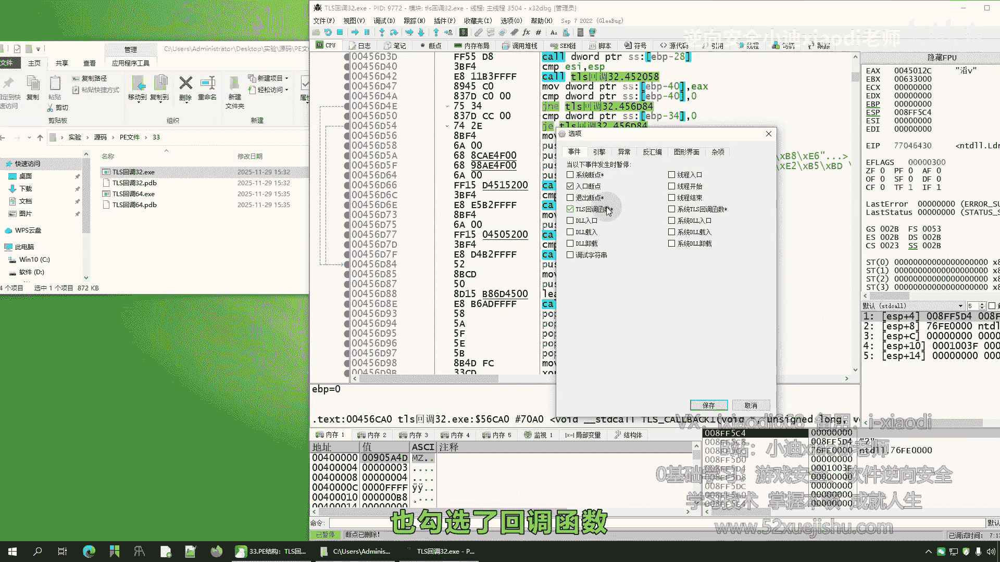

# 逆向破解：第33讲：TLS回调之x64dbg反调试绕过方法 🛡️

大家好，我是小迪老师。今天是我们的第三十三讲：PE结构 TLS回调之程序运行后动态抹除实验。在本节课中，我们将要学习PE结构中的TLS回调机制，以及如何利用x64dbg配合Cheat Engine，在程序运行的那一刻动态抹除TLS回调，从而绕过反调试检测。**TLS回调（Thread Local Storage Callback）** 是一种比程序入口点更早执行的机制，很多软件保护壳和恶意程序都会利用它来做反调试。如果我们发现某些小动作，比如说反调试检测，发生在TLS回调中，那么就可以直接在程序运行的那一刻把它清除掉。本节会先演示效果，再讲解理论原理，最后动手实践，让大家对这套绕过思路有一个完整的认识。

## 🎯 适用场景：反调试藏在TLS回调里

今天的内容适用于什么情况呢？简单来说就是这样：如果我们发现某些小动作，比如说反调试检测，它是发生在TLS回调中的。**反调试**是指程序检测自己是否处于调试器的监控之下，如果发现被调试，就采取异常退出、改变运行路径等对抗手段。很多程序会把这种检测逻辑放在TLS回调里，因为TLS回调执行得比入口点还早，能够在主程序逻辑运行之前就完成检测，让分析者措手不及。

那面对这种情况，我们该怎么办呢？答案就是：直接在程序运行的那一刻清除掉它。这里说的清除，并不是把TLS回调函数里的指令一条一条地打上nop补丁，而是采用一种**动态清除**的思路。也就是说，在程序还在启动阶段的时候，顺手把存放TLS回调函数地址的那个数组给清空掉。这样一来，系统在启动流程中就会认为这个程序压根没有注册过任何TLS回调，自然不会去执行它，反调试检测也就被绕过了。这种做法的好处很明显：我们不需要去分析TLS回调函数内部那一大堆复杂的代码，只需要从外围把它的入口给堵死就行。

## 🧪 效果演示：程序被顺利放行

我们先来看一下实际效果。比如现在我们的x64dbg已经打开了，然后设置是这样的：在选项里面我们可以勾选上"入口断点"和"TLS回调函数"这两个选项，然后点击保存。把程序拖过来之后，会先断在TLS回调的一个位置上。接着再点击运行，看到没有？程序弹出了"检测到调试行为"的提示。那这个行为是发生在哪里呢？没错，就发生在这个TLS回调函数中。

如果说就是这种情况，那我们就可以把这个回调函数给它动态地清除。为了让大家看清楚，现在给大家演示一下效果。大家会发现，这个TLS回调函数还在，并没有被打上nop补丁，我们看一下它里面的代码都是非常完整的，我并没有做任何的处理。也就是说，我没有去修改TLS回调函数本身的哪怕一个字节。

好，这个时候我们点击"选项"，在选项里面我勾选了"入口断点"，也勾选了"回调函数"断点。这个时候我点击"运行"，那这个程序发生了一种怎样的现象呢？就是它好像没有识别到那个TLS回调函数，直接就绕过了它，然后直接就来到了入口点。这个时候再点击运行，看到没有？程序就正常执行了，没有任何"检测到调试行为"的弹窗。那这就是我们的一个效果：代码没改，回调还在，但程序就是不再执行它了。

## 📚 理论基础：主角 LdrInitializeThunk

看完了效果，接下来小迪老师去给大家讲一下它的理论基础和实践方法。我们要先介绍一个函数，就是 **LdrInitializeThunk**（简称LDR）。这个函数是Windows操作系统内核中一个非常核心但不公开文档化的函数，它是进程启动和加载机制的真正入口点，可以说是Windows加载器（Loader）的启动引擎，整个进程的加载工作都是由它一手操办的。它在进程真正开始执行前，完成所有模块加载、映像初始化相关的工作。简单来说，它负责把一个静态的PE镜像文件，也就是磁盘上的EXE文件，变成一个可以正常运行的进程。

这里还有一个非常重要的认知：在32位的程序中，这个函数几乎总是进程进入用户态后执行的第一个函数。其实我们都知道，操作系统是分为内核层和应用层的。内核层那个代码怎么去执行的，我们先不管，我们只关注应用层。那应用层我们获得了这样一个非常重要的概念：**当进程进入到应用层之后，执行的第一个函数就是 LdrInitializeThunk**。也就是说，无论你在程序的入口点（OEP）布置了多少反调试的花招，在这之前，系统早就已经通过这个函数把整个进程的地基给打好了。

## ⚙️ LdrInitializeThunk 的关键工作流程

那这个函数做了哪些关键的事情？我们可以简单地给大家梳理一下。当一个新的进程被创建时，系统最终会跳转到这个函数执行，大致的顺序如下。以下是 LdrInitializeThunk 的核心执行步骤：



1. **保存上下文**：把当前线程的上下文（寄存器等状态）保存下来，为后续初始化做准备。
2. **初始化进程的加载器状态**：建立加载器内部的数据结构，记录模块列表、加载状态等信息。
3. **处理导入表**：在这一步中，它会加载并映射所有依赖的DLL，然后去修复IAT（导入地址表）。
4. **执行TLS静态初始化**：对线程局部存储做静态初始化，为TLS回调的执行做好准备。
5. **执行初始化函数**：执行当前模块和已加载DLL的初始化函数。
6. **做一些检查**：进行一些安全性和完整性相关的检查，比如验证签名、检查加载配置等。
7. **进入程序真正的进程入口点**：一切准备就绪后，才跳转到程序的OEP，开始执行用户代码。

用伪代码来表示的话，整个过程大概是这样的：

```text
LdrInitializeThunk():
    保存上下文
    初始化加载器状态
    处理导入表:
        加载并映射所有依赖的DLL
        修复IAT（导入地址表）
    执行TLS静态初始化
    执行当前模块和已加载DLL的初始化函数
    做检查
    跳转到进程入口点（OEP）
```

那在这边我们会发现，**TLS的执行是早于进程入口点的**。所以说，看上面的顺序我们就明白了，为什么前几节课我们讲TLS执行比入口点还要早，答案就在这里。这个顺序是整个过程中最关键的认知，也是我们后面动态清空TLS回调数组的理论依据。

## 🗺️ 进程启动完整流程

那么进程启动完整的流程图，我给大家做了一下简单的整理。大家可以看一下。首先，真正的起源是内核态，也就是底层的那个东西。然后再往下走，它做了一些核心的操作。再往下走，走到这儿，它从内核态转到了应用层。整个流程可以用下面这个链条来概括：

```text
内核态（底层创建进程） → 核心操作 → 切换到用户态
    → 用户态第一个函数：LdrInitializeThunk
    → 做初始化操作
    → 对 TLS 进行预处理
    → 执行 TLS 回调函数
    → 执行入口点函数
```

当进到用户层之后，它第一个执行的函数就是这个 LdrInitializeThunk。然后继续往下走，继续往下走，这边也是做一些初始化的操作。走到这儿，它对TLS进行了一个预处理。然后再往下，就开始执行TLS回调函数。那么走到最后，它才去执行这个入口点的函数。所以说，TLS回调函数的执行时机比入口点还要早，这一点在这里再次得到了验证。

> **核心结论：TLS回调函数的执行时机比入口点还要早。**

## 💡 核心思路：在 LdrInitializeThunk 上下手

这个函数是非常重要的，它是**用户态最强的控制点**，可以做所有进程初始化相关的攻击或防御行为。大家在这里可以简单了解一下它的分量。既然 LdrInitializeThunk 是用户态第一个执行的东西，而且TLS回调的执行也发生在它的管辖范围之内，那我们要在什么时候去清空TLS回调呢？最好的时机，就是在这个函数上下断。具体来说，我们在这个函数上下断点，等程序停住之后，再去搜索TLS回调的地址，然后直接把TLS回调数组清掉。那么清掉的方法有很多，在这里我用 Cheat Engine 给大家做一下实验。核心思想可以概括成下面这个公式：

```text
TlsCallbackArray[0] = 0   // 数组以0结尾，首元素置0即表示空数组
```

因为TLS回调函数地址数组是以零结尾的，所以只要把第一个元素改成0，操作系统就会认为这个数组是空的，从而跳过所有TLS回调的执行。

## 🛠️ 实战操作：Cheat Engine 动态抹除

好，现在我带大家来操作一下。我们把这个程序拖过来，拖过来之后，我们先记录一下这个TLS回调函数的一个地址。这里显示的是 `4533D1`，我们可以记录一下，就这个地址。然后我们跳转到这个函数上，打一个断点，然后重新加载一下程序。那这个时候程序就断下来了，看到没有？就断在这个函数上，也就是断在 LdrInitializeThunk 里。

好，那这个时候我们就可以去搜索这个地址了。我们来打开我们的 Cheat Engine，以下是具体的操作步骤：

1. **打开进程**：在 Cheat Engine 中打开目标进程。
2. **勾选十六进制**：在扫描设置中勾选"十六进制"选项。
3. **粘贴地址**：把刚才记下的 `4533D1` 粘贴到扫描框中。
4. **勾选可写**：勾选"可写"选项，因为我们关心的TLS回调数组应该是一块可写内存。
5. **点击首次扫描**：执行首次扫描，得到的这个地址就是TLS回调函数地址所在的数组。

那我们要做的，就是把这个数组的首地址给它清空清掉就可以了。为什么清掉首地址就够用了呢？因为这个数组它是以零为结尾的，也就是说，数组的结束标志就是0。现在我们把第一个元素改成 `0`，这就说明这是一个空的TLS回调函数数组。好的，改成 `0`。那这个时候，把这个断点再放开，然后再去运行，看到没有？程序就正常运行了，没有弹出任何调试检测的提示。可以吧？效果已经出来了。

## ✅ 操作逻辑总结

所以说，我们的操作逻辑总结起来就是这样子的。以下是完整的操作逻辑链条：

1. **第一步**：先知道TLS回调函数的地址。这一步可以通过x64dbg在 LdrInitializeThunk 上下断，再结合TLS回调断点来拿到。
2. **第二步**：通过这个地址，我们就可以进一步扫描到这个回调函数地址所在的数组。用 Cheat Engine 搜索这个地址值，找到存放它的那块内存。
3. **第三步**：我们再把找到的这个数组给它清空掉就可以了。具体做法就是把数组首元素置为0。

大家回去之后，可以自己去实验一下。建议找一些带有TLS回调反调试的CrackMe或者CTF题目来练习，按照我们今天讲的流程完整地走一遍，体会一下动态抹除和静态打补丁之间的区别，这对理解PE结构会有很大的帮助。

## 🏁 本节总结


本节课中，我们一起学习了TLS回调反调试的绕过方法。我们首先明白了：如果反调试行为发生在TLS回调中，可以采用动态抹除的方式来解决。然后我们重点学习了核心函数 LdrInitializeThunk，知道了它是进程进入用户态后执行的第一个函数，并且梳理了它的七大执行步骤，弄清了TLS回调为什么早于入口点执行。最后，我们通过x64dbg配合Cheat Engine，亲手完成了"记录TLS回调地址 → 扫描回调数组 → 清空数组首元素"的完整操作。这个思路在游戏安全、软件安全、网络安全以及CTF比赛中都非常实用，希望大家课后多多动手练习。以上就是我们今天全部的内容，我们下期再见，拜拜。
