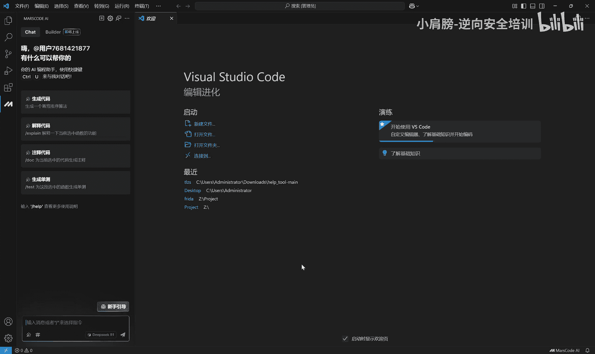
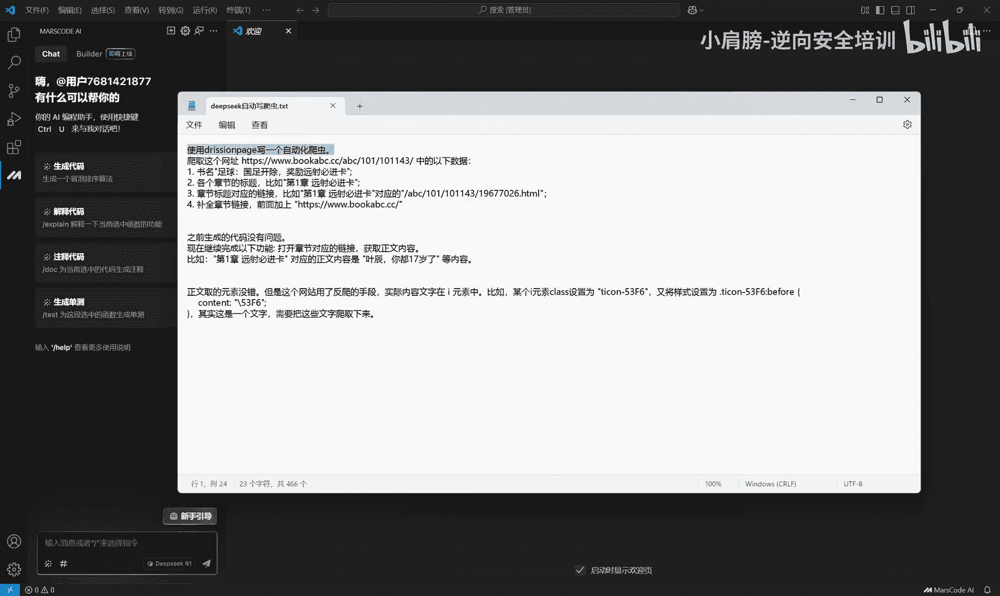

# 【零基础AI爬虫】🐍：第1节：使用DeepSeek自动编写爬虫

在本节课中，我们将学习如何使用DeepSeek来自动编写一个爬虫程序，并且使用JSON配置来定义爬虫的行为。这个教程面向零基础的同学，所以我们会用最直白的话来解释每一个步骤，保证你即使没有接触过爬虫，也能跟着操作。我们先从整体上了解一下这节课要做什么：我们要访问一个具体的案例网站，观察它的页面结构，然后让DeepSeek根据我们给出的提示词，自动生成一个符合要求的爬虫代码。这个过程中，我们还会遇到一个常见的反爬措施——字体反爬，需要提前了解它的存在。

  

## 案例网站介绍 🖥️

我们先来看一下这个具体的案例网站。当我们访问这个页面时，页面会展示出章节信息以及对应的章节链接。也就是说，首页或者列表页上，会列出很多章节的标题，每个标题都带有一个链接，指向该章节的详细内容页面。我们把这个页面理解为“列表页”或者“目录页”，它的主要作用就是让用户看到有哪些章节，并且提供入口。

  



当我们点击这些章节链接，进入对应的详情页之后，就能看到文章的正文信息了。这个详情页才是我们真正需要抓取内容的地方，因为正文内容都在这里。所以，整个爬虫的逻辑可以分为两步：第一步，从列表页获取所有章节的链接；第二步，依次访问这些链接，从详情页中提取正文内容。

  

## 反爬措施：字体反爬 🛡️

需要特别注意的是，这个网站是有反爬措施的，它采用的是字体反爬技术。字体反爬是一种比较常见的反爬手段，它的原理是：网站把正常的文字信息映射到了自定义的字体文件中，浏览器在渲染页面时会根据这个字体文件把特殊的字符显示成正常的文字，但如果我们直接通过代码抓取页面源码，得到的往往是一堆乱码或者特殊的字符编码，而不是我们看到的文字。因此，如果直接用普通的请求方式去抓取，我们拿到的内容并不是真正显示出来的文字，这就给爬虫增加了难度。

  

不过，我们这节课的重点不是自己手动去破解这个字体反爬，而是让DeepSeek帮我们处理。我们只需要在提示词中明确告诉它这个网站有字体反爬，要求它使用合适的方案来解决，DeepSeek就会在生成的代码里包含相应的处理逻辑。这样，我们就可以绕过这个障碍，顺利获取到正文内容。

  

## 准备提示词 📝

接下来，我们要让DeepSeek帮我们完成爬虫的第一个部分。这里的“第一个部分”指的是什么呢？我们通常把一个完整的爬虫任务拆解成几个部分，比如分析页面结构、设计爬虫流程、编写具体代码、处理反爬、输出结果等等。本节课我们先让DeepSeek编写最核心的爬虫主体逻辑，也就是根据配置自动访问列表页、解析链接、访问详情页、提取正文这一整套流程。

  

那么，在开始之前，你需要准备好提示词。所谓提示词，就是你输入给DeepSeek的指令文字，告诉它你应该怎么写。提示词的质量直接影响最终代码的准确性，所以我们需要把要求说得清晰、具体。比如，你要告诉DeepSeek：这是一个爬虫任务，目标是某个网站，网站的页面结构是怎样的，有什么反爬措施，希望用什么样的配置方式来组织代码，等等。

  

对于本案例，我们要求DeepSeek使用JSON配置来编写一个自动化的爬虫。什么是JSON配置呢？简单来说，就是把爬虫的各种参数（比如起始网址、选择器、超时时间、重试次数等）写在一个JSON格式的配置文件里，然后让爬虫代码去读取这个配置并执行。这样做的好处是，修改配置时不需要改动代码，非常灵活。下面是一个JSON配置的简单示例，它描述了爬虫的基本信息：

  

```json
{
  "start_url": "https://example.com/chapters",
  "list_selector": "div.chapter-list a",
  "detail_selector": "div.article-content",
  "use_anti_font": true
}
```

  

在上面的配置中，`start_url` 表示列表页的地址，`list_selector` 是提取章节链接的CSS选择器，`detail_selector` 是提取正文内容的CSS选择器，`use_anti_font` 则告诉爬虫是否需要启用字体反爬处理。当然，实际使用时，你需要根据目标网站的真实结构来修改这些值。

  

## 让DeepSeek生成爬虫代码 🤖

有了提示词和JSON配置的设想，我们就可以正式让DeepSeek生成代码了。你可以在DeepSeek的对话框中输入类似下面这样的提示词：

  

> 请编写一个自动化爬虫，使用JSON配置来定义爬虫参数。目标网站是[网址]，列表页会显示章节列表和链接，详情页包含正文。网站有字体反爬措施，需要在代码中处理。请生成完整的Python代码，并包含一个JSON配置文件示例。

  



DeepSeek收到这个提示词后，就会根据它自己的理解生成相应的代码。我们作为初学者，不需要完全理解每一行代码，只需要知道核心流程是什么。生成的代码通常包括：读取配置文件、请求列表页、解析链接、请求详情页、处理字体反爬、解析正文、保存结果等步骤。你可以把生成的代码和配置保存到本地，然后运行试试效果。

  

## 总结 📚

本节课中，我们一起学习了如何使用DeepSeek来自动编写一个带JSON配置的爬虫。我们首先了解了案例网站的结构：列表页展示章节信息和链接，详情页展示正文内容。然后，我们认识到该网站存在字体反爬这一反爬措施，并知道了它的大致原理。接着，我们学习了准备提示词的方法，以及如何告诉DeepSeek使用JSON配置来编写自动化的爬虫。最后，我们看到了一个简单的JSON配置示例，并了解了提示词的基本写法。下一节课，我们可能会深入解析DeepSeek生成的代码，看看它具体是怎么处理字体反爬的。希望你已经掌握了这节基础内容，能够自己动手让DeepSeek生成一个简单的爬虫脚本。

