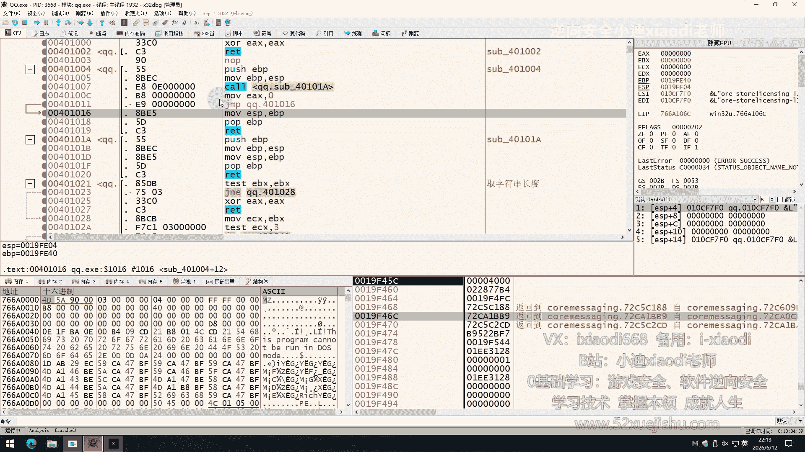
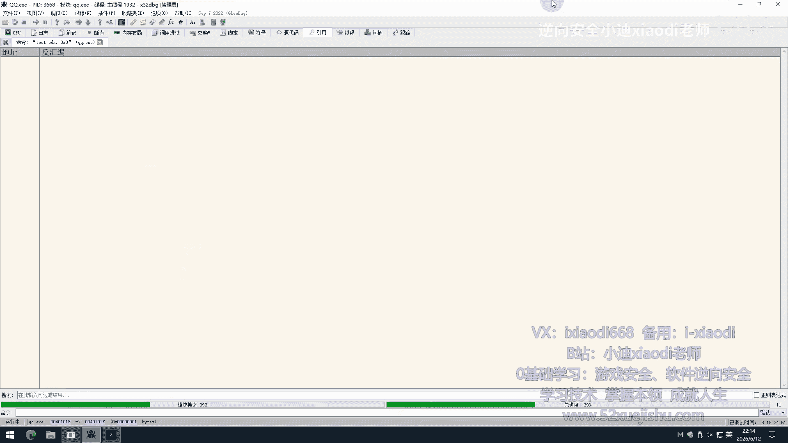
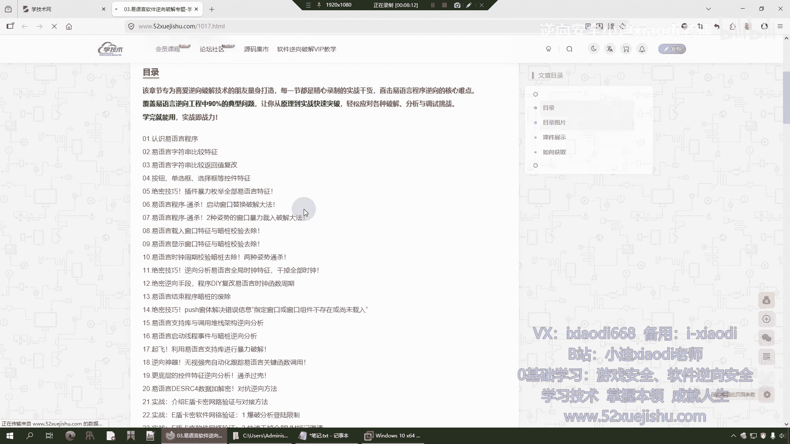
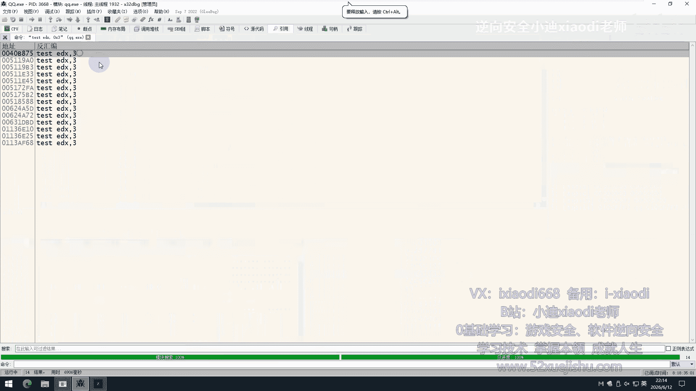
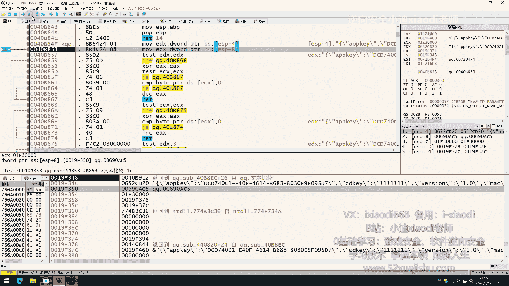
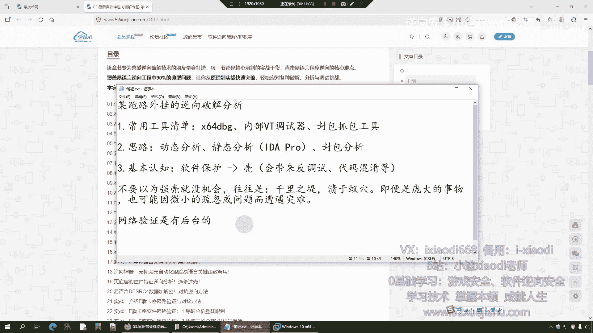

# 零基础学软件逆向：第1章：某跑路外挂的逆向破解分析 🔍

> 在本节课中，我们将针对一款名为“QQ”的跑路外挂进行逆向破解分析。课程会介绍软件逆向的基础知识，并完整演示动态分析与封包分析两种思路。整个流程不需要太多编程基础，适合零基础同学入门。本节由小迪老师主讲。

## 1. 逆向分析能做什么 🤔

经常有同学在评论区问：讲逆向为什么会有这么多人听？逆向到底能做什么？其实，逆向能够帮助你分析各种小型软件，外挂就是一个非常典型的例子。

外挂本身也是软件，你可以把它运行起来，也可以对它进行分析。开外挂不推荐，但分析外挂是很好的学习路径。这节课要分析的这款外挂，作者已经跑路，软件基本停用，但不妨碍我们从分析中学到各种逆向知识。

在以前，软件逆向的学习资料很少，没有系统教程，也没有人带领，只能在网上零散地找资料，自己反复琢磨，慢慢才入了门。现在有了完整的知识框架，就可以把这些分析思路整理成教程，讲给零基础的同学听。

工具方面，需要把常用工具练熟，这也是逆向学习的基本功。下面先看需要准备哪些工具，以及对应有什么作用。

## 2. 工具准备与三种分析思路 🧰

在具体分析之前，先解决两个问题：用什么工具，以及用什么思路。

必备工具包括以下三类：

- **x64DBG**：一款开源、免费的动态调试工具，用来附加正在运行的进程，查看程序代码、内存和寄存器。
- **VT调试器**：一种基于虚拟化技术的调试器，用来对抗反调试保护。
- **HTTP Debugger**：一款封包抓包工具，用来截获程序与服务器之间的网络数据包。

这里先记下这些工具，后面实战中会看到它们各自在什么场景下发挥作用。为什么需要封包抓包工具？因为外挂一般不会只做本地功能，它通常还会带网络验证。你向作者购买卡密后，把卡密输入到软件中，验证通过后就能使用功能。在登录过程中，程序会向服务器发送网络数据包，用封包抓包工具可以把这个数据包抓下来，再进一步分析验证逻辑。

在思路层面，软件逆向大体可以分为三种分析方式，分别是动态分析、静态分析和封包分析。

- **动态分析**：让程序运行起来，用调试器附加到进程，在运行过程中打断点，观察寄存器、内存、堆栈里的临时数据。整个过程相当于一边运行一边检查程序内部状态，是逆向分析中最常用的方式。
- **静态分析**：不运行程序，直接用分析工具查看文件结构。常用工具包括 Exeinfo PE、IDA 等。这类工具不需要程序执行，直接解析文件，给出导入表、函数调用等信息。
- **封包分析**：把网络数据包单独拿过来分析，不需要分析程序本体代码。动态分析和静态分析都聚焦于代码，而封包分析直接观察程序与服务器之间的通信内容。如果不懂代码，仍然可以通过封包分析判断软件行为。

本节课中，静态分析部分不会展开，后续课程会系统讲解。今天重点关注动态分析和封包分析，最终破解掉这个外挂，依靠的也是封包分析。三种思路的核心区别可以用下面这个公式描述：

```
动态分析 = 运行程序 + 调试器附加 + 设断点 + 观察寄存器/内存/堆栈
静态分析 = 不运行程序 + 反汇编/反编译工具 + 检查导入表/文件结构
封包分析 = 不关注代码 + 拦截网络请求 + 查看请求/响应内容 + 修改数据包
```

工具和思路都准备好之后，还要理解一个核心概念，那就是壳。下一节就来解释这个概念。

## 3. 核心概念：什么是壳 🥚

在分析软件之前，需要有一个基本认知：软件可能带有保护层。在软件安全与逆向领域，这种保护层通常被称为“壳”。

套了壳的程序会带来两类典型问题：

- **反调试**：程序检测到调试器后主动退出，或者让调试器失效，导致无法继续观察运行状态。
- **代码混淆**：把可读的指令转换成难以理解的形式，增加人工分析的成本。

用公式表示就是：

```
壳 = 保护层
壳带来的效果 = 反调试 + 代码混淆
```

网上有一句话叫“山重水复疑无路，柳暗花明又一村”。面对带壳程序，动态分析和静态分析都可能遇到障碍，但破解点往往会出现在意想不到的位置。这个外挂的破解点就在封包分析上。

不要以为有防护的软件就没有机会。古话说，千里之堤，溃于蚁穴。再庞大的系统也可能因为微小的疏忽而出现问题，这种疏忽就是突破口。

下面正式进入软件分析环节，先来看动态分析的完整流程。

## 4. 动态分析实战：查壳、反调试与数据拦截 🛠️

拿到一个软件后，第一件事是检查程序有没有保护，可以用 Exeinfo PE 这类工具进行查看。

这款外挂起了一个非常有迷惑性的名字，就叫“QQ”。首先运行软件，随便输入一组卡密，点击“登录”，程序提示“接口算法不存在”。

再打开 Exeinfo PE，把程序拖进去，可以看到检测结果是 VMP 3.0 到 3.5。VMP 是一个保护器，也就是一种壳。程序带保护器，意味着不能直接用普通的调试器分析。

打开 x64DBG，这是经典的开源免费动态调试工具。点击“文件”→“附加”，切换到程序主模块，即可查看程序代码。在 x64DBG 中随便输入卡密，点击“登录”，观察程序状态：程序会自己退出，调试窗口也会变成空白。这是非常明显的反调试现象，它把调试器“剥离”掉了，导致所有调试信息都无法继续观察。

这里解释一下“调试”的概念。调试就是调整测试，我们正在用外部工具对程序进行观察和调整。当前使用的 x64DBG 就是外部调试工具。反调试则是不允许程序在调试器环境下运行。

关闭整个软件的时候也会觉得特别卡，这也是反调试保护带来的表现。

要对抗这种反调试，需要用 VT 调试器。运行 VT 调试器，进入 VT 调试模式，然后启动调试器。重复刚才的步骤：运行程序，点击“文件”→“附加”，点击“符号”切换到程序主模块，再点击“登录”。此时程序不会再闪退，说明 VT 调试器已经成功绕过了反调试。

接下来继续进行分析。点击“登录”时，程序会弹出一个信息框。这类信息框通常调用 Windows 的 API 接口，也就是应用程序开发接口。它的名字是 MessageBox。后续系统学习会知道，这里实际调用的是 MessageBoxA。信息框也可能由其他方式实现，但本节课不需要深究。

在调试器中，点击“登录”后，程序会中断在 MessageBoxA 附近。所谓中断，就是程序执行到指定位置后停下，等待分析。可以理解为路上出现一个拦截点，把程序暂时拦下来，这样才有机会观察程序状态。此时右上角是临时数据，右下角也是临时数据。

调试器中两个常用操作如下：

```
Ctrl+F9 = 运行到返回，把当前函数剩余部分执行完，停在函数返回位置
F8 = 单步执行，从函数返回后回到外层代码
```



按 Ctrl+F9，然后点击“确定”，让信息框执行完毕，再按 F8 返回外层。回到外层代码后，会发现有一些内容已经看不懂。此前的内容还能猜出含义，例如 ESP+C、ESP+10 这类寄存器加偏移地址。再往后，代码变得非常奇怪，甚至出现问号。这就是代码混淆。



壳会带来反调试，也会带来代码混淆。从代码层面继续分析会很困难，但还没有到放弃的时候。回到调试器，点击“符号”，双击切换到程序主模块。如果以前接触过易语言程序，可以看到主模块中出现两行特征信息。这两行特征说明该程序是一个易语言程序。



对于易语言程序，可以使用相关插件分析。插件可以载入程序调用的所有命令，其中有一个命令叫“比较文本”。在调试器中鼠标右键，搜索当前模块的命令，可以找到“比较文本”命令。更详细的操作在后续易语言逆向破解专题中会讲解。



在“比较文本”位置按 F2 设置断点。断点就是程序运行到该位置会停下来。再次点击“登录”，虽然代码被混淆，但相关数据仍然可以提取出来。此时程序使用了一个 AppKey，这个值表示该软件属于哪个程序的版本。右侧是我们输入的 CDK，也就是卡密。更右边可能是一个版本号。另外还可以看到机器码。

程序既然在运行时使用了这些数据，就存在伪造数据的可能。假设一个卡密绑定了固定机器码，换电脑后机器码改变，原来的卡密就无法使用。此时可以在“比较文本”断点处拦截参数，把新机器码替换成原有机器码，同一个卡密就能在其他电脑上继续使用。这个思路用公式表示就是：

```
伪造机器码 = 在“比较文本”断点处拦截机器码参数
            + 替换为新机器码
            + 卡密在所有机器上通用
```

动态分析的体验到这里就结束了。通过这一轮分析，我们可以把主要收获整理如下：

- 使用 Exeinfo PE 快速识别 VMP 壳
- 使用 x64DBG 附加进程，观察反调试现象
- 使用 VT 调试器对抗反调试，使程序可以继续运行
- 在 MessageBoxA 附近设断点，观察信息框调用
- 利用易语言插件定位“比较文本”命令，提取 AppKey、卡密、版本号、机器码
- 在断点处修改机器码，让卡密在不同机器上通用

动态分析已经体验完毕，下面切换视角，来看封包分析。

## 5. 封包分析实战：抓包、改包与绕过验证 📦

前面已经说到，动态分析和静态分析都是分析代码，如果不想分析代码，或者从代码层面很难继续，还有一个思路是封包分析。本节课使用 HTTP Debugger 来完成这个任务。



先打开 HTTP Debugger，再运行程序。输入卡密，点击“登录”，程序提示“接口算法不存在”。此时，HTTP Debugger 中会出现一个请求方法，后面的 URL 就是卡密登录的服务器地址。点击“内容”面板，可以看到响应内容中的状态值为 -403。

经常分析这类软件就会知道，-403 通常是一个错误标记，正确的标记可能是 0，也可能是 200。响应判断规则大致如下：

```
-403 = 错误标记
0 或 200 = 正确标记
```

现在做一个小实验。在响应内容上点击右键，选择“自动回复”→“新建自定义规则”→选择“完全匹配”，把响应中的 -403 改成 0，同时可以把回复内容改成“登录成功”。保存规则后，点击“登录”，程序提示“当前网络异常”，说明状态值 0 不是程序期望的结果。

接下来把 0 改成 200，再次保存规则。点击“登录”，界面虽然仍然提示“接口算法不存在”，但登录过程已经成功，程序直接进入了功能区，提示“驱动加载成功”。

为什么会出现“接口算法不存在”？这是因为外挂的网络验证有后台。作者跑路后，后台可能把软件相关信息删除或修改了，所以程序无法找到接口算法。然而，通过修改网络响应内容，我们仍然通过了网络验证。

整个封包改包策略可以整理成如下公式：

```
原始响应：状态值 -403 → 验证失败
修改响应：状态值 200 → 验证成功
结果：跳过网络验证，直接进入软件功能
```

进入软件后，程序提示“请检查酷狗歌词是否打开”。当前演示环境是虚拟机，没有安装酷狗，所以无法展示后续功能。这不影响核心思路，抓包改包已经完成了网络验证的绕过。

到这里，动态分析和封包分析都演示完了。最后来回顾一下整节课的内容。

## 6. 总结与学习建议 📚



这节课面向零基础同学，我们一起完成了一个带 VMP 壳、带反调试、带代码混淆的外挂软件的分析。核心结论是：即使外壳很坚硬，只要找到薄弱点，软件仍然有机会被破解。这个薄弱点，在这个例子中就是封包响应。

归纳一下，本节课的主要知识点如下：

- 外挂本身也是软件，不推荐开挂，但可以通过分析学习逆向技能
- 软件逆向的三大思路：动态分析、静态分析、封包分析
- 壳是程序保护层，会带来反调试和代码混淆
- 使用 Exeinfo PE 识别 VMP 壳
- 使用 x64DBG 附加程序时，如果程序闪退，说明存在反调试
- 使用 VT 调试器可以对抗反调试
- MessageBoxA 断点可以帮助观察程序弹出的信息框
- Ctrl+F9 和 F8 是调试器中非常实用的两个操作
- 易语言程序可以通过插件定位“比较文本”命令，提取关键数据
- 使用 HTTP Debugger 修改响应状态值，可以绕过外挂网络验证

本课程拥有完整的后续教学体系，覆盖从入门到进阶的完整路径，内容包括：

- **IDA Pro**：静态分析神器，用于反汇编大型程序
- **x64DBG**：动态调试工具，本节课已实际使用
- **易语言逆向破解专题**：针对易语言程序的专项分析技巧
- **PE 文件结构**：程序文件格式的基础知识
- **C 语言基础**：为后续编程和代码分析打底

如果对课程体系感兴趣，可以私信获取大纲。合适就学习，不合适就当交个朋友。学习过程中需要交流环境，会员通常都有专门的学习群。软件逆向相关资料在网上比较少，很多内容还是英文，而且很少有人系统讲解。希望通过这些课程，能够带领大家少走弯路。

录制这些内容其实很花费时间，但每次看到评论区有人说“看懂了”“学到了”，就会觉得这些付出非常值得。感谢大家的支持。本节课程就到这里，我们下节课再见。
