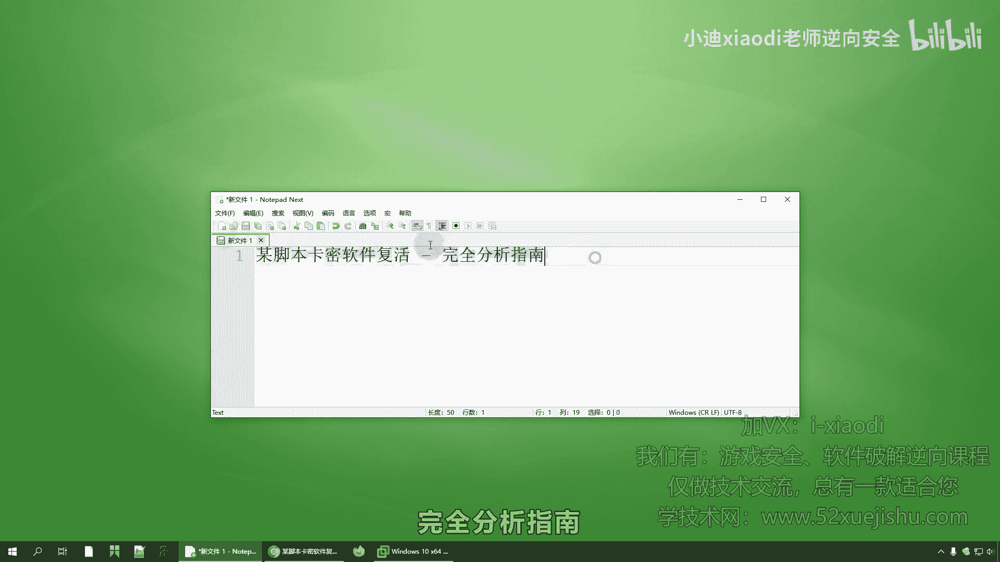
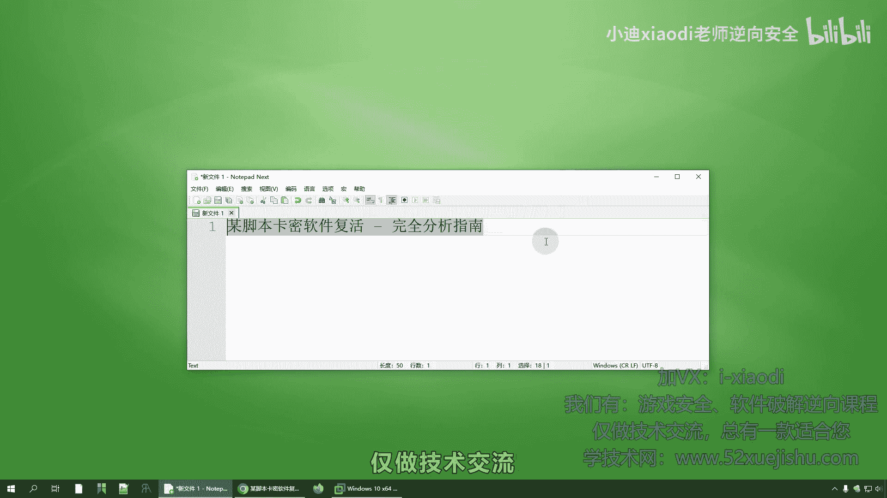
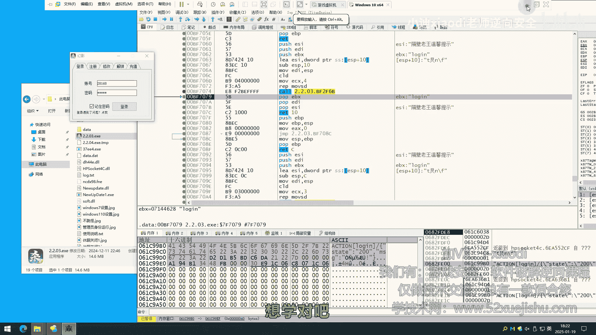
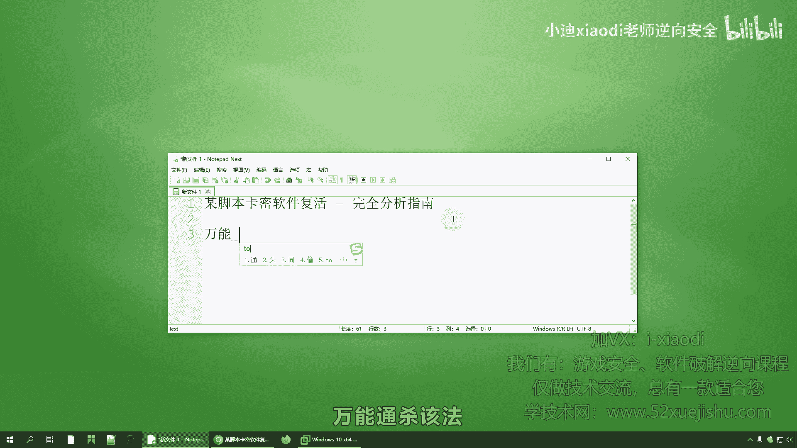
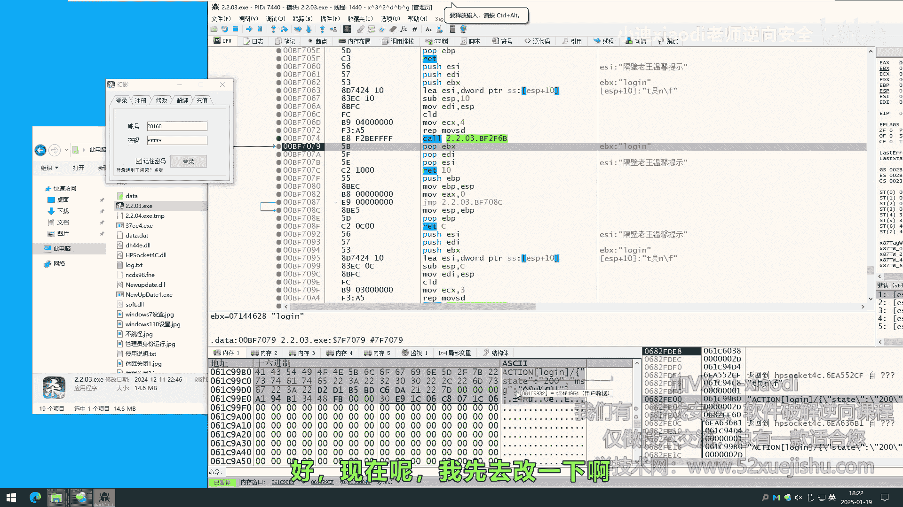
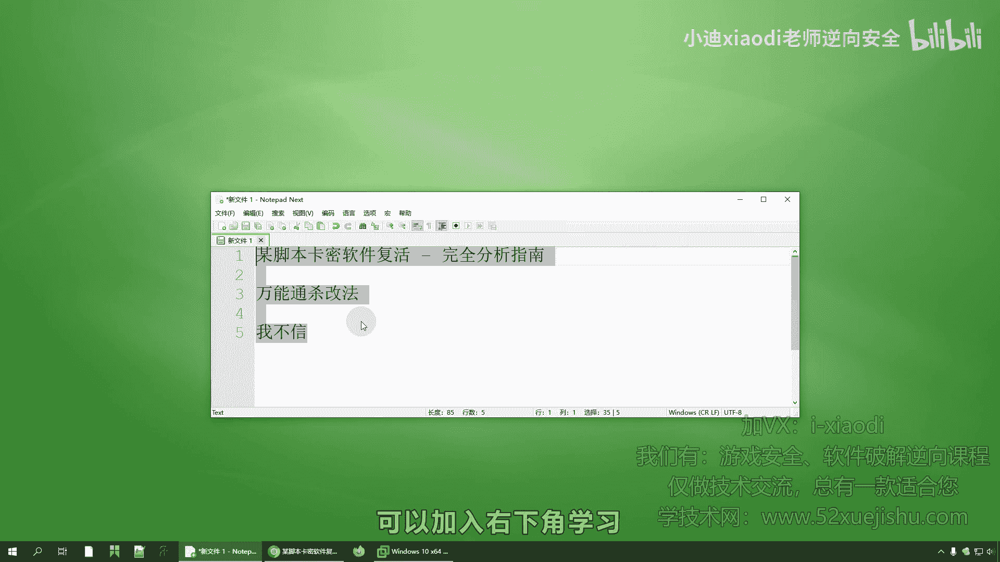

📚 逆向破解卡密软件：第1章：课程简介与破解原理



大家好，我是小丁老师。本节课给大家带来《某脚本卡密软件复活完全分析指南》。所谓“复活”，就是让一个已经跑路的卡密脚本软件重新恢复可用。这套内容我已经同步发布到论坛了，感兴趣的同学可以去阅读，所有相关细节都整理在那边。


经常有同学纳闷，为什么一讲逆向破解，就有这么多人愿意听？逆向破解到底能干什么？说直白一点，逆向能帮我们分析各种各样的小软件。举个例子，你花钱买了一个脚本软件，结果用着用着突然失效了；又或者开发者直接跑路，卡密服务器永远连不上，导致软件彻底瘫痪。遇到这种“软件到期、失效、跑路”的情况，难道只能自认倒霉吗？通过技术手段，完全可以让它重新用起来。这就是逆向破解的魅力所在。

当然要强调一下，本节内容仅做技术交流，请不要把它用在违法违规的场合。

> 注意：本节内容仅用于技术学习和研究，请勿利用逆向技术对商业软件进行非法破解或传播。

在正式开始之前，先明确一下本次破解的整体思路。目标软件登录时会弹出一个“已到期”的提示框，我们的切入点就是这个弹框。通过调试工具附加进程，在弹窗函数上设置断点，然后一步步回溯它的调用关系，从根源找到到期判断逻辑，最后用一张正版卡的数据把校验内容替换掉，实现即使提示“已到期”也照样能用。下面每一章都会把这个流程逐步展开。



🔧 逆向破解卡密软件：第2章：附加调试进程与弹窗定位

先看目标软件的现象。点击登录按钮之后，程序弹出一个提示框，上面写着“已到期”。既然它一定会弹出这个提示框，那我们就能从弹框入手顺藤摸瓜。

首先打开 DBJ 这款调试工具，它是一个动态分析工具，可以在进程层面和目标软件建立连接。什么叫建立连接？简单讲，就是让调试器可以读取目标程序的内存、查看函数调用、设置断点、控制程序暂停和继续。点击附加之后，DBJ 和卡密软件之间就建立起联系了。

连接建立之后，我们要查看这个程序相关的代码和数据。在 DBJ 的符号列表中，找到目标模块并双击展开，符号名字和程序里出现的字符串是一致的。看到这些一致的命名，就可以确定：这部分代码和数据确实属于这个软件，后续分析也就有了方向。

程序当前还在正常运行。另外还需要说明的是，由于这是我之前分析时留下的环境，里面已经有一些断点。为了不让旧断点干扰本次操作，我先把所有断点全部禁用掉，让程序处于一个“干净”的运行状态。

接着继续观察，程序弹出了“已到期”的提示框。Windows 程序中的所有弹窗，最终都是由系统提供的消息框函数负责弹出的。现在我们要做的，就是在这个函数上下手。

在 API 列表中找到 MessageBox，对它下断点。什么是 MessageBox？把这个英文单词拆开看就明白了。Message 是“消息”，Box 是“盒子”，合起来就是“消息盒子”，也就是程序用来弹提示的弹窗函数。Windows 中任何弹窗，无论内容是什么，最终都会进入这个函数。它的标准形式可以用下面这段代码描述：

```c
int MessageBox(
    HWND hWnd,        // 父窗口句柄
    LPCSTR lpText,    // 弹窗中显示的文本
    LPCSTR lpCaption, // 弹窗标题
    UINT uType        // 按钮和图标类型
);
```

找到 MessageBoxA（字符串版本的 MessageBox）之后，按 F2 给它打上断点。什么是断点？断点就是“中断的点”，也就是程序执行到这条指令时会被强制暂停。DBJ 中下断点之后，这一行会变成红色。红色代表警戒位置，意思是“程序运行到这里必须停下来”。

这和日常生活的逻辑是一模一样的。红灯停、绿灯行、黄灯亮了等一等，程序运行中的红色断点也是同一个道理：一旦遇到红色标记，程序就乖乖停下，等待你的操作。设置好断点，再点击软件中的“登录”按钮，程序立刻在 MessageBoxA 处停了下来，左下角同时提示“已暂停”。如果你是零基础小白，完全不用担心，断点不是什么神秘的技术，它和红绿灯的设计逻辑差不多，是一个“信号控制暂停”的机制。程序停住之后，我们就可以慢慢分析它周围的数据了。

🎯 逆向破解卡密软件：第3章：回溯调用栈，找到“已到期”源头

上一节中，程序已经被断点稳稳地拦在了 MessageBoxA 函数内部。到这一步，很多人会好奇：程序不是已经停下来了吗，接下来该看什么？关键就在这个地方——程序虽然停下来了，但弹窗本身并不是最终要找到的目标。

弹窗只是一个被调用的函数，相当于最后执行“喊话”的那个人。真正要关心的问题是：这次弹窗到底是谁让弹出来的？它经过几层传递才到达这里？要搞清楚这个问题，需要返回到上一层。程序的函数调用是一层套一层的，就像命令的传达过程：最上级下达指令，中间层转发指令，最底层执行指令。弹窗只是最底层的执行者，指令是从上一级传下来的。所以我们要沿着调用链往上回溯，找到最早发出“喊出已到期”这个命令的那段代码，这样才能定位到源头。

具体操作分为两步。按 Ctrl+F9，这个快捷键的意思是“运行到返回”，也就是让程序从当前所在函数里一直执行到函数结束、即将返回调用者的位置；然后按 F8，也就是单步步过，让程序真正跳回上一层调用点。两个键组合起来，就能一层一层往外跳。

回到上一层之后，先在当前这一层的代码里找一找有没有关键信息。结果发现这一层里面暂时没有我们要找的字符串，只是一些常规的函数调用和参数传递。遇到这种情况，不要停下来，继续按 Ctrl+F9，再按 F8，再往上回溯一层。连续两层都没有明显收获，这很正常，调用链往往要分很多层，不可能每一层都有需要关注的内容。如果在具体分析中对某条指令不太确定怎么判断，咱们社区里有更详细的逐指令讲解，可以对照着一起学习。

继续重复操作，按 Ctrl+F9，然后按 F8，这一次这一层出现了肉眼可见的关键内容。仔细一看，代码里非常清晰地出现了“已到期”这个字符串。也就是说，这层代码就是真正的弹窗调用点：它判断出软件已到期，于是调用了 MessageBox，把“已到期”弹了出来。

再往下看，这里有一个条件跳转指令。在“已到期”分支的旁边，这个跳转可以直接跳过整个错误弹窗流程，跳到后面“未到期/成功”的逻辑。跳过去之后，程序就会进入后续逻辑，比如载入主窗口。也就是说，从这一层直接修改跳转指令，是可以绕过到期限制的。不过本节我们并不打算用这种简单粗暴的方式，后面会介绍一种更通用的处理思路。

⏳ 逆向破解卡密软件：第4章：时间比较与设备码/登录封包分析

上一节我们定位到了“已到期”字符串所在的代码层，这是整条调用链中非常关键的一环。这一节继续沿着调用栈向上回溯，看看更上层还藏着什么重要逻辑。继续按 Ctrl+F9 返回上一层，再按 F8，翻看代码时发现这里有一个 18:18:32 的数据，这明显是一个时间值。由此可以判断，这里存在一次时间比较逻辑。

程序内部记录了某个授权截止时间，同时在更上层，很可能会去服务器获取当前时间，然后拿这两个时间做比较，最终决定是进入“已到期”分支还是“未到期”分支。这类判断用伪代码表示就是：

```c
if (当前时间 < 截止时间) {
    进入软件;
} else {
    MessageBox("已到期");
}
```

按 Ctrl+F9 继续返回上一层，再按 F8。这一层出现的内容开始变得非常关键。先看到的是一个可能是设备码的数据。什么是设备码？把显卡信息、主板信息、网卡 MAC 地址、系统序列号等硬件特征收集起来，经过一系列数据运算和哈希处理，最终得到一个字符串，这就是机器码。它可以唯一标识一台机器，相当于这台电脑的“身份证号”。用公式表示：

```c
机器码 = Hash(GPU_ID + 主板ID + 网卡MAC + 系统序列号)
```

设备码旁边，还跟着一些和登录状态相关的字段。继续一层一层往上层返回，每返回一层，能看到的信息就更多一些。再往上走，可以看到登录封包的内容，也就是客户端发往服务器的登录请求数据。封包不是一步组装完的，而是每一层往里填一部分字段，逐层完善，最终形成一份完整的登录数据包。

这个登录封包可以简单理解成如下的结构：

```c
typedef struct _LoginPacket {
    char  device_code[64];      // 设备码/机器码
    char  expire_time[32];      // 授权截止时间
    int   status;               // 登录状态
    char  card_info[128];       // 卡信息
} LoginPacket;
```

到了这里，程序的核心校验链路已经清晰了：获取设备码，获取服务器时间，判断是否到期，组装登录封包，返回登录结果。那么接下来该怎么让它永久可用？需要一个关键道具：一张正版卡。用正版卡登录一次，拿到合法数据，然后把程序内存中校验的这部分数据整体填充为正版内容。这样程序在校验时读到的就是正版数据，也就能绕过到期限制，实现无限使用。



有的同学可能会问，具体改哪个地址、填什么值，有没有一套固定的规律？规律肯定是有的，改哪个字段、怎么构造数据，都有套路。这个万能通杀方法后面会演示核心思路，完整的通杀方案在社区课程里有专门的讲解。



✅ 逆向破解卡密软件：第5章：通杀改法演示与效果验证

上一节我们分析了时间判断、设备码和登录封包，明确了核心校验链路。这一节就来实战演示通杀改法，看看效果究竟如何。先把视频暂停一下，到调试器里把之前定位到的封包内容改成正版卡的数据。修改完成后，程序依然处于中断暂停的状态。这时只需要在调试器里点击“运行”按钮，让程序继续执行。

程序很快又弹出了几个弹框，这些弹框全部点掉取消。然后可以看到，软件竟然还是提示“已到期”，但是完全没有关系。因为正版数据已经写进对应的内存位置了，程序真正读取到的内容是正版的，所以它照常进入了主窗口。看到没有，软件进来了，主界面加载出来了，功能都能正常使用。



由此可以看出，“已到期”这个弹框只是程序默认写死的一个提示弹窗。它的作用仅仅是提示用户“授权到期了”，并不真正决定软件能不能用。既然是写死的文本，那就可以任意修改。比如有同学说：“我不信，你能把‘已到期’改成‘我不信’吗？”当然可以，而且操作起来并不复杂。

为了证明这一点，我重新把软件分析了一遍，把弹窗里的文本改成“我不信”三个字。然后点击登录，弹窗里显示的就是“我不信”。这段修改对应的代码变化可以这样理解：

```c
// 修改前
MessageBox("已到期");

// 修改后
MessageBox("我不信");
```

经过修改之后，软件的功能依然是可用的。窗口可以正常排列，各个按钮都能点击，没有任何问题。因为我当前没有运行游戏，所以看不到它在游戏内的实际渲染效果，但单从程序本身来说，它已经完全正常工作了。再运行一次做最终确认，程序能正常启动并进入主界面，到此整个“复活”过程也就完成了。

📝 逆向破解卡密软件：第6章：课程总结与学习建议

到这里，本节课的全部核心内容已经走完了。我们来一起回顾一下卡密软件“复活”的完整流程：从现象来看，目标软件登录时弹“已到期”，所以我们从弹窗入手，用调试工具附加进程，让程序和调试器建立连接；随后在 MessageBox 上打上断点，把程序拦截在弹窗函数处；接着回溯调用栈，逐层向上查找，定位到“已到期”字符串所在的那一层代码；再继续往上分析，找到了时间比较逻辑、设备码/机器码生成逻辑以及登录封包的组装过程；最终，把正版卡数据填充进去，程序即使弹“已到期”也能正常进入使用。

以下就是本次课程的核心操作要点，汇总成一个清单：

- 附加进程之后，在 MessageBoxA 上按 F2 下断点，点击登录触发暂停。
- 按 Ctrl+F9 运行到返回，再按 F8 返回上一层调用，重复此操作直到找到目标字符串。
- “已到期”弹窗所在层存在条件跳转，可以跳过错误分支，直接进入成功逻辑。
- 时间比较逻辑通常出现在特定时间常量附近的代码中。
- 设备码由显卡、主板、网卡、系统序列号等硬件信息哈希得到。
- 正版卡数据是通杀改法的关键，将程序内存中的校验数据填充为正版值，即可无限制使用。
- 弹窗文本可以自由修改，例如把“已到期”改成“我不信”。



逆向破解最有意思的地方就在于此：当一个软件看似已经彻底失效的时候，你还能通过分析它的调用逻辑、数据结构和校验方式，把它重新“救活”。这也是为什么这么多同学愿意听逆向课。如果你喜欢这类内容，欢迎加入学习，我们下期再见。

