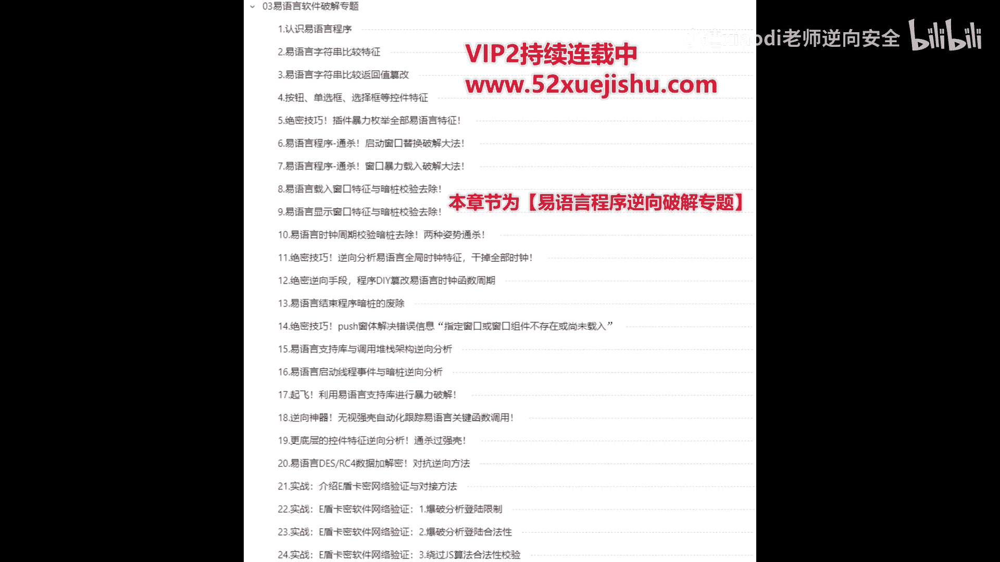
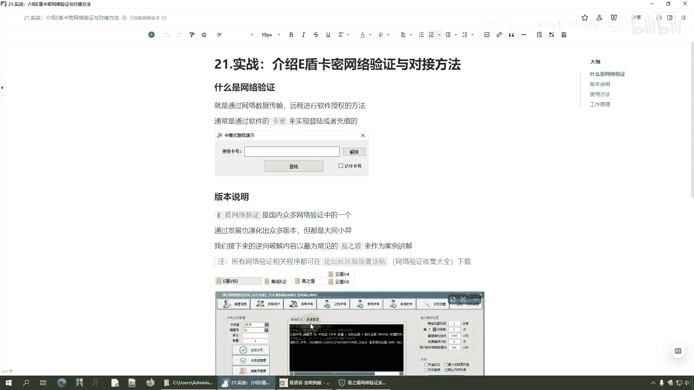

# 🔐 黑客技术邪修-网络验证破解：第二十一讲：实战介绍异盾卡密网络验证与对接方法



在本节课中，我们将学习异盾卡密网络验证的基本概念、常见版本、具体对接步骤以及它的工作原理。我们会用一个简单的本地服务器案例，一步步演示如何让软件通过卡密完成远程授权。目标是把“网络验证对接”这件看似神秘的事情讲得明明白白，让零基础的同学也能动手操作。

## 🌐 什么是网络验证？

网络验证是一种通过网络数据传输，远程完成软件授权的方法。通俗地说，软件本身不存储授权信息，而是把卡密发送到服务器，由服务器判断这个卡密是否有效，再把结果返回给客户端。整个过程可以写成这样一个简单流程：

```text
输入卡密 -> 客户端发送到服务器 -> 服务器校验 -> 返回成功/失败 -> 客户端执行对应操作
```

实际使用中，通常是通过软件的卡密来实现登录或者充值。比如说，有一个程序在界面上要求你输入卡号，随便输入一个卡号后点击登录。正常情况下按钮按下之后会等待一小段时间，然后界面会给出提示。如果服务器已经停止运行，也就是所谓的“跑路”了，程序就会提示“连接服务器失败，请稍后尝试”。反过来，如果服务器正常运行，而卡号是错的，程序就会提示“卡号不存在”。

不管结果如何，这个程序都需要一个卡密才能进入登录流程。没有卡密，你就无法正常使用软件。所以，网络验证本质上就是“认卡不认人”的远程授权机制。

## 📦 异盾网络验证的版本与特点

异盾网络验证是国内众多网络验证系统中的一种。这个系统在发展的过程中演化出了很多版本，但总体思路都差不多。我们接下来的逆向破解内容，选择最常出现的“易支盾”作为案例来讲解，因为它的典型性和覆盖面最广。

需要说明的是，所有与网络验证相关的程序，都可以在论坛社区板块的置顶帖中找到。在那个帖子里有一个“网络验证收集大全”，大家可以根据需要下载对应的版本，其中就包括异盾的常见版本。

异盾常见的版本有下面这些：

```text
异盾 V60
离线一起异制盾
云盾 V4（异盾改版）
云盾 V6（异盾改版）
```

严格来说，这几种版本都属于异盾的体系，只是在功能和稳定性上做了不同的调整。学习的时候，只要掌握其中一个版本，其他版本基本就能触类旁通。

## 🛠️ 异盾网络验证的对接步骤

了解了基本概念和版本情况之后，我们来看看异盾网络验证到底怎么用。其实使用方法非常简单，核心就是先运行服务端，再运行客户端，然后测试卡密。下面是具体的操作步骤。

第一步，运行服务端软件。这个软件一般运行在服务器上，所以它叫服务端软件。我们这里以本地服务器为例子，找到服务端软件之后，不需要修改任何配置，直接运行即可。稍等片刻，软件就会启动起来。

第二步，运行客户端程序。异盾官方并不直接提供编译好的客户端软件，而是会发送源代码给使用者。所以你需要拿到源代码之后，自己编译程序，或者以调试模式直接运行。

第三步，进行登录测试。运行起来之后，我们可以假设左边这个服务端软件运行在服务器上，右边这个客户端软件运行在用户的电脑上。在客户端里随意输入一个卡号，然后点击登录。这时候客户端会提示“卡号不存在”，服务端这边也会在日志信息里显示“卡号不存在”。两边的信息是同步的，这条日志就说明通讯链路已经打通了。

第四步，进行开卡测试。我们回到服务端去开一张卡，点击生成卡号，然后取消当前选择，再点击所有卡号，就能看到列表中有很多卡号。复制其中一个卡号，把卡号填到客户端的输入框中，再次点击登录。此时客户端就会显示登录成功，服务端也会出现一条成功的日志。到这里，一次完整的对接测试就完成了。

整个流程可以浓缩成这样的代码逻辑：

```python
def login(card_key):
    response = send_to_server(card_key)
    if response == "success":
        load_main_window()
    else:
        show_error("卡号不存在" or "连接服务器失败")
```

对接异盾网络验证，本质上就是让客户端发请求、收反馈。这个反馈决定软件是进入主界面，还是停在登录提示上。

## ⚙️ 异盾网络验证的工作原理

上面介绍了对接步骤，那么软件运行之后，后台到底做了哪些事情？我们来拆解一下。整个过程可以划分为初始化、登录请求、服务器校验和反馈处理四个阶段。先来看初始化阶段。

客户端软件启动后，会先读取配置项，然后执行一个“验证初始化”的操作。这个操作实际上是把服务器的 IP 地址、端口号、软件的版本号以及软件的名称，统统写入到程序中，用来初始化与服务器的连接。以本地环境为例，服务器 IP 我们填的是 `127.0.0.1`，这个地址代表本地服务器，是一个需要记住的小知识点。所谓初始化连接，可以理解为软件在正式验证之前先“打招呼”：

```text
服务器地址 = 127.0.0.1
端口号 = 服务器配置的端口
版本号 = 当前软件版本
软件名称 = 当前程序名称
```

接下来，当我们点击登录按钮时，客户端就会执行一个“验证卡登录”的操作。这个操作会把卡密相关的信息发送到服务器，请求服务器判断卡密是否合法。发送的信息往往不是明文，而是经过加密处理的通讯数据。

服务端软件接收到来自客户端的通讯信息后，会先校验这个通讯信息的合法性，然后再发送网络数据包，把校验结果反馈给客户端。这里的“合法性”有两层意思：一是数据包是否有效，二是卡密是否正确。把这两层含义用代码表示就是这样：

```python
def check_communication(data):
    if not is_valid_packet(data):
        return "非法请求"
    if not is_valid_card(data.card_key):
        return "卡号不存在"
    return "登录成功"
```

客户端收到反馈信息之后，会对结果进行判断。如果结果是登录成功，就载入工作窗口或者功能窗口，让用户正常使用软件；如果反馈是登录失败，界面就会直接提示登录失败。不仅如此，客户端还会根据反馈结果执行登录、冻结、充值等相关的操作。也就是说，判断卡密是否有效、是否被冻结、是否已经到了有效期，这些逻辑全部由服务器完成，客户端只负责展示反馈结果。

所以，讲到最后你会发现，异盾网络验证的对接实际上非常直观：客户端发起请求，服务器返回结果，客户端根据结果决定下一步行为。站在对接者的角度，你要做的事情就是按照协议把卡密发出去，然后把返回的数据解读出来。

## ✅ 总结



本节课中，我们一起学习了异盾网络验证的完整知识，包括什么是网络验证、异盾有哪些常见版本、如何对接使用，以及它在后台的工作原理。我们用一个本地服务器的例子，完整演示了从启动服务端、运行客户端、测试错误卡号到开卡登录成功的全过程。同时，我们也把初始化参数、加密通讯、合法性校验这些概念拆开讲了一遍。希望大家回去之后能自己动手尝试一次对接，开发出自己的第一个网络验证软件。只要把流程走通，你会发现它并没有想象中那么复杂。
