# 黑客技术邪修-逆向破解：实战利用封包技术破解VMP强游戏外挂程序，网络验证卡密绕过技巧

## 📖 课程概述

在本节课中，我们将要学习如何利用封包技术来破解带有网络验证的软件。这个技术属于逆向破解领域的一个经典方向，通过对软件发送和接收的网络数据包进行分析与修改，绕过服务器端的验证限制。课程将利用星球内部开发的“风暴工具”进行抓包演示，破解目标是一个带有VMP保护壳和网络验证功能的软件。我们将看到即使是最强大的VMP加壳保护，在封包技术面前也形同虚设。

## 🛠️ 工具与目标软件介绍

很多同学可能会疑惑，逆向破解技术到底能做什么？简单来说，它能够绕过网络验证软件的各种限制，比如账号登录、时间限制、功能锁定等等。今天我们要动手操作的就是一个需要账号密码登录的网络验证软件，它的验证流程是典型的客户端与服务器交互模型。在登录过程中，客户端会把账号信息发送到服务器，服务器验证后返回登录结果，比如是否登录成功、到期时间是多少。这种网络数据包被称为“封包”，是通信双方交换信息的载体。

先来看看这个目标软件的运行情况。打开软件后，需要输入账号，然后点击登录。如果没有这个用户，就会提示“没有这个用户”。如果账号到期了，就会提示“账号到期”。如果账号没有到期，则会提示具体的到期时间，然后成功登录。这是一个标准的网络验证流程，也是我们要破解的对象。

## 📡 抓包工具使用与操作流程

接下来我们看看如何操作。首先运行目标程序，然后运行我们的抓包工具。这个工具是工具包中的一个原创工具，内部社区专用，支持对指定进程进行数据包拦截。操作流程很简单：打开工具，在进程列表中找到目标程序（注意要选择x86架构的进程，因为目标软件是32位的），然后点击“开始抓包”，再回到目标程序点击登录按钮。

此时工具会拦截到几个数据包。我们需要重点关注的是“RE位”收到的数据包，也就是服务器返回给客户端的数据。这些返回包包含了服务器对登录请求的响应内容，是破解的关键所在。第一次登录时，把收到的两条数据包复制下来保存好，可以使用右键菜单中的“复制封包数据”功能。然后关闭软件，重新打开，再次登录，记录第二次的封包数据。这样我们就有了两组登录数据可以对比分析。

## 🔍 封包数据分析与时间戳识别

现在对比一下两次登录收到的封包数据，观察差异。在180011A区域，两次数据有细微的不同。再看第二个返回包，附件部分也发现了变化。但注意观察，有一部分数据是完全相同的，这个相同的部分是什么呢？这里要介绍一个关键概念——时间戳。

为了验证这个判断，再执行一次登录操作，注意界面显示的时间是**2024-9-9 10:06:23**。然后在搜索引擎中搜索“时间戳转换工具”，找到在线转换工具后，输入这个时间，点击转换，得到一串数字。接着用计算器的程序员模式，把这串数字转换成十六进制，观察得到的值：

```
十进制时间戳: 1725854783
十六进制: 0x66DE581F
```

把这个十六进制数和封包中的数据对比，发现封包数据是`1F58D166`，正好是时间戳的字节序反转。这里的规律非常清晰：

```
封包中的数据 = 时间戳十六进制表示的字节逆序
示例: 66 DE 58 1F → 1F 58 D1 66
```

也就是说，服务器返回的封包中包含了时间戳信息，验证了账号的到期时间。这个发现是后续破解的基础。

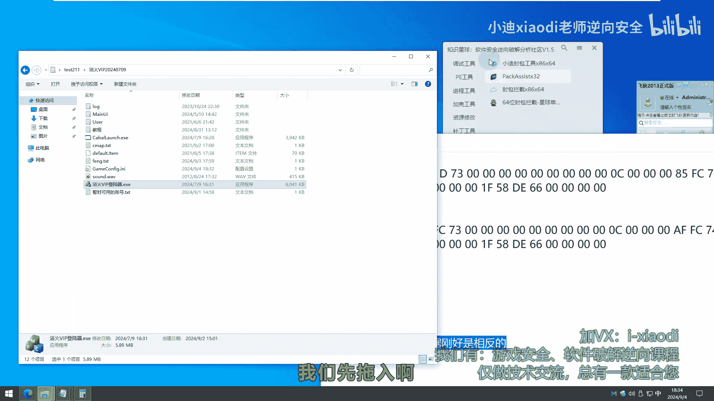

## ⏱️ 时间戳转换与封包校验机制

日期和时间在计算机系统中常常以时间戳的形式存储和传输。时间戳是从1970年1月1日开始计算的秒数，理解了这一点，就明白了封包中某个固定位置的数据到底是什么含义。

来验证一下这个规律：封包数据`1F58D166`，用十六进制编辑器查看，看到`66DE581F`，两者是相反的。这说明封包在传输过程中进行了字节序的转换，通常称为“小端序”存储。知道这个规律后，下次看到类似的封包数据，就能快速判断出它包含时间戳信息。时间戳在封包校验中的角色可以用公式表示：

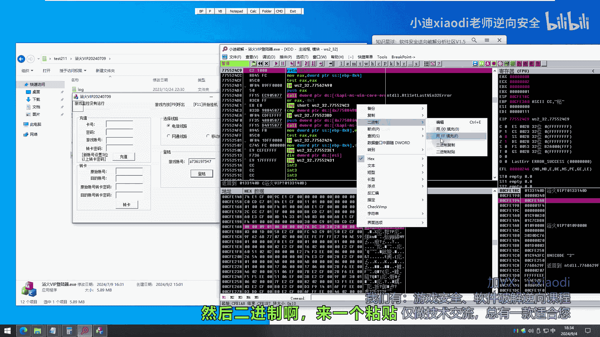

```python
# 时间戳验证逻辑伪代码
server_timestamp = decode(binary_packet, offset=0x1A)
if server_timestamp > now():
    login_success()
else:
    login_fail("账号已到期")
```

## 🔓 实战修改封包修改到期时间

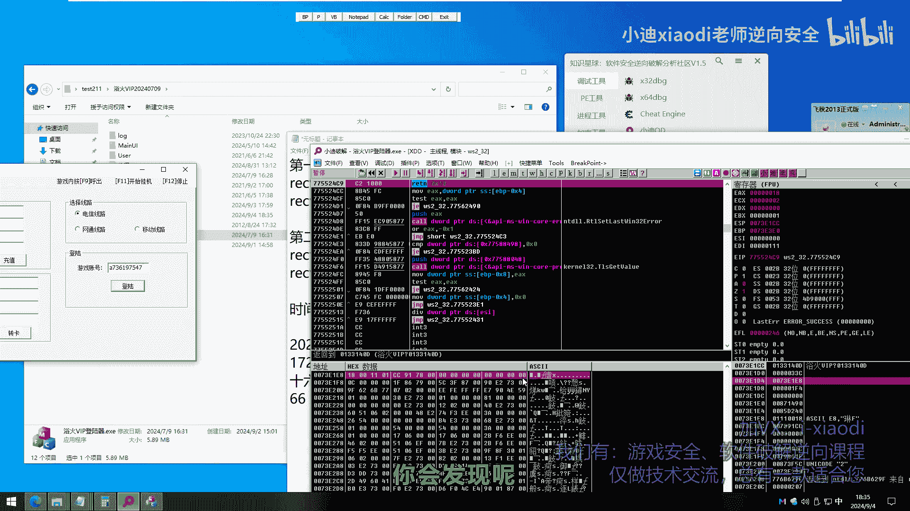

现在思考一个问题：既然封包里有时间戳，能不能修改它来改变到期时间呢？答案是肯定的。实际操作一下这个修改过程。首先打开软件，把登录流程跑起来，注意这里在2ECV处打一个断点，方便调试封包数据。先运行程序，然后填入一个到期账号，点击登录，第一次断下来，第二次断下来，数据窗口跟随，看到的封包数据就是到期账号的返回数据。

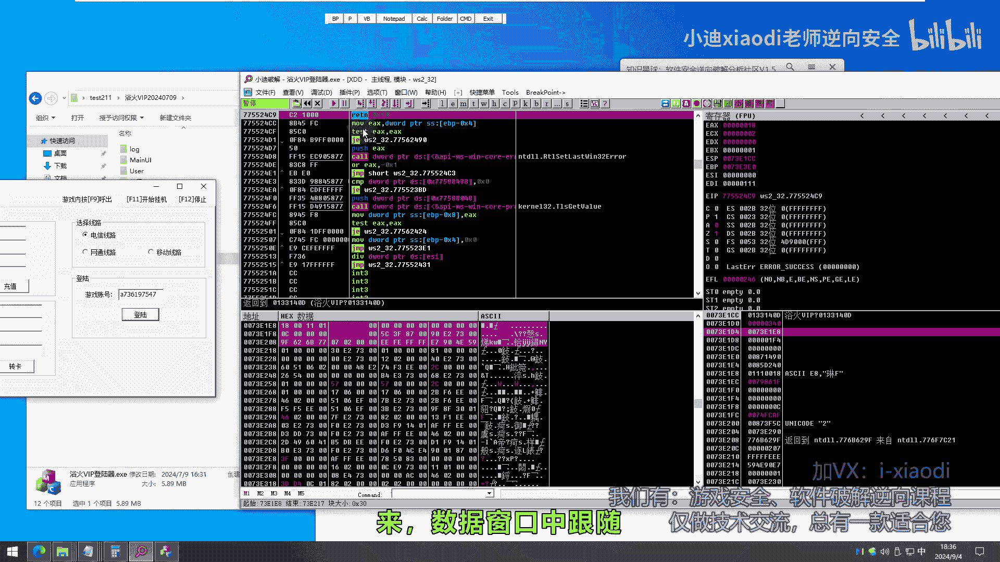

接下来，把没有到期账号的封包数据复制下来，选中当前数据区域，用二进制粘贴功能替换掉原来的数据。然后运行程序，观察结果。这时发现到期时间显示为**1970-1-1**，而且登录成功了，说明修改成功了一半，但显示的时间有问题。这是因为第一次收到的封包也会影响一些数据。没关系，重新来一遍更精细的操作。

再次拖入程序，按照之前的方法打上断点，然后登录。第一次断下来后，按`Ctrl+F9`运行，在1A00位置复制几行数据，使用二进制粘贴功能替换。再次执行，断下来后，`Ctrl+F9`，在数据窗口中跟随第二次数据包，把修改后的数据粘贴进去，二进制粘贴，运行。此时可以看到，到期时间显示为**2024-9-9**，登录也成功了。

这个破解的核心思路可以用一张简单的流程图表示：

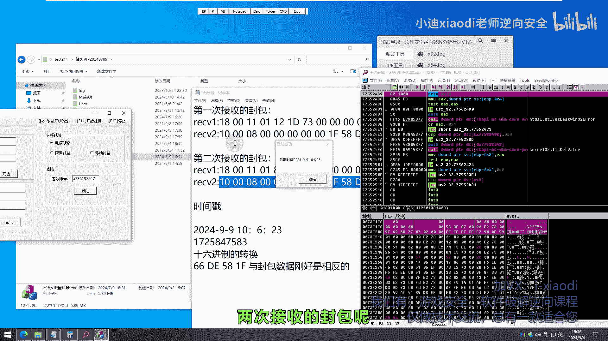

```text
原始流程:
账号到期 → 服务器返回到期时间戳 → 客户端拒绝登录

修改后流程:
账号到期 → 拦截返回封包 → 替换时间戳为有效时间 → 客户端接受登录
```

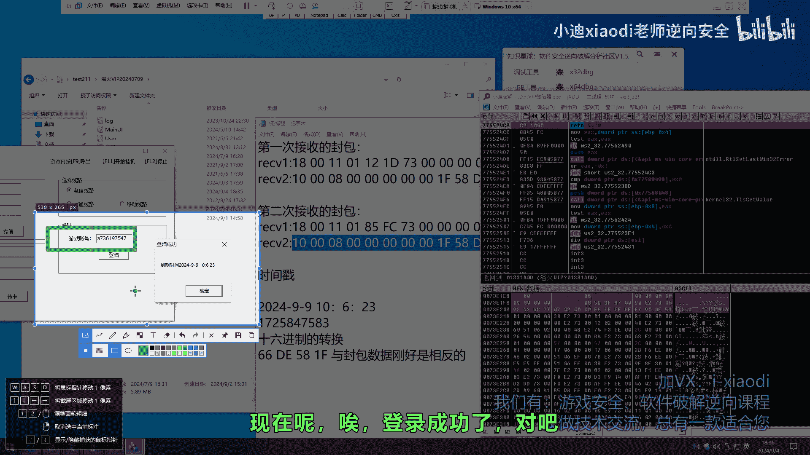

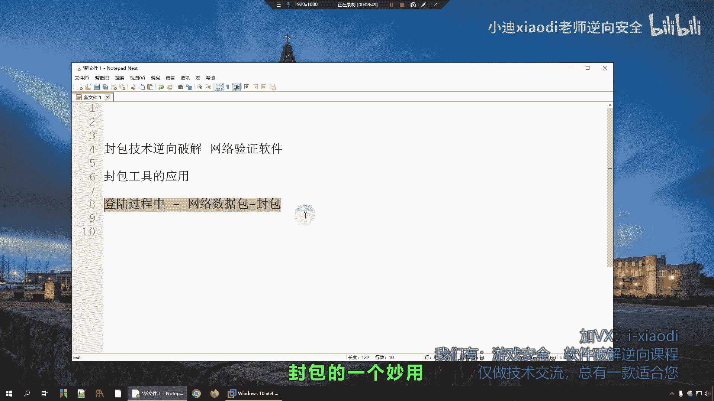

两次发包、两次收包，把两次接收的封包数据中的时间戳改成有效值，就完成了破解。这就是封包的妙用——不是绕过验证，而是直接篡改服务器返回的数据，让客户端认为验证已经通过。

## 🛡️ VMP加壳问题的突破

这个破解实例中，程序带有VMP壳。VMP（VMProtect）是一种非常强的软件保护壳，很多逆向破解工具都无法在这种壳下正常运行。但刚才的演示已经证明，风暴工具可以在VMP加壳的环境下正常工作，程序直接就能跑起来。有些同学可能会问：“VMP的壳能不能搞？”刚才的操作已经展示得非常清楚了，用这个工具，加了VMP壳的程序照样可以抓包、修改、运行。

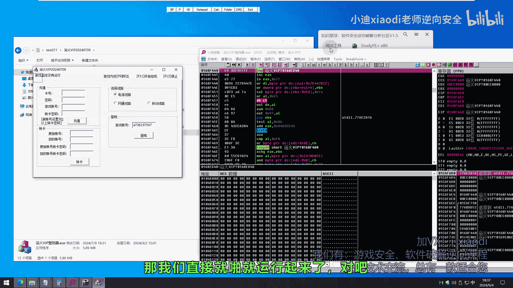

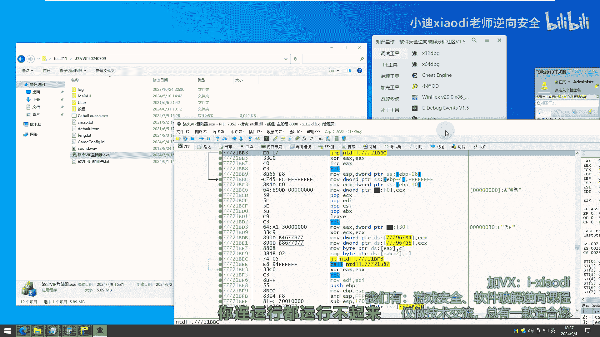

如果缺少这个工具，情况就完全不同了。没有工具的话，程序加壳后直接就会退出，根本运行不起来。这也说明了合适的工具对于逆向破解工作的重要性：有了合适的工具，看似强大的防护也能突破；没有工具，一切就无从谈起。

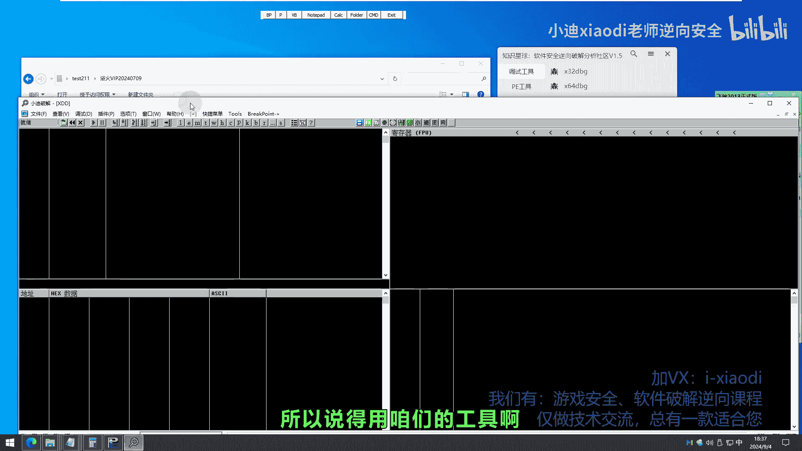

## 📝 总结

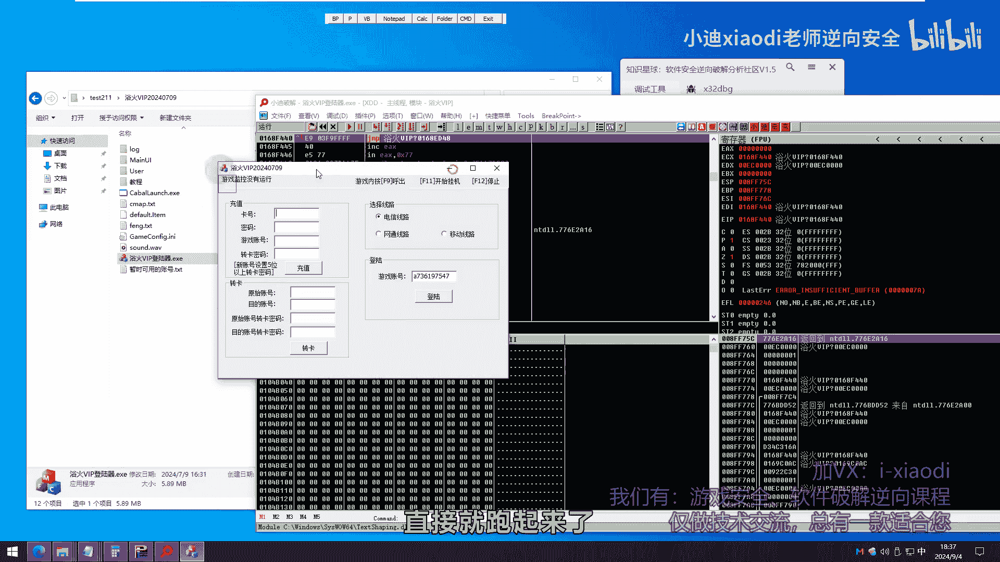

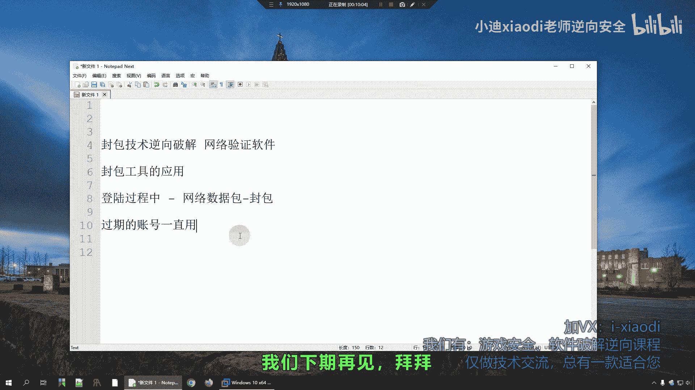

本节课中，我们一起学习了利用封包技术破解网络验证软件的核心过程。回顾一下要点：网络数据包也叫封包，在登录过程中会产生。封包数据中可能包含时间戳等关键信息，时间戳可以从时间转换工具获得，并转换成十六进制观察其字节序。通过对比不同账号的返回封包、定位时间戳字段，使用抓包工具和断点调试功能修改封包中的时间戳数据，可以将过期账号变为有效账号，实现绕过网络验证的目的。同时，这个工具还能在VMP加壳环境下工作，突破程序保护壳的限制。这节课只是简单了解了封包技术的应用。如果想要深入学习更多技术细节，进行系统化的学习与研究，可以跟随后续课程，逐步构建完整的逆向破解知识体系。
