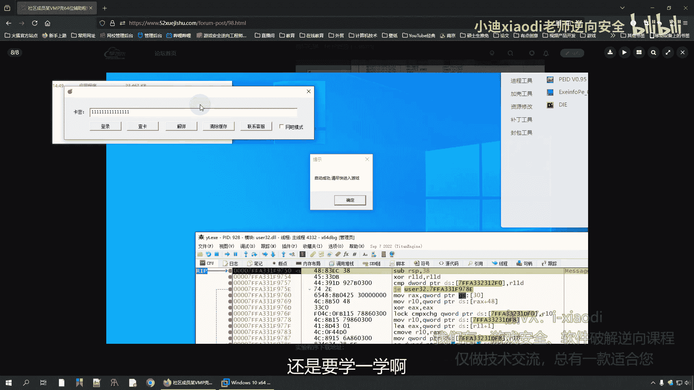
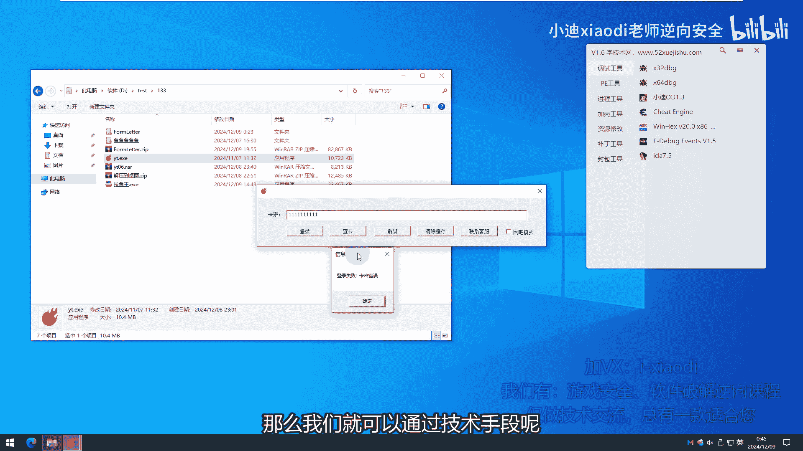
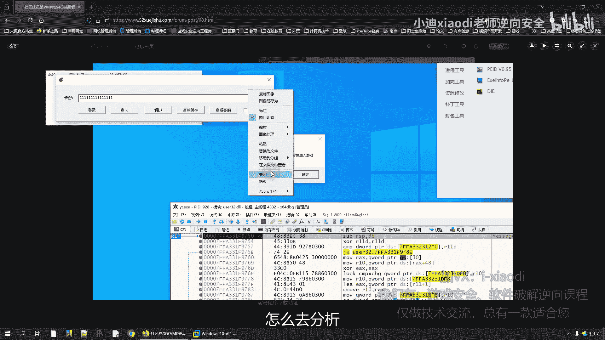
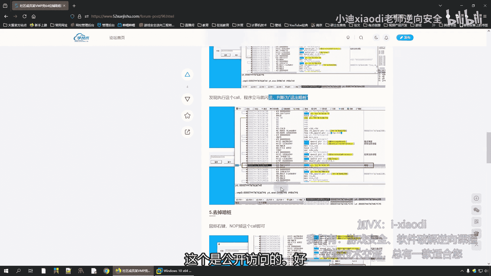
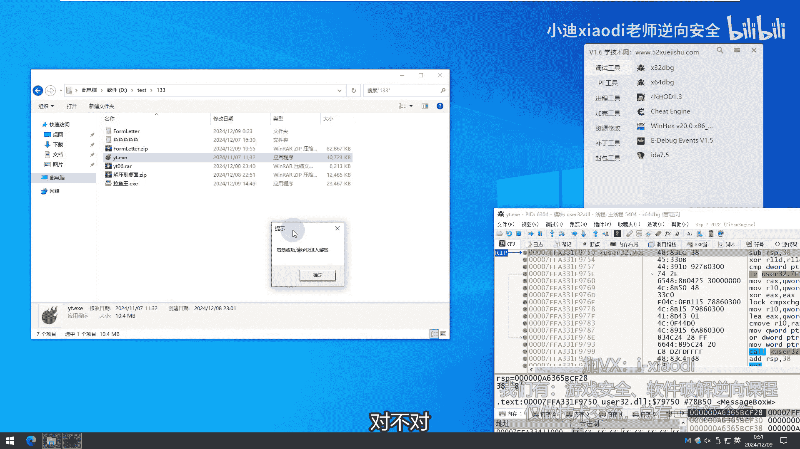

# 黑客技术邪修-逆向破解：01：认识逆向破解与游戏外挂

在本节课中，我们将学习如何使用x64dbg调试工具，对一款64位的游戏外挂程序进行逆向分析和破解。我们会从检查软件防护开始，逐步演示如何定位关键逻辑、修改跳转指令，最终实现绕过登录验证的目的。整个教学过程将使用一个实际的外挂程序作为案例，帮助大家理解逆向破解的基本思路和操作步骤。

很多初学者可能会好奇，逆向破解这门技术到底能做什么。简单来说，逆向破解就是通过技术手段去突破软件的一些限制。说得直白一点，就是破解软件。比如现在很多软件需要输入卡密或者序列号才能使用，逆向破解就是要绕过这些验证机制。虽然听起来像是破坏行为，但从另一个角度看，如果我们破解的是一个游戏外挂程序，那性质就不一样了。

游戏外挂是破坏游戏平衡的工具，这是大家都知道的常识。如果我们能够破解掉外挂软件，让它无法正常工作，那不就等于在维护游戏的公平性吗？这样一想，学习逆向破解技术不仅不是坏事，反而是对游戏环境的一种保护。所以这门技术还是值得花时间去学习和研究的。

接下来我们来看看这个外挂程序的工作原理。当我们随便输入一个卡密，然后点击登录按钮，程序会提示登录失败、卡密错误。我们的目标是通过技术手段，让程序在即使没有正确卡密的情况下也能直接登录成功。一旦登录成功，程序就会显示启动成功、请尽快进入游戏的提示。下面我们就一起来分析这个外挂软件，看看它是如何验证卡密，以及我们该如何破解它。



## 第一步：检查软件是否有防护





首先，我们需要确定这个软件是否带有防护机制。这一步非常重要，因为如果软件被加壳保护，直接进行分析可能会遇到很多障碍。我们先关闭弹出的错误提示窗口，然后使用工具包里的PE查看工具，把程序拖进去查看它的基本信息。

通过查看工具，我们可以看到这是一个64位的程序。现在大家的电脑应该都知道分为32位和64位两个体系，程序也是一样，有32位版本和64位版本。既然是64位的程序，那我们后面就需要使用64位的调试工具来进行分析。

接下来我们重点查看区段信息，在区段列表里发现了一个名为VMP0的区段。稍微懂点软件保护的人都知道，VMP是一个壳，是软件用来防止被逆向分析的一种保护手段。我们再换一个工具来确认一下，用另一个PE分析工具打开这个程序，虽然表面上没有明显的提示信息，但在说明文字中可以看到有“sections protected with”这样的描述，后面跟着的正是VMP的字样。这说明这个程序确实是有防护的。

那么，面对有防护的程序，我们该害怕吗？当然不需要。防护只是增加了分析的难度，并不代表无法破解。我们继续往下操作。

## 第二步：附加进程并设置断点

现在我们把程序运行起来。程序启动后，打开x64dbg调试工具。由于目标程序是64位的，所以我们选择x64dbg的64位版本。接下来，在调试工具中点击文件菜单，选择附加选项，然后在进程列表中切换到我们刚才运行的那个程序的主模块。

当我们点击登录按钮时，程序会弹出一个错误提示窗口。我们的思路是，先对这个弹窗下断点，这样当程序准备弹出窗口时，就会中断下来，我们就能趁机分析程序的执行流程。断点的作用就是让程序在指定的位置停下来，方便我们观察程序的运行状态。

现在程序已经中断在弹窗位置，界面显示已暂停。我们需要返回到程序的上一层，也就是找到是哪个代码调用了这个弹窗。这时我们使用快捷键Ctrl+F9，这个快捷键的功能是运行到返回，也就是让程序执行到当前函数的返回语句。执行到返回位置后，再次按下F8进行单步调试，这样我们就回到了上一层代码。

通过单步跟踪，你会发现程序是从某个位置跳转到这里来执行错误弹窗的。这个位置就是调用弹窗的地方，弹窗本身是调用了一个消息框函数，用于显示错误信息。再往下看，程序还调用了获取当前进程信息的函数，以及结束进程的函数。这个结束进程的操作，就是程序发现卡密错误后做的清理工作。

看到这里，规律就很明显了。程序验证卡密后，如果发现错误，就会跳转到弹窗和结束进程的分支。那么这个关键的跳转指令，或者说关键的分支逻辑，就在这个位置上面。只要我们把这个跳转指令修改为无条件跳转，让它直接跳过错误处理代码，就能实现破解。

## 第三步：修改跳转指令实现破解

在修改之前，我们先在关键跳转位置设置一个断点，然后关闭程序，重新运行并附加进程。操作步骤和之前一样，打开程序，点击文件、附加，切换过来，然后点击登录按钮。这一次，程序直接中断在我们设置的断点位置。

你会发现，程序执行到这里时，跳转箭头是虚线，说明程序没有跳转，而是直接往下走了。这里的跳转指令是条件跳转，它根据验证结果来决定是否跳转。我们需要把这条条件跳转指令改成无条件跳转指令。在汇编语言中，有符号跳转和无条件跳转的助记符是不同的。这里我们要把JNE改成JMP，JMP就是无条件跳转指令。这样程序无论验证结果如何，都会执行跳转，跳过下面的错误处理代码。

改完跳转指令后，我们按F8单步执行，观察程序的运行情况。注意看程序的反应，执行到某个函数时，程序直接崩溃退出了。这说明程序还有一个退出陷阱，也就是反调试机制。一旦程序检测到代码被修改，就会触发退出操作，导致程序闪退。这是一个常见的软件保护手段。

## 第四步：去除退出陷阱

针对这个退出陷阱，我们需要在关键位置也做一些处理。回到附加程序的操作步骤，再运行一次程序，点击登录，让程序断在断点位置。这时，我们先把刚才修改的跳转指令处理好，即将条件跳转改为无条件跳转。然后，把鼠标定位到退出陷阱的那行代码上，也就是程序闪退前执行的那个函数调用。

具体做法是，在那一行上用鼠标右键点击，选择二进制菜单，然后选择使用NOP填充。NOP是一条空指令，它不执行任何操作，只是占一个位置。用NOP填充后，这个退出陷阱就被废掉了。这样一来，程序再也不会闪退。

完成这些修改后，我们就可以放心大胆地让程序继续运行了。点击运行按钮，这时程序虽然会有一个新的弹窗，但这已经不是错误提示了。继续点击运行，你会看到程序显示启动成功，请尽快进入游戏。这说明我们已经成功破解了这个外挂程序的登录验证。

我们来理一下这个破解过程的逻辑：程序原本的逻辑是，如果卡密验证不通过，就执行JNE跳转到错误处理分支。我们修改后，JNE变成了JMP，所以程序无论如何都会跳转到成功分支，不存在验证失败的情况了。我们用伪代码描述一下这个变化。



修改前的逻辑结构是：

```python
if 验证通过:
    跳转到成功分支
else:
    跳转到失败分支（弹错误窗口，结束进程）
```

修改后的逻辑结构是：

```python
无条件跳转到成功分支
# 失败分支的代码已经不会被执行到了
# 退出陷阱的代码位置已经被NOP填充，不会导致闪退
```

## 总结



本节课中，我们一起学习了如何对一个带有VMP防护的64位游戏外挂程序进行逆向破解。整个流程包括检查程序防护、使用x64dbg附加进程、对弹窗下断点、跟踪关键跳转、修改跳转指令，以及去除退出陷阱。通过这一系列操作，我们成功地让外挂程序在没有正确卡密的情况下提示启动成功，在实战中验证了逆向破解技术的完整思路。如果大家对这门技术感兴趣，想要深入学习，可以访问相关的技术论坛了解更多内容。论坛刚刚建立，欢迎大家进去浏览、访问和提问。以上就是今天的内容，我们下节课再见。
