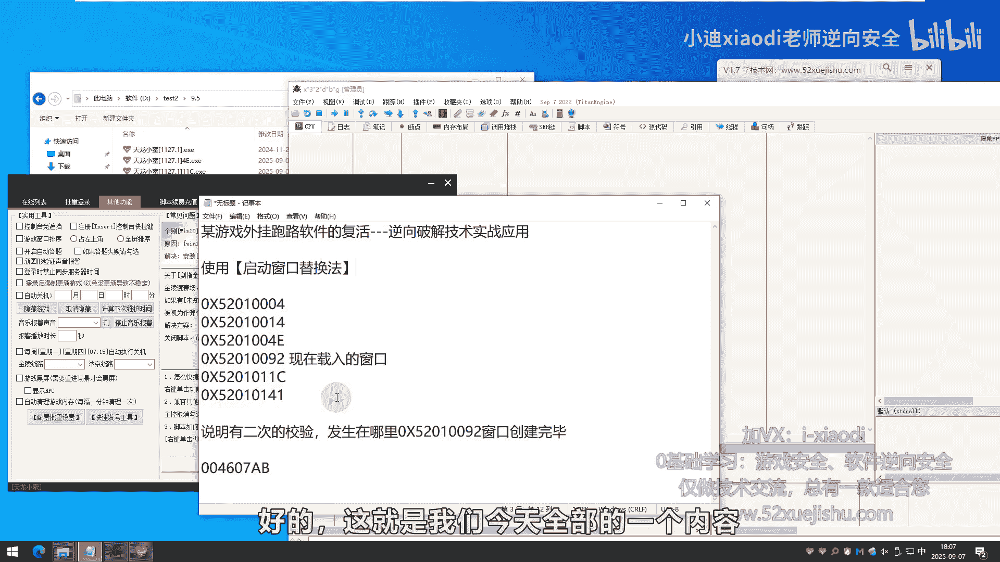

🔧 软件逆向破解教程：第1节：启动窗口替换法

在本节课中，我们将学习一种比上节课更深入的软件逆向破解技术——启动窗口替换法。这项技术能帮助我们复活失效的软件，尤其是那些作者跑路、无法通过正常方式使用的程序。今天学习的是一个黑客小技术，属于软件逆向破解的范畴。郑重声明，本技术为正规网络安全技术科普，所有操作仅用于技术交流，切勿用于非法用途。大家好，我是小迪老师，下面开始今天的讲解。

> 郑重声明：本技术为正规网络安全技术科普，所有操作仅用于技术交流，切勿用于非法用途。


首先，我们来回顾上节课的内容。上节课我们采用了“窗口暴破法”来绕过错误窗口，但不少同学反映该方法过于傻瓜化，缺乏技术含量，没有“排面”。为了满足大家的学习需求，本节我们换一种方法，即“启动窗口替换法”。这个方法相对深入，具备一定的技术含量，希望大家集中注意力，因为重点来了。所谓启动窗口替换法，核心思路非常简单，可以用下面的公式表达：

```
启动窗口替换法 = 将启动窗口ID替换为功能窗口ID + 清除二次校验
```

现在，我们开始实际操作。第一步是重新分析目标程序。我们将程序直接拖入调试器，点击运行，此时会出现一个错误弹窗。我们点击插件菜单，选择“小迪5.0”，然后点击“开始分析”。这里需要记录一个关键信息：该程序一共有多少个窗口。经统计，程序包含多个窗口，每个窗口都有各自的窗口ID。窗口ID类似于身份证号，是独一无二的，就像每个人都是独一无二一样。因此，我们需要在这里完整记录下来。以下是记录窗口ID时需要关注的信息：


- 窗口总数：程序中存在多个窗口，具体数量因程序而异，需要实际统计。
- 窗口ID：每个窗口对应一个唯一ID，例如后面的 `5201004` 和 `92` 都是这样的ID。

有了窗口ID，我们就能在代码中精准定位每个窗口，这是后续替换操作的基础。接下来，我们在当前模块中搜索匹配特征。我们搜索 `FF25` 这个特征码。关于 `FF25` 的具体原理，内部视频中已有详细介绍，如果大家想系统学习，欢迎加入社区。点击确定后，可以看到程序加载启动窗口的位置。向上翻动，就能看到启动窗口的ID。我们会发现，程序刚开始加载的窗口ID是 `5201004`，而功能窗口是ID值较大的那一个，也就是 `92`。因此，我们可以在这里将启动窗口ID替换为 `92`。修改完成后，直接打一个补丁并保存文件。保存操作很简单，点击保存并替换即可。这里多说一句，打补丁的过程其实就是在修改后的二进制文件上应用我们的改动，类似于给程序“做手术”。

保存完毕后，我们运行修改后的程序。程序提示“天龙小蜜”已经放置在这里，但当我们想要点击时，发现程序退出了。这说明我们高兴得太早，程序出现了闪退。那么应该怎么办呢？我们需要分析这个二次校验。程序出现了二次校验，说明在代码中还有额外的验证逻辑。那么二次校验发生在哪里呢？大家想一想，我们载入的是不是这个ID为 `92` 的功能窗口？是的，我们修改后载入的就是这个窗口。程序在显示“天龙小蜜”后退出，说明二次校验大概率发生在这个功能窗口的创建完毕事件中。对于易语言编写的程序，这类分析在内部视频中都有非常详细的讲解。如果想要系统学习，欢迎加入我们。

现在，我们将打完补丁的程序拖入调试器，来到窗口控件匹配特征 `FF55FC5F5E` 处。这个特征码是通用的，我们在这里下一个断点。设置好断点后，直接点击运行，程序会断在窗口创建的位置。然后按 `F7` 键单步跟进，会发现这个位置就是功能窗口创建完毕的函数，其ID正是 `92`。接着我们单步向下执行，观察是否有关于窗口销毁或程序结束的相关操作。走到某个关键点时，出现了“天龙小蜜”要放在这里的提示。我们会看到 `321` 放下的动作，然后“天龙小蜜”被成功放置，说明提示已经出现。但接下来程序即将退出。注意观察什么时候退出，我们继续单步执行。当走到某个位置时，程序开始跳转，跳到了一个创建完毕的功能位置，地址是 `4573AD`。在这个地址内部，我们向下翻，可以看到有窗口销毁的操作。再往下翻，会发现各种嵌套的校验逻辑。这里面嵌套了一些可能引起问题的代码。到底有没有问题呢？我们在关键位置按 `F8` 单步执行，观察程序从哪里跳过去。因为代码在这里调用了额外的窗口，地址为 `4607AB`。复制这个地址，它开始调用额外窗口，说明这里有猫腻。我们继续按 `F8` 执行，可以看到窗口开始销毁。再运行一下，程序开始出现异常，然后结束。这说明窗口载入后，到某个代码地址，一旦开始载入就会出问题。


处理办法很简单：直接将该位置的校验代码干掉。在这里，相关的校验代码都要清除。例如，这一页的 `push EBX` 等指令，以及所有相关的校验逻辑，全部用 `NOP` 填充。我们看到从该位置到关键位置之间，全部被 `NOP` 填充之后，代码变得非常干净。这里给大家解释一下，`NOP` 是空操作指令，用 `NOP` 填充代码，相当于告诉程序“这里什么都不用做”，从而跳过校验逻辑。之后直接保存修改。点击“设本文件”，然后对补丁进行命名，比如命名为“实战去除脚印”。应用补丁时，会看到有37个补丁被应用。好，现在来见证奇迹吧。



再次运行程序，可以看到“天龙小蜜”被放置了，程序没有闪退。至此，启动窗口替换法成功实现了失效外挂软件的复活。总之，软件逆向破解技术能够帮助我们解决日常生活中的很多软件问题。如果大家想要学习，欢迎在右下角加入我们。我们有内部视频，都是从零基础讲起，内容非常详细。想要系统化学习，欢迎加入我们。这就是我们今天全部的内容。
