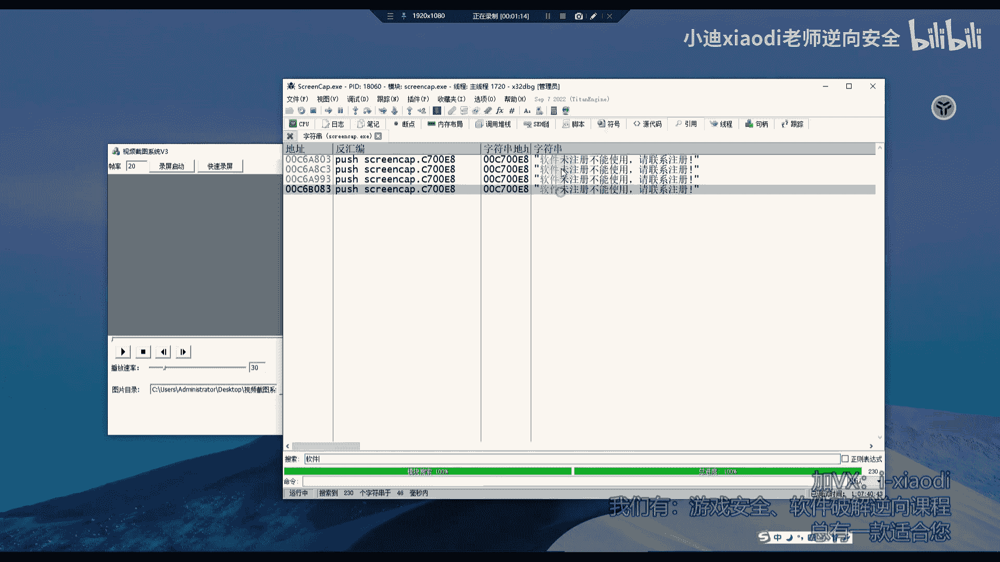
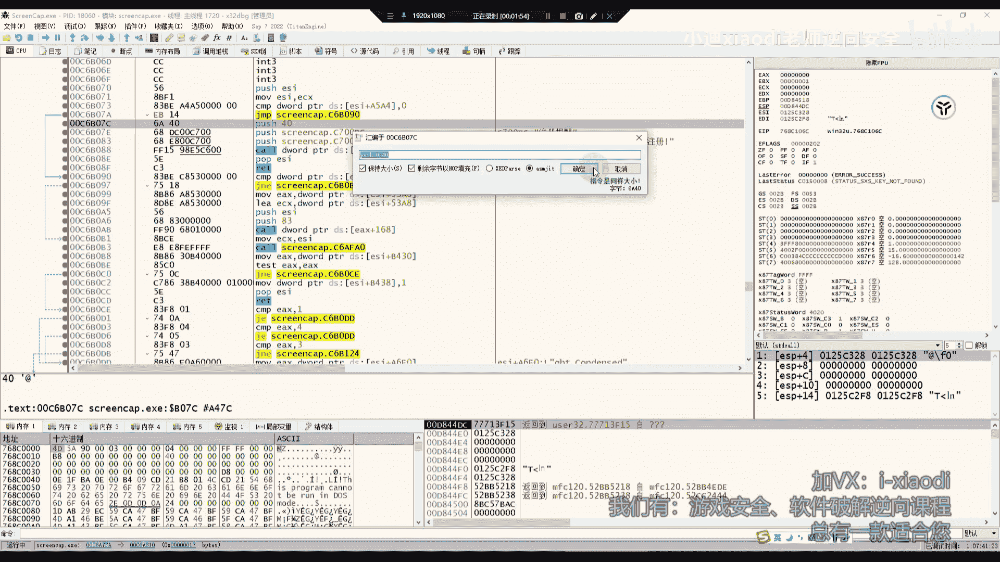
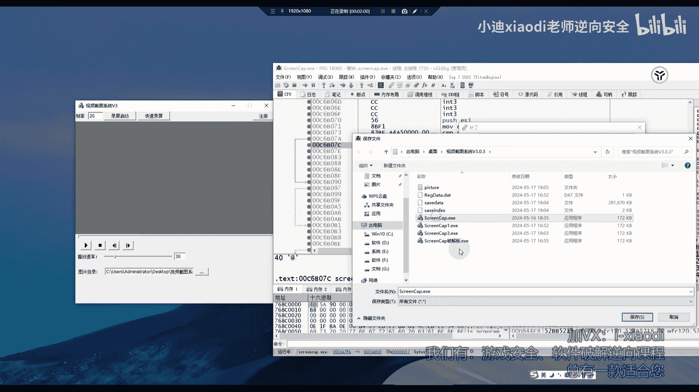
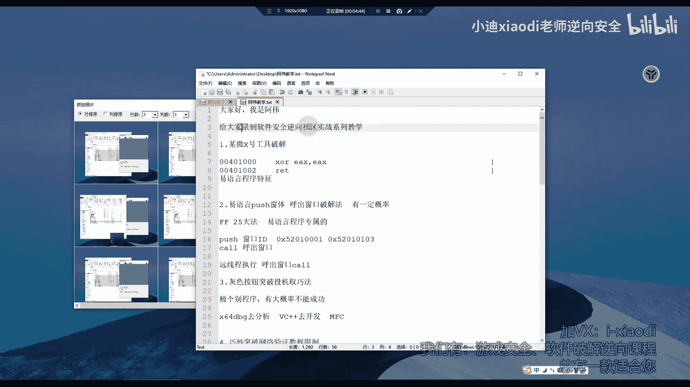

# 🔓 软件安全逆向实战系列教学：第七讲：某注册码的另一种破解方式


本节课中，我们将学习如何通过修改关键跳转来绕过软件的功能限制，从而实现对未注册软件的破解。我们会从观察软件行为开始，逐步分析字符串、定位关键跳转、修改指令并保存补丁，最终让软件恢复正常功能。整个过程不需要太复杂的技术，核心思路就是找到程序判断是否注册的那个点，然后把它改掉。


大家好，我是阿伟。今天我们继续软件安全逆向实战系列教学，这是第七讲。本次要讲的是：某注册码的破解——另一种破解方式。在第五集中，我们已经讲过一个软件的破解。但是破解之后呢，发现存在一点点问题，于是我们又换了一种思路，搞出了另外一种破解方式。下面我们就来看一下这种新的方法。


首先，拿到一个软件，我们要注意观察这个软件。如果你没有注册，点击“录屏启动”，程序就会提示“软件未注册，不能使用”。并且，任何按钮点击后都会有这个提示。这种提示本质上是对功能的一种限制。换句话说，程序在每次执行功能之前，都会先检查你是否有注册权限。那么，我们其实可以通过绕过这种功能限制的方式，直接越过它的检查。接下来，我们就来分析一下。


我们打开调试工具，比如 x32dbg，按照下面的步骤来定位关键位置。具体操作步骤如下：



1. 点击“文件”菜单，然后点击“附加”。
2. 附加这个程序，也就是选中正在运行的程序进程。
3. 点击“符号”选项卡，切换到程序的主模块。
4. 搜索当前模块的字符串。




搜索什么呢？刚才提示的“软件未注册，不能使用”这句话。我们在搜索框中输入“软件”，就会出来几个字符串，其中就有“软件未注册，不能使用”。这时我们该怎么办呢？很简单，双击这个字符串，切换过去。在对应代码区域，会看到一个 JNE 跳转指令。这个跳转的作用就是跳过“软件未注册，不能使用”的限制。换句话说，只要这个跳转成立，程序就会认为你没有注册，从而禁止你使用所有功能。




那么，JNE 指令我们应该怎么修改呢？我们可以把它改成 JMP，也就是强制跳转。这样无论条件是否满足，程序都会直接跳过未注册提示，进入功能逻辑。修改方法如下：

```asm
; 修改前
JNE short 跳过未注册提示

; 修改后
JMP short 跳过未注册提示
```

一共有四处这样的 JNE 跳转，我们需要依次修改。第一个改成 JMP，第二个同样修改，第三个也改成 JMP，第四个双击过去也改成 JMP。全部改完，程序就不会再弹出未注册的提示了。


由于这个程序是一个没有加壳的程序，所以我们修改完之后，直接打一个补丁、修补文件，然后给它重新命名保存。点击确定就可以了。修改完成后，我们再看一下这个程序的功能运行。它依然会提示“注册码不正确”，但这个提示已经无关紧要了，我们完全可以忽略掉。对于它的内容，我们还可以进一步修改，比如改成“欢迎使用”，让它变成欢迎使用。


此时点击“录屏启动”，我们可以拖动这个界面，实际上它就已经在录屏了，程序进入了录屏操作中。不过，这个软件给我的感觉并不是很好用。比如我们随便操作一下，确实不太好用。现在录制已经开始了，我们播放一下，看看刚才录制的效果。刚才确实已经在录制了，看到没有？已经录上了。虽然这个软件不那么好用，但我们可以用回车来查看每一张图片，都是可以的，进度条也都存在。可以看到，这个软件通过上述方法，确实可以被破解。


它的图片保存功能也是可以用的，这边没有功能限制。如果它存在功能限制的话，我们照样可以直接在 x32dbg 里把它干掉，只需要改一个跳转就可以了。好的，这就是我们说的另外一种破解方法。


说到这里，大家要注意：对于一个软件，我们必须要熟练地使用它。你要知道它的各种功能按钮都会引发怎样的结果，前因后果一定要自己想明白、想通。只有这样，我们才能真正掌握破解。破解实际上很多时候靠的是思路，而不是单一的技术。有的人技术一般，但思路很好，敢于尝试、勇于尝试，他就能实现不错的效果。所以大家一定要加油。


想要学习的同学可以联系小迪老师。我是阿伟，是社区成员的一部分，我也是跟着小迪老师学习的。大家如果想跟我一样实现这样的学习效果和目标，可以联系小迪老师加入学习。大家都是学有所成的。好的，我们下一集再见。我经常会受小迪老师所托，在社区中发布相关的实战教学。我们下一集再见，拜拜。




本节课中，我们一起学习了另一种软件破解方法：通过搜索字符串定位未注册提示，找到关键 JNE 跳转并改为 JMP，从而绕过功能限制。我们还演示了修改后软件的运行效果，并强调了解软件功能与思路的重要性。希望大家能多多实践，真正掌握这种逆向破解的思路。

