# 🔐 二进制软件破解逆向技术：第一章：动静态分析破解程序密码卡密

欢迎大家加入软件安全逆向社区学习技术。在本节课中，我们将要学习如何利用 x64dbg 来验证我们在 IDA Pro 里做出的逆向分析结论。也就是说，我们要把一个真实的程序跑起来，通过动静态分析结合的方式，一步一步看清楚它的密码卡密是怎么生成的、又是怎么被校验的。这门技术是游戏安全、软件安全、网络安全以及 CTF 比赛中的必备基础，学会了它，你就拥有了拆解任意软件密码校验逻辑的能力。下面让我们正式进入课程。

## 🔍 1.1 动态分析与静态分析

先聊两个核心概念：静态分析和动态分析。IDA Pro 的逆向分析属于静态分析，它不需要让程序运行起来，而是直接读取程序文件，把整个代码结构展示给我们看。你可以把它理解成读书：整本书从头到尾摊开，每一行代码都清清楚楚地摆在那里，我们可以安安静静地慢慢读，慢慢推理。x64dbg 的逆向分析则属于动态分析，它会真的把程序加载起来运行，然后让我们观察程序在每一行代码执行时的细节，比如某个数据在寄存器里是怎么变化的、某个内存地址里存了什么值、某次比较的结果到底是真是假。这个过程更像是在做实验，一边动手一边看结果。

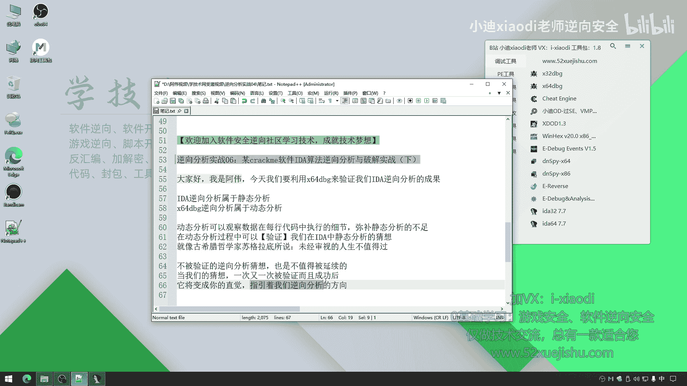

动态分析最大的价值，就是能看到程序运行时产生的那些真实数据，这是静态分析不容易做到的，所以动态分析可以弥补静态分析的不足。在动态分析的过程中，我们可以去验证之前在 IDA 中做出的种种猜想。古希腊哲学家苏格拉底说过：

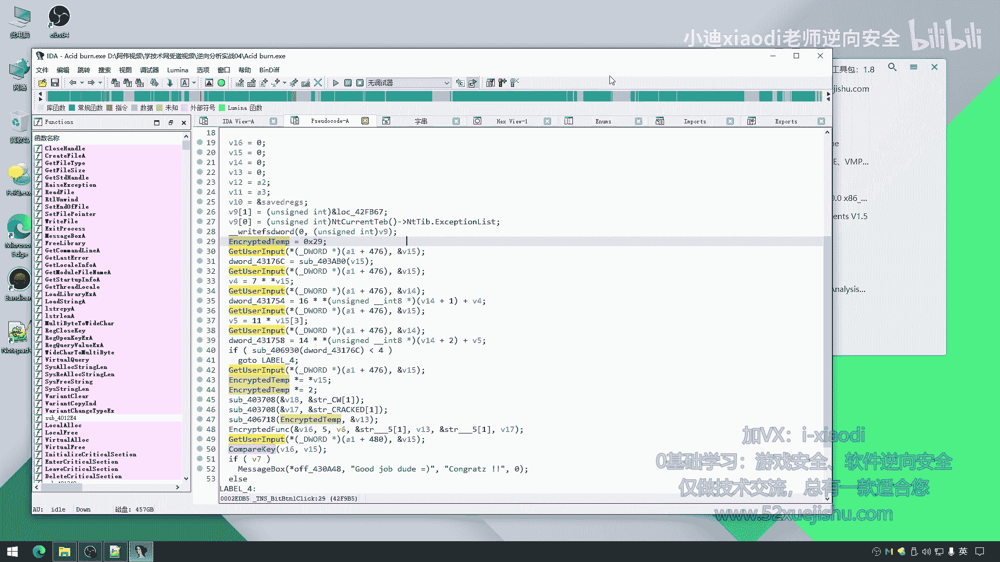

> 未经审视的人生不值得过。

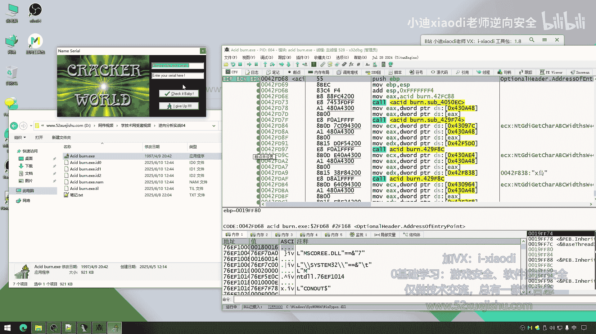

这句话套用到逆向分析里也完全成立：不被验证的逆向分析猜想，是不值得被延续的。当我们的猜想一次又一次地被验证，而且验证成功之后，这个猜想就会慢慢沉淀下来，变成你的直觉。这种直觉会在后续的逆向分析工作中指引方向，带着你往正确的地方走。理解了这两者的关系，接下来我们就在 x64dbg 中实际操作一遍。

## 🧭 1.2 加载程序与定位关键代码

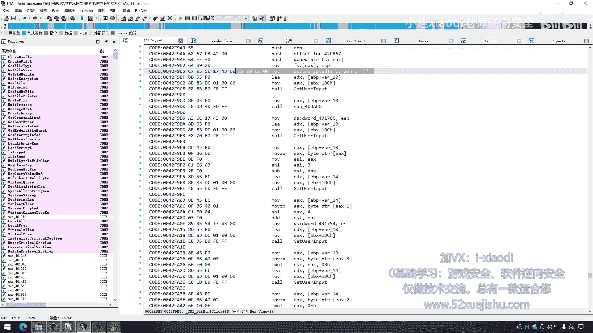

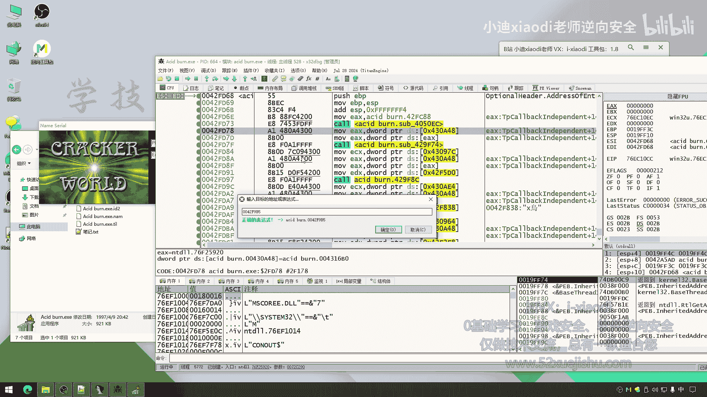

上一节我们弄清楚了动态分析和静态分析各自的定位，现在我们把理论落到实操上。首先，把上一次通过 IDA 分析过的那个程序直接拖到 x64dbg 里面。拖进来之后，先运行这个程序，然后点击程序界面上的按钮，让程序进入等待输入的状态。接下来，我们就要去找这个程序里最关键的位置。回顾一下我们之前的分析成果，在 IDA 的代码窗口里有这么一行关键的赋值指令，它基本决定了密码校验的核心逻辑。问题是，这行代码在内存中到底处于什么地址？没关系，我们可以直接在 IDA 的这一行代码上按下键盘上的 T 键，这样就可以看到它的代码所在位置和对应的内存地址。

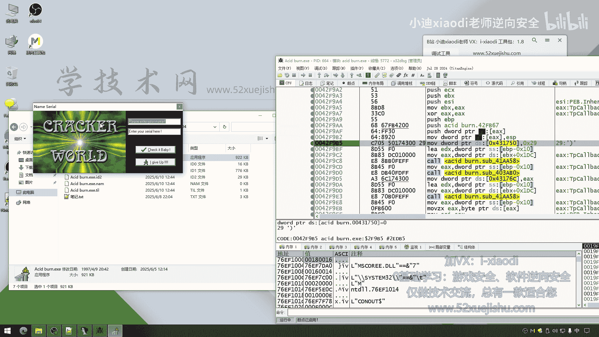

拿到了这个内存地址之后，我们切换到 x64dbg 窗口，准备跳转到这个地址上。在 x64dbg 中定位到这个地址，点击确定，然后在这里打上一个断点。断点的作用就是让程序运行到这一行时自动暂停，方便我们停下来检查现场。接下来回到程序界面，输入我们的用户名，然后点击按钮，程序就会立刻中断在我们刚刚设置好的断点处。程序停在断点处之后，我们就可以一步一步地去分析代码了。

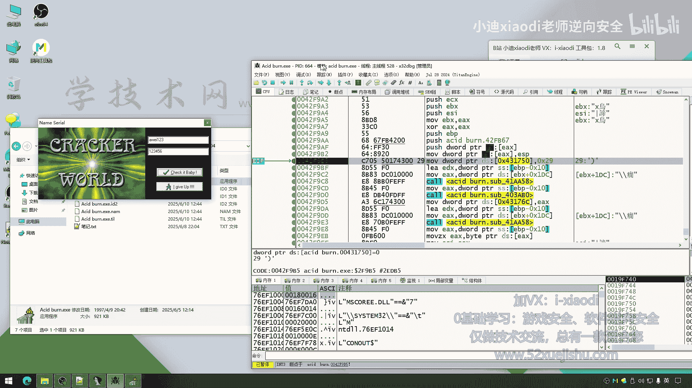

为了不走弯路，我们可以先把整个操作流程列出来，后面分析时心里有个数：

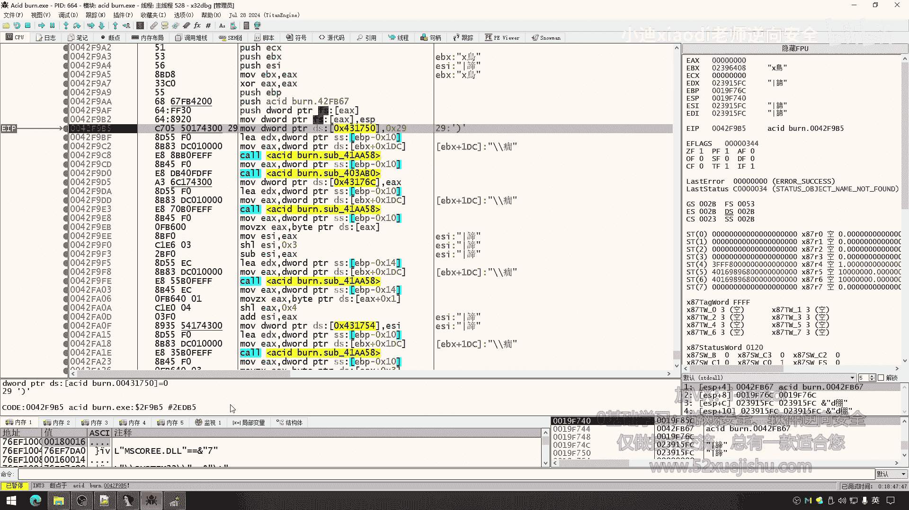

1. 把程序加载进 x64dbg，运行程序并点击按钮。
2. 在 IDA 里找到关键赋值行，按 T 键取得它的内存地址。
3. 在 x64dbg 中跳转到这个内存地址，打好断点。
4. 回到程序界面输入用户名，点击按钮触发断点。
5. 中断后使用 F8 单步执行，逐步检查每条指令带来的数据变化。

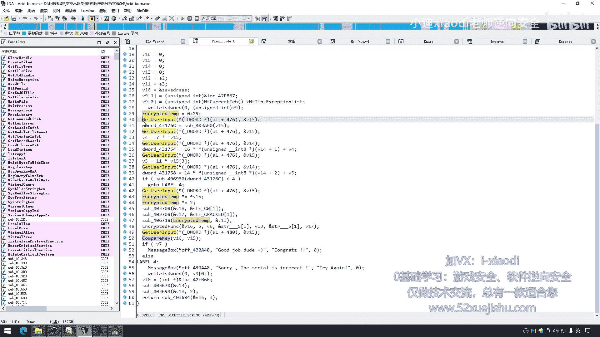

## 🚦 1.3 单步跟踪：验证用户输入逻辑

程序顺利停在断点处，接下来我们要做的就是一步步验证之前的分析结论。在 IDA 静态分析时，我们判断这个函数的执行流程应该是：首先是一行赋值指令，然后是一行获取用户输入的代码。现在我们来看看现实中到底是不是这样。按下 F8，进入单步执行模式。所谓单步执行，就是一次只执行一条指令，执行完立刻停下来，方便我们观察每一步的结果。

执行第一个函数调用之后，我们发现，程序果然把我们的用户名获取到了。在示例中输入的是“阿伟123”，它被完整地送到了程序内部。这就验证了我们之前的猜想：这个函数的功能就是获取用户输入。确认之后，为了方便后续的分析，我们给这个函数打上一个标签。鼠标右键点击这个函数所在的位置，然后选择“标签”，给当前地址写一个容易识别的名字。我们可以直接把它命名为“获取用户输入”，点击确定。打完标签之后，再返回反汇编窗口，所有调用获取用户输入函数的位置都会清楚地显示出来。

继续往后执行。获取完用户输入之后，程序会在这里进行一次新的函数调用，然后进行一次赋值操作。我们看一下第二个 call，当这个 call 执行完之后，寄存器 EAX 中存放的就是我们的用户名。紧接着，这个用户名会被放到一个内存地址 0x43176C 里面。我们可以从当前地址跳转到 0x43176C，看看这里到底存了什么。跳转过去之后，鼠标右键再给它打一个标签，命名为 user name。这样一来，以后只要看到 0x43176C 这个地址，我们就能立刻反应过来：这里保存的是用户名。

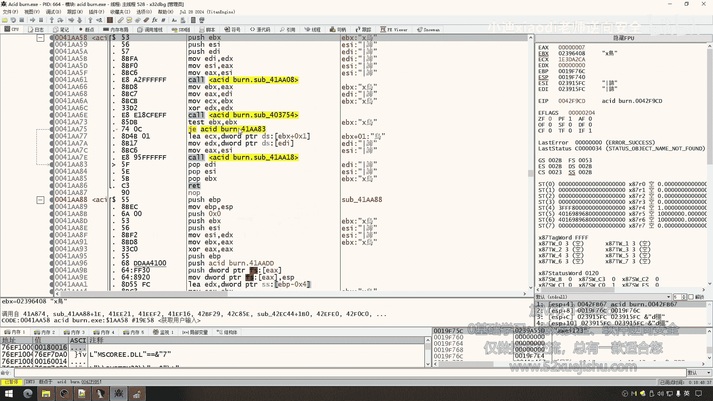

接下来的几行代码对于程序的关键跳转逻辑是没有任何帮助的，它们只是一些普通的赋值和搬运操作，我们可以快速跳过。唯一对我们真正有帮助的就是这个 user name 的地址 0x43176C。跳过无关代码之后，我们就来到了真正关键的条件跳转逻辑附近。

## 🩺 1.4 分析字符串长度校验

验证完用户的输入逻辑，我们继续往后走，来到关键跳转的核心位置。继续按 F8 单步执行，一直走到一个条件跳转指令附近。这个条件跳转在汇编里就是 JE/JNE 一类的指令，程序的下一步走向完全取决于它。仔细观察，我们会看到它拿一个值和数字 4 做比较。那这个值是从哪来的？往前看几行就明白了：程序在比较之前调用了一个函数，这个函数的作用是获取字符串的长度。所以整段逻辑一下子就清楚了：程序先计算用户名的长度，然后把长度和 4 进行比较。

这个获取字符串长度的函数，我们同样可以给它打上一个标签。鼠标右键选择“标签”，命名为“获取字符串长度”，点击确定。回到代码执行流程中，由于我们输入的用户名长度非常标准，完全满足程序的要求，所以这次的比较会顺利通过，不会触发中间那个错误弹窗。继续按 F8 执行，越过这个跳转，进入下一个分析阶段。

## 🔢 1.5 跟踪关键运算与字符串准备

通过了长度校验，再往下走就是整套密码校验中真正的算法部分。走到这里，大家会发现程序又调用了一次“获取用户输入”。这说明程序重新获取了一遍用户名。这一次，用户名被存放在 EBP-0x10 这个栈内存位置。我们可以在内存窗口中转到 EBP-0x10，仔细确认一下这里的存储情况。从内存布局中可以看到，这个位置存放的就是我们的用户名。

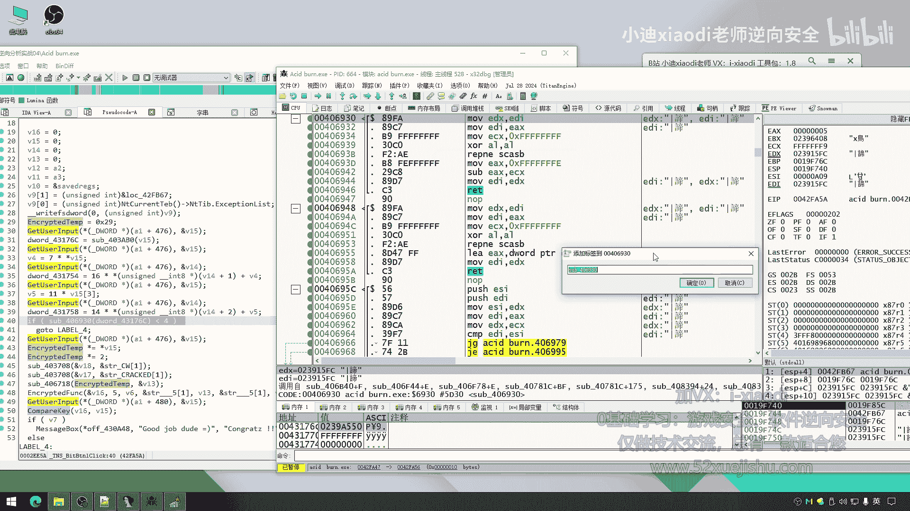

程序把用户名的地址取出来之后，会先把用户名放到寄存器里，然后从用户名字符串中取出第一个字节。以演示时的输入为例，取出来的第一个字节是字符 'A'。接下来，这个 'A' 就要开始参与数学运算了。程序会把 'A' 乘以地址 0x431750 中保存的一个数值。我们转过去看一下，0x431750 里面存放的是 0x29，也就是十进制的 41。所以这一步做的就是 'A' × 0x29。乘完之后的计算结果被放回寄存器，然后程序又把这个值加上它自身，说白了就是再乘以 2。这段运算的完整公式如下：

```text
key = (first_char × 0x29) × 2 = first_char × 0x52
```

其中 first_char 就是用户名字符串的第一个字节。到这里，这一小段运算逻辑就和 IDA 中的静态分析结果完全对上了。继续往下看，程序接下来会将 EBP-0x4 这个地址取出来，然后调用一个函数。这个函数执行完之后，EBP-0x4 里面装的就是字符串 "CW" 了。也就是说，这个函数的功能就是把 "CW" 这个字符串赋值给局部变量 v18。同样的道理，右边另一个函数负责把字符串 "correct" 赋值给局部变量 v17。这两个字符串在后面都会参与到加密计算当中，所以现在先准备好。

程序继续往下执行，这时候一个类似分隔符或者横杠的常量字符串也开始出现了。再往后，经过某个函数运算之后，数值 0x7954 就被计算出来了。这个 0x7954 正好对应我们之前在 IDA 静态分析中看到的那个关键计算结果。把它提取出来之后，真正的加密环节就要开始了。

## 🧮 1.6 深入加密函数内部

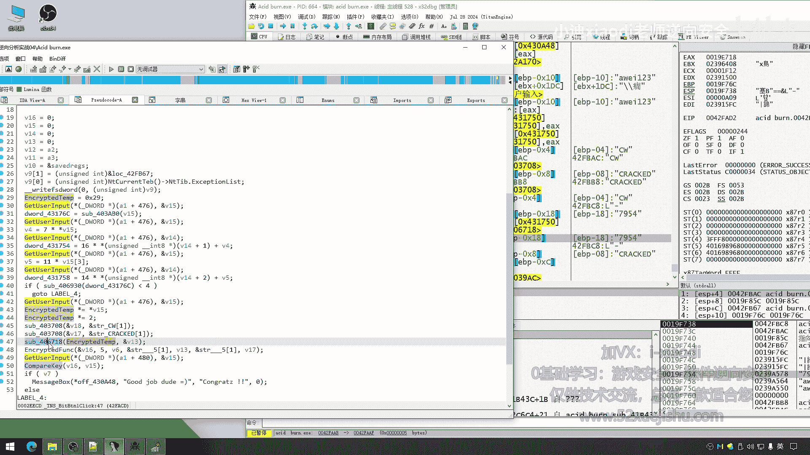

上一节我们看到了 0x7954 是怎么产生的，现在我们进入加密函数内部，看看它到底做了什么。下一个被调用的函数就是一个加密函数。我们可以在这个函数的位置双击鼠标，直接进入函数内部查看代码。进去之后，鼠标右键点击“标签”，给当前地址写上“加密函数”这个名字，方便后面快速识别。想要理解这个函数的功能，最直观的方法是先搞清楚它接收了什么参数。

通过 call 指令之前的参数准备代码可以看出，这个加密函数一共接收三个参数：第一个是刚刚计算出来的 0x7954；第二个是类似分隔符/横杠的那个常量字符串；第三个是 "correct" 字符串。而前面提到的 "CW" 果然没有直接出现在这个参数区域里。这说明 "CW" 已经在之前的逻辑中被处理掉了，不需要作为参数直接传进加密函数。这一条信息和我们在 IDA 中看到的结论完全一致。

下面我们跟到加密函数内部做进一步分析。先按 F8 执行几步，来到真正需要深入的那个 call 指令前面，然后按 F7 直接步入。进入函数之后，继续使用 F8 单步执行。走着走着，我们会发现加密相关的数据开始逐步显现出来。此时观察一条关键的取数指令，程序是通过 ESP+EDX×4+0x10 这样的地址表达式，从栈中取出数据，然后放到 ECX 寄存器中。对于初学者来说，这种组合地址看起来会有点绕，不知道怎么算出真实地址。我教大家一个实用的办法：点击 x64dbg 工具栏上的“计算器”按钮，然后在反汇编窗口里按一下空格键，把当前指令里的地址表达式复制出来，粘贴到计算器里直接计算。在演示中，计算出来的实际地址就是 0x19F73C。

拿到实际地址之后，再往上看几行，就能看到 "CW" 字符串就保存在这一带。可以说，在这行取数指令中起到关键作用的是 EDX 寄存器。那 EDX 又是从哪里来的？我们在加密函数内部观察一下，会发现 EDX 只在一个地方被 push 过，上面根本没有对 EDX 赋值的指令。这说明这个 EDX 是来源于外层函数的。我们回溯到外层代码去查找，果然在外层函数里看到了一条 mov 指令，正是这条指令对 EDX 进行了赋值。之后 EDX 就被带进了加密函数，参与地址计算，最终把数据取出来送到 ECX 寄存器。

为了看清楚 ECX 在这个加密函数中到底做了哪些操作，我们可以用鼠标右键点击寄存器窗口中的 ECX，然后选择“高亮模式”。这样，所有会影响 ECX 的指令都会在反汇编窗口里被高亮显示出来，ECX 的数据流向就一目了然了。至于加密函数里面更细致的具体运算环节，大家可以在课后自己按 F8 一步步单步跟踪一下，这里就不做赘述了，留给大家动手体验。

## ⚖️ 1.7 验证密码比较逻辑

加密函数执行完毕，接下来程序就要进行最后的密码比对了。执行完加密函数之后，程序会再次调用“获取用户输入”函数。注意，这一次获取到的内容已经不再是用户名，而是用户输入的密码。得到密码之后，程序会把用户输入的这个假密码和它内部计算出来的加密密码放进同一个比较函数里面，进行逐位比对。这个负责比较的函数就是 compare_key。比较完成之后，compare_key 会返回一个结果，程序再根据这个结果去判断比较是否成立。这里的条件跳转指令，对应的正是我们在 IDA 静态分析中看到的那个 if 语句。到这一步，整个程序的密码校验逻辑就被完全打通了，我们也顺利完成了动态分析和静态分析的结合验证。

## 🎯 本节小结

本节课中，我们一起体验了一次完整的二进制软件破解逆向分析流程，核心是把 IDA Pro 的静态分析和 x64dbg 的动态分析结合起来。我们先把程序加载到 x64dbg 中，根据 IDA 给出的线索定位关键代码地址并设置断点；然后通过 F8 单步执行，验证了用户输入获取的逻辑；接着分析了字符串长度校验，并跟踪到了用户名到密码因子的关键运算；之后深入加密函数内部，观察了参数传递、地址计算和寄存器追溯的方法；最后验证了密码比较函数与条件跳转的关系。整个程序的校验逻辑可以用下面这段伪代码清晰地表示出来：

```c
// 第一步：获取用户名
char* username = get_user_input();

// 第二步：判断用户名长度是否合法
int length = get_string_length(username);
if (length != 4) {
    show_error_popup();
}

// 第三步：取用户名首字节参与运算
char first = username[0];
int key = (first * 0x29) * 2;   // 等价于 first * 0x52

// 第四步：准备加密需要的固定字符串
char v18[] = "CW";
char v17[] = "correct";

// 第五步：执行加密计算，得到核心密码值 0x7954
int magic = compute_magic(key, v18, v17);

// 第六步：获取用户输入的密码并与之比较
char* password = get_user_input();
int result = compare_key(password, magic);

// 第七步：根据比较结果走不同分支
if (result) {
    // 密码正确，校验通过
} else {
    // 密码错误，校验失败
}
```

通过这个案例可以看到，静态分析负责让我们从宏观上理解程序结构，动态分析负责从微观上验证每一个猜想的正确性。看完今天的内容之后，在今后分析真实的软件时，大家应当熟练掌握两种工具结合使用的方法，用它们互相验证、互相补充，弥补单一工具的缺陷。我是阿伟，欢迎加入软件安全逆向社区学习技术，成就技术梦想。我们下期再见。
