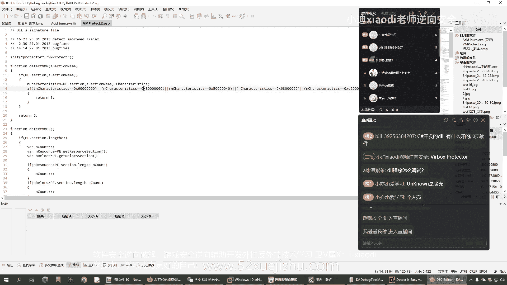
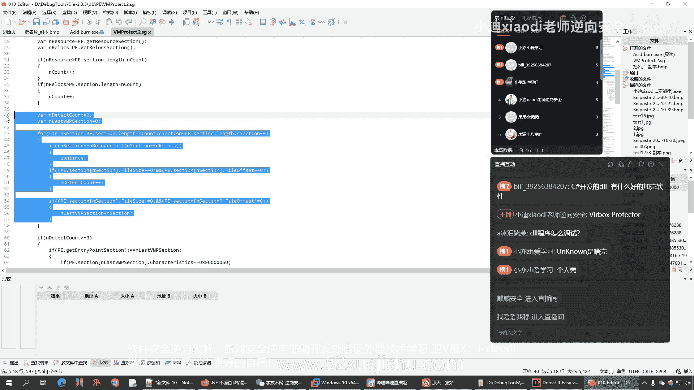
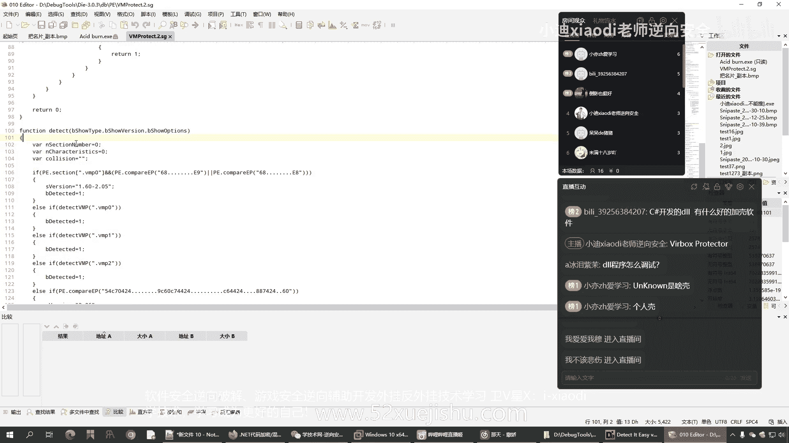
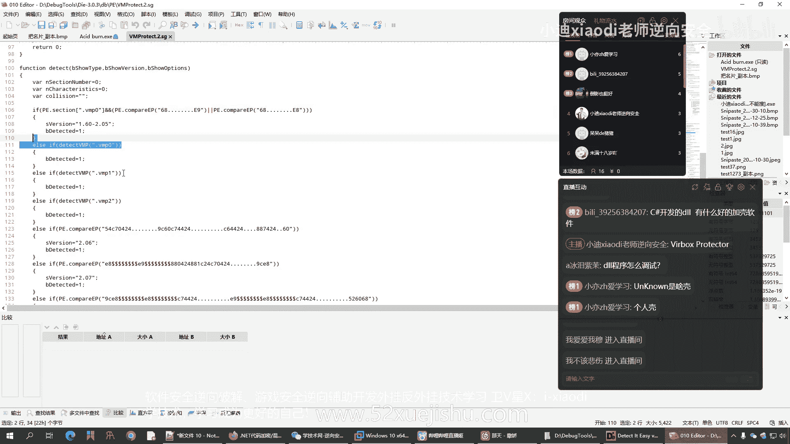
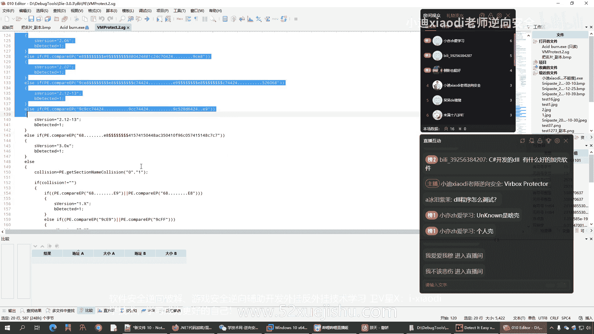
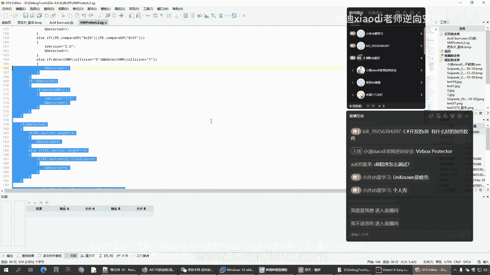
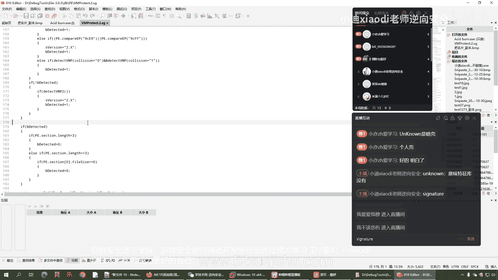

# 🔐 二进制软件逆向破解安全：第1章：查壳工具的原理

在本节课中，我们将要学习二进制软件逆向领域中一个非常基础但又极其重要的概念——查壳工具的工作原理。很多初学者在使用查壳工具时，只知道点击按钮然后看结果，却不知道工具背后到底做了什么事情。今天我们就来揭开这层神秘的面纱，从最底层的逻辑出发，一步步弄清楚查壳工具是怎么判断一个程序是否加壳的。这个过程其实并不复杂，核心就是一个特征匹配的思路，理解了它，你对整个软件安全领域的认知都会上一个台阶。

## 🔍 什么是查壳工具

首先我们要明确一个问题，查壳工具到底是干什么用的。说白了，查壳工具就是一个用来识别程序有没有加壳、加的是什么壳的软件。在软件保护和逆向工程这个圈子里，加壳是一种常见的保护手段，程序作者通过加壳工具把原始程序代码加密或压缩，让分析者无法直接看到程序的真实内容。而查壳工具就是反制这种保护手段的第一道工序，你只有知道了对方加的是什么壳，才能决定后续用什么方法来脱壳。

那么这个工具如何做到这一点呢？安诺（也就是我们常说的检测工具）并没有直接拆解程序内部逻辑的能力，它靠的是另外一套思路，就是特征匹配。这种软件内部有一个特征库，这个特征库是预先收集好的各种已知壳的特征信息。换句话说，它不是一个智能分析系统，而是一个查字典的工具。它把你给它的程序拿去和特征库里的条目进行比对，看看能不能匹配上。



以下是查壳工具工作的基本流程：

- 读取待检测程序的二进制数据
- 提取其中的PE结构信息和区段信息
- 将提取到的信息和特征库中的签名逐一对比
- 若匹配成功则输出对应的壳名称，否则提示未知

## 📄 特征文件与sig签名



在查壳工具中，你会经常看到一个关键词叫sig。很多刚接触这个领域的朋友看到这三个字母觉得很神秘，其实它就是一个缩写，全称是signature，中文意思就是签名。我们来看一下这个单词在词典里的解释，它有签字、识别标志、签名附件等多重含义。那么为什么在计算机安全领域会用到签名这个词呢？因为计算机里说的签名，其实和现实生活中的签名逻辑是相通的。

举个例子，你出国旅行的时候，去某个机构办理业务，工作人员会递给你一张纸，指着某个位置告诉你，请你在这里签名。你签下的这个名字，就代表你确认了这张纸上写的内容，是你的个人标识。计算机里说的签名，本质上也类似，它就是一个用来识别身份的标记。对于一个壳来说，它的签名就是它区别于其他壳的那段独特的特征数据。



用公式来表达这个关系就是：

$$\text{Signature} = \text{特征签名} = \text{用于识别程序身份的标记}$$

在软件开发领域，签名还有一种理解方式，就是软件作者在发布程序时附加的一段校验信息，用来保证程序的完整性和来源可信度。但在查壳这个场景下，我们更关注的是签名作为"特征"的那层含义。简单来说，一个壳工具在加壳时，会在生成的程序里留下一些特有的痕迹，这些痕迹就是这个壳的签名。查壳工具把这些签名收集起来，放进自己的特征库里，下次遇到带有相同痕迹的程序时，就能认出它是什么壳了。

## ⚙️ 查壳过程详解

现在我们来具体看看查壳工具是怎么工作的。这里我们拿VMP（VMProtect）来举例，这是一种非常常见的商业保护壳，很多游戏和商业软件都会使用它。当你把一个疑似加了VMP的程序拖进查壳工具时，工具会做什么呢？它会把程序文件加载起来，然后开始扫描里面的PE文件结构。



PE文件是Windows系统下可执行文件的标准格式，不管是EXE还是DLL，本质上都遵循这个格式。在PE文件里，包含着各种各样的结构信息，比如文件头、节区表、导入表、导出表等等。加壳工具在修改一个程序时，往往会在这个结构上留下一些蛛丝马迹。



查壳工具所做的，就是把这个PE文件的各种特征提取出来，然后将这些特征和特征库里记录的特征进行逐一比对。比如特征库里记录着，如果检测到某个程序包含VMP0、VMP1、VMP2这几个区段名，同时存在某些特定的结构特征，那么就可以判定这个程序使用了VMP。这个过程类似于拿着一个指纹去比对指纹库里的记录。

我们可以用伪代码来描述这个逻辑：



```python
def detect_shell(pe_file):
    features = extract_pe_features(pe_file)
    for shell in signature_database:
        if shell.match(features):
            return shell.name
    return "未知"
```

简单解释一下这段代码的意思。首先我们从PE文件中提取各种特征信息，然后遍历特征数据库中的每一个壳条目，逐个尝试用这些特征去匹配。只要有一个壳条目匹配成功，就返回这个壳的名字。如果所有的条目都试过了还是匹配不上，那就只能返回"未知"了。

这个"未知"的结果非常关键，很多初学者看到查壳工具显示"未知"就慌了，以为自己遇到了什么神秘的高强度壳。其实完全不用这么想，"未知"的意思很简单，就是特征库里没有收录这种壳的特征，或者说这个程序的特征没有命中你用的这个查壳工具所掌握的任何已知签名。仅此而已，并不代表这个程序一定加了很牛的壳，也不代表它没有壳。

关于"未知"这个状态，我们可以从以下几个角度来理解：

- 代表该程序未命中当前特征库中的任何签名
- 可能是新出的壳，特征库尚未收录
- 可能是经过改造的壳，特征已经被修改
- 可能程序本身就没加壳，只是恰好有一些特殊结构

## ✍️ 签名概念的日常类比

刚才我们提到了signature就是签名的意思，为了让你更好地理解这个概念，我们不妨再深入一点。在计算机领域，签名这个概念其实是从现实生活借过来的。现实生活中的签名，代表的是你这个人本身，是你的身份的一种体现。每一个人的签名笔迹都是独一无二的，一般来说很难完全模仿。程序世界里的签名，也是类似的逻辑，每个壳的开发者写出来的壳代码都有自己独特的风格和固定模式，这些模式就像程序世界的笔迹一样，成为了识别这个壳的证据。

回到我们的场景中，查壳工具就是那个检查签名的人。你给它一个程序，它就去看这个程序身上带着什么样的签名。如果这个签名它见过，它就能说出来这是谁的签名。如果这个签名它从来没见过，它就没办法了，只能告诉你"我不知道"。这就是整个查壳过程的最核心逻辑。

这个概念在计算机安全领域还有很多应用场景。杀毒软件识别病毒时也是类似的思路，病毒库里面存放着各种已知病毒的特征码，杀毒软件扫描文件时就是在找这些特征码。加壳工具和病毒虽然目的不同，但在"留有特征"这一点上，其实是一样的。理解了查壳工具的原理，你就能顺带理解很多其他安全工具的底层逻辑了。



## 📝 总结

本节课中我们一起学习了查壳工具的核心原理，重点在于理解特征库和签名这两个概念。查壳工具并不是靠什么高深莫测的算法来识别壳的，它的本质是一个基于特征匹配的查表工具。工具内部有一个特征库，里面存放着各种已知壳的签名信息，当我们把一个程序交给工具检测时，工具会提取这个程序的PE特征，然后和特征库里的签名逐一比对，匹配上了就输出壳的名称，匹配不上就显示未知。我们还学习了VMP的检测事例，知道了通过VMP0、VMP1、VMP2等区段信息可以判断程序是否使用了VMProtect。此外我们还明白了"未知"这个结果的实际含义，就是特征库里没有对应的签名，并不是什么可怕的事情，只是说明当前工具认不出来而已。最后我们通过签名的日常含义类比，理解了signature在计算机领域中的意义。希望这节课的内容能帮你打下扎实的基础，在后续的逆向学习中更加得心应手。
