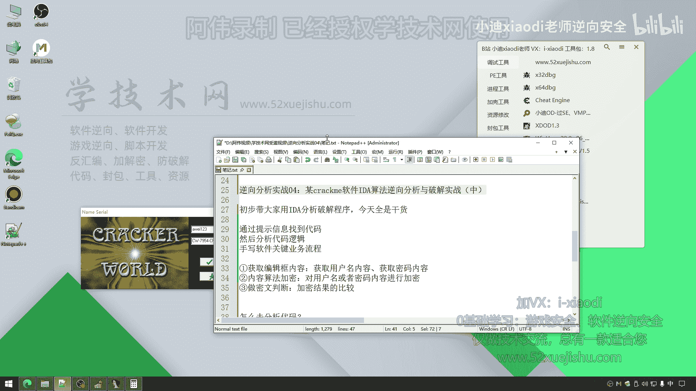

# 🛠️ 二进制黑客软件破解逆向技术：01：用IDA Pro逆向破解软件

大家好，我是阿伟。在本节课中，我们将要学习如何使用 IDA Pro 对一个程序进行逆向破解。今天的内容全是干货，我会带大家从一个可执行程序出发，通过分析它的错误提示，定位到核心判断逻辑，最后手动算出正确的密码，完成破解。整个过程不需要太高深的理论，只要跟着步骤走，你就能掌握逆向分析的基本套路。

首先，我们来看一下这个待破解的程序。运行之后，界面上有用户名输入框、密码输入框和一个登录按钮。当我们随意输入用户名和密码，点击按钮时，程序会弹出一个错误提示。这个错误提示就是我们的突破口。一个很自然的思路是：既然错误提示是由程序生成的，那么程序里一定有一段代码引用了这段文字。我们只要顺着这段文字去搜索，就能找到处理判断逻辑的地方。

在动手之前，先想清楚软件在输入用户名和密码之后到底做了什么。我们可以这样推测：程序会先获取编辑框的内容，也就是用户名和密码；然后对用户名或者密码做一次加密；加密完成后，再把加密结果和输入内容进行比较，根据比较结果决定是提示“登录成功”还是“登录失败”。经过这样一分析，关键的业务流程就出来了。换句话说，只要我们知道了程序正向是怎么执行的，那么反过来做逆向就会变得非常轻松。

有了思路，下面我们就打开 IDA Pro 来实际操作。IDA 的安装包，小迪老师应该已经发给各位了，这里就不再重复上传。启动 IDA 之后，直接把目标程序拖到 IDA 的窗口中。在弹出的加载选项对话框中，保持默认设置，点击 OK。等待 IDA 完成自动分析，程序就加载好了。


## 🔍 第一步：从字符串交叉引用定位关键代码


程序加载完成后，我们需要找到刚才看到的错误提示字符串。在 IDA 中打开字符串窗口，搜索相关的字符串。找到之后，选中它，按 X 键（或者在右键菜单中选择“交叉引用”），IDA 就会跳到引用了这个字符串的代码位置。这里就是软件破解的最关键逻辑部分。

我们可以看到，在反汇编代码的引用列表里，左边有一处是错误提示的引用，右侧有一处是成功提示的引用，另外还有一处是另一个错误提示的引用。这些引用点就像路标，告诉我们这里就是分支判断所在的位置。

## 📝 第二步：按 F5 查看伪代码

在关键逻辑位置按下 F5，IDA 会生成一份反编译后的 C 风格伪代码。这份代码看起来可能非常有迷惑性，因为变量名都是自动生成的，还夹杂着各种类型转换，一眼扫过去会觉得头疼。不过没有关系，我们只要抓住重点。

分析伪代码的时候，不应该从头到尾逐行硬读，而应该先找关键的业务逻辑和判断语句。什么是关键的业务逻辑？就是能够决定你破解成功或者破解失败的比较和跳转。在这份伪代码里，我们可以看到代码调用了两次 MessageBox（也就是弹窗）。为了方便阅读，我们可以给它们重命名。在 IDA 中点击函数名，按 N 键，输入 message_box，然后回车确定。重命名之后，可以使用高亮功能来锁定这些关键调用位置。

接下来，我们要特别关注跳转逻辑。伪代码里有一个 label4 标签，后面跟着 goto label4。这个 label4 为什么会跳过去？原因是前面有一个判断，条件是某个值小于 4。这个值是通过一个函数对某个变量执行运算后得到的结果。那这个变量最初的数据是 0，它从哪里获得数据呢？应该是从一个函数中获取的，该函数把 V15 中的数据取出来，然后交给这个变量，再进行判断。如果结果小于 4，就跳到 label4 去执行错误提示。

## 🧩 第三步：梳理业务逻辑

回顾我们刚才的分析，软件的业务流程是获取编辑框的内容。那么在伪代码里，这个位置就应该对应获取编辑框内容的函数。我们给它起一个名字叫 get_user_input。重命名之后，再点击高亮，你会发现所有高亮的位置都是在获取用户输入。这样一来，逻辑就清楚多了。

接下来我们一行一行地看代码。以下是关键代码片段和对应的注释：


- 第一行调用 get_user_input，获取用户名的内容。获取之后，数据放到 V15 中。我们注释为“获取用户名的内容”。
- 接着，有一行代码把 V15 中的数据取出来，得到真正的用户名字符串。这个过程通过一个函数（AB0）完成，我们把这个函数改名为 user_name，得到的变量也命名为 user_name。
- 然后，对 user_name 调用一个函数，判断字符串长度。我们把这个函数命名为 get_string_len。
- 紧接着是一个 if 判断：如果 get_string_len(user_name) < 4，就弹出错误提示；如果长度没问题，就继续往下执行。

到这里，第一段逻辑就梳理清楚了：输入用户名 -> 提取用户名 -> 判断长度。如果用户名太短，直接拒绝，不再进行后续验证。

## 🔐 第四步：分析加密算法

刚才我们看到了用户名长度判断，下面这段代码会进入正确流程，继续处理用户名，并生成校验用的加密结果。

- 这一行依然是在获取用户名内容，我们照旧注释一下。
- 获取之后，数据又放到 V15 里。然后代码对 V15 做了一个运算：`V15 = *V15 * 0x29`。这里的 `*V15` 表示取用户名字符串的第一个字符。如果用户名是 Awei123 这样的字符串，那么取出来的就是首字母 A。
- 这一行代码的含义就是：`0x29` 乘以字符 A 的 ASCII 码。字符 A 的 ASCII 码是 `0x61`，所以运算结果是 `0x29 * 0x61`。
- 紧接着，代码又乘了一个 2。因此最终结果是 `2 * 0x29 * 0x61`。

我们可以把这段加密核心写成公式：

```text
临时值 = 0x29 * 0x61
加密结果 = 2 * 临时值
```

计算一下：`0x29 = 41`，`0x61 = 97`，所以 `41 * 97 * 2 = 7954`。换算成十六进制是 `0x1F12`。这个数值就是后续拼接密钥的一部分。

再往下看，伪代码里出现了两个函数调用，它们分别对两个结构体进行操作。点进其中一个结构体，可以看到结构体里放了一个字符串，上方是字符串的长度，下方是字符串内容。另一个结构体也类似，同样是一个字符串。这两行代码的意思，就是把这两个字符串分别取出来，放到 V18 和 V17 中。

然后，有一行代码把刚才计算出来的数值 `7954` 放到 V13 中。此时，V13、V17、V18 都有数据了。另外还有一个变量 ST25，它是一个长度为 1 的字符串，内容是一个横线 `-`。到这里，加密所需的“原料”已经凑齐了，接下来程序要调用真正的加密函数了。这个函数我们给它重命名，比如叫 encrypted_function。加密完成后，最终的计算结果存放在 V16 中。我们可以在这行代码上注释：计算加密结果。

## 🎯 第五步：找到比较逻辑


在 V16 得到加密结果之后，代码又一次调用了 get_user_input。不过这次，它获取的是密码框的内容，也就是我们输入的密码。获取之后，代码把密码和 V16 进行比较。可以给 V16 注释为 encrypted_key，也就是“加密后的密钥”。

到这里，整个业务逻辑已经非常清晰了，可以写成下面这段伪代码：

```text
输入用户名和密码
-> 判断用户名长度
-> 根据用户名计算出一个字符串 encrypted_key
-> 将用户输入的密码与 encrypted_key 比较
-> 相等则登录成功，否则失败
```

所以，破解的关键就是算出 encrypted_key 到底是什么。一旦算出来，往密码框里一填，就能通过验证。

## 🧮 第六步：手工计算密钥


既然逻辑已经清楚，我们就可以手动把密钥拼出来。从伪代码来看，加密结果是一个拼接字符串，拼接的顺序是这样的：

- 首先，V18 也参与拼接，而且它拼接在最前面。虽然表面上看起来，V18 好像没有参与运算，但逆向分析中经常会有这种“障眼法”式的变量。它实际上并没有被忽略，而是被放在了结果串的最前面。
- 接着，是一个横线 `-`。
- 然后，是 V13 中的数值，也就是 `7954`。
- 再接着，又是一个横线 `-`。
- 最后，是 V17 中复制出来的那个字符串。

因此，最终密钥可以用下面这个公式表示：

```text
encrypted_key = V18 + "-" + "7954" + "-" + V17
```


接下来，我们把这一串计算出的结果，复制到程序的密码输入框中，点击登录按钮。看到没有？程序直接提示“登录成功”！这说明我们逆向计算的密钥是正确的。至于 V18 具体是怎么以“拼在最前面”的方式参与运算的，我们可以通过反汇编代码去进一步分析。这个可以留作一个作业，大家课后尝试自己分析一下。

## 📚 总结

本节课中，我们一起学习了如何使用 IDA Pro 进行最基本的软件逆向破解。核心思路是：先通过错误提示定位关键代码，再按 F5 生成伪代码，然后从伪代码中梳理业务逻辑，找到判断分支和比较函数，最后手工推导出加密结果，也就是正确密码。


我们还学到了几个非常实用的操作：使用字符串交叉引用定位代码位置、按 N 键重命名变量和函数、使用高亮功能跟踪关键调用、按 H 键切换十进制和十六进制显示。这些操作都是逆向分析中常见的基本功，熟练掌握之后，再遇到类似的软件破解问题，你就能更快地找到突破口。




最后，如果你在观看视频的过程中有什么疑问，可以到学技术网相关的帖子下面留言，我们下一集再见。

