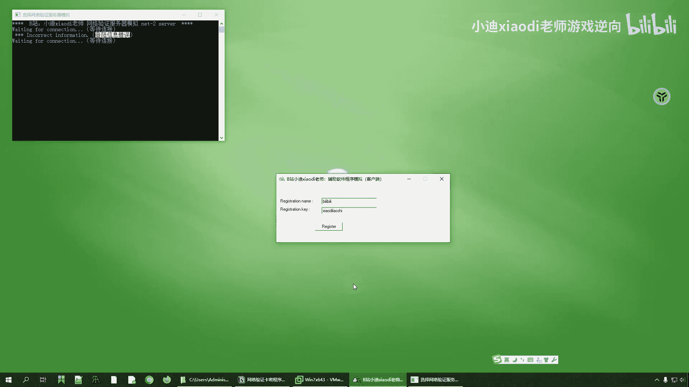

# 网络验证卡密程序逆向教程：第1章：什么是网络验证程序

在本节课中，我们将要学习什么是网络验证卡密程序，这是软件安全、游戏安全、网络安全和CTF比赛的重要基础。很多刚接触软件安全逆向的朋友都有疑问：破解技术到底能干什么？今天我们就通过一个实际例子来回答这个问题——网络验证卡密程序的逆向分析。这是系列课程的第一讲，我们将了解网络验证程序的样子、工作原理，以及客户端和服务器之间的关系。

## 🧩 网络验证程序的两种常见形态

很多朋友在日常生活中应该见过这种程序，只是不知道它的名字而已。如果你能看到这个视频，大概率遇到过这类软件。网络验证程序通常有两种样子，下面我们逐一介绍。

### 🔑 第一种形态：卡密登录

第一种形态是卡密登录。这种程序运行起来之后，界面上会有一个输入框，需要你输入一个卡密，然后点击登录按钮。完成这个操作之后，软件就可以使用了。


那么这个卡密是从哪里来的呢？答案很简单：你需要联系这个软件的作者去购买。你可以买一个月的、一个星期的，或者买半年的，购买时长取决于你的需求。购买之后，软件作者会给你一个卡密，你把卡密填到输入框里，点击登录，软件就可以正常使用了。

### 👤 第二种形态：账号密码登录

第二种形态是账号密码登录。你购买了软件之后，软件作者会给你一个用户名和密码，同时还会给你一个到期时间。你在登录界面输入这些信息，点击登录即可。一个月之后如果到期了，软件就会提示"已到期"，这时如果你想继续使用，就需要续费。

这种模式跟QQ会员差不多，或者说你可以自己去注册一个账号密码，然后去购买使用时长。这两种模式都是网络验证程序的典型形式，它们的共同特征是：需要卡密或者账号，并且账号需要充值才能使用。


## 💻 绑定电脑机制

除了卡密和账号密码之外，网络验证程序还有一个常见的特征——绑定电脑。很多网络验证程序都会绑定电脑，那什么是绑定电脑呢？下面我们来解释这个概念。


举个例子：我在当前这台电脑上购买了一个卡密并点击登录，那么我的卡密就和这台电脑绑定在一起了。如果我用同一个卡密，换到另一台电脑上去登录，那么就会登录不上去。软件会提示"已经绑定了其他电脑"，这时候你就必须解绑。

解绑是什么意思呢？解绑这两个字就是解除绑定的意思。具体来说，就是将软件卡密和当前电脑系统之间的绑定关系解除。解除之后，你就可以用这个卡密在另外一台电脑上登录了。

## 🖥️ 客户端与服务器的关系

理解了网络验证程序的形态之后，我们接下来要看一个更深入的问题：网络验证程序是怎么工作的？很多人觉得网络验证很神秘，其实它并没有那么高深。它也是一个普普通通的程序，就像人一样，虽然白人和黑人在肤色上有差异，但本质上都是人。程序也是类似的道理，大部分程序的结构都差不多，只不过网络验证程序有一些独特的东西。

为了帮助大家理解，我们准备了两个实验程序，都放在知识星球社区里，大家可以自行下载。这两个程序一个叫服务器模拟，一个叫客户端模拟。我们先运行服务器，再运行客户端，来进行实验。

### 📱 什么是客户端

先来说明什么是客户端。客户端就是我们自己使用的程序。为什么这么说呢？比如我们在买软件的时候，我们是对方的客户，是软件作者的客户，所以我们用的这个程序就叫客户端。同样的道理，我们用的各种登录程序、应用软件，这些都是客户端。


客户端还有一个特点，就是需要输入各种账号密码之类的信息。这些信息都是你花钱才能得到的。比如界面上有账号输入框和密码输入框，我们输入账号密码之后点击登录，软件会提示"登录信息错误"。如果登录成功，软件会提示"注册成功"；如果没有登录成功，就什么都没有显示，软件也用不了。


### 🖧 什么是服务器

服务器实际上就是一台电脑。这台电脑上存放着账号信息，并且会对账号密码进行校验。这台电脑你是碰不到的，它可能是软件作者本地的一台电脑，也可能是作者购买的云服务器，比如北京的服务器、阿里巴巴的服务器，甚至美国的服务器都有可能。机房可能在中国大陆，也可能在美国，你是看不见也摸不着的。

服务器做的事情就是和客户端软件进行连接。服务器上存放着所有的账号数据，客户端发来请求时，服务器就在数据库里查找对应的账号，然后返回结果。这样客户端和服务器才能配合工作。

### 🤝 客户端与服务器的协作

通过实验你会发现，客户端和服务器是相辅相成的关系。如果在实验过程中服务器崩溃了，那么客户端软件也就用不了了。我们在视频中确实遇到了服务器崩溃的小意外，这恰好说明了客户端和服务器之间的共生关系：如果服务器崩了，软件就无法使用。

这种问题在生活中也很常见。比如你买了一个软件，本来用了一个月好好的，突然就登录不上了。你可能买了半年的使用期限，结果才用了一个月就登不上去了。这时候很可能是软件作者跑路了，而他跑路之后做的第一件事就是把服务器停掉。服务器没了，你的客户端自然就登录不上了。

## 📡 网络验证的通信流程

了解了客户端和服务器各自的作用之后，我们来详细看看它们之间是怎么通信的。整个网络验证的过程本质上就是客户端和服务器之间传递消息，接下来我们用流程图来描述这个过程。

假设我们购买的服务器在美国，而我们人在中国大陆。当我们点击"注册"或"登录"按钮时，会发生以下的事情。客户端会先把账号密码信息打包成网络数据包，然后通过网络发送到服务器。服务器收到这个网络数据包后，会在自己的数据库里查询，检查这个账号是否存在、密码是否正确、有没有到期。最后服务器会返回一个结果给客户端，客户端根据这个结果决定允许登录还是拒绝登录。


整个流程可以用下面的形式来描述：


```
客户端输入账号密码 → 客户端封装网络数据包 → 发送到服务器 → 服务器校验账号信息 → 返回校验结果 → 客户端根据结果决定是否允许登录
```

这里有一个重点：客户端发送的网络数据包中包含的内容，可以是原始的账号密码，也可能是经过加密之后的账号密码。很多软件为了安全会先对数据进行加密再发送，这个细节在后面分析逆向时会用到。

举个例子来说明这个流程：假设我们输入了错误的账号密码，客户端会把账号密码信息发送给服务器，服务器查询后发现这个账号不存在或者密码不对，就返回"登录信息错误"的消息给客户端，客户端收到这个消息后就不允许登录。如果我们输入了正确的账号密码，服务器查到了有效账号，就返回"允许登录"的标记，客户端收到后登录成功。

所有关于账号是否到期、是否允许登录的权限判断，都是通过网络数据包来传递的。网络验证程序的判断登录方法，本质上就是分析和处理这些网络数据包。如果中间的网络断了，或者出现了一些问题，客户端就会卡住，登录请求发不到服务器那边。

## ⚙️ 核心概念总结

为了便于记忆，下面是一些核心概念。网络验证程序的关键组件包括客户端、服务器、网络数据包和卡密。典型流程包括四个步骤：发送账号信息、服务器校验、返回结果、客户端判断。 


从逆向的角度来看，网络验证程序和其他程序的逆向方法大差不差，只不过增添了一些网络相关的特性需要处理。传统的逆向方法是直接分析程序代码，而网络验证程序除了代码分析之外，还可以利用网络数据包来分析认证逻辑。这种方法上的区别，我们会在后续课程中深入讲解。

## 📖 本章总结

在本节课中，我们一起学习了网络验证程序的基础知识。我们从两种常见的形态入手——卡密登录和账号密码登录，知道了网络验证程序是软件作者用来控制软件使用权限的一种手段。我们还学习了绑定电脑机制，明白了什么是解绑。接着我们认识了客户端和服务器这两个概念：客户端是我们自己使用的程序，服务器是存放账号信息并进行校验的电脑。最后我们讲解了网络验证的通信流程，知道了客户端通过发送网络数据包给服务器，服务器校验之后返回结果，从而决定是否允许登录。




在下节课中，我们将学习这种程序如何进行逆向分析。我们可以先用传统的逆向分析方法去分析，然后再利用网络数据包特有的技巧和方法，带领大家掌握一些更有意思的分析思路。实验程序可以在知识星球社区下载，我们下节课再见。
