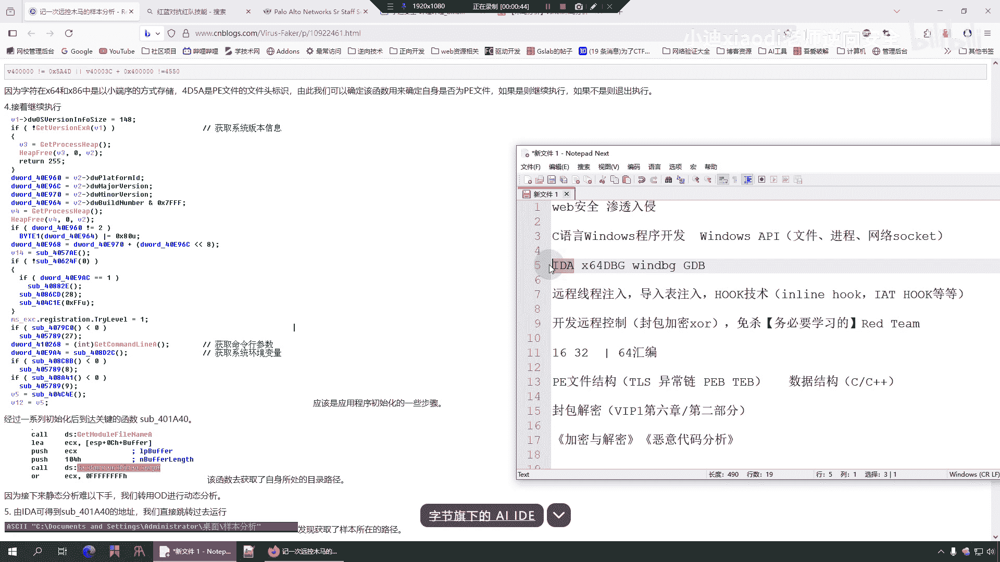
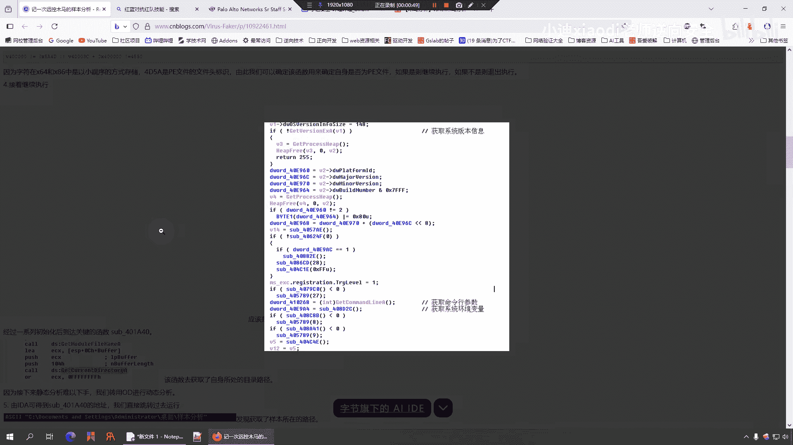
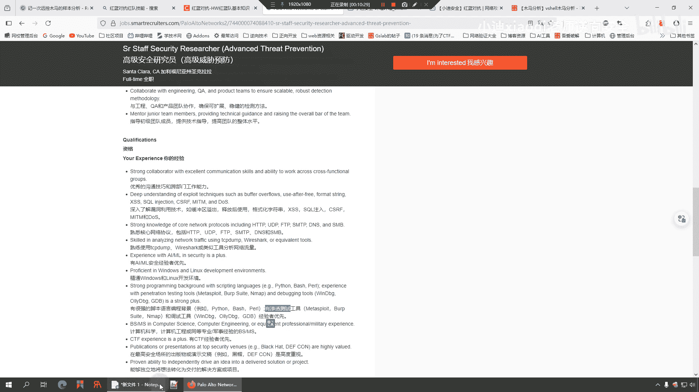

# 🛡️ 黑客职业技术需求分析：全流程入门指南

## 📖 黑客职业技术需求分析：第1章：课程概述与学习路径总览

在本节课中，我们将要学习如何一步一步踏入黑客技术领域，特别是软件安全逆向、红蓝对抗、免杀技术、软件破解、网络验证、Crackme、山寨软件、封包分析等一系列相关技能。我们不会直接上来就讲具体职位要求，而是从恶意代码分析这类大家感兴趣的方向切入，带你梳理出完整的技能树。

首先你要明白一件事：黑客技术不是一个孤立的技能点，它是一张互相连接的网。你懂开发，才能懂破解；你懂破解，才能懂免杀；你懂免杀，才能懂攻击。所以我们的学习路径是环环相扣的，每一步都是在为下一步打基础。

接下来，我们会从木马分析这个最直观的入口开始，逐步展开介绍Windows程序开发、调试工具、注入技术、远控开发、流量分析、免杀对抗、漏洞利用、Web安全等知识模块。每一块都有它存在的意义，缺少任何一块，你的技术拼图都是不完整的。

那么现在，让我们从第一个环节开始——拿到一个木马样本之后，你该怎么入手？

## 🔬 黑客职业技术需求分析：第2章：恶意代码分析入门（木马样本分析流程）

这一节我们来聊聊恶意代码分析，也就是俗称的木马分析。很多人以为木马分析很高深，但它的起步其实是一个套路化的流程。我们来看一个最简单的案例：当你拿到一个木马样本之后，第一步应该做什么？

### 第一步：查看壳信息与PE信息

拿到一个未知的可执行文件，你首先需要检查它的壳信息以及PE（Portable Executable，可移植可执行文件）文件结构信息。这个操作就好比你去医院看病，医生先给你量体温、测血压，做一个基础检查。

如果这个程序没有加壳，那么直接使用IDA进行静态分析就行了。静态分析的意思就是不去运行这个程序，而是直接对它的二进制代码进行解析和阅读。在这个过程中，你会查找关键的字符串，比如网址、命令、提示信息等等。一般来说，所有恶意代码分析都是这么开始的。

以下是木马分析的几个典型步骤：

- 使用PE工具查看程序的节区、导入表、编译时间等基本信息，判断它是否被加壳或混淆。
- 如果没壳，直接拖入IDA进行静态分析，利用字符串窗口快速定位关键线索。
- 根据找到的字符串或导入函数，顺藤摸瓜找到核心代码块，进而分析它的业务逻辑。



通过这一套流程走下来，你基本上就能搞清楚这个木马在做什么事情了。

### 第二步：熟练使用IDA进行代码分析

在这个过程中，你对IDA的热爱程度将决定你的分析效率。IDA（Interactive Disassembler，交互式反汇编器）是逆向工程领域的神器，它能把机器码还原成汇编代码，甚至在一定程度上还原出接近源代码的逻辑。

不过IDA也不是万能的。有些时候它识别函数会出错，或者对栈帧的恢复出现异常，这些都需要你手动去修复。你可以把它想象成一个自动翻译器，翻译得不准的时候，你得自己上手改。

那么这里就对你的技能提出了一个非常明确的要求：你必须熟练掌握IDA的常见用法，并且能够解决它的各种疑难杂症。

以下是IDA使用中的几个常见痛点及对策：

- 函数识别错误。当IDA对某些函数的边界判断失误时，你需要手动创建函数或者调整函数边界。
- 栈指针异常。有些加壳或混淆后的代码会导致IDA的栈分析失效，这时你需要在Options > General > Stack pointer中修复栈偏移。
- 类型信息缺失。对于常见的API调用，你可以加载符号文件或类型库来辅助识别。

总之，IDA不是拿来看的，是拿来用的。你用多了，自然就熟了。

### 第三步：结合Windows API理解程序行为

接下来我们要看一个很核心的点。这个程序它是一个木马，对吧？木马想要在系统里干坏事，它总得调用系统提供的一些功能。比如说，它要获取版本信息、获取系统版本信息，它要遍历系统进程，它要做文件替换操作，这些动作全都绕不开Windows操作系统提供的一个标准接口，也就是Windows API（Application Programming Interface，应用程序编程接口）。



所以到这里，你就该明白了：C语言的Windows程序开发，是整个恶意代码分析中非常重要的基本功。你必须要掌握它。

以下是Windows API调用的几个典型场景对应表：


- 获取系统版本信息：调用 `GetVersionEx()` 或 `RtlGetVersion()` 函数，用来判断目标系统的版本，以便选择合适的提权方式或攻击载荷。
- 遍历系统进程：调用 `CreateToolhelp32Snapshot()` 配合 `Process32First()` 和 `Process32Next()` 函数，用来枚举当前系统中的进程列表。
- 文件替换操作：调用 `MoveFileEx()` 并传入 `MOVEFILE_REPLACE_EXISTING` 标志，用来替换系统关键文件实现持久化。

当你看到IDA的反汇编窗口里全是C语言的影子时，你就知道——不懂C语言，这条路根本走不下去。所以说C语言是必须拿下的，没有商量余地。


### 第四步：掌握Windows程序开发的核心API

然后我们再来扩展一下。Windows程序开发所涉及的核心API，不仅仅局限于上面提到的文件操作和进程操作。网络通信这块也极其重要，因为木马十有八九是要和外部的C2服务器（Command and Control Server，命令与控制服务器）通信的。

以下是Windows核心API的核心分类：

- **文件相关API**：`CreateFile()`、`ReadFile()`、`WriteFile()`、`DeleteFile()`等，用于对磁盘文件进行各种操作。
- **进程与线程相关API**：`CreateProcess()`、`OpenProcess()`、`CreateRemoteThread()`等，用于管理进程和线程的生命周期。
- **网络Socket编程相关API**：`socket()`、`bind()`、`connect()`、`send()`、`recv()`等，用于建立网络连接并传输数据。

掌握了这些东西之后，你在看一个恶意样本的时候，就能做到一眼看穿它的底牌。

## 🐛 黑客职业技术需求分析：第3章：调试工具的深度掌握

上一节我们介绍了通过静态分析来理解木马的逻辑。但是静态分析有一个天然缺陷：如果你遇到的是加壳的、动态生成的代码，那么静态分析根本看不到真实逻辑。这个时候，你就需要另一件法宝——动态调试工具。

在动态调试这个领域，x64dbg是绕不开的一个工具。它是一款开源的x86/x64调试器，界面友好，功能强大，社区活跃。关键它免费。

你掌握了x64dbg之后，其他调试工具其实都是大同小异的。调试器这种东西，核心思想都是：下断点、单步执行、查看寄存器、查看堆栈、修改内存。只要你精通了一款，换到另一款工具上，最多也就是适应一下界面布局和快捷键的事，没有任何心理负担。

以下是动态调试的几个基本操作：

- 下断点。在可疑的API调用处下断点，例如 `CreateFileW()`，然后让程序跑起来，看看它到底访问了哪些文件。
- 单步执行。使用F8逐行执行汇编指令，观察程序每一步的跳转方向和计算过程。
- 查看堆栈窗口。当你断在一个函数入口时，堆栈窗口会告诉你参数是从哪儿传进来的。

动态调试给我们的价值就在于，你不再只是猜测程序在干什么，而是可以亲眼看着它一步一步去执行操作。

## 💉 黑客职业技术需求分析：第4章：Windows注入技术进阶指南

有了分析和调试的基础之后，我们来聊点更高级的东西。你可能会好奇：木马是怎么做到悄无声息地在别的进程里运行代码的？这就要引出注入技术了。

接下来，我们来系统梳理一下几种常见的注入手段。

以下是几类经典的Windows注入技术：

- **远程线程注入（Remote Thread Injection）**：核心思路是在目标进程中创建一个新线程来执行我们的恶意代码。核心实现方式是调用 `OpenProcess()` 打开目标进程，然后在目标进程内分配内存并写入恶意DLL路径，最后通过 `CreateRemoteThread()` 创建远程线程并加载DLL。
- **导入表注入（Import Table Injection）**：通过修改目标PE文件的导入表，让目标程序加载我们指定的DLL，这样我们的代码就会在目标程序启动时被自动加载执行。
- **COM劫持（COM Hijacking）**：利用Windows COM组件的注册表机制，在特定注册表位置替换COM对象指向的DLL路径。

这些技术和木马、外挂程序经常用到的功能是强挂钩的。你把这些学会之后，再去理解一个木马的运作方式，思路瞬间就不一样了。

## 🔌 黑客职业技术需求分析：第5章：开发远控软件与流量分析实战

前面我们铺垫了那么多基础知识，目的就在这一节开始发挥作用——把所有的技能串起来，做一个完整的远程控制程序。

开发一个远控（Remote Administration Tool，RAT）其实是一个极具综合性的练习项目。它需要你具备网络编程能力、多线程处理能力、加密解密能力以及对Windows系统底层的理解。

### 传输数据的加密策略

一个远控程序的核心功能就是传输数据。传输数据的时候，你可以选择直接明文发送，但是这样太容易被杀毒软件和防火墙识别了。于是我们可以对数据进行加密，最简单的方案是使用异或（XOR）加密。

比如下面这段代码展示了一个简单的异或加密函数：

```c
void xor_encrypt(char* data, size_t len, char key) {
    for (size_t i = 0; i < len; i++) {
        data[i] ^= key;
    }
}
```

异或加密的好处是它非常简单，执行效率极高，同时它也能有效规避简单的字符串特征检测。但它的缺点也很明显——密钥一旦泄露，任何分析者都能瞬间破解。所以它在恶意代码分析中很常见，因为这是一个“够用就好”的场景。

### 从明文流量到加密流量的分析演练

在开发远控的过程中，分析封包是一个非常有意思的环节。你可以这样安排自己的练习：

1. 先不加密。让你的远控程序以明文方式发送数据，然后用抓包工具分析流量。
2. 使用Wireshark或Fiddler抓包，观察你的远控程序产生的数据流。
3. 抓包分析完毕之后，对你的数据通道进行加密，再抓包进行一次对比。

通过这样的对比，你就把开发、加密、流量分析、C语言编程全部串联到一起了。关于封包分析的具体流程，这里给大家提供一个简单的Python抓包分析示例，用scapy库来解析TCP负载：

```python
from scapy.all import *

def analyze_packet(packet):
    if packet.haslayer(TCP) and packet[TCP].payload:
        payload = bytes(packet[TCP].payload)
        print(f"Source: {packet[IP].src}:{packet[TCP].sport}")
        print(f"Dest:   {packet[IP].dst}:{packet[TCP].dport}")
        print(f"Payload: {payload[:64]}")

sniff(prn=analyze_packet, filter="tcp port 4444", count=20)
```

你先运行这段代码，然后让远控程序发数据，你就能清晰看到数据包的内容了。经过这样一轮完整的实战之后，你对网络技术的理解会比其他学习方式深刻得多。

## 🧼 黑客职业技术需求分析：第6章：免杀技术与红蓝对抗的概念解析

当你辛辛苦苦开发出一个远控之后，等待你的那个结果几乎是命中注定的——你的程序会被杀毒软件杀掉，百分百被杀。这个时候，你就必须要学习免杀技术了。

免杀，全称是“免于被杀毒软件查杀”，它的核心思想是让你的恶意程序在运行前不被安全软件识别出来。免杀和红队（Red Team）工作直接挂钩——红队模拟真实攻击者的行为来测试企业的安全性，如果打进去了但被杀了，那不是白费功夫吗？

### 静态免杀的思路

静态免杀的核心是对程序特征进行混淆。杀毒软件会在文件里寻找特征的MD5哈希或者特定的代码模式。你可以修改程序的入口点、混淆字符串、加壳或者用自己的加密器加密代码。

有一个很简单的思想：杀软看到的是程序的样子，如果你的程序长得不像恶意文件，它就不会被杀。这就好比你把刀伪装成一根筷子，安检自然就放你过去了。

### 动态行为免杀的思路

免杀不仅仅是静态层面的对抗，更是行为层面的伪装。杀毒软件不仅会看文件长什么样，还会监视程序运行时的行为。如果你的程序一运行就创建远程线程、注入进程、修改注册表开机启动项，那就算你隐藏得再好，它也会判定你有恶意行为。

### 红蓝对抗中的免杀定位

现在我们来说说红蓝对抗这个概念。红队扮演攻击者，蓝队扮演防守者。红队要想在防守严密的网络里存活下来，免杀技术就是基础中的基础。没有免杀工具，你的攻击载荷进入目标系统的那一刻就会被杀掉，后面的事情根本谈不上。

## 🧬 黑客职业技术需求分析：第7章：从汇编视角看木马分析与PE结构

前面我们提到，木马分析大多时候看的是C代码和伪代码。但还有一种更硬核的恶意样本——它不会乖乖地让你看到清晰的C代码，而是展示大量的汇编指令。什么样的程序会让你看汇编？给你看汇编的几乎可以断定是经过动态调试后的结果，因为正常的、未经处理的程序，分析者看到的应该都是反编译器返还的近似代码。

这一小节就来扩展一下相关的名词和知识。

### TEB与PEB的结构解析

在Windows系统中，每个线程都有一个对应的TEB（Thread Environment Block，线程环境块），每个进程有一个PEB（Process Environment Block，进程环境块）。这俩结构体在操作系统的内部机制中扮演着极其重要的角色。

PEB中有一个结构叫 `BeingDebugged` 标志位，恶意代码常常用它来检测自己是否正在被调试器附加。在免杀和反调试中这是一个非常经典的手段，相关的C语言示例可以参考以下代码：

```c
#include <windows.h>
#include <stdio.h>

int IsDebugged() {
    return (*(unsigned char*)(((unsigned char*)NtCurrentPeb()) + 0x02));
}

int main() {
    if (IsDebugged()) {
        printf("Debugger detected! Exiting...\n");
        return 1;
    }
    printf("No debugger found.\n");
    return 0;
}
```

这段代码直接读取PEB中偏移量为 `0x02` 的字节，如果值是1，说明程序正在被调试。恶意代码经常会用这种手段做反分析。

### PE文件结构

PBTEB这些东西，本质上都是隶属于PE文件结构这个大框架的。PE文件结构描述了一个Windows可执行文件在磁盘上和内存中是如何组织的。

以下是PE文件结构中你必须知道的核心组件：

- **DOS头**：每个PE文件的最开头，包含一个指向PE头部的偏移量。它存在的目的仅仅是为了让老系统识别这是有效的EXE。
- **NT头**：包含文件签名、文件头和可选头三部分，它们描述了PE文件的总体布局和入口点。
- **节表**：用于描述PE文件中各个节（代码节、数据节、资源节）在磁盘和内存中的位置。
- **导入表**：列出该程序从其他DLL文件导入的所有函数名和函数地址。
- **导出表**：列出该DLL对外导出供其他程序使用的函数。

在做免杀和恶意代码分析的时候，对PE结构要烂熟于心。你知道他们每个部分干什么用的，后面遇到可疑样本时，一眼就能定位问题。

### 双向链表与数据结构

再往深处走，你会遇到双向链表这个概念。这个对于有编程基础的人来说，听起来不陌生吧？双向链表（Doubly Linked List）是一种常见的数据结构，它的每个节点拥有两个指针，一个指向下一个节点，另一个指向前一个节点。

以下是一个简单的双向链表节点定义：

```c
typedef struct Node {
    int data;
    struct Node* prev;
    struct Node* next;
} Node;
```

在Windows内核中，进程和线程的链表就是用类似的方式实现的。你把这个数据结构搞清楚，再去看PEB和TEB遍历进程的操作时，就不会一头雾水。

## 🔑 黑客职业技术需求分析：第8章：木马核心逻辑与免杀操作的基本功

拿到一个木马之后，你除了分析它的加载方式，还得去看它的业务逻辑。木马要干活，它会做一些常见的操作。

### 常见的木马字符串操作

木马经常干的一件事情就是拼接字符串。为什么？因为它需要动态地构建攻击命令、构造URL、拼接文件路径。这些动态构建的字符串如果是明文的，很容易被杀毒软件感知；所以它经常会把字符串拆成一小段一小段，最后在内存中拼接起来，这样做就是为了给后续的免杀做最基本准备。

### 动态调用API：活动函数地址

这类木马还会做一件事：它对所有敏感API函数都采取动态调用的方式。当它想要调用 `MessageBox()` 这种函数的时候，它不是直接在导入表中声明，而是通过获取函数真实地址，然后动态调用。

这种获取函数地址再调用的实现方式，可以用下面这段代码来直观展示：

```c
#include <windows.h>
#include <stdio.h>

typedef int (WINAPI *MessageBoxFunc)(HWND, LPCSTR, LPCSTR, UINT);

int main() {
    HMODULE user32 = LoadLibrary("user32.dll");
    MessageBoxFunc myMessageBox = (MessageBoxFunc)GetProcAddress(user32, "MessageBoxA");
    
    myMessageBox(NULL, "Dynamic Call!", "Hi", MB_OK);
    return 0;
}
```

仔细看，这段代码中我们并没有在导入表里声明 `MessageBoxA`，而是通过 `GetProcAddress()` 在运行时获取它的地址再调用。这本质上是免杀的基本操作。

免杀技术本身并不复杂，当你理解了动态调用的原理之后，你再回头去看恶意样本，就会发现它的套路其实非常固定。

## 🥷 黑客职业技术需求分析：第9章：高级免杀技术与内存恶意代码执行

下面我们要进入更高级的话题——免杀中的内存执行技术。很多时候，恶意程序根本不会把恶意代码放在硬盘上，而是将它们加密保存在数据段中，运行时再解密到内存中直接执行。这就相当于一个间谍从来不带武器入境，都是在境内自己组装武器。

### 纯内存加载机制

这种技术被称为“纯内存执行”。恶意样本从磁盘读取到内存后，不落地生成新文件，直接在内存中完成解密、映射、修复导入表并执行代码。正因为整个过程不经过磁盘，传统的基于文件扫描的杀毒软件根本无从检测。

### 解密与代码执行的联动关系

如果网络流量中的指令也都是经过加密的，那么样本接收到指令后就会调用解密函数，然后执行解密后的数据。这个过程把“解密”和“执行”牢牢绑定在了一起。

当你自己完整开发过一个类似的远控之后，你会培养出一种直觉。这种直觉能让你在看到别人样本的瞬间，就知道它在加密什么、在解密什么、调试的时候应该在哪个函数下断点。

## 🌐 黑客职业技术需求分析：第10章：核心网络协议与工具开发实践

前面我们讲了太多的分析和对抗，现在来补充一下网络层面的知识底子。红蓝对抗中，你永远绕不开各种网络协议。这里我们梳理几个最核心的协议，并提供实际开发的项目思路。

以下是各个核心网络协议对应的实战练习建议：

- **HTTP**：你可以尝试开发一个HTTP网站的自动登录和自动签到的工具。这个练习可以让你理解Cookie、Session、HTTP头以及请求会话维持的具体细节。
- **UDP**：UDP是一种无连接的传输层协议，非常适合用来做低延迟的远控数据传输。你可以基于UDP协议做一个简单的远控，体验一下UDP和TCP在开发上的区别。
- **FTP**：FTP用于文件传输，你可以开发一个传文件的工具。做一个可视化的小工具，拖拽上传下载，顺便练习一下怎样处理大文件的分块传输。
- **TCP**：对于TCP协议本身，不想手写代码的话，你也可以利用AI工具（比如ChatGPT）来生成代码，然后自己一行一行读一读，理解它是如何建立连接、收发数据的。

网络协议，学起来看上去枯燥，但配合具体项目和抓包分析之后，就会感觉逻辑非常顺畅。


## 💥 黑客职业技术需求分析：第11章：漏洞利用技术与Web安全概述

前面讲完了协议和开发，现在我们来聊一个更有进攻性的话题——漏洞利用。

### 常见的系统级漏洞类型


漏洞利用（Exploitation）技术的核心是找到软件中的逻辑缺陷从而破坏程序原有的执行流程。以下列出几种最常见的漏洞类型：

- **缓冲区溢出（Buffer Overflow）**：程序向固定大小的缓冲区写入超出其容量的数据，导致相邻内存被覆盖。最经典的案例就是直接改写函数的返回地址，把它指向恶意代码。
- **释放后使用（Use-After-Free）**：程序在释放了一个内存块之后仍然继续使用该内存，攻击者可以抢占这块内存来控制程序的执行流。
- **格式化字符串（Format String）**：当程序员把用户输入直接作为 `printf()` 函数的格式化字符串参数时，用户就可以通过 `%x`、`%n` 等特殊符号来读取或修改内存。

这三类漏洞是软件安全中最经典也最常见的“三剑客”。你完全可以用C语言写一个最简单的存在漏洞的demo，然后亲自用调试器去分析攻击效果。

### Web安全中的经典攻击类型

再往后延伸，就到了Web安全的地盘。Web安全是整个网络安全中占比最大的一块战场，这里我们简单列几个经典攻击面。

以下是几类典型的Web攻击技术：

- **XSS（跨站脚本攻击，Cross-Site Scripting）**：攻击者向目标网站注入恶意的JavaScript代码，当其他用户浏览该页面时，恶意代码就会在用户的浏览器中执行。
- **CSRF（跨站请求伪造，Cross-Site Request Forgery）**：攻击者诱导用户在自己的浏览器中发送一个并非用户本意的恶意请求，利用用户的身份完成转账、改密等操作。
- **中间人攻击（Man-in-the-Middle）**：攻击者把自己放置在通信双方之间，窃听或篡改通信内容。这种攻击在公共WiFi环境下尤为常见。
- **DoS（拒绝服务攻击，Denial of Service）**：通过大量请求消耗目标服务器的资源，使合法用户无法访问服务。

这些内容属于Web安全的核心版图，也是渗透测试和红队行动中不可或缺的技能模块。

## 🎯 黑客职业技术需求分析：第12章：学习路径整合与优质资源推荐

前面几章我们分别拆解了各个技能模块，现在我们来整合一下整体学习路径。你可能会发现，从XSS、CSRF一直到中间人攻击、DoS，再延伸到渗透测试、社会工程学、免杀技术，这些内容本质上都是互相关联、交织在一起的。Web安全和渗透测试往往分不开。

这一节我们来看看一个可行的学习方法。我推荐你先去B站搜索一位知名UP主，名叫“小题安全”。请注意，这位“小题”并不是我本人。他大约在2012年左右开始做这个方向的视频教学。而我入行的时候，这位UP主就已经在做视频了，因此可以断定他的资历非常老。

这位UP主的视频质量相当不错，内容也相当客观实用。我们来看看它的大致课程目录结构，你会发现他讲的内容极其丰富。

以下是“小题安全”视频课程的主要内容架构：

- **Web安全**：包括抓包分析、HTTP协议分析、Cookie机制等。
- **免杀与漏洞利用**：包括免杀对抗、漏洞挖掘、漏洞POC编写。
- **代码审计**：教你如何从源代码级别发现安全隐患。
- **红蓝对抗**：从攻击方和防守方两个角度来分析攻防技术。
- **渗透测试**：教你如何系统地测试一个网络系统的安全性。
- **社会工程学**：教你如何利用人的心理弱点进行安全攻击。

你完全可以通过这个视频合集，把自己前面分散学习的各个知识点串成体系。红蓝对抗的实践技能在这类课程中能得到很好的补充。红蓝对抗需要的核心素质是：你必须手里头有漏洞利用的工具，同时掌握免杀技术，最好还能懂一些渗透技巧。有了这些东西，你才能有效地执行攻击任务。

## 💻 黑客职业技术需求分析：第13章：编程语言背景与个人能力模型构建

现在我们来谈谈编程语言的背景。很多人问：做黑客是不是要精通很多门语言？其实不需要太多，但你必须有一门用得滚瓜烂熟的语言。

如果你选择Python，那么事情会变得非常简单。很多渗透测试和漏洞利用的工具都是基于Python脚本编写的。学习Python的语法非常简单，它是最适合入门且表达能力极强的语言之一。

而除了技术本身，你还需要具备一个更为核心的能力。什么能力呢？就是能够独立将你的想法转换为一个可落地的解决方案的能力。比如说，你想做一个自动扫漏洞的工具，你就能够写一个脚本去实现。你想做一个远控，你就能从零把它搭起来。

以下是一个快速上手的自动化网络请求示例，你直接使用Python的requests库就可以编写出网络交互脚本：

```python
import requests

# 基本的使用方式
response = requests.get("https://httpbin.org/get")
print(response.status_code)
print(response.text)
```

这个能力非常关键，它代表着你已经从“看教程的观众”变成了“写代码的开发者”。到这个时候，你不再只会看别人的代码，而是能够自己创造新的东西。

## 🧠 黑客职业技术需求分析：第14章：你的专属学习路线与后续规划

到这里，我们这节宏观的介绍也接近尾声了。来梳理一下，你从这套学习路线中到底要掌握什么。

本节我们已经了解到，整个技术栈涵盖了以下几个方向：

- **恶意代码分析**：从拿到一个样本到读懂它逻辑的完整流程。
- **Windows程序开发与API**：C语言基础、Win32 API使用、进程、网络、文件操作。
- **调试与逆向工具**：IDA、x64dbg等工具的学习与实战。
- **注入技术**：远程线程注入、导入表注入等Windows高级技术。
- **远控开发与分析**：开发一个可以远程控制目标机器的程序，并进行封包分析。
- **免杀技术**：怎样让你的恶意代码不被杀毒软件拦截。
- **Web安全与渗透测试**：XSS、SQL注入、CSRF、中间人攻击和渗透测试的通用方法。
- **核心编程语言**：Python、C语言，以及AI辅助编程的实践思路。

在宏观这个层面，上述内容已经足够全面。如果你在这条路上遇到瓶颈，可以随时把你遇到的问题留言告诉我，我们可以一起讨论。至于学习辅助资源，你就认准“小题安全”这个UP主的视频去自学就可以了，基本上可以帮你覆盖到我们目前提到的大部分知识模块。毕竟对于一个初学者来说，有一个靠谱的资源做指引，确实能少走很多弯路。

## 📌 黑客职业技术需求分析：总结



本节课我们一起梳理了从木马分析到远控开发，再到免杀对抗和Web安全的完整黑客技术学习路径。我们首先从恶意代码分析入手，介绍了查看壳信息、使用IDA静态分析、识别关键字符串、分析核心逻辑的方法。然后我们讨论了Windows API和C语言在安全分析中的重要地位，以及x64dbg在动态调试中的作用。接着我们深入介绍了注入技术、远控开发、流量加密与封包分析；然后打开免杀技术和红蓝对抗的大门，解释了动态调用API、内存执行等核心概念。最后我们梳理了核心网络协议、漏洞利用、Web安全等扩展知识，并推荐了相关的学习资源。

总的来说，这门技术领域有一个非常清晰的特点：它涉及的面非常广，但是各个环节又紧密相连。可以说，你掌握的每一个小技能都在为你的最终目标服务。你接下来要做的，就是按照这个路线一步一个脚印地走下去，把每一项基础技能都吃透，然后在这个基础上构建属于你自己的技术体系。
