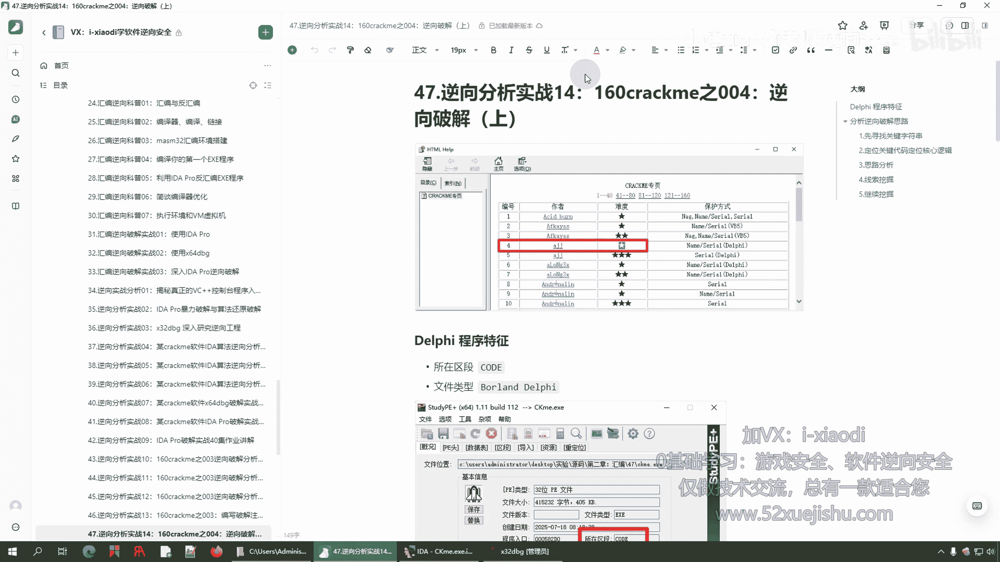
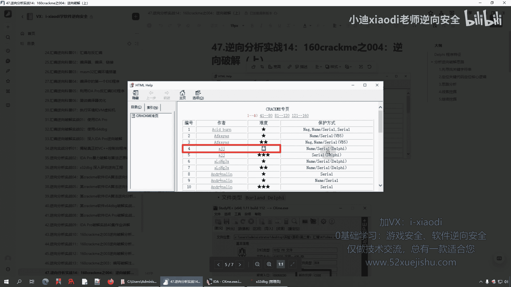
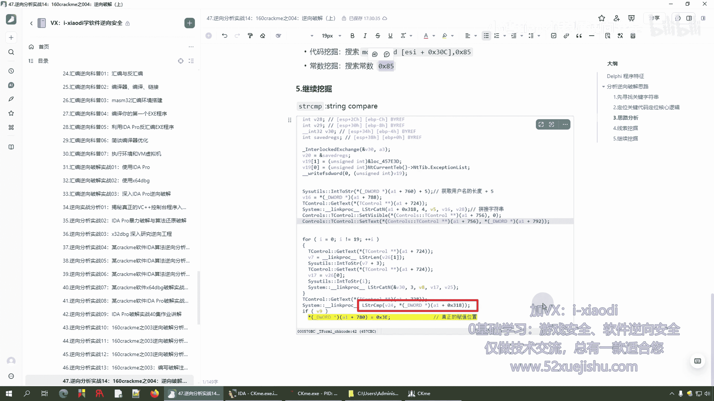

# 软件逆向破解实战：004：160crackme之004一人一码破解 🎯

## 📋 概述

在本节课中，我们将学习160个crackme系列中的第004号程序，编号为4，难度评级为一颗星。虽然这个程序的难度标注只有一颗星，但从实际反馈来看，许多同学在这个程序上都遇到了不小的困难。我们将会从头到尾分析这个程序的破解流程，包括程序特征识别、关键字符串定位、核心算法分析以及注册码验证逻辑的逆向推导。通过本节课的学习，你将会掌握一套完整的软件逆向破解思路和方法，为后续的游戏安全、软件安全、网络安全以及CTF比赛等领域打下坚实的基础。

## 🔍 第一节：程序特征识别

首先，我们来讲解如何识别这个程序的特征。识别程序的方法非常简单，打开我们社区配套的工具包，点击工具菜单，里面有一个`study`工具。把这个工具运行起来之后，我们只需要将待分析的程序直接拖拽到`study`工具窗口中，工具就会自动加载并显示程序的相关信息。

加载完成后，我们只需要观察两个关键的地方。第一个是所在区段（Section），这里显示的应该是`code`；第二个是文件类型（File Type），这里会显示为`MFC`（Microsoft Foundation Classes）程序。当你在分析其他程序时，如果发现某个程序同时具备这两个特征，就可以判定它是一个`Delphi`开发的程序。识别程序的开发语言和框架类型是逆向分析的第一步，因为不同的开发环境生成的程序在结构和特征上都有显著差异，了解这些差异能帮助我们选择更合适的分析工具和策略。

这个程序的开发环境识别完毕之后，下面我们实际运行一下这个程序，看看它的界面是什么样的，观察它有哪些输入框和按钮。

## 💻 第二节：运行程序与初步尝试

这个程序运行起来之后，界面上有一个输入框要求输入用户名，还有一个输入框要求输入注册码。界面上有一个提示信息，说明如果注册成功的话，程序中会出现朱茵小姐的一张照片。相信看过《大话西游》的朋友应该都知道朱茵饰演的紫霞仙子，她可是不少人心目中的梦中情人。这个提示信息是我们逆向分析的重要线索，因为注册成功后的行为往往能帮助我们验证最终的破解是否成功。

我们先来随便输入一个用户名，然后在注册码一栏中随意输入一些字符，点击确定按钮。这时候观察程序的行为，我们会发现这个程序没有任何的反应，没有弹窗提示，也没有显示错误信息或成功信息。程序的行为完全静默，没有给我们提供任何有用的反馈，这个程序像是一个无响应状态，我们点了一下按钮，程序完全没有动静。

这种情况下我们就不能凭借软件的行为来获取分析了，因为程序没有给出任何正面或反面的反馈，我们在界面上看不到任何异常或者正常的提示。既然从外部行为无法获取有效信息，那么我们就需要主动去挖掘这个软件内部存在的一些关键信息，找到程序内部的关键逻辑。

## 🔑 第三节：查找关键字符串



在程序没有任何反应的情况下，我们需要转换思路，不再依赖软件的外部行为来给我们提供提示，而是要主动去挖掘这个软件中存在的关键信息。怎么去挖掘呢？方法非常简单，一共包含两个步骤。



第一步，先寻找关键的字符串。我们拿到程序之后，直接使用`OD`（OllyDbg）加载这个程序，然后按下`Shift+F12`打开字符串查找窗口。在这个窗口中，我们会看到很多字符串，仔细浏览查找，就能发现一个明显的字符串——“恭喜注册成功”。

这个“恭喜注册成功”的字符串应该就是我们要找的关键字符串，它是一个关键的切入点。通常情况下，注册成功提示字符串所在的位置就是验证逻辑通过之后的执行路径，逆向分析这个字符串的引用位置就能找到整个验证核心。

找到这个关键字符串之后，我双击这个字符串，就可以跳转到它所在的内存地址，然后查看这个地址的交叉引用。在汇编代码窗口中，我们先按空格键，让代码以图表的形式显示，这样能更清晰地看到代码的跳转关系。接着按`F5`键，查看返回的伪代码。

这个时候我们就会发现信息框的提示在这个位置，然后继续往上看，这一行代码应该是设置控件可见性的一个函数，`可见`应该就是`控件`的意思。所以说这个函数应该就是设置控件的可见性，也就是说当注册成功时，程序会将某个控件设置为可见，这个控件很可能就是显示朱茵照片的图片控件。

再往上看，这里有一个循环结构。这个循环应该就是计算注册码的核心算法，是程序验证用户名和注册码的关键计算过程。不过我们先不深入分析这个循环的具体逻辑，继续往下查看代码的整体结构。

这里有一个判断，这个判断需要成立，这个循环才可以执行。我们可以看到这个判断成立的条件是这个里边的数据等于`85`才对，这个`85`是一个十六进制数，在汇编中表示为`0x85`。并且我们往上看，这个循环好像跟这个地址的一个复值呢并没有直接的关系，说明这个循环的执行条件和前面的赋值操作没有直接的联系。

所以在整个的`BtnClick`事件函数里面，最关键的地方应该就是这里，这里决定着下面的弹窗是否能够正常执行。也就是说，如果这里的条件不成立，整个注册成功的流程就无法继续下去。

## 🧩 第四节：核心判断逻辑分析

接下来，我们来详细分析一下这个关键判断的汇编代码。它的汇编代码是`CMP ESI+30C, 85`，这里`CMP`是比较指令，`85`是十六进制数据。也就是说，程序拿`85`这个十六进制数据和`ESI+30C`这个地址里边的值做一个比较。

那么这个核心逻辑就非常清晰了，它的验证逻辑可以简化为如下形式：

```asm
CMP DWORD PTR [ESI+0x30C], 0x85
```

如果用高级语言来描述，这段逻辑就是：

```cpp
if ([ESI+0x30C] == 0x85) {
    // 显示成功提示
    // 显示朱茵照片
} else {
    // 什么都不做
}
```

整个验证过程的核心就是一个数值比较，这个比较决定了程序是否执行注册成功的分支。

那么这个时候我们就要思考一个问题了：如果说这个地址里边存在`0x85`的话，这个数据是从哪里来的呢？换句话说，`ESI+0x30C`这个内存地址中存储的值是在什么时候、由什么代码被写入的。

根据逆向分析的常规思路，其来源有两个可能性：

+ 可能性一：由上层的函数赋值并写入到这个地址里边。也就是说，在调用当前这个按钮事件之前，某个父函数或调用方函数曾对该地址进行过赋值操作。
+ 可能性二：由没有互相引用的外部函数写入这个地址里边。也就是说，这个地址的赋值操作可能发生在其他模块或者其他没有直接调用关系的代码中，比如通过消息机制或回调函数在不同的上下文中写入。

我们需要逐一验证这两种可能性。对于可能性一，我们可以通过动态调试的方式下断点去观察，看看在程序运行过程中，这个地址是否确实被上层函数赋值过。

## 🐞 第五节：动态调试验证

我们不妨去下断点去分析一下，看这个地址的数据来源。首先记录一下这个地址的数值，这个地址在`0x458031`。我们就在`0x458031`这个地址上打一个断点，让程序在访问这个地址时中断下来，以便我们观察现场的寄存器和内存状态。

设置好断点之后，回到我们的程序窗口，随便点击一下按钮触发事件，这时候程序就在我们预设的断点位置断下来了。程序断下来之后，先把断点放开，然后按下`Ctrl+F9`执行到返回，返回到上一层调用函数。观察这一层的代码，发现这里什么都没有，也没有看到任何与赋值相关的操作。

继续按`Ctrl+F9`，多返回几层去看一下。此时我们就可以观察一下当前的代码中是否有`ESI+30C`这样的访问操作，仔细检查每个指令后，好像是没有发现对`ESI+30C`的写入。如果说大家比较执着的话，可以多返回几层去看一下，但从目前的调试结果来看，通过动态调试的验证，方向一并没有发现向这个地址写入`0x85`的操作。

那么通过我们的分析，方向一没有发现`0x85`的赋值，只剩下方向二了，也就是：由没有互相引用的外部函数写入`ESI+0x30C`这个地址。如果这个可能性是真实的话，那么我们就可以推测写入代码大概是这样的：`MOV ESI+30C, 85`，意思就是把`85`这个数据放到`ESI+30C`这个地址里去。

那么此刻也就意味着这个程序里边存在这样一条代码，我们需要在程序的二进制机器码中找到它。既然推测出了这条关键指令的存在，接下来我们就要在程序中定位它。

## 🔎 第六节：线索挖掘

既然已经推测程序中存在`MOV ESI+30C, 85`这样的指令，那么我们就要想办法在程序中找到这条指令的具体位置。线索挖掘的方法有两种，分别是代码挖掘和常数挖掘。

**方法一：代码挖掘**

第一种方法是代码挖掘，我们直接去搜索这条汇编代码对应的机器码。怎么去挖掘呢？操作非常简单，首先在`OD`中复制这条指令对应的机器码，然后切换到`CPU`窗口，点击鼠标右键，选择`搜索` -> `当前模块`，在输入框中输入命令后点击确定。

点击确定后，就会找到一条反汇编结果，这个就是我们要找的赋值指令了。找到这条指令后，我们就可以通过`IDA`跳转到这个地址上进行一个分析了。使用`IDA`的好处在于它可以提供更清晰的交叉引用和函数调用关系，方便我们理解这条赋值指令所在的上下文环境。

**方法二：常数挖掘**

第二种线索挖掘的方式是常数挖掘。我们直接去搜索常数`0x85`。在`OD`中，点击鼠标右键，选择`搜索` -> `当前模块` -> `常数`，输入`85`，默认进制是十六进制，点击确定后就会列出所有涉及这个常数的相关代码。在搜索结果中，我们同样会看到这个赋值指令的位置。

双击这条结果，同样可以跳转到这个位置。通过这两种方法，我们都能找到`0x85`赋值语句的具体位置。双击这条赋值指令之后，我们就可以看到`MOV ESI+30C, 85`这个复值的一个位置了。

**关键位置的上游分析**

既然已经定位到了那条赋值指令的位置，那么我们继续往上看，寻找更上层的逻辑。大家会发现这里有一个`strcmp`相关的代码，在汇编中表现为`ST23`和`MPT23`这样的符号，这里的`ST23MPT23MP`其实是`strcmp`，也就是字符串比较的意思。`strcmp`是C语言标准库中的字符串比较函数，通常用于比较两个字符串是否相等。

那么我们就要注意了，`字符串比较`的位置通常就是关键代码的破解位置。因为程序要验证用户名和注册码，必然会将用户输入的内容与正确的注册码进行字符串比较操作，而程序判断是否继续执行后续逻辑，关键就在这个字符串比较的结果上。在某些情况下，甚至可以通过修改跳转条件来跳过验证，但这种暴力的修改方式往往不是最优解，我们还是应该分析完整的验证逻辑，以便理解整个程序的运行机制。

核心的验证逻辑可以概括为以下流程：

```cpp
// 伪代码表示验证流程
输入用户名、注册码

if (strcmp(用户名, 正确用户名) == 0) {
    if (strcmp(注册码, 正确注册码) == 0) {
        // 赋值操作
        MOV ESI+0x30C, 0x85
        // 显示成功界面
    } else {
        // 返回错误状态
    }
}
```

今天我们的分析就到这里，内容已经覆盖了从程序定位到关键代码挖掘的整个流程，最后的字符串比较位置涉及到的具体算法留待大家自己验证和推导。

## 📝 课后作业

为了巩固本节课所学的知识，这里给大家留一个作业。大家回去之后，可以把上边的验证逻辑自己分析一下，然后做一个注释，把每个关键函数的作用都标注出来，仔细看一下这些函数分别是干什么用的。通过这个练习，你将会更加深入地理解软件逆向分析的思路和方法，尤其是如何从已知的破解点向回追溯整个验证逻辑的过程。



## 💎 总结

本节课中，我们一起学习了`160crackme`系列第004号程序的逆向破解流程。首先我们通过`study`工具识别了程序的开发环境特征，接着通过字符串查找定位到了关键的成功提示信息。随后我们分析了核心验证逻辑，发现了`CMP ESI+30C, 85`这个关键判断，并通过动态调试排除了上层函数赋值的可能性。然后通过搜索机器码和搜索常数两种方式成功定位到了赋值指令的位置。最后我们向上追溯，找到了`strcmp`字符串比较的位置。这就是一个完整的从目标识别到关键逻辑定位的逆向分析过程，掌握了这些基础方法，今后的逆向分析将变得越来越顺手。希望大家课后多加练习，有任何疑问都可以随时联系，我们下节课继续深入分析。
