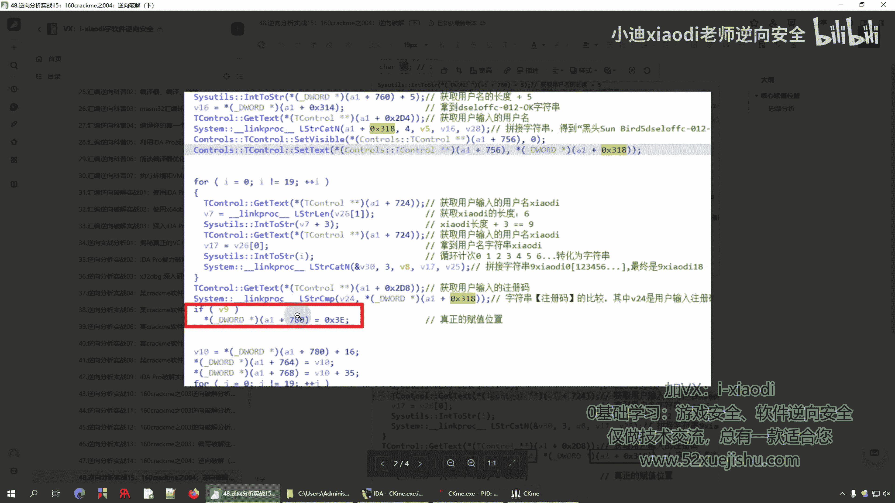
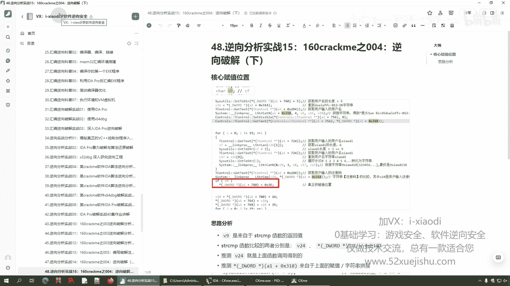

# 🔧 软件逆向破解：004：一人一码破解实战（下）

  

在本节课中，我们将继续分析160个crackme中的004号程序。前面已经定位到校验值的源头，接下来将通过动态调试验证之前的猜测，并最终解析出注册码的生成规则。最后会对整个逆向思路做一次完整的总结。整个过程会尽量使用大白话，帮助初学者理解每一处关键点。

  

## 1. 回顾与思路梳理

  

在开始动态调试之前，先回顾一下目前的进展。通过之前的逆向分析，我们找到了校验值的源头，它就位于一段关键代码之前。如果这行关键代码要执行，就必须要求上边的if语句成立。细心的你一定可以发现，在这个语句上面有一个字符串比较函数。那么，此时就可以梳理一下思路了。

  




首先，这个ZF标志位被推断为来自于函数的返回值。因为它是一个ZF标志位，同时这里又做了一次比较，所以才做出这个推断。其次，第二个信息是，比较函数比较的两者分别是V24和右边的参数。由此可以进一步推测，V24可能是通过上面函数的调用得到的，而318中的数据可能来自于上面的一个赋值操作。因为上面同样存在318的字符串拼接以及赋值的位置。

  


以下是当前梳理出的关键信息：


- 校验值的源头依赖一个if语句的判断。  
- if语句上方存在一个字符串比较函数。  
- ZF标志位来自函数返回值，并且被比较操作影响。  
- 比较的双方分别是 V24 和 318 中的数据。  
- V24 可能来自某个函数调用，318 中的数据可能来自字符串拼接和赋值。

  

带着这些猜测，我们就可以开始进行调试分析了。

  

## 2. 动态调试：定位用户名比较

  

上一节我们提出了猜测，本节就来通过实际调试验证。首先分析一个函数到底是干什么用的。它的地址是 `457D27`，于是我们在这个地址上设置一个断点，然后切换到程序。点击相关位置时，程序没有任何反应。但是，当我们输入注册码之后，程序会中断下来。此时按下 F8 单步执行，可以看到获取到的正是用户输入的注册码。因此，这个函数的功能就是获取用户输入的注册码。

  

紧接着，下面就是一个字符串比较函数。经过观察，这个比较函数比较的双方，一边是用户输入的注册码，另一边是某个预先设置的值。由此可以确认，`V24` 就是用户输入的注册码。那么，318 里面到底装的是什么东西呢？这就需要继续向上追查。

  

## 3. 追查318数据的来源

  

在确认了 V24 是用户输入之后，接下来我们来看看318中的数据从何而来。通过分析发现，318 的数据来源是位于上面的某个位置，所以我们去上面下断点详细分析。先看这行代码的地址是 `457C7A`，于是在这个地址上下断点，然后随意输入一个注册码。F8 单步执行后，发现它返回了一个数字 11。这个 11 实际上是和 5 做加法得到的，因为 11 减 5 等于 6。那么，谁是 6 呢？可以看到，用户名的长度刚好是 6。所以这行代码的含义就是：获取用户名的长度，然后再加上 5。

  

接下来，代码中出现了类似 `V16 = A1 + 314` 的操作，但实际上 EB+1 中存储的是一个字符串，因此它的实际意思是取出这个字符串。紧接着，程序又去获取一个文本，获取到的依然是用户名，所以这里就是获取用户输入的用户名。然后，学过 C 语言的朋友都知道，后面调用的是字符串拼接函数。通过分析可以发现，拼接的内容包括“黑头三”、用户名长度加 5 得到的数字（例如 11）、另一个字符串，以及用户名（例如“小迪”）。整个拼接在一起，就是一个合法的注册码。

  

我们可以用下面的伪代码来描述这个注册码的生成过程：

  

```python
key_318 = "黑头三" + str(len(username) + 5) + <另一串字符> + username
```

  

此时，`V24` 是用户输入的注册码，而 318 中的数据就是上述拼接出来的字符串。复制这个拼接结果，就得到了注册码。接下来我们实际试一下。

  

## 4. 验证注册码

  

理论分析已经完成，现在我们进行实测。先把“小迪”作为用户名填入对应的输入框，然后将复制出来的注册码粘贴到注册码输入框中。双击确认按钮之后，可以看到朱茵的头像已经显示出来，这说明注册成功。到这里，整个破解过程的核心部分已经完成。

  

## 5. 逆向思路总结

  

最后，我们来总结一下这个程序的完整破解过程。首先，根据注册成功的提示框，找到了一个关键的赋值位置。然后，在程序内部搜索常量或者搜索代码，最终找到了这段赋值代码。这个赋值代码中存在一个关键的跳转判断（依赖于 ZF 标志位），所以我们继续去寻找影响 ZF 的来源。往上追溯时，发现刚好有一个字符串比较函数，于是分析它到底在比较什么。进一步分析后确认，比较的双方分别是用户输入的注册码和 318 中的数据。

  

那么318中的数据又是什么？继续追踪它的源头，可以发现它是一个字符串拼接的结果。于是我们再去分析它到底是由哪几部分拼接而成的。最终知道了原来是由“黑头三”、长度数字 11、另一串字符以及用户名拼接而成。另外，在分析过程中还出现了一些循环之类的结构，这些属于作者设置的干扰。它们对整个逆向分析并没有起到核心作用，甚至可以说一点用都没有，仅仅起到了干扰和混淆视听的作用。

  



本节课中，我们一起学习了 004 号 crackme 的完整逆向过程。从定位校验值，到动态调试确认关键函数，再到追查注册码的生成规则，最后成功验证。同时还了解了如何识别和处理作者留下的干扰代码。希望初学者能够通过这个例子掌握一套通用的软件逆向分析方法。如果想要学习软件安全逆向相关的内容，可以联系课程，目前优惠名额不多，需要抓紧加入。我们下期再见。

