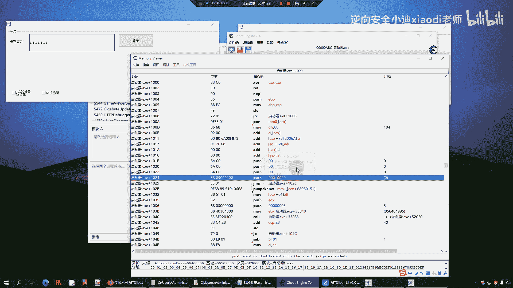
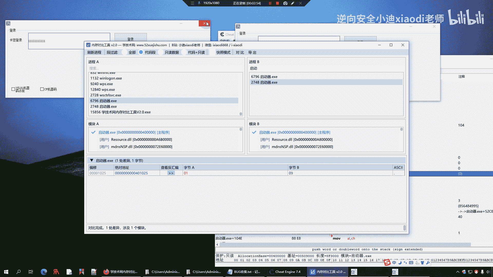
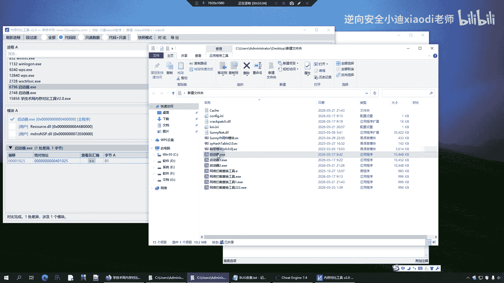
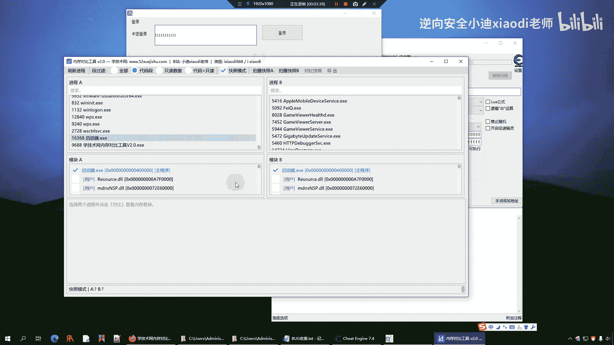
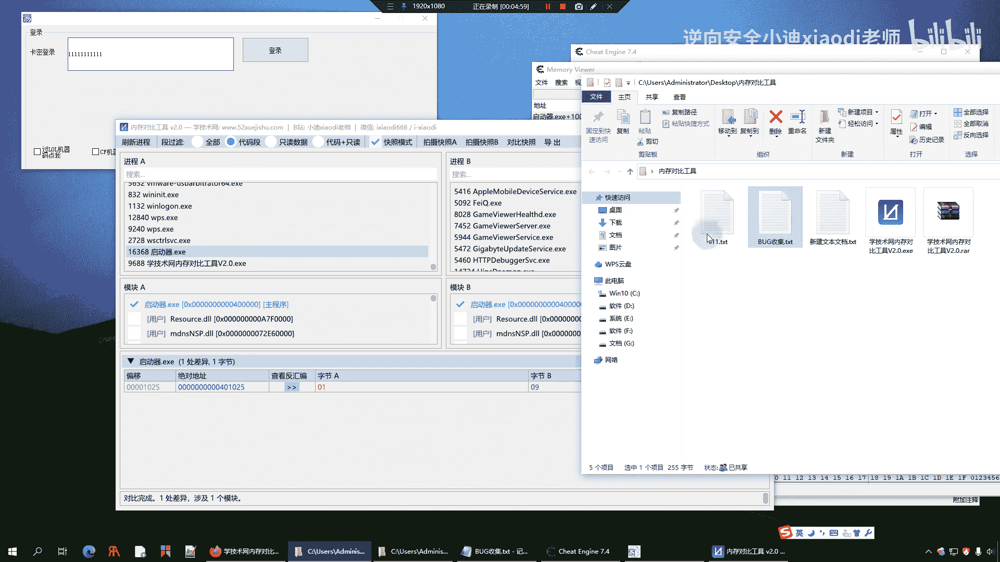
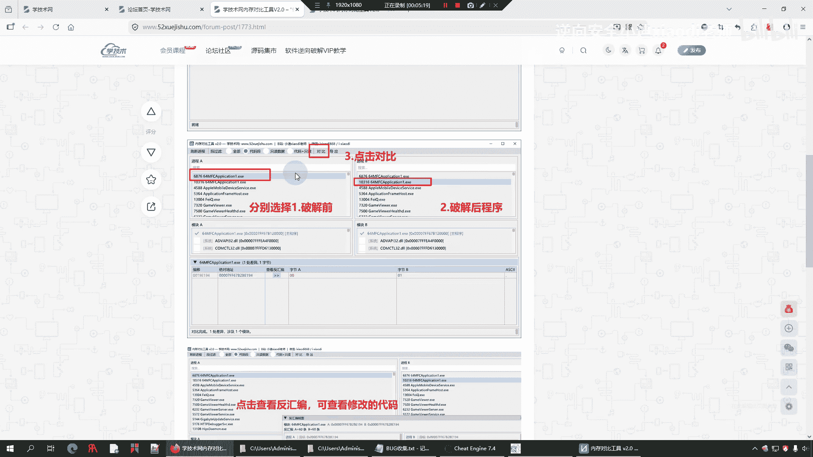
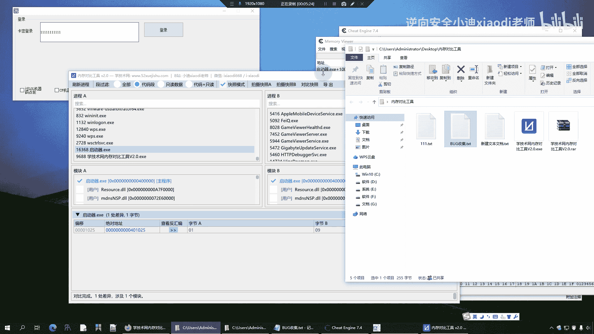

🔧 免费内存对比工具V2.0：第一章：内存对比工具的几种使用方式


本教程由小迪老师主讲。今天我们将学习免费内存对比工具V2.0的几种使用方式。有些同学可能会问，内存对比工具到底有什么用？实际上它的用途非常多。它可以用来分析破解补丁、外挂地址的数据，也能够帮助我们在逆向分析时快速定位修改点。无论是外挂还是破解版软件，它们肯定都对原始软件进行了代码或数据上的修改，这是毫无疑问的。如果我们有一款工具能够对比修改前和修改后的差异，就能清楚地知道破坏者或逆向分析者到底改了哪里，进而学习他的思路，甚至仿写一个补丁。从这个角度来看，这个工具还是相当方便的。下面我们就按照它的功能来进行演示。


### 一、同名进程的内存对比


第一种使用方式是“同名进程的内存对比”。这种方式需要同时运行两个同名程序，让其中一个保持原样，另一个被修改，然后对比它们的内存差异。通过这种方式，我们可以快速发现破解补丁或外挂到底改了哪些位置。核心原理可以用下面这段代码来表示：

```c
// 同名进程对比原理
if (processA.memory[address] != processB.memory[address]) {
    printf("发现差异地址: 0x%X\n", address);
}
```



以下是同名进程内存对比的具体操作步骤：

1. 打开内存对比工具。
2. 打开一个软件，例如“启动器”。然后再开一个启动器，这样我们就有了两个相同的进程。
3. 让其中一个启动器保持原样，另一个启动器进行修改。修改方式模拟破解补丁或外挂的做法：通过Cheat Engine修改数据。例如将地址0040100处的数据从1001改成1009。
4. 由于我们是先打开了软件，之后才打开被破解的程序，所以需要点击“刷新”按钮来刷新进程列表。刷新后，列表里就会出现启动器进程。
5. 在进程列表中选择目标进程。这里有两个启动器，进程ID分别是6796和2748，我们选择2748。工具也支持按进程名称进行过滤，这样查找起来会更方便。
6. 默认比较的是代码段，因为一般来说，这些破坏者都是修改代码段的。点击“对比”按钮，工具就会显示出差异。果然，01被改成了09，差异非常明显。

对比完成之后，我们还可以进一步查看反汇编代码。点击“查看反汇编”按钮，工具会打开一个反汇编视图窗口。你可以上下滑动这个窗口，观察哪里有差异。有差异的位置已经被高亮显示，非常清晰鲜明。通过这种方式，你就能准确知道破坏者到底修改了哪里的代码。


### 二、快照模式


上一节中我们介绍了同名进程内存对比，但这种方式需要同时运行两个程序。很多程序或游戏不允许双开，比如有些游戏不可能运行两个实例，那该怎么办呢？这时候就需要使用“快照模式”。快照模式只针对同一个进程，在修改前拍一张快照，修改后再拍一张快照，然后对比这两张快照，就能知道差异。它的核心逻辑可以用以下伪代码描述：

```c
snapshotA = read_memory(processId);
modify_process(processId); // 模拟破解补丁或外挂的修改
snapshotB = read_memory(processId);
diff = snapshotB - snapshotA;
```



以下是快照模式的具体操作步骤：

1. 先关掉之前的多余进程，只打开一个目标程序，例如“启动器”。如果你想要顺序更清晰，最好重启一下这个程序；当然不重启也是可以的。
2. 在内存对比工具中勾选“快照模式”。此时工具会自动选择当前运行的启动器进程，无需额外操作。
3. 在程序尚未修改时，点击“拍摄快照A”。
4. 接下来修改这个程序。打开该进程，比如把数据01改成09，模拟一次破解修改。注意，这是同一个程序，修改前后都在同一个进程里完成。
5. 修改完成后，点击“拍摄快照B”。
6. 点击“对比快照”按钮，差异就会显示出来。这就是同一个程序前后对比的方法。

可以看到，快照模式对于程序和游戏都是非常适用的。对比之后，你同样可以点击“查看反汇编”来查看到底修改了哪里的代码。另外，你还可以点击“全部”查看所有类型的差异。在本例中，由于只有代码段数据被修改，所以“全部”视图下没有额外内容，这也是很正常的。


### 三、导出补丁




当我们通过同名进程对比或快照模式找到差异之后，还可以把修改内容导出为补丁文件，方便后续使用或进一步分析。导出补丁的操作其实非常简单，以下是具体步骤：



1. 点击“导出”按钮。
2. 找到工具所在的文件夹，作为保存路径。
3. 随意输入一个文件名，例如“111”，然后点击保存。
4. 导出完成后，工具会生成一个名为“111”的文件，同时还会生成一份报告。

有了这份补丁文件和报告，你就能在后续的分析中更方便地查看修改内容，也可以基于它来制作自己的补丁。这样，整个流程就形成了一个闭环：从对比差异到导出补丁，非常实用。


### 四、获取工具


如果你发现工具存在bug，最好及时提交给作者。另外，这款内存对比工具的下载地址放在论坛上，下面是获取方式：



1. 打开论坛网址：3W点52学技术点com，也就是“52学技术”论坛。
2. 进入网站后，点击“社区论坛”。
3. 进入“工具资源”板块，或者点“综合”板块。
4. 最新发布的帖子就放在那里，点进去后，帖子下方就是下载地址。
5. 直接点击下载即可。

如果你在使用过程中发现了任何bug，也请及时反馈，这样作者才能不断完善工具。






以上就是本节课的全部内容。我们学习了免费内存对比工具V2.0的几种使用方式：首先介绍了同名进程内存对比，接着讲解了快照模式，然后演示了如何导出补丁，最后说明了获取工具的途径。这个工具在逆向分析、游戏安全、软件安全、网络安全以及CTF比赛中都很常用，掌握它能够帮助你更高效地分析内存数据变化。希望本节课对你有所帮助，我们下期再见。

