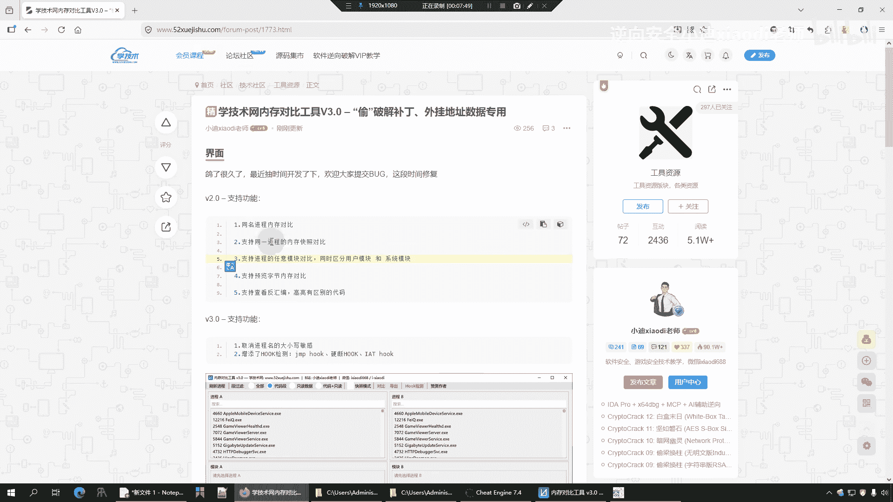

# 内存对比工具教程：概述：V3.0新特性与Hook检测实战

## 📖 概述

在本节课中，我们将要学习内存对比工具的最新V3.0版本。这个工具在二进制软件逆向、游戏安全、软件安全、网络安全以及CTF比赛等场景中都是必备的基础技能。很多同学可能会有疑问，这个工具到底有什么用？它在我们的逆向工作中具体能解决哪些问题？今天我们就来详细讲解它的应用场景和新增功能。我们首先从最实际的场景入手，看看内存对比工具能帮我们做什么，然后再深入了解V3.0版本带来的新特性，最后通过实战演示来掌握它的完整用法。无论你是刚入门的初学者，还是已经有经验的开发者，这节课的内容都能帮助你更好地理解内存对比工具的价值。

## 🎯 应用场景：为什么要使用内存对比工具

内存对比工具的核心功能，就是对比两个程序在运行时的内存数据差异。通过这种对比，我们可以发现程序之间有哪些不同之处，从而推断出某个人对程序做了什么修改。

假设你有一款破解版的软件，同时也有一款原版的软件。那么通过破解版和原版的内存数据对比，你就可以弄清楚这个破解版到底是怎么实现破解的。我们学习技术嘛，归根结底还是要追根究底的，不能只知道结果而不知道原理。比如说，破解版可能修改了某个关键的跳转指令，或者修改了某个验证函数的返回值，这些通过内存对比都能看出来。

再举一个例子，你有一款游戏，同时你有一款外挂程序。这个外挂对游戏做了某些操作，那么它具体做了哪些操作呢？我们就可以通过这个内存对比工具，把它的操作数据给抓出来。外挂可能会修改游戏中的金钱数值、角色属性、或者注入了一些代码，这些修改都会在内存中留下痕迹。

总之，在我们日常的生活场景或者说技术场景中，内存对比工具有很多可以应用的地方。无论是分析软件的安全性、研究外挂的实现原理、还是排查程序被篡改的情况，它都是一个非常实用的工具。接下来，我们就来看看V3.0版本相比之前的版本更新了哪些内容。

## 🆕 V3.0新增功能：大小写敏感取消与Hook检测

上节课我们已经讲过了2.0版本都有哪些功能，那么3.0版本我们更新了哪些东西呢？下面我们逐一来看。

### 取消进程名的大小写敏感

第一点更新是取消了进程名的大小写敏感设置。这个改进是什么意思呢？有同学之前在评论区给我留言反馈说，他使用的飞秋这个程序，在搜索进程名"F"的时候，只能用大写的F搜索到，小写的f就搜索不到。这确实是一个bug，或者说不够人性化。现在这个版本我们已经更新了这个问题，无论你输入大写还是小写，都能正确匹配到对应的进程。

### 新增Hook检测功能

第二点更新是增添了Hook检测功能。这个功能包括三个部分，分别是Inline Hook检测、硬断Hook检测也就是硬件断点的Hook检测、以及IT Hook检测。这三个东西一看就很专业，对不对？它们都是破解者或者外挂开发人员常用的技术。下面我们先简单了解一下什么是Hook，然后再看看这个工具如何帮助我们检测这些Hook。

## 🔧 什么是Hook：大白话解释

对于初学者，这里用大白话解释一下Hook的概念。大牛们肯定已经知道了，但小白同学可能需要一个直观的理解。

假设代码从上往下执行，正常流程肯定是执行到某个位置后继续往下执行。但是恶意程序在这个位置做了一个Hook，这是什么意思呢？它让程序通过一个JMP跳转指令，跳转到恶意程序自己申请的内存空间里去。看到没有？它把程序的执行流程引导到了自己的地盘上。程序到了恶意程序的内存空间后，就要执行恶意程序的代码，也就是做恶意程序想要做的事情。那么执行完之后呢，原来的程序还得继续执行，对不对？所以恶意程序还会再加一个跳转指令，让程序跳回到原来应该执行的位置。整个过程就是先从原程序跳到恶意程序的地盘上，处理完事情后再从恶意程序的地盘回到原程序的执行位置。这个跳出来再跳回去的过程，就叫作Hook。

那为什么要来到恶意程序的地盘呢？来到自己的地盘才好办事啊。在自己的地盘上，恶意程序就可以为所欲为，比如修改数据、窃取信息、破坏逻辑等等。这就是Hook的作用和意义。我们通过这个工具，现在就可以检测出程序是否被植入了这种Hook技术。

## 🧪 实战演示一：双进程内存对比与Hook检测

接下来我们用V3.0工具进行实际的演示操作，看看它具体是如何工作的。首先打开我们的实验程序，这是用来测试的程序。我们先测两个程序，一个是原版程序，一个是破解版程序，这样就能比较出破解版改了哪些东西。然后运行我们的工具，选择哪个是破解版呢？我们看一下，选择进程号为3544的，因为3544需要转换成十六进制，它对应的十六进制是0x3544，再转换成十进制就是13636。好，我们就拿它作为修改版。所以原版就是其他进程，刷新一下进程列表后，进程号14664的那个就是原版程序。往下翻找一下，找到了，进程号13636的就是破解版。

### 普通内存修改的对比

现在你直接点击对比，会发现没有任何差异，对不对？因为两个程序的内容看起来是一样的。我们要修改一下，所以我们需要去修改代码。比如我跳转到00401000这个地址，做一个修改。比如把这里的00改成09，行不行？这时候直接点击对比，差异就出来了。那这个是一个简单的内存修改操作，很简单对不对？但这种修改只是改了一个字节的数据，不涉及代码逻辑的改变。

### Inline Hook的检测

接下来我要做一个Inline Hook，也叫Inline JMP Hook。我在哪里做呢？就选在这儿吧。点击工具菜单，点击自动汇编，点击模板代码注入。这个是一个非常方便的做Inline JMP Hook的工具。把我们构造好的代码写在这个模板里，然后点击执行。弹出提示后点击"是"，再点击"否"。这时候我们再点击对比，看到没有？我们发现刚刚修改的那个字节已经被检测到了。但是这只显示出了普通的数据变化。然后我们点击Hook检测，看到没有？Inline JMP Hook已经检测到了，是不是非常方便？这个功能可以非常方便地帮我们揪出到底是一个普通的数据修改，还是一个Inline Hook的修改，两者是完全不同性质的操作。

### 硬件断点Hook（硬断Hook）的检测

还有一种Hook是不修改代码的。这种就是硬件断点Hook。硬件断点Hook通过制造异常来工作，它接管异常处理流程，然后去操作数据，整个过程不会修改原来的代码。那么这种情况怎么去检测呢？我们同样可以用这个工具检测出来。

我随便找一个位置，在反汇编窗口中鼠标右键设置断点。注意这里选择的是硬件断点，看到没有？这种硬件断点是不会修改代码的。如果你用普通的对比方式，是看不出任何差异的。但是用这个Hook检测功能，看到没有？这个硬件断点操作就被我们检测出来了。原来啊，这个破解者或者说破坏者，对我们的00401050这个地址做了一个硬件断点的操作。那么他就有可能去做一些硬件断点Hook之类的攻击。看到这个信息后，你就应该额外关注一下这个地址了。

### Hook检测的三个类型

这里我们总结一下Hook检测的三个类型，它们各自的检测原理和用途如下：

- **Inline Hook检测**：检测通过修改代码（例如JMP跳转指令）来实现的Hook。这种Hook会改变程序原有的代码内容，通常是在代码开头写入一个跳转指令，使程序跳转到攻击者准备好的内存空间。
- **硬断Hook检测**：检测通过硬件断点机制实现的Hook。这种Hook不修改代码，而是利用CPU的调试寄存器设置断点，在断点被触发时接管程序执行流程。
- **IT Hook检测**：检测通过导入表（Import Table）劫持等方式实现的Hook。这种Hook修改程序的导入表，使程序调用系统API时被重定向到攻击者的代码。

你看，这个工具帮我们清晰地识别出了各种不同类型的非法操作，这正是它最有价值的地方。

## ⚙️ 实战演示二：单进程快照模式与Hook检测

上面我们已经介绍完了双进程的对比用法，接下来我们介绍单进程的使用方法。单进程和双进程的场景略有不同，它主要用来分析一个程序在自己运行过程中发生了哪些变化。我来演示一下。首先启动一个实验程序，然后把这个打开的实验程序加载到工具中。针对单个进程，刷新一下进程列表，然后点击启动器。单个进程也可以做Hook检测，你可以直接点击Hook检测按钮。比如说我去设置一个硬件断点的操作，在某个地址设置断点，点击"是"，然后点击Hook检测，可以看到窗口直接刷新并显示出了检测结果，直接就检测到了。

除了Hook检测之外，单进程模式还有一个重要功能是快照模式。因为你面对的是单个进程，肯定要用快照模式来把从以前到现在的内存变化给比对出来。这相当于拍照片，先拍一张状态，运行一段时间后再拍一张，然后对比两张照片的差异。点击快照模式，此时点击拍摄快照A，然后改一个地方的数值。改什么呢？比如在某个地址写一个数据，我输入2200209，按下回车确认修改。然后再次点击拍摄快照B，这时候点击对比快照，看到没有？内存的差异就出来了。我们看到这个地址的值被修改了，这就是快照功能的威力。

然后我们再试一下Hook检测，结果是正常的。接下来我们再做一个Inline JMP Hook的操作。这次的Hook做在哪里呢？往下翻一翻，看看哪个位置合适。选个位置，点击自动汇编，点击模板代码注入，点确定。然后随便写点什么，比如mov eax，ebp之类的指令，只要确保它是一个Inline Hook就行。现在Hook已经生效了，程序在执行到该地址时会跳转到我们申请的内存空间，执行完我们的代码后再跳回去，就是这么一个过程。然后我再次拍摄快照B，再点击对比快照，看到没有？最新的快照对比结果显示程序已经跳转到了那个地方。因为快照A是最初始的状态，而快照B可以不断刷新覆盖，你可以一直刷新、刷新、刷新的这样拍，总能捕捉到变化。点击Hook检测，看到没有？Inline JMP Hook能够检测到了。

## 💡 总结

本节课中我们一起学习了内存对比工具V3.0的核心功能和使用方法。我们首先了解了这个工具的核心应用场景，它能够帮助我们对比原版程序和破解版程序的内存数据差异，从而分析出破解逻辑。它也可以用于分析外挂程序对游戏数据的修改操作。然后我们学习了V3.0版本更新的两个重点内容：第一是取消了进程名搜索时的大小写敏感，修复了之前版本中搜索小写字母找不到进程的问题；第二是新增了Hook检测功能，包括Inline Hook检测、硬断Hook检测和IT Hook检测。我们还通过实战演示，分别掌握了双进程对比模式和单进程快照模式的操作流程。最后我们用大白话解释了Hook的概念，明白了它本质上就是篡改代码执行流程、跳到攻击者代码再跳回来的技术。这个工具能在逆向分析的过程中提供很大的帮助，能够提升你的分析思路。当你在分析一个程序遇到困惑时，不妨用内存对比工具观察一下，借鉴别人的思路，很多时候就能找到突破口。

如果需要下载这个工具，可以来到我们的论坛3w.52xuejichu.com，直接点击工具资源栏目，在正文中就可以看到下载地址。这个工具是完全免费下载的。如果大家想学习软件安全逆向相关内容，可以从零开始学习，我们提供了完整的技术学习路线。可以联系小迪老师，现在限时有特价优惠。学习的内容非常丰富，大家可以自己去了解一下。我们下期再见。
