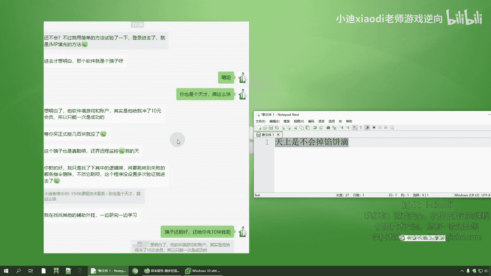

# 软件逆向工程教程：第1章：分析刷元宝外挂——揭穿木马真面目

在本节课中，我们将学习如何分析一个声称能“刷元宝”的外挂软件。通过实际案例，我们能够看到这类软件背后的真实面目——它其实是一个带有远程控制功能的木马程序。接下来，我们会从逆向工程的基本概念出发，逐步演示如何使用云沙箱分析恶意样本，以及如何通过本地调试工具破解软件的登录限制，最终彻底看清这个骗局的运作机制。

## 一、逆向工程能做什么

有些同学可能一直有疑问：你讲逆向，听的人也不少，但学了逆向到底能干什么呢？逆向工程可以帮助我们分析程序，了解程序运转和运作的原理。通过分析，我们能够定位到关键的代码，然后修改代码的逻辑，进而实现我们想要的功能。也就是说，当你掌握了逆向技术，你不仅能看懂程序在做什么，还能按照自己的意愿改变它的行为，这才是逆向真正强大的地方。

今天的内容，我们聚焦在一个具体的案例上——分析一款外挂。今天中午，一位粉丝向我投递了一个样本。他说他有一个传奇私服刷元宝的软件，试用版用一次就不能用了，账号也登录不上去。他说自己开通会员都弄好了，结果还是不行。大家听说过“刷元宝”这种东西吗？我当时的反应是：元宝都能刷的话，那还不如直接刷人民币呢。因为元宝是用人民币充值的，这个大家应该都知道。像“刷元宝”“刷枪”这类说法，我感觉基本上都是假的。所以中午的时候，我就帮这位粉丝朋友简单分析了一下这个软件。

## 二、粉丝的投稿与初步判断

收到样本后，我进行了初步分析。分析结果非常惊人：这个软件实际上是有后门的，它有远程控制功能，可以远程监控你的电脑桌面，甚至打开你的摄像头。我当时就觉得，这个作者真的是胆大包天。首先，“刷元宝”这个东西本身就是诈骗，对不对？如果这个功能是假的，那它肯定涉及诈骗。然后，你还释放木马，这就涉及计算机系统侵入罪了。所以，在这里奉劝大家，学到技术之后，只用于技术交流，千万不要误入歧途，把它用到其他用途上。技术的价值在于建设，而不是破坏。

后来，这位同学加入了我们的学习课程，他对我们讲的内容非常感兴趣。通过学习之后，他发现了这个软件的真面目——它实际上就是一个骗子。同时，他还掌握了突破这个软件限制的方法，能够直接登录进去。最后，我跟他说：这个骗子还挺好，还给你充了10块钱，对不对？舍不得孩子套不着狼，他给你充10块，就是为了钓你后面那几百块钱。接下来，我们就来讲一讲，如何分析这样一款假的刷元宝软件——实际上它是一款木马，并且我们一步一步地把它破解掉。

## 三、使用微步云沙箱分析

把粉丝发来的压缩包解压之后，我们看到里面多出了这些文件。在这些文件当中，有一个名为“外挂程序”的文件——明目张胆的四个大字。我当时想：还有没有天理了？反了你了，你竟然敢直接叫“外挂程序”。当然，现在我们不能直接运行它，因为这个外挂程序肯定具备一定的风险。难道它白白让你用吗？肯定不会。所以，它里面一定有猫腻。那么，如何分析这些猫腻呢？我们需要使用一个平台，叫做“微步云沙箱”。大家可以去搜索“微步云沙箱”，打开之后，把这个文件上传上去，它会开启自动分析。

### 1. 上传外挂程序

上传文件后，微步云沙箱会进行一系列自动化的行为分析。分析完成后的界面就像这个样子。你需要等待一定的时间，这里我们直接跳过等待过程。从分析报告中，我们可以看到它相关的一些行为。这些行为都是非常敏感的，比如它会关闭你的操作系统。请注意，一个正常的外挂程序通常不会去关闭操作系统，这种操作明显带有恶意意图。

### 2. 执行流程分析

接下来，我们往下拉，拉到“执行流程”这个位置。我们会发现，这个外挂程序是这样执行的：运行起来之后，它释放了其他的软件，然后这些软件又做了其他的一些操作。我们去看一下具体的细节。首先，我们在电脑磁盘里面找到了`LG3.EXE`这个程序。这个文件很可能是外挂的真实主体。我们用类似的流程，将它也上传到微步云沙箱，然后直接点击“执行流程”查看。在这个执行流程里面，我们看到这里有一个IP的连接，这个是非常敏感的，所以我在这里直接做了一个遮挡。这个IP连接，实际上就是它远程控制的一个罪证。通过这个连接，攻击者可以向被控电脑发送指令，实现远程操控。

### 3. 发现后门程序

接着，我们又在磁盘里面找到了`SX.EXE`这个程序。用类似的形式，我们将它上传到微步云沙箱。微步云沙箱直接判断威胁分类为“后门”。什么是后门呢？我们看这里的定义：后门是一类允许攻击者远程控制主机的木马，一般通过构造隐蔽通道来实现。所以说，真正的一个后门应该就是它了。实际上，其他释放出来的文件也都是后门的组成部分。点击“执行流程”，我们会发现这个后门会释放一个`qqmin.EXE`，假装自己跟腾讯有关系，实际上并没有。右边显示的，是它连接的IP地址。总的来说，这个软件就是一个恶意的木马，它的目的就是控制你的电脑，窃取你的信息。

## 四、本地动态调试与破解

现在，我们来演示一下这个软件的逆向过程。这个软件我们已经在调试器中打开了，实际上它非常不堪一击。我们一步一步来看一下是如何搞定的。在这个过程中，我们要特别注意：这个“外挂程序”并不是真正的外挂程序主体，而是一个释放器。它会把木马以及真正的外挂程序释放出来。同时，这个木马肯定要联网才能进行远程控制，所以我们在操作的时候，最好用网络连接与断开的管理器来禁用网络。我们把这个网络关掉，这样能避免造成一些损失。好，这个时候我们点击“禁用网络”。现在，这个网络已经断开了。好，这个时候我就可以大胆地去运行这个外挂程序了。来，运行。

### 1. 运行外挂并提取进程

运行起来之后，我们可以在任务管理器里面看到`qqmin`这个东西，它已经跑起来了。还有一个就是`LG3`，这个东西也跑起来了，看到没有？这两个就是它核心的程序了。那它的外挂程序窗口到底是谁呢？我们可以通过图标来识别。这个图标叫做`LG3`，应该就是`LG3`。我们也可以用`SPY++`这个工具，然后拖放到窗口上面来看一下。这个程序就是`LG3`。那这个时候，我们就把`LG3`给它提取出来。提取的话，我们直接用工具去找它的路径。找到这个路径，然后往下翻，翻到`LG3`，看到没有？这两个母体实际上都释放到这个位置了。我们来看一下这个`LG3`，把它关掉，然后直接把这个`LG3`放到我们的调试工具中。

### 2. 调试器分析

这个外挂程序，我们可以用工具包里的调试工具去分析。我们先来观察一下，输入用户名，以及输入验证码。现在验证码加载不出来，点击登录，它正在读取这个东西，对吧？我们先来看一下这个程序有没有壳。经检查，这个程序没有壳，没有保护，我们可以直接进行静态分析。搜索当前模块的字符串。那个提示文字是“正在”，那我们就搜索“正在”这两个字。找到“正在读取数据”的字符串，对不对？这个位置就是“正在读取数据”的位置了。我们在这里打一个断点试一下，看它是否会停下来。看到没有？这个位置就是“正在读取数据”。好，那么我们可以尝试跳过这个检查。跳过的方法很简单，直接把这个`JE`条件判断改成一个`JMP`无条件跳转就可以了。也就是说，我们不再根据条件跳转，而是强制跳转，绕过等待验证的逻辑。

### 3. 绕过登录验证

修改之后，我们点击登录。这个时候它会提示“登录失败”，原因可能有那么几点：比如“VIP期限已到期”之类的，但完全是胡扯，根本就没有VIP这个东西。好，这个时候我们再去搜索“失败”这个字符串。找到“登录失败”就在这个位置。我们在这里打一个断点，看会不会走这个位置。果然会走这个位置，对吧？好，这就是登录失败的处理代码。那我们来看一下，到底是从哪里跳过来的呢？鼠标右键，查找引用，选定一个地址来看一下。好，原来是这个位置。那这个位置呢，实际上就是一个登录成功的逻辑判断。也就是说，当程序走到这里时，它根据结果决定是跳转到登录成功还是登录失败。而紧接着下面这个东西，有可能就是一个校验了。我们直接全部给它用`NOP`填充，也就是把这里的判断指令全部替换为空操作，不做任何比较和跳转。这样一来，程序执行到这里就不会再检查条件，而是直接顺序往下走，直到进入登录成功的位置。来，这时候我们点击登录。登录成功！看到没有？然后点击“呼出外挂”。好，这个时候我们就给它搞开了。

### 4. 软件真实工作原理

这个软件的工作原理实际上是这个样子的：它让你输入游戏账户，输入之后，这个软件的作者——也就是那个骗子——可能会通过后门远程监控你的桌面，发现你确实在操作，或者说他后台真的收到了你的账户信息。然后呢，他就会给你充10块钱，再告诉你说：“充值成功了，我这个软件是可以用的。”接下来，他就会让你去买正版，而正版的价格要几百块。在这个过程中，可能就会有很多小白朋友轻易相信了，然后几百块钱就没了。所以说，大家看完这个视频之后一定要注意：天上不会掉馅饼。怎么可能会有刷元宝这个东西呢，对不对？你都能刷元宝了，那为什么不能给我刷个人民币呢？你给我刷个10张、100张的，对不对？又不用刷那么多。那这个就是咱们今天的内容。

## 总结

本节课中，我们一起学习了如何分析一款伪装的刷元宝外挂。我们从逆向工程的基本用途讲起，了解了恶意软件如何通过释放器释放木马和后门程序；我们使用了微步云沙箱来识别这些恶意行为，看到了远程控制IP和木马分类；我们还通过本地调试工具，在没有壳的情况下搜索字符串、修改条件跳转和填充`NOP`指令，成功绕过了软件的登录限制，最终暴露了它的诈骗逻辑。这个案例告诉我们，所谓“刷元宝”完全是骗局，背后隐藏的是窃取信息和远程控制的恶意代码。希望大家通过本节课能够提高警惕，增强对恶意软件的分析能力，同时将技术用于正道，而不是误入歧途。如果你也想学习这样的技术，像那位粉丝一样能够分析程序的本质，探究问题的真理，欢迎联系咱们。我是小迪老师，我们下集再见。
