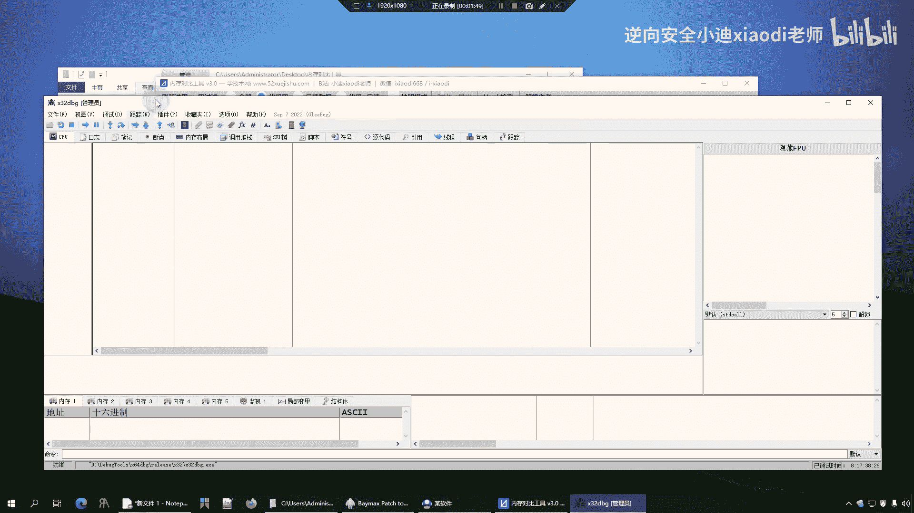
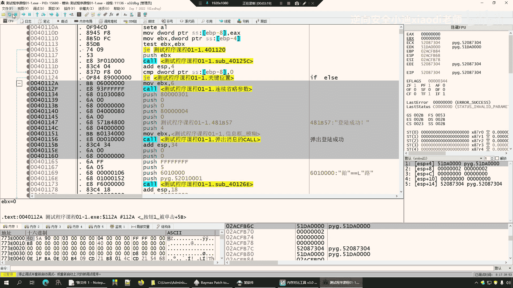
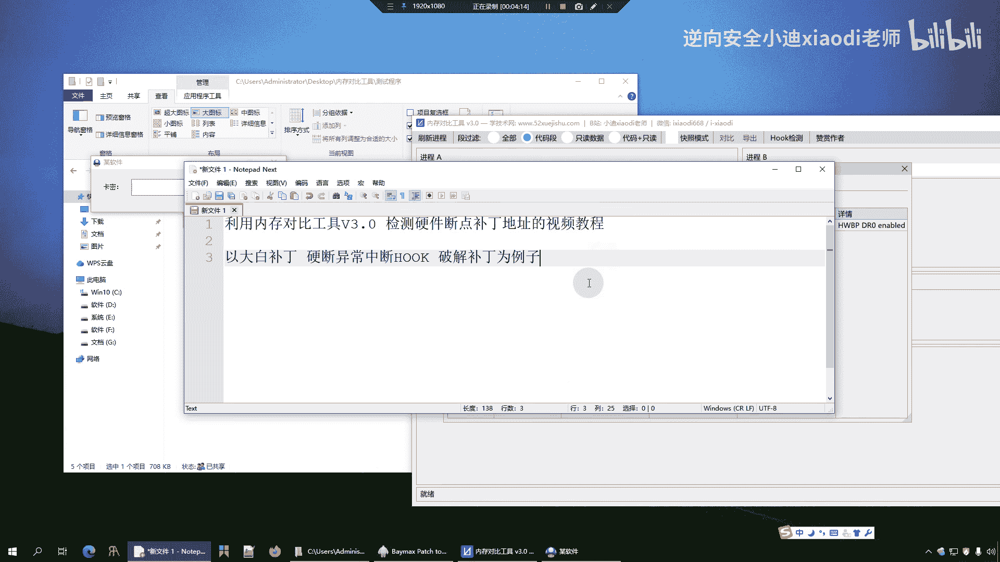

# 🔧 软件逆向工程实用教程：内存对比工具V3.0：检测硬件断点补丁地址

## 📋 课程概述

在本节课中，我们将学习如何使用内存对比工具V3.0来检测硬件断点补丁地址。这个工具是我们在软件逆向、游戏安全、软件安全、网络安全以及CTF比赛等领域中经常需要使用的基础技能。小迪老师将带领大家从零开始，通过一个具体的破解补丁案例，把整个检测过程完整地走一遍。哪怕你是完全没有接触过逆向工程的小白，只要跟着教程一步步操作，也能轻松掌握这个实用技巧。我们使用的案例是大白补丁的异常中断Hook，这是一个非常经典的破解补丁实现方式，非常适合用来讲解硬件断点检测的原理和操作流程。通过本节课的学习，你将能够独立使用内存对比工具，快速定位破解补丁所修改的内存地址，从而深入理解补丁的工作原理。

## 🎯 破解补丁效果展示

在正式讲解技术细节之前，我们先来看一下这个破解补丁到底实现了什么效果。我们准备了一个实验程序，它分为原版和破解版两个版本。首先运行原版程序，点击登录按钮后，系统会直接提示"登录失败"，这就是程序在未被打补丁时的正常行为。然后我们来运行破解版程序，这个破解版使用的是最常见的大白补丁工具。运行之后，你会发现界面上出现了一个飘云格的背景图案，这是一个非常明显的视觉标记，表明补丁已经成功加载到了进程之中。接下来点击登录按钮，奇迹出现了，系统直接提示"登录成功"。这两个版本之间的行为差异，就是破解补丁所产生的效果。我们通过对比这两个版本的程序运行状态，就能够直观感受到补丁的存在和作用。大家看到这个效果之后，肯定会对补丁的内部实现原理产生好奇心，那么接下来我们就深入探究一下，这个补丁到底是怎样做到这一点的。

## ⚙️ 补丁实现原理剖析

其实这个破解补丁的实现方式并不复杂，它采用的是异常中断补丁的机制，具体来说就是利用了硬件断点。补丁程序会对一个特定的内存地址进行Hook操作，这个地址就是0x401124。当程序执行到这个地址时，硬件断点会触发一个异常，然后补丁代码会接管程序的执行流程，将原本的逻辑修改为直接跳转到登录成功的处理代码。这个过程听起来可能有些抽象，我们通过具体的操作演示来让大家有一个直观的认识。我们先将破解版程序运行起来，确认它已经处于破解状态，然后打开内存对比工具。在工具界面中，我们需要找到实验程序对应的进程，然后点击"Hook检测"按钮。可以看到，工具立刻就抓到了关键信息，显示了地址0x401124。也就是说，破解补丁对这个地址进行了Hook操作，实现了登录逻辑的篡改。掌握了这个地址信息之后，我们就可以进行下一步的分析，看看补丁到底对这个地址做了什么具体的操作。通过这种方式，我们就能还原出补丁作者的思路，理解破解程序的完整逻辑。

## 🧪 实战演示：原版与破解版对比测试

为了让大家更清楚地理解整个过程，我们来进行一个对比测试，分别对原版程序和破解版程序执行检测操作。首先运行原版程序，启动好之后，我们需要在内存对比工具中点击"刷新进程"按钮，从列表中找到原版程序对应的进程。找到之后，点击"Hook检测"按钮，这个时候工具会显示"未发现Hook"，并且会提示请先运行对比后测试。这个结果完全在我们的预期之中，因为原版程序本身没有被破解，自然也就不存在任何Hook操作。接下来，我们打开破解版程序，等待它运行起来之后，再次点击"刷新进程"按钮。这一次我们看到的进程ID是8888，这个数字看起来非常吉利，令人印象深刻。选中这个进程之后，点击"Hook检测"按钮，工具立刻抓取到了Hook信息，显示了对0x401124地址的操作。通过这个对比实验，我们可以非常清晰地看到内存对比工具的功能，它能够快速判断一个进程是否存在异常Hook，并且准确定位到Hook的地址。当我们抓到Hook信息之后，就可以配合调试器进行附加分析，进一步了解补丁作者的操作逻辑。这个流程对于理解和分析各种破解补丁来说非常实用，我们只需要按照这个步骤执行就可以了。

## 🔍 深入分析Hook地址的操作逻辑

当我们通过内存对比工具获取到Hook地址之后，下一步就是使用调试器对该地址进行深入分析。打开调试器，然后附加到正在运行的破解版程序进程上。附加成功之后，我们需要在调试器的符号或地址栏中输入我们刚才获取到的地址，也就是0x401124，然后跳转到这个地址处。跳转过去之后，我们可以看到该地址处的指令已经被修改了。通过观察可以发现，这个位置原本应该是一段条件跳转指令，然后下方就是登录成功的处理逻辑。而补丁程序的操作方式是修改EIP的值，让程序跳过某一行的执行，直接跳转到登录成功的代码段。EIP寄存器在计算机中扮演着非常重要的角色，它决定了接下来要执行哪一条指令。修改EIP的值就可以控制程序的执行流程，让程序按照我们希望的方式运行。在这个案例中，我们看到补丁将EIP的偏移设置为0x401124加6，也就是跳转到0x4012A这个地址。这样一来，原本应该执行登录失败逻辑的代码就被跳过了，程序直接执行登录成功的代码。如果我们在分析过程中遇到类似的代码结构，看到某个地址附近有登录失败的提示，那么在它的下方通常就会有登录成功的代码路径。当我们看到这种跳转结构时，基本上就可以确认补丁的实现逻辑。理解了这一点，你就能够快速判断出补丁作者大致的操作思路，这对于逆向分析来说是一个非常有价值的技能。

## 📝 总结与资源获取

本节课我们一起学习了如何使用内存对比工具V3.0来检测硬件断点补丁地址。我们首先展示了破解补丁的实际效果，然后深入分析了异常中断补丁的实现原理，接着通过对比实验验证了工具在检测原版和破解版程序时的不同表现，最后详细讲解了如何使用调试器分析Hook地址的具体操作逻辑。整个过程涵盖了一个完整的逆向分析流程，从检测到定位，再到深入分析，每一步都有清晰的操作方法和原理支撑。这些工具和技巧都是完全免费的，如果你希望深入学习相关的知识，可以访问52学技术网站，并且可以在论坛社区的工具资源板块找到最新版的工具下载。我们会在网站上持续更新相关的文章和资源，方便大家获取最新内容。通过本节课的学习，相信大家已经对硬件断点补丁检测有了基本的认识和操作能力，这个技能在今后的逆向工程实践中会经常用到，建议大家多加练习，熟能生巧。以上就是本节课的全部内容，我们下节课再见。
