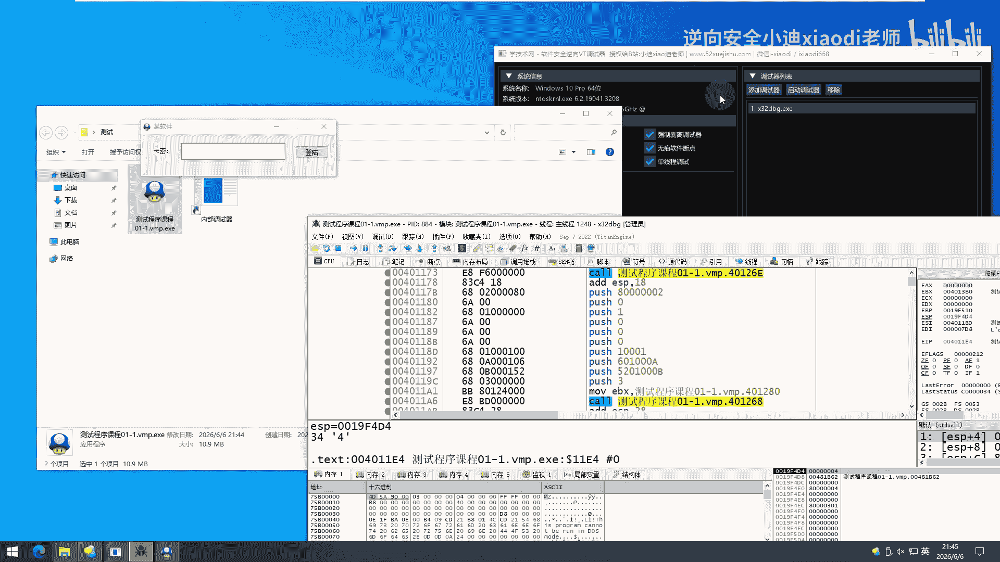

# 利用社区内部VT调试器：01：绕过VMP/TMD强壳反调试 🔧

## 概述 📋

在本节课中，我们将要学习如何利用社区内部VT调试器来绕过VMP、TMD等强壳的反调试机制。这是二进制软件逆向、游戏安全、软件安全、网络安全、CTF比赛等领域必备的基础技能。我们将通过实际演示，对比普通调试器与社区VT调试器在处理反调试时的表现差异，最终掌握正确使用专用调试器进行逆向分析的方法。视频中使用的工具是软件逆向强壳专用版，社区会员可以免费使用。

## 背景与工具介绍 🛠️

在逆向工程领域，VMP（VMProtect）和TMD（Themida）是最常见的两款商业级软件保护方案。它们之所以被称为“强壳”，是因为它们不仅具备代码加密和虚拟化功能，还内置了多层反调试机制，能够检测调试器的存在并采取对抗措施。传统的调试器在面对这些保护时往往会遭遇各种问题，例如断点无效、程序闪退、甚至调试器自身崩溃等。因此，我们需要使用专门的工具来解决这些难题。

本节所使用的工具是软件逆向强壳专用版调试器，它通过VT（Vanderbilt Technology，虚拟化技术）层面的支持，实现了对反调试机制的有效规避。该工具面向社区会员免费开放，所有相关的工具和文章资源均可免费获取。目前会员费用为299元，后续可能会调整至499元，因此有学习需求的朋友可以尽早加入。

需要补充的是，如果大家需要绕过游戏驱动的保护，普通的软件逆向工具就不够用了。针对游戏调试场景，我们提供单独的游戏定制版服务，该版本以点卡形式销售，具体详情可以联系我获取更多信息。这里是我的联系方式，有需要的朋友可以记录一下。

## 环境配置与版本说明 ⚙️

我们开始实际演示。首先要看一下当前使用的软件版本，我打开“关于”窗口查看，显示的是VMP 3.8.1版本，这个版本相对较新，保护强度也比较高，正好可以用来测试调试器的性能。调试器的检测模式我设置为user mode（用户层）和con mode（内核层）两种模式，这两种模式组合起来可以模拟顶层反调试机制，即同时监控用户态和内核态的调试行为。接下来我们点击编译按钮，等待程序构建完成。编译过程需要一些时间，我们稍作等待。编译完成后，我们就可以开始进行测试了。

## 普通调试器测试 🧪

首先，我们使用普通的调试器来进行测试，看看它的表现如何。这里需要验证一下，面对VMP 3.8.1的满血反调试，普通调试器是否能够正常工作。我们启动普通的调试器，然后点击“文件”菜单，选择“附加”选项来附加到一个正在运行的进程上。附加成功后，我们随便在代码中找到一处关键位置，然后设置一个断点。设置断点的操作非常简单，只需在目标代码行上按F2键即可。打好断点之后，我们点击“登录”按钮触发程序的逻辑。可以看到，进程直接停止了，退出码显示程序出错。这个结果表明，普通调试器在附加后，程序检测到了调试器的存在，并主动终止了运行，这是一种典型的反调试响应机制。看到这个结果后，有同学可能会问，是否可以使用一些现有的插件来绕过VMP的反调试。接下来我们来尝试一下这个方案。

## 插件方案测试 🔌

目前许多调试器插件声称可以绕过VMP的保护。为了验证这个说法，我已经在调试器中打开了相关的插件，然后再次进行附加操作。附加完成后，我们在之前的位置重新设置断点，接着点击“登录”按钮。可以看到，程序依然闪退了，这说明单纯依赖插件并不能解决VMP反调试的问题。程序闪退之后，整个代码就无法继续分析了，这就是反调试机制带来的实际影响。因此可以肯定地说，基本上没有办法直接切入到被保护的程序中。注意观察，调试器直接卡死在一个状态，无法继续响应操作，这进一步印证了反调试机制对调试工具的影响。之所以会出现这种情况，是因为反调试机制检测到了异常痕迹并采取了强硬的反制措施，具体实现原理在我们的内部视频中有详细讲解，大家有兴趣可以自行学习。

## 原理讲解与内部资源 📚

关于反调试实现的具体细节，在内部视频的PE章节中有专门的讲解。这部分内容位于PE文件格式分析的相关课程中，涉及到反调试代码的注入位置、检测逻辑的实现方式等内容。大家如果想深入学习，可以翻阅内部视频中对应的部分。本节的重点是演示VT调试器的实际效果，原理部分在这里不作展开，但相关知识在逆向工程中非常重要，掌握反调试的原理有助于我们更好地选择应对策略。对于想要深入理解的朋友，建议先掌握PE结构基础，再研究反调试的检测与绕过方法。由于反调试机制通常会与代码混淆和加密技术联动使用，理解这些基础非常重要，因此这里强烈推荐大家后续系统学习相关内容。

## 使用VT调试器进行逆向分析 ✅

接下来我们来进行关键测试。我们将这个测试程序发送到虚拟机中，为了确保使用的是最新版本的程序，我先把最新的版本发送过去。在虚拟机中，我们将程序保存在测试文件夹中，保存完成后确认文件已经成功复制到虚拟机中。接下来，我们运行社区VT调试器，进入调试模式。在调试器中，点击“启动调试器”按钮来初始化调试环境。完成这些准备工作后，我们就可以开始测试VT调试器的实际效果了。

然后，我们检查一下调试器中的插件状态，可以看到我们什么都没开，保持默认设置。接着点击“文件”菜单，选择“附加”选项，附加到目标进程上，操作方式与普通调试器相同。附加成功之后，我们也是按照之前的操作流程来设置断点。在“登录成功”或“登录失败”的代码位置，我们进行分析。可以看到，相关代码就在这里。我们在这段代码所在的位置按F2键，设置一个断点。然后，我们点击“登录”按钮，观察程序的响应。可以看到，程序正常地停在了断点处，没有发生任何异常退出，也没有触发反调试机制。

我们可以进行正常的分析操作。运行过程中，这里弹出的是mess box A，这是之前我设置的另一个断点，可以通过Ctrl+F9来快速运行到返回语句。信息框成功弹出来了，这是我们预期中的行为。接下来按F8键单步继续执行，然后按Ctrl+F9运行到返回点，再按F8单步。可以看到，整个调试分析过程没有任何问题，程序的行为完全符合我们的预期。这意味着VT调试器可以完整地绕过VMP满血状态下的反调试机制。

## 总结 📝

本节课中，我们一起学习了如何利用社区内部VT调试器绕过VMP/TMD强壳的反调试机制。我们首先了解了普通调试器在附加被VMP保护的进程时会触发反调试导致程序退出，然后尝试了插件方案同样无法解决问题，最终使用社区VT调试器成功进行了断点调试和代码分析。通过对比可以看出，VT调试器在规避反调试方面具有显著优势。在下一节中，我们将继续深入探讨VT调试器的其他高级功能，并分析更多实际逆向场景中的应用技巧。如果需要使用本工具，或者希望在逆向领域有更系统的学习和实践，可以考虑加入我们的课程，我们提供永久学习、永久答疑和永久服务。今天的课程就到这里，我们下次再见。👋
