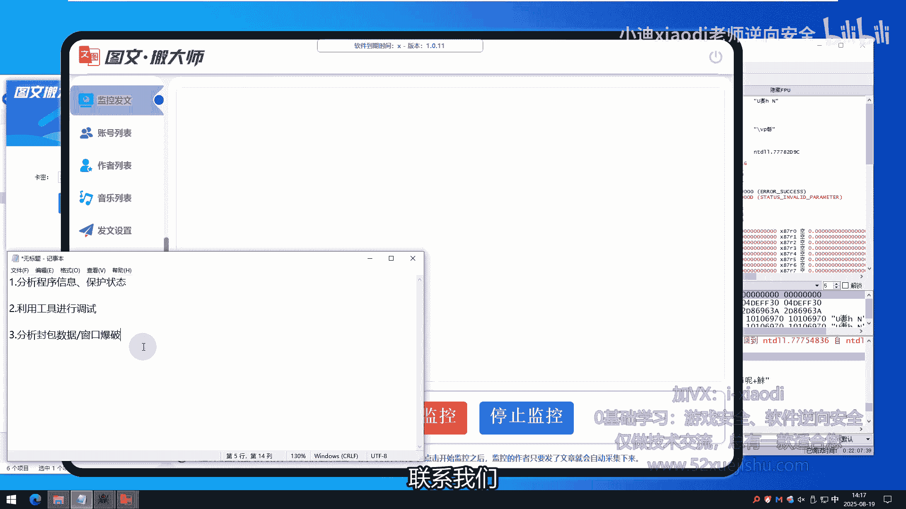

# 🛡️ 黑客小技术：第1节：软件逆向破解入门之卡密破解

在本节课中，我们将学习软件逆向破解技术。这是一项正规的网络安全技术科普内容，所有操作仅用于技术交流，切勿将技术用在非法用途。接下来我们进入正题，通过一个实际程序的分析，来演示如何破解软件的卡密验证，从而免费使用软件。

首先，我们要分析一个名为“图文班打师”的程序。分析方法分为三个步骤：第一步查看程序信息和保护状态；第二步进行调试分析；第三步尝试不同的破解方案。我们一步步来。

## 🔍 第一步：查看程序信息与保护状态


我们使用工具包中的P工具来查看这个程序的信息。打开P工具后，把程序直接拖进去。然后查看“所在区段”，点击区段按钮，你会发现所有区段都是相同的东西。这种情况不太正常。正常的程序是怎么样的呢？我们拖一个正常的程序进去，比如点T工具再拖入，就可以看到正常的区段分布。一般所有程序的代码段都是.text，除了部分特殊程序可能叫.code。点击区段后可以看到：这个是代码段，这个是只读数据段，这个是数据段，这个是资源段，这个是reloc段。总之，正常程序大概有这么几个区段。但是我们要分析的这个程序，所有区段都一样，没有这些正常结构，所以它肯定加了保护壳。


加了保护壳怎么办呢？不要紧，直接分析就可以了。我们利用自己的工具进行调试分析，这个工具可以过掉防护。直接把程序拖过来，然后点击运行，程序就启动起来了。


## 🛠️ 第二步：调试分析与封包拦截

程序运行起来后，点击“开始登录”，它会提示“卡密不存在”。这里有一个小的提示。好，我们去搜索一下字符串，看看有没有什么有用信息。点击搜索，稍等它完成搜索。搜索完成后，我们会发现有一些比如“设置代理”之类的字符串，应该是进行了服务器通讯。那么这个程序是什么写的呢？我们可以点击符号双击一下。如果你看到X2EXEX，这就是一个易语言程序。看到没有？这个程序是易语言写的。

那怎么去分析呢？我们可以下一个封包断点。因为这个程序会接收数据包，所以我们在R1位下个断点，按F2，然后点击“开始登录”。看，断下来了。按Ctrl+F9运行，这时候我们就可以看到封包的内容。这里就是程序截获到的封包内容。如果你有一张正版软件卡密的话，你可以分析正版的数据，然后进行补时间操作，或者补正版操作。然后按F8单步，返回，Ctrl+F9，F8，继续Ctrl+F9，F8。

来到某一层的时候，我们发现代码被混淆了。所以如果你想直接通过代码分析，而且又没有正版卡密的情况下，这一步就行不通了。懂我意思吗？好，那可以怎么办呢？我们先把这个东西，你看它又断下来了，说明它有两次数据包。看这一次，这次就是真正的一个数据包。如果你有正版的话，直接在这里补上正版信息，就破解成功了。好，然后再运行，又提示卡密不存在。那这时候怎么办？我们先把断点取消掉，分析封包数据行不通，我们可以换个方法，进行窗口爆破。


## 💥 第三步：窗口爆破破解


窗口爆破怎么操作呢？点击符号切换过来，使用我们的插件，有一个“小迪5.0”，点击开始分析，会弹出一个“小迪5.0”的窗口。弹出来之后，我们直接点击“窗口控件”。这时候我们就可以看到它内部的所有窗口，这个程序到底隐藏了多少窗口都在这里。可以看一下，这个好像是功能窗口，因为它里边控件挺多的。再看第二个，这个好像是一些额外的窗口。再看这个，应该就是我们的主窗口，因为它有“开始登录”、“下载软件”，还有“密码”编辑框，还有“开始登录”之类的按钮，以及“验证登录”。好，那怎么办呢？我们切换到我们猜测的这个功能窗口上，然后直接点击“暴力测试窗口”。看到没有？这时候我们就直接破开了。我们的账号、列表、音乐列表、方文设置都可以看到，程序的设置都没有问题。

## 🧩 核心概念总结

整个破解流程的核心可以用下面这个伪代码描述：

```python
def crack_program():
    # 1. 检查程序信息，判断是否有壳
    if 区段全相同:
        程序加了保护壳
        # 2. 用工具调试，绕过防护
        debugger.attach(program)
        # 3. 下封包断点，尝试分析数据
        if 有正版卡密:
            分析正版数据，补丁正版信息
        else:
            # 4. 窗口爆破：直接展示隐藏窗口，绕过验证
            udev.plugin.窗口暴力测试(主窗口)
            return 破解成功
```

也就是说，软件破解的核心思路是：先摸清程序的底细，再通过调试工具寻找漏洞，最后选择最合适的破解路径。如果无法解析数据包，就直接从窗口层突破。


## 💬 工具与学习建议

大家要记住一句话：工欲善其事，必先利其器。所以说，如果想要获取相关的工具，想要学习相关的技术，欢迎加入我们，联系我们。我们下期再见。

## 📝 总结




本节课中，我们一起学习了软件逆向破解的基本流程：首先通过区段信息判断程序是否加壳，然后利用调试工具绕过保护并拦截封包，最后通过窗口爆破方法成功破解卡密验证。虽然过程看似简单，但每一步都需要细心操作。再次强调，本技术仅用于网络安全学习和交流，切勿非法使用。下节课我们将继续深入探讨更多破解技巧。
