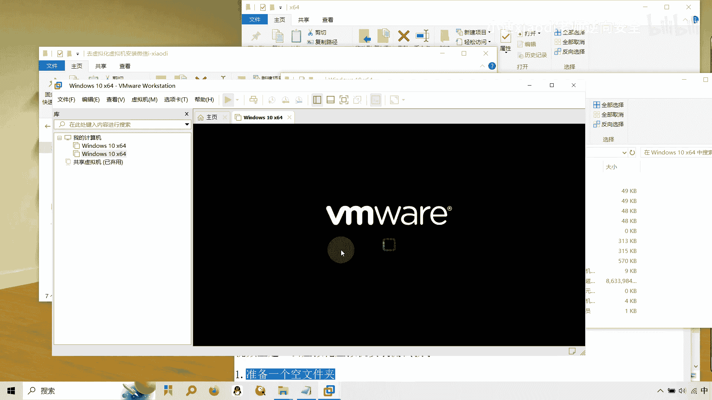
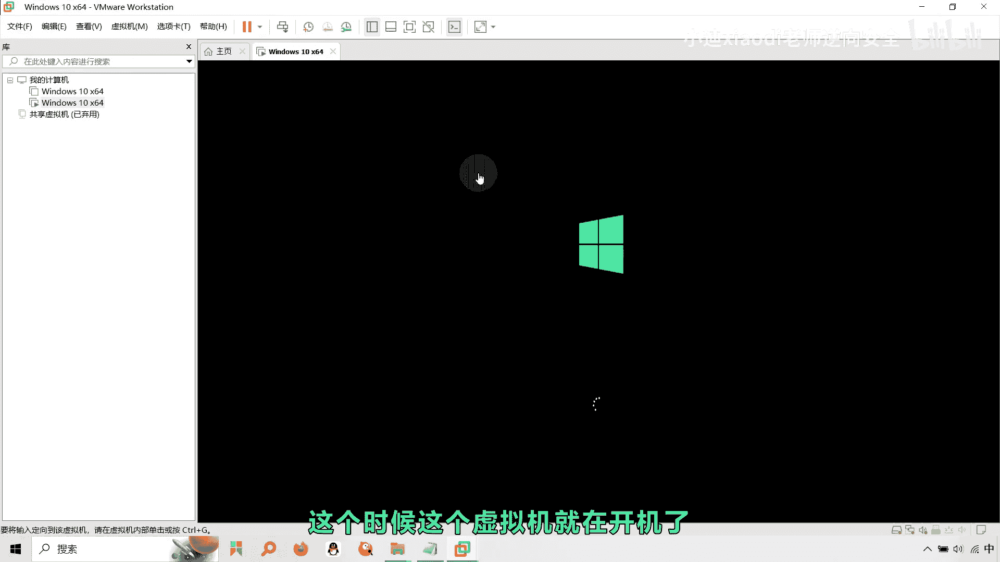
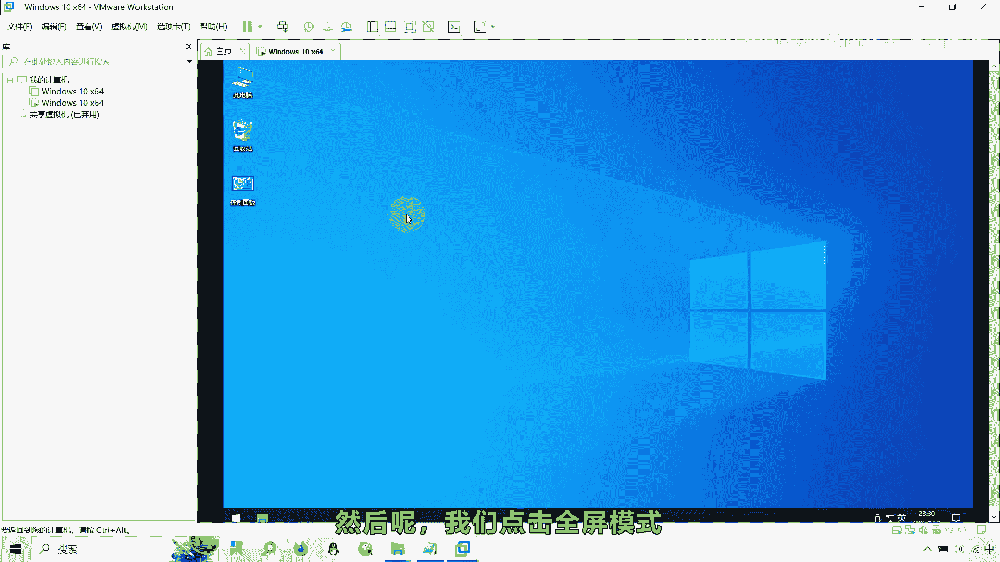
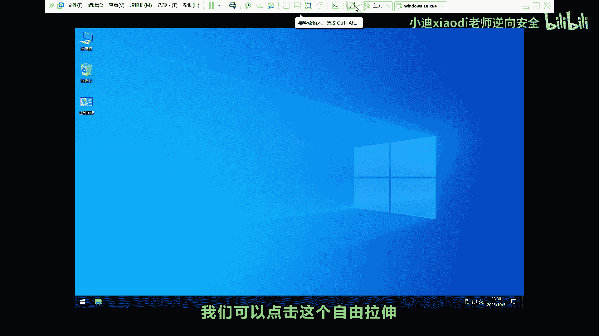
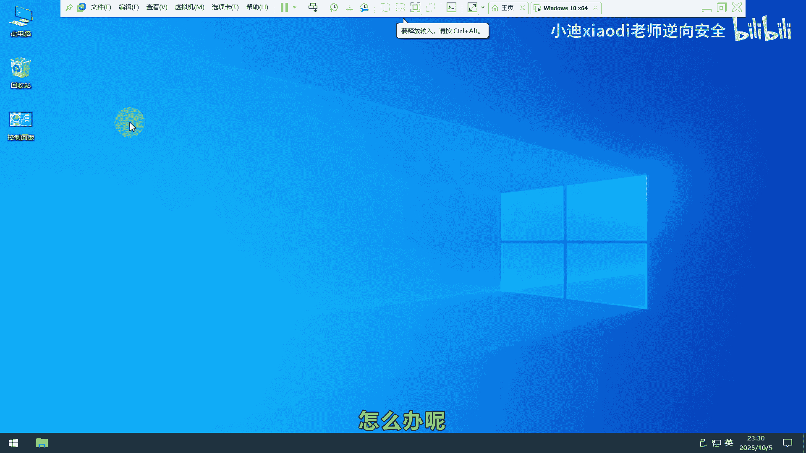
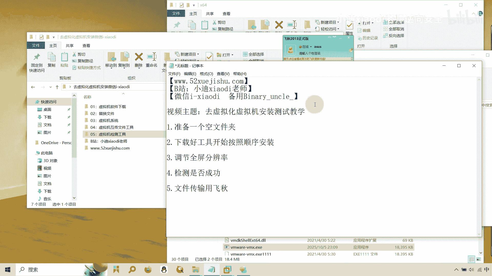

# 去虚拟化虚拟机安装教程：第一章：从零开始安装配置去虚拟化虚拟机

## 📖 概述

在本节课中，我们将学习如何安装一个“去虚拟化”的虚拟机。为什么要去虚拟化？因为很多软件（尤其是一些强壳保护、病毒木马样本）会检测虚拟机环境，一旦发现你运行在虚拟机里，就会拒绝运行或者隐藏真实行为。通过去虚拟化，我们可以让这些软件误以为我们运行在真实物理机上，从而方便我们进行逆向分析、破解学习、病毒分析等工作。整个流程包括：下载虚拟机软件、安装并激活、替换关键文件、导入系统、配置分辨率、安装文件传输工具、最后用检测工具验证去虚拟化是否成功。内容非常适合零基础的新手，跟着一步一步做即可。

## 🛠️ 前期准备：工具下载与文件夹整理

开始安装之前，我们需要把所有的材料都准备好，避免中途来回折腾。首先，请在你的硬盘上新建一个**空的文件夹**，这个文件夹将用来存放所有的安装包、系统镜像、补丁文件和检测工具。你可以把它命名为“去虚拟化虚拟机材料”，记住这个路径，后面会反复用到。

接下来，我们需要下载以下这些东西：
- VMware Workstation Pro（虚拟机软件）
- 一个已经配置好的虚拟机系统压缩包（里面包含了操作系统和去虚拟化补丁）
- 去虚拟化替换文件（一般是一个文件夹，里面有两个文件）
- 飞Q（局域网文件传输工具，用于物理机和虚拟机之间传文件）
- 虚拟机检测工具（VMP、CheckVM、SE等，用来验证是否去虚拟化成功）

准备好之后，我们正式开始。

## 📥 第一步：安装虚拟机软件（VMware Workstation Pro）

首先，我们要把虚拟机软件下载下来。找到下载好的安装程序，双击运行。然后等待它的安装向导启动。

安装界面出来之后，点击**下一步**。然后勾选“我接受许可协议中的条款”，点击**下一步**。后面默认也是下一步，注意在“产品更新”和“客户体验提升计划”这些选项上，把勾选取消掉，这样可以减少不必要的打扰。然后点击**下一步**。

接下来，关于“创建快捷方式”，大家可以根据自己的喜好，勾选或者取消勾选都可以，这个不影响使用。点击**下一步**，然后点击**安装**，等待安装完成即可。

安装完成之后，我们需要激活软件。点击“许可证”，然后双击解压出来的文档文件，把里面的第一行密钥复制出来。然后回到激活界面，使用**Ctrl+V**粘贴进去，点击“输入”，然后点击“完成”。到这一步，虚拟机软件就安装并激活成功了。

## 📂 第二步：替换核心文件实现去虚拟化

软件安装好后，我们先不要急着创建虚拟机，还有一个关键步骤要做。点击左下角的“Windows开始菜单”，往下拉，找到一个以“VMware”开头的文件夹，展开它，可以看到“VMware Workstation Pro”的图标。鼠标右键点击它，选择“更多”，然后点击“打开文件位置”。

在弹出的文件资源管理器里，你会看到一个快捷方式，再次鼠标右键点击它，选择“打开文件所在位置”，这样就找到了VMware真正安装的文件夹。

接下来，我们往上翻一翻，找到一个名称为`x64`的文件夹，双击进去。进去之后，找到“02替换文件”文件夹，双击打开，你会看到里面有两个文件。把这两个文件直接拖到`x64`文件夹中，系统会提示“替换目标中的文件”。如果弹出“需要提供管理员权限”的警告，不用管它，直接点击“继续”。稍等片刻，文件替换就完成了。这一步就是去虚拟化的核心，相当于把VMware中自带的、会让软件识别到“这是虚拟机”的特征文件换掉，从而骗过检测工具。

## 🖥️ 第三步：导入并启动去虚拟化虚拟机系统

替换完文件之后，我们需要把准备好的虚拟机系统导入进来。还记得刚才新建的空文件夹吗？我们把这个系统压缩包直接拖进空文件夹里，然后解压到当前目录。解压完成后，就可以把压缩包关闭了。这时候你会看到，这个空文件夹里多了一个“操作系统”的文件夹，里面包含了虚拟机磁盘文件等。

如何使用这个系统呢？我们再次找到“VMware Workstation Pro”，点击运行。打开软件后，点击左上角的**文件**菜单，选择**扫描虚拟机**。然后找到我们刚才解压的那个目录，把路径复制到扫描窗口的位置，点击**下一步**。这时候，VMware就会扫描到这个已经配置好的虚拟机了，点击**完成**。

紧接着，我们把鼠标放到该虚拟机的名字上，可以看到它的保存路径。如果这个路径和你解压的路径一致，那就说明导入成功了。然后点击选中这个虚拟机，点击右侧的“开启此虚拟机”。启动时会弹出一个对话框，询问“已移动该虚拟机”还是“我已复制该虚拟机”，这里我们选择**我已复制该虚拟机**。

## 🖥️ 系统初始化与分辨率调整

虚拟机开始启动后，我们把它放大一点，可以看到启动过程已经正常开始了。开机进入系统后，点击“是”来完成网络相关的设置，让它能够联网。

接着，我们点击“全屏模式”按钮，如果你发现没有真正全屏，或者分辨率不合适，那要怎么办呢？我们可以点击菜单栏上的“自由拉伸”选项，手动调整窗口大小。不过这样分辨率可能还是不太理想，这时我们可以鼠标右键桌面，点击“显示设置”，在设置界面里根据你自己电脑屏幕的大小调整分辨率。比如我这台电脑调整为1920×1080，画面就变得清晰好看了。

注意，此时这个虚拟机默认是没有办法和物理机直接传输文件的，我们还需要安装一个工具来解决这个问题，那就是飞Q。

## 📡 第四步：安装飞Q并实现文件互传

飞Q是一个局域网传输工具，它的作用和QQ差不多，但更轻量，专门用于设备之间快速传文件和发消息。我们需要分别在虚拟机和物理机上各装一个。

先回到虚拟机，点击“开始”菜单，找到“Windows附件”，里面有一个“Internet Explorer”浏览器，打开它。然后在浏览器地址栏输入“飞Q”的拼音或中文（例如直接输入`feiq`），回车搜索，会找到它的官网，点进去。在官网上点击“免费下载”，然后点击“打开”运行安装程序。下载完成后，把网页关掉，然后把飞Q的快捷方式拖到桌面上，运行起来。首次运行会提示防火墙授权，点击“确定”，再点击“允许访问”即可。

接着，我们在物理机上也运行一下飞Q。稍等片刻，它就会自动获取到局域网内其他飞Q设备，也就是虚拟机那个设备。我们可以给虚拟机发送一条消息测试一下，例如输入“你好，虚拟机”，回车发送。这时候虚拟机端就会收到消息提示，说明通信正常。飞Q不仅可以传消息，也可以传文件。我们随便找个文件测试一下，找个小一点的，点击发送。虚拟机端会有铃声提示，点击“全部另存”，然后选择保存到桌面。看到没？这个文件就出现在桌面上了，传输工作完成。

## 🔍 第五步：验证去虚拟化是否成功

最后，我们需要检测一下这个去虚拟化的虚拟机到底有没有真正去虚拟化成功。我们找到提前下载好的“虚拟机检测工具”文件夹，把整个文件夹通过飞Q拖拽到窗口里，点击发送。回到虚拟机，点击“全部另存”，保存到桌面。传输速度非常快，一下就完成了。

然后在虚拟机桌面上，打开这个检测工具文件夹，依次运行里面的几个检测程序。先运行`VMP`，看到显示“大帅逼”就说明去虚拟化成功了。再运行`checkVM`，如果显示“没有检测到虚拟机”也通过。接着看`SE`检测，没有问题。再运行其他的检测项，挨个查看，都正常显示未检测到虚拟机环境。最后看`SE通过`，也没有问题。再看腾讯的检测工具，运行一下，依然没有问题。就这样，所有的检测工具都通过，说明我们的去虚拟化配置已经生效，虚拟机成功伪装成了物理机。

## 🎯 总结

本节课中，我们一起学习了如何从零开始安装一个去虚拟化的虚拟机。我们先后安装了VMware Workstation Pro并激活，替换了`x64`目录下的关键文件，导入了解压好的虚拟机系统，开启了虚拟机并调整了分辨率，安装了飞Q实现宿主机与虚拟机之间的文件传输，最后用多款检测工具验证了去虚拟化效果。整个流程虽然步骤较多，但只要按部就班操作，就能顺利获得一个能够绕过大部分虚拟机检测的环境，为后续的软件逆向、破解、病毒分析等工作打下基础。如果在操作中遇到任何问题，都可以在网站上联系我们，或者关注我们的B站，学习更多相关内容，也可以加微信咨询。我们下期再见。

