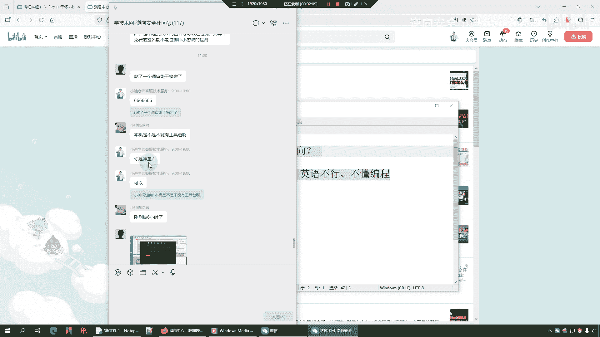
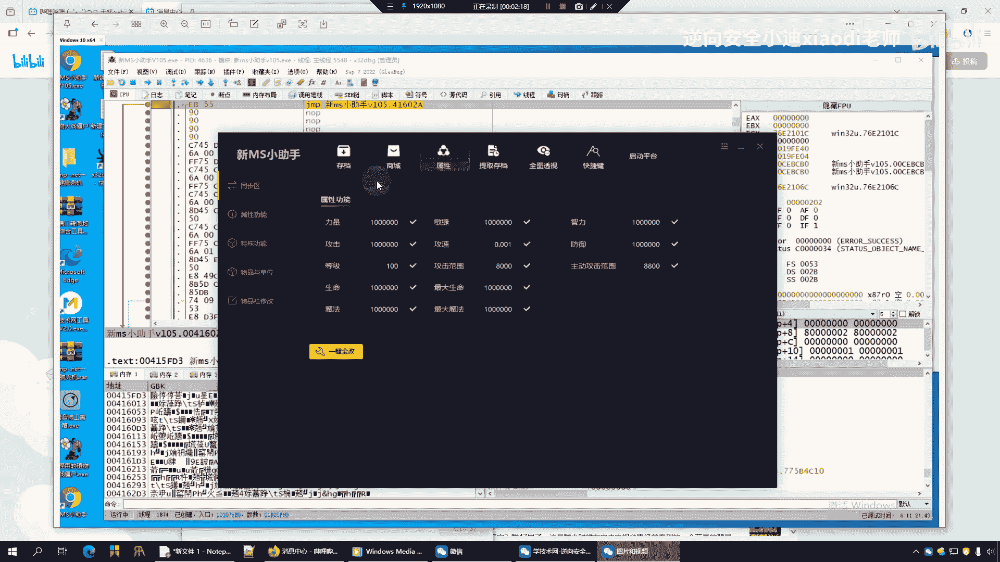
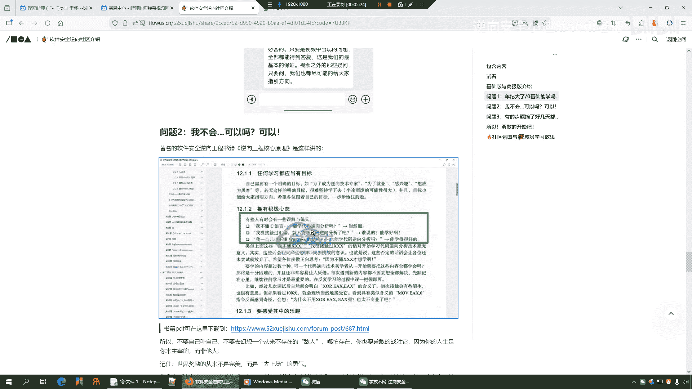
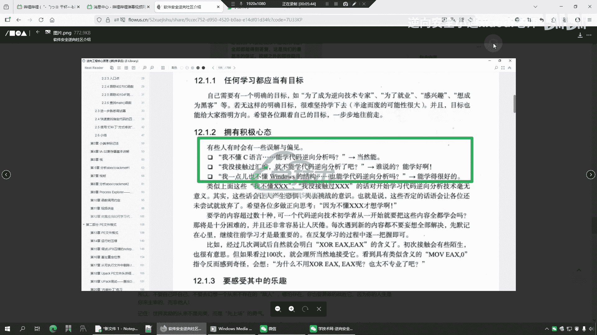
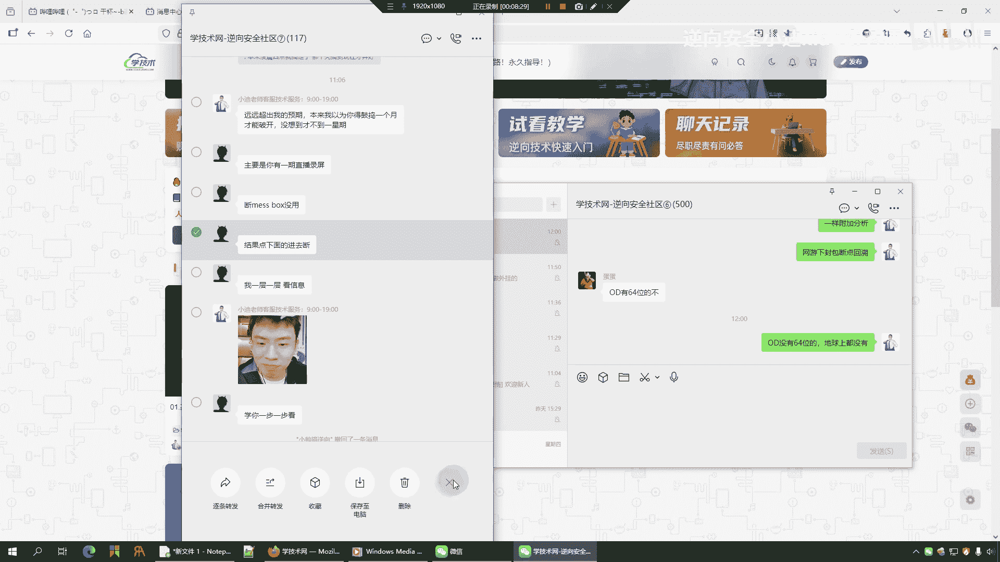

# 🛡️ 软件逆向零基础入门：第01章：学历低、不懂英语、不懂编程，能学逆向吗？

在本节课中，我们要学习一个非常常见的问题：学历低、年龄大、没文化、英语不行、不会编程，能不能学软件逆向。

这个问题最早来自一条 B 站留言：大专学历好不好入行。它还可以继续延伸成“我某某能不能学网络安全”，或者“我某某能不能学某门技术”。其实这些问题都是通用的。统一回答是：可以。

软件逆向并不是少数天才才能做的事。它属于软件破解、游戏安全、软件安全、网络安全，也是 CTF 比赛的基础。下面我们通过真实案例、书籍观点和学习方法来详细说明。

## 1.1 🧭 最常见的担心

先来看看大家通常担心什么。以下是几个最常见的问题：

- 学历低
- 年龄大
- 没文化
- 英语不行
- 不会编程

这些担心看起来各不相同，但本质都一样：怕自己不够资格。实际上，这些都不是真正的门槛。下面先看一个真实案例。

## 1.2 📼 真实案例：三天暴力破解

有同学可能会说：你在骗我。我拿真实案例说话，不搞假的，不搞虚的。

有一位学员，前几天刚来看直播。他说自己考虑了好几天，怕学不会。他可能学历比较低，之前各方面都没接触过，计算机也不太懂。后来，在我们的群聊氛围、课程服务、直播答疑这些综合因素下，他决定加入学习。

加入之后，他一开始说太难了，像听天书一样。当时我在直播间帮他分析过那个软件，告诉他：作为新手小白，最少要一个月。他刚开始学了十几集，觉得没学到什么东西。我说，不能要求刚学就马上破解，凡事都需要一个理解和消化的过程，必须脚踏实地。

然后我们来看他最新的消息。时间是 2026 年 3 月 7 日，周六。这位学员从周四开始学，到周六满打满算只有 3 天。昨天晚上 11 点，今天上午 10 点，他说熬了一个通宵，终于搞定了。老师问：你是神童吗。他真的搞开了，而且是暴力破解，不是那种烂大街的窗口破解方式。

所谓暴力破解，就是把所有可能的值逐个试一遍。用代码表示，大致是这样：



```python
# 暴力破解：尝试每一种可能的注册码
for code in range(10000):
    if 注册码验证(code):
        print("破解成功:", code)
        break
```



这位学员的情况是：学历低、年龄大、没文化、英语不行、不会编程。结果满打满算 3 天就破解开了。这远远超出老师的预期。本来老师估计要一个月，结果不到一星期。这位学员还夸了老师几句。老师说应该的，毕竟帮到了他。

从这个案例可以得出一个经验：只要脚踏实地，跟着一个老师学习，有问题就问，并且群内有问必答，就可以放心大胆地往前走。视频内容基本覆盖实战中 80% 到 90% 的场景，所以不用太担心。

## 1.3 👴 更多案例：年过五十、70 后也一样

刚才说的是一个比较快的案例。接下来再看看其他真实情况。这一类情况其实有很多，课程介绍里都展示过。

有人问：年纪大了，零基础能不能学。当然能学。没有人从娘胎里就把知识带出来，除非你是爱因斯坦。每个人生下来都是慢慢学习、慢慢成长的。

有一位学员稍微有点基础，跟着学习一下，很快就把软件破解开了。还有一位学员 1998 年就毕业了，现在年过五十，也照样学习，最终得到了帮助。群里一直有问必答。

还有一位 70 后朋友。老师当时劝他：千万不要加入学习了，好好享受天伦之乐。但他还是要学，拦都拦不住。进来之后，他感觉很好，大家慢慢聊天，群聊交流氛围很好，一起交流、一起学习、一起进步。人生学习无止境，活到老学到老。

这位 70 后朋友也问：我不会这个，不会那个，能不能学。答案是：可以。下面把每个担心分别说清楚：

- 学历低：没事。
- 年龄大：没事。
- 没文化：也没什么事。
- 英语不行：现在有 AI 工具可以帮忙。
- 不会编程：有零基础 C 语言程序开发课，也有零基础编程课。

所以不用太担心。来了之后什么都有，所有条件都已经准备好了。

## 1.4 📚 书上早就说过：可以

案例之外，还可以看看专业书籍。有一本非常出名的软件安全逆向书籍，书名叫《逆向工程核心原理》，作者是韩国人。书里正好有这样几个问答：

- 我不懂 C 语言，能不能学逆向。当然能。
- 我没接触过汇编，能不能学。当然能。
- 我一点不懂，能不能学。能学。

这本书非常出名，大家有机会可以去看一看。所以，不要把自己想象得那么弱。其实每个人都很强大。

## 1.5 ⚙️ 核心方法：敢学、敢练、敢犯错

刚才的案例和书都说明，零基础、学历低、年龄大都不是问题。那具体该怎么做。核心方法就是：敢于学习，敢于练习，敢于犯错，然后修正，再迭代。

这个过程可以用一段伪代码描述：

```python
while not 成功:
    学习()
    练习()
    犯错()
    修正()
    迭代()
```



只要把这个循环坚持跑下去，就能离成功越来越近。就像前面那位学员，周四、周五、周六，才三天就学完了。但他刚开始也担心自己学不会，加老师微信还犹犹豫豫了很久。这说明，担心是正常的，但不能因为担心就不开始。

## 1.6 ⏱️ 为什么有人快，有人慢

有同学说，自己的程序分析好几天都不行。这种情况很正常。有人分析三天就能成，有人需要通宵，有人则可能分析半年。



破解速度不是一个固定数字，它和很多东西有关。可以近似写成这样一个公式：

\[
T \approx f(\text{软件难度}, \text{个人能力}, \text{运气}, \text{投入时间})
\]

如果拿一个非常强的软件来练手，而自己的能力还没达到那个水平，自然会比较慢。如果学得比较好，再选一个和自己的水平相当的软件，破解起来肯定快。实力要与目标相契合。

用一个拳击的例子来解释：你是 80 公斤的选手，对方是 150 公斤的选手。这种擂台赛你很难打赢，对方压都能把你压死。所以，不要拿太难的软件来打击自己，也不要因为慢就否定自己。

## 1.7 💬 有问必答与社区氛围

总的来说，不要担心，也不要犹豫。这里的社区是有问必答的，氛围很好。所有聊天记录、交流氛围都是能看到的。

例如，有同学在群里问：OD 有没有 64 位版本。答案是没有，地球上都没有。OD 指的是 OllyDbg，是一款常用的调试工具。诸如此类的问题，群里都会有回应。

学逆向也需要有人带。学逆向就找小迪老师，可以节省学习时间，不走弯路。这也是很多人选择这个课程的原因。

## 1.8 📦 课程内容与版本

视频课程内容紧贴实战，体系完善，持续更新，永久答疑，永久服务，还有直播答疑。以下是选择课程时比较重要的几个理由：

- 内容紧贴实战
- 体系完善
- 持续更新
- 永久答疑
- 永久服务
- 直播答疑

当前课程版本分为两种。以下是价格与区别：

- 基础版：199
- 高级版：299

高级版肯定更好，因为高级版是更新的，内容也是最前沿的。高级版包含全部基础版内容，基础版只有那一个模块。高级版里面其实有好几百集，不要看表面上好像只有一个入口，实际上最新课程只是被拆开，分模块化方便学习。

高级版后续还会继续更新。界面上有三个空白模块，之后会逐步补充，2026 年持续更新。前几天刚讲过的那些有用内容，学员马上就能用上，用上之后就把软件破解开了。所以要学就学最新的内容。

现在的价格是 299，未来未必还是这个价格。有人怀念当初的 249，但现在已经没有了。如果真想学习，就要抓紧加入。

为什么选择这里，而不是别处。因为这里的内容紧贴实战、体系完善、持续更新、永久答疑、永久服务，还有直播答疑。人生没有白学的课，每一节都算数。最好的开始就是现在。



## ✅ 总结

本节课中，我们一起学习了软件逆向零基础入门的第一课：学历低、不懂英语、不懂编程，能不能学逆向。

答案是：可以。真实案例里，有学员只用了 3 天暴力破解成功；有年过五十的学员在学；有 70 后学员也在学；专业书籍里也一样给出肯定回答。核心方法是：敢于学习、敢于练习、敢于犯错、修正、迭代。遇到问题有问必答，社区氛围好，课程内容覆盖实战中 80% 到 90% 的场景。

最后记住：人生没有白学的课，每一节都算数。最好的开始就是现在。本期教程到这里结束，我们下期再见。
