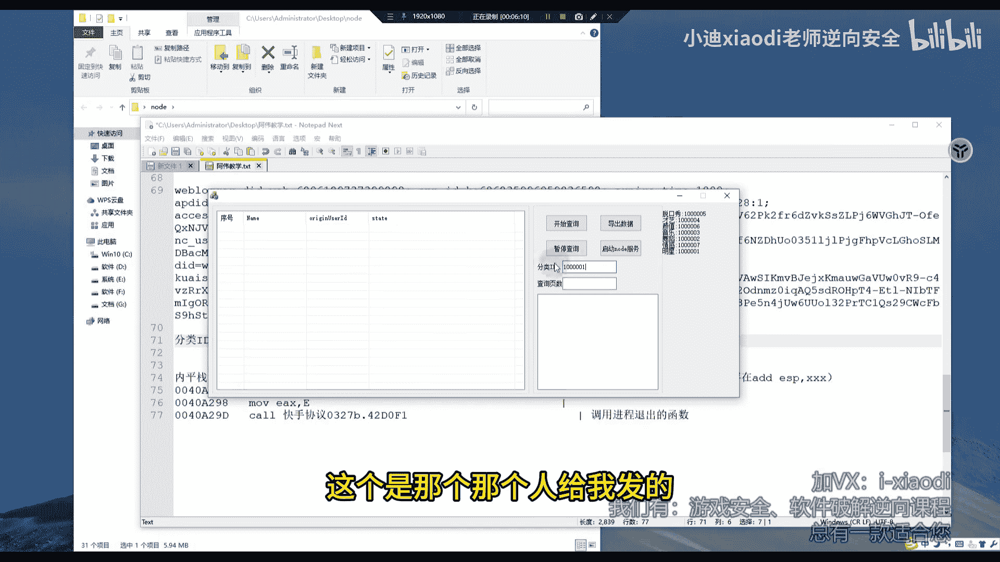
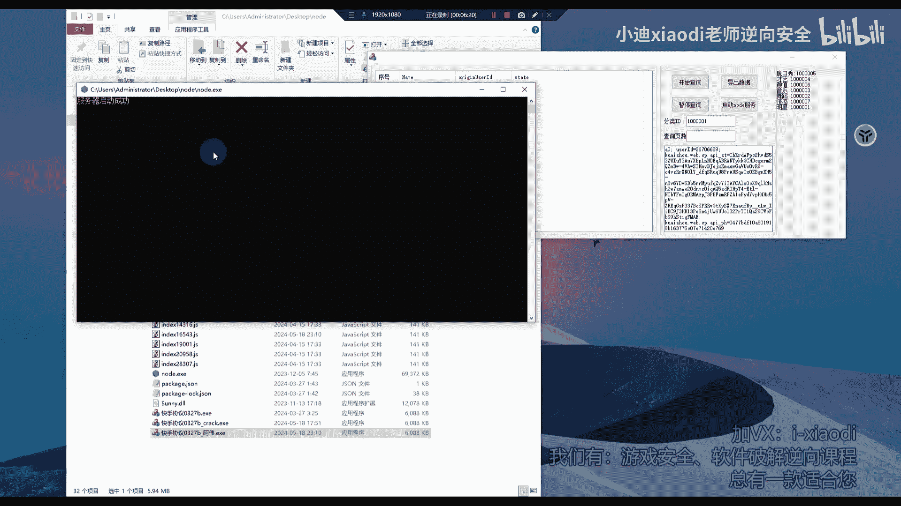
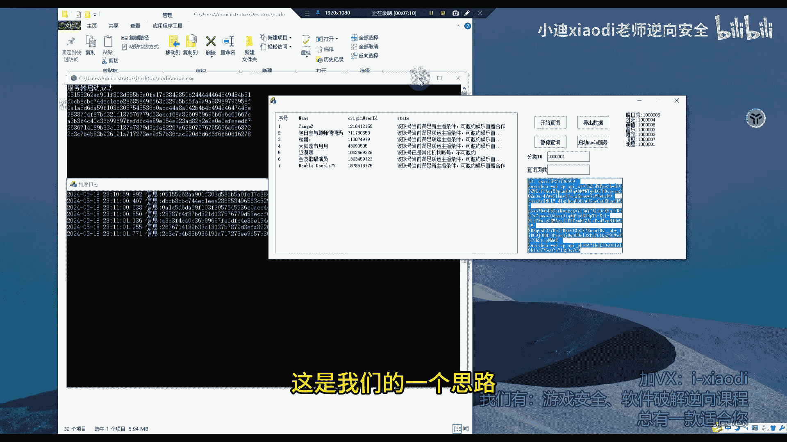
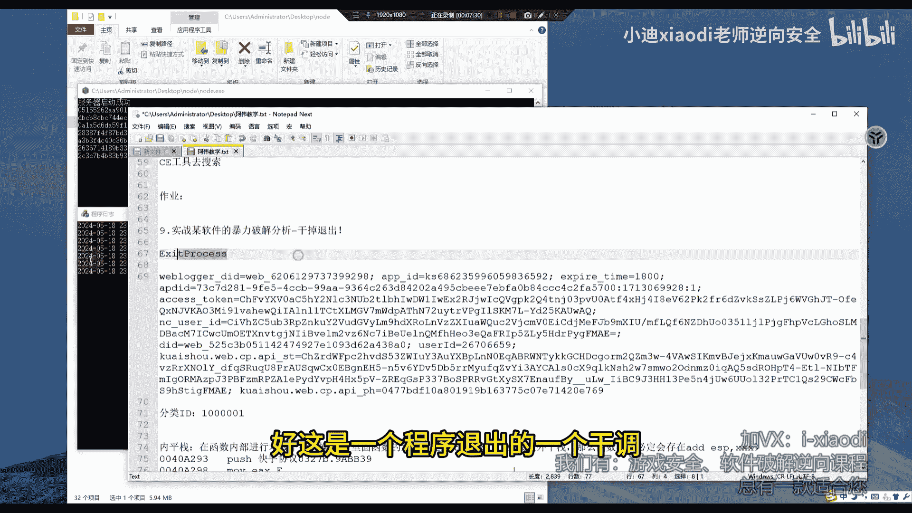
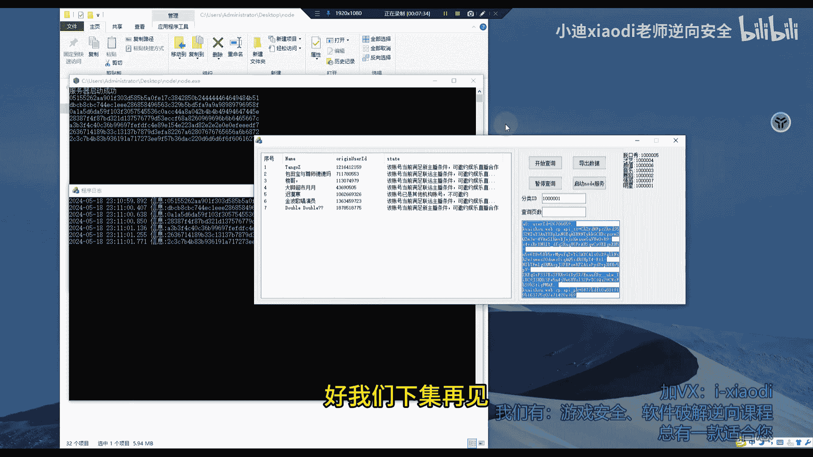
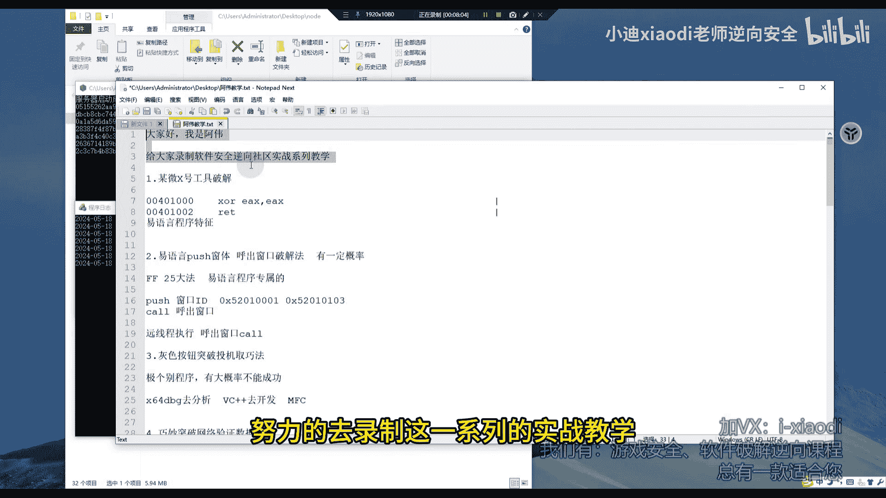

🛠️ 实战网络验证卡密软件的逆向分析：暴力破解法突破服务器限制，付费软件是如何被逆向破解的：第九讲：暴力破解分析干掉退出

在本节课中，我们将学习如何对一款带有网络验证的软件进行暴力破解。具体场景是：软件因为服务器端禁用导致无法打开，程序启动后立即退出。我们需要通过逆向分析定位退出逻辑，并用暴力破解的方式让程序跳过退出分支，从而正常运行。这是实战中非常典型的一个案例，尤其适用于那些“服务器拉黑”后程序自动退出的情况。我们会从查壳开始，一步步完成断点定位、堆栈分析、二进制填充和补丁保存。

上一节我们介绍了环境准备和基础工具的使用，本节我们来看一个更具体的实战案例。首先，用户给阿伟发来消息说，这个软件打不开了，应该是服务器那边禁用了。用户还发来“520”的消息，阿伟开玩笑说感觉像是在说很喜欢他。随后用户提到，他已经替换掉了某个文件，虽然不清楚他为什么要替换，但猜测可能是因为他已经破解了一部分。然而替换之后，软件依然打不开。阿伟的分析是在用户替换文件的基础上进行的，也就是说，用户替换的那个文件本身是分析的一个关键起点。

这是一个易语言程序，我们看到了它的主程序。运行之后，程序没有任何反应，直接退出了。遇到这种情况，我们首先需要判断程序是否有壳。打开stud_PE工具，把程序拖进去查看区段信息。区段非常干净，没有常见的壳特征，这说明它是一个无壳程序。无壳程序的好处是我们可以直接修改二进制文件并打补丁，而不需要处理壳的校验和解压逻辑。

既然进程会退出，那么我们应该下什么断点呢？应当下`ExitProcess`断点。`ExitProcess`是Windows API中用于结束进程的函数，程序退出时必然会调用它。我们在调试器中下这个断点，就能在退出函数执行前中断下来，从而回溯调用来源。

接下来，我们打开调试器，把程序直接拖进去。拖进去之后，程序会要求传入一些参数，这些参数是软件正常运行需要的，我们先将其关闭。由于程序会自动退出，所以我们可以在`ExitProcess`上下一个断点。按F2打上断点后，运行程序。程序运行后立即触发了退出流程，自然就中断在了`ExitProcess`处。

中断之后，我们需要查看调用堆栈。点击“调用堆栈”窗口，这里会显示所有调用`ExitProcess`的位置。不过我们主要关注的是程序主模块中的调用，而不是系统模块或第三方DLL。因为我们要破解的是这个程序本身，不可能去其他模块里面修改逻辑。所以我们在调用堆栈中挨个查看，寻找那些属于主模块的函数调用。

在查看过程中，我们会发现当前是从某个函数内部出来的。从调用堆栈的弹栈关系来看，这一层实际上就是调用`ExitProcess`的位置。也就是说，在某个函数内部，程序调用了退出函数，导致进程终止。此时程序还没有真正退出，我们正处于调用前的瞬间。那么，我们能不能直接把这个调用位置用`NOP`填充掉呢？答案是肯定的。

不过在`NOP`的时候，必须注意堆栈平衡。我们观察调用指令下方的代码，发现没有`add esp, xxx`这样的指令，这说明它不是外平栈，而是内平栈。所谓内平栈，就是在函数内部进行堆栈平衡操作，函数返回时会使用`ret n`（带立即数的返回指令）来清除参数。外平栈则是函数返回后，由调用者通过`add esp, xxx`来清理堆栈。关于堆栈平衡的详细解释，小迪老师在相关视频中讲得非常清楚，这里就不展开细说了。我们需要记住，内平栈的平衡工作由被调用函数自己完成，调用者不需要额外处理。

既然这是一个内平栈调用，我们就需要小心处理。因为调用约定要求栈在调用前后保持一致。如果我们直接`NOP`掉`call`指令，那么原本压入的参数（`push`指令）就没有函数来弹出，会导致栈不平衡，程序后续执行可能会崩溃。因此，我们不仅要把`call`指令填充掉，还要把它上面的`push`指令也一起填充掉。另外，在`push`之前通常还有一个`mov`指令，用来准备传给函数的数据。既然函数都不调用了，这个数据也就没有意义了，同样可以填充掉。也就是说，从`push`到`call`之间的三条指令全部用二进制`NOP`填充，以保持栈的相对平衡。

具体操作如下：选中从`push`开始到`call`结束的所有指令，在调试器中用二进制编辑功能将它们全部填充为`0x90`（即`NOP`指令）。`NOP`指令是一个空操作，执行后什么也不做，程序会继续向下运行。通过这种方式，我们就把“调用退出函数”的逻辑彻底废除了。

填充完成后，程序没有壳，所以我们可以直接打补丁。点击“保存补丁”按钮，给补丁文件起一个名字，比如“阿伟”。然后点击保存并应用补丁，关闭调试器。此时补丁文件已经生成，我们再运行这个补丁后的程序，可以看到程序直接运行起来了，并没有退出。这说明我们的暴力破解成功了。

接下来验证软件功能是否正常。我们先把相关参数填进去，这些参数是用户之前发给阿伟的。填好参数后，启动Node服务，服务器启动成功。然后点击“开始查询”按钮，程序开始进行查询操作，一切正常。这个软件可能是用来查询一个榜单的，它会根据我们传入的参数去请求数据并展示结果。只要程序能正常退出逻辑消除，整个软件就能正常使用。

最后总结一下本节课的内容。我们一起学习了如何针对程序退出问题进行分析和破解。核心思路是通过`ExitProcess`断点定位到程序主模块中的退出调用，然后分析其堆栈平衡方式，在保证不破坏堆栈的前提下，将相关的`push`和`call`指令全部`NOP`填充，最后打补丁生成可执行文件。这样就实现了“干掉退出”的效果。需要注意的是，这种方法只适用于程序自己主动退出，而不是其他异常情况。如果程序因为崩溃或被调试保护而退出，就需要另找原因了。另外，本节课涉及的软件仅供技术交流，请不要随意传播。阿伟也会在后续的实战教学中继续分享更多案例。如果大家想深入学习技术，可以关注小迪老师并加入交流群。希望大家能给阿伟提出宝贵建议，阿伟会继续努力录制实战系列教学。好的，我们下节课再见。
