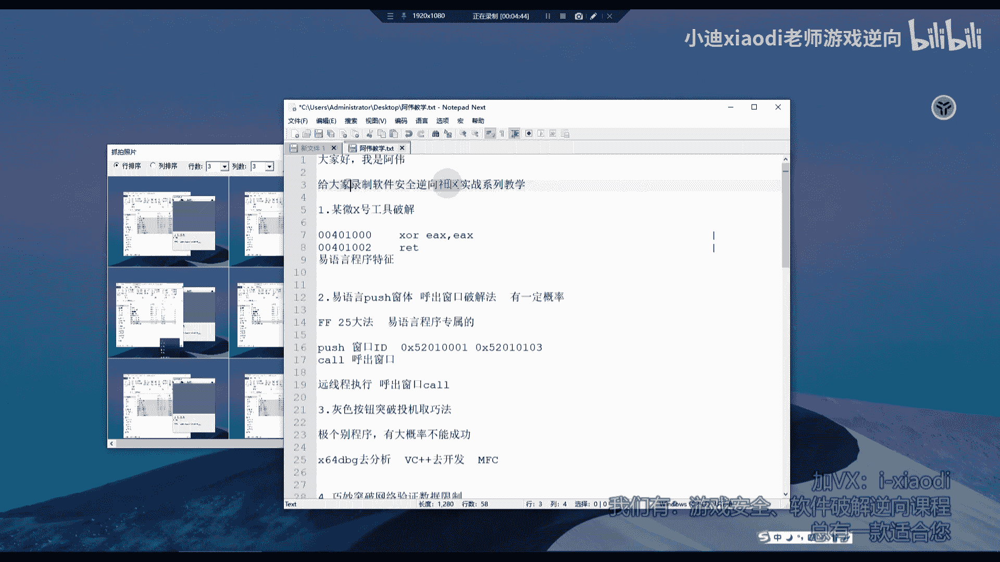

# 实战软件破解：07：注册码暴力破解

## 🎯 课程概述

在本节课中，我们将要学习一种绕过软件注册码验证的实战方法。具体来说，当软件弹出“未注册不能使用”的提示时，我们可以通过修改程序内部的跳转指令，让软件直接跳过注册验证的逻辑，从而实现无视注册码直接使用全部功能的效果。这种技术在游戏安全、软件安全、网络安全以及CTF比赛中都是非常重要的基础技能，掌握它能够帮助你深入理解程序的运行逻辑和反汇编逆向分析的基本思路。

## 🔧 回顾之前的破解方法

在第五节课的内容中，我们曾经对某个软件进行过一次破解尝试。但是在破解完成之后，我们发现那个方案存在一些小小的缺陷，没有完全达到预期的效果。正是因为那个方案不够完美，所以今天我们要来探索另外一种破解的思路和手段。这种新的方式会更加直接，也能够帮助我们绕过更多类型的限制。

当我们拿到一个软件的时候，首先需要做的事情就是仔细观察这个软件的行为特征。你要留意它在不同状态下的表现。比如说，如果你没有进行注册，当你点击录屏启动这个按钮的时候，系统就会弹出一个提示信息，告诉你软件未注册，不能使用。不仅仅是一个按钮，几乎所有的功能按钮在未注册状态下点击都会出现一模一样的提示。

## 🚫 功能限制的分析

这种提示信息的本质是什么？简单来说，这是软件开发者对功能的一种限制手段。他们通过这种方式来阻止未注册用户使用完整的功能。但是，既然我们想要破解这个软件，我们就可以从这种功能限制入手，找到直接绕过限制的方法。实际上，这种基于功能限制的提示信息，反而给了我们一个很好的突破口，因为程序必须包含这些提示字符串，我们就能顺着字符串找到关键的判断逻辑。

下面是我们破解步骤的简要介绍：

- 打开动态调试工具x32dbg，用它来附加到正在运行的目标程序进程上。
- 在附加完成之后，切换到符号视图，找到程序的主模块并双击进入。
- 在主模块中，使用搜索功能查找当前模块的所有字符串。

在搜索框里，我们可以输入什么关键词呢？根据刚才程序提示的内容，我们输入“软件”这两个字。点击搜索之后，界面中就会显示出几个相关的字符串。其中就包含了我们刚才在程序中看到的“软件未注册不能使用”这条提示信息。这个字符串就是程序用来提示用户的关键文本，也是我们定位关键代码的起点。


## 📍 定位关键跳转

当我们找到这条字符串之后，接下来要做什么呢？我们可以直接双击这个字符串，切换到反汇编代码的对应位置。在这个位置附近，你会看到一个条件跳转指令，它的名字叫做JNE。JNE是什么含义呢？它代表“不相等则跳转”。如果这个跳转被执行，程序就会跳过“未注册不能使用”的限制，让用户进入正常的使用流程。但如果程序没有跳转，就会弹出那个限制提示。

让我们用一个简单的公式来描述这个逻辑：


```assembly
IF 注册状态 != 已注册 THEN
    跳转到未注册提示
ELSE
    继续正常执行
END IF
```

我们可以看到，这个JNE跳转就是整个限制的关键所在。如果我们想绕过限制，就要让程序每次都跳转到正常执行的路径上。


## ✏️ 修改跳转指令

那么，我们可以怎样修改这条JNE指令呢？一个常见的思路是把它改成JMP。JMP是无条件跳转，也就是说不管什么情况，程序都会执行跳转操作。这样一来，程序就不会再判断注册状态了，每次都会直接跳转到正常执行的位置。

下面是修改过程的汇总：

- 找到第一条JNE跳转指令，双击它，在弹出的编辑框中将JNE改成JMP。
- 继续向下寻找，如果发现第二条同样的JNE跳转，重复相同的操作方法，也改成JMP。
- 继续查看代码，找到第三条类似的跳转指令，用同样的方式修改成JMP。
- 继续往下搜索，找到第四条跳转指令，双击修改为JMP。

在实际操作的演示中，我们发现这个程序总共出现了四处这样的JNE跳转。每一处都是程序在不同功能入口处设置的注册验证关卡。这些关卡的位置分布在软件的各个功能模块中，所以我们需要逐一修改，确保所有功能都能被解锁。把所有的这些条件跳转都改成无条件跳转JMP之后，整个程序的注册限制就等于被彻底解除了。

## 🩹 保存补丁


由于这个程序本身没有加壳，也就是不存在壳的保护机制，所以我们不需要处理复杂的壳检测或者重定位问题。这样一来，我们修改完跳转指令之后，就可以直接打一个补丁，把修改后的内容保存到文件中。具体操作是点击工具栏上的补丁按钮，然后在补丁窗口中应用修改并保存到新的文件。

为了区分修改前后的程序，保存的时候我们把新文件重新命名为一个不一样的名字，比如说加上“O”字母来标记这个文件是修改后的版本。这样我们就得到了一个已经破解完成的程序文件。

## 🎬 验证破解效果

现在，重新启动这个修补过的程序，看看它的功能运行情况。程序起来之后，可能会弹出一个窗口，提示“注册码不正确”。对于这个提示，我们可以完全忽视掉，因为我们已经跳过了所有的注册验证，这个提示已经不会影响任何功能的使用了。我们可以把它当成一个无关紧要的弹窗，关掉或者直接忽略都可以。

更有意思的是，对于程序中的一些文字内容，我们其实也可以做进一步的修改。比如说，原本显示“未注册”的地方，我们可以把它改成“欢迎使用”这样的友好提示。这种修改可以通过修改字符串常量来实现，让软件看起来更像是经过授权的正版软件。修改完成之后，我们再点击录屏启动按钮，然后试着拖动一下界面，这时候你会发现软件已经开始正常录制了。这说明软件的录屏功能已经完全解锁了。

当然，从使用体验来说，这个软件操作起来并不是那么顺手。可能它的界面设计或者交互逻辑还有一些不够完善的地方。比如我们随便在界面上进行一些操作，它给我的整体感觉是功能虽然可用，但用起来不太流畅。不过这并不影响我们的破解成果，因为重要的是我们成功绕过了它的注册限制。


录制完成之后，我们可以点击播放按钮来查看刚才录制的效果。从屏幕上可以看到，录制的内容已经正常保存下来了。我们还可以按回车键逐张查看录制的每一帧图片，这些都是可以正常操作的。进度条呢，也是存在的，拖动进度条可以快速定位到录制的任何时间点。所以说，这款软件完全可以通过我们刚才讲解的方法和手段来进行破解。

## 🖼️ 图片保存功能的说明

另外，关于图片的保存功能，在破解之后的版本中也是可以正常使用的。这个软件对于图片保存功能本身没有设置额外的功能限制，所以不需要额外处理。如果说某一天你遇到一个软件，它对图片保存也做了限制，那处理办法也是一样的。我们可以继续在x32dbg调试器里面找到对应的跳转指令，然后修改跳转方向，就能轻松绕过这个限制。

## 💡 破解思维的重要性

好的，上面介绍的就是我们讲解的另一种破解方法。大家需要特别注意的一点是，对于一个软件，我们必须非常熟练地去应用调试工具，并且要去理解软件中各个功能按钮的作用。你需要知道每个操作会引发什么样的后果，要思考它的前因后果。只有把这些逻辑关系都想明白、想透彻，我们才能真正掌握破解的技艺。

破解实际上很多时候靠的是思路，而不仅仅是一种固定的技术。你会发现有些人可能技术水平一般，代码功底也不深，但是他们的思路非常灵活。这种人敢于尝试，勇于不断试验，在失败中总结经验，他们往往也能取得不错的效果。所以说，灵活的思维在逆向领域比单纯的技术积累更加重要。

因此，大家一定要加油，要在实战中多练习，多思考。如果你想要更系统地学习这些内容，可以联系小迪老师。我是阿伟，我是这个社区成员的一部分，我也是跟着小迪老师学习的。如果说大家希望通过学习实现和我一样的效果和目标，可以联系小迪老师报名加入课程。社区里的每位成员都在认真学习，大家都是学有所成的。

好的，我们下一节课再见。我会经常受小迪老师所托，在社区中发布相关的实战教学视频。我们下一集再见，拜拜。



## 📝 课程总结

本节课中，我们一起学习了如何通过x32dbg动态调试工具对一个未注册软件进行破解。核心思路是搜索程序的关键提示字符串，定位到负责注册状态判断的条件跳转指令，然后将JNE改为JMP，强制程序跳过所有注册验证逻辑。之后通过补丁功能保存修改，最终获得一个去除了功能限制的破解版程序。这个方法广泛应用于各类无壳程序的破解场景，希望同学们能够熟练掌握。
