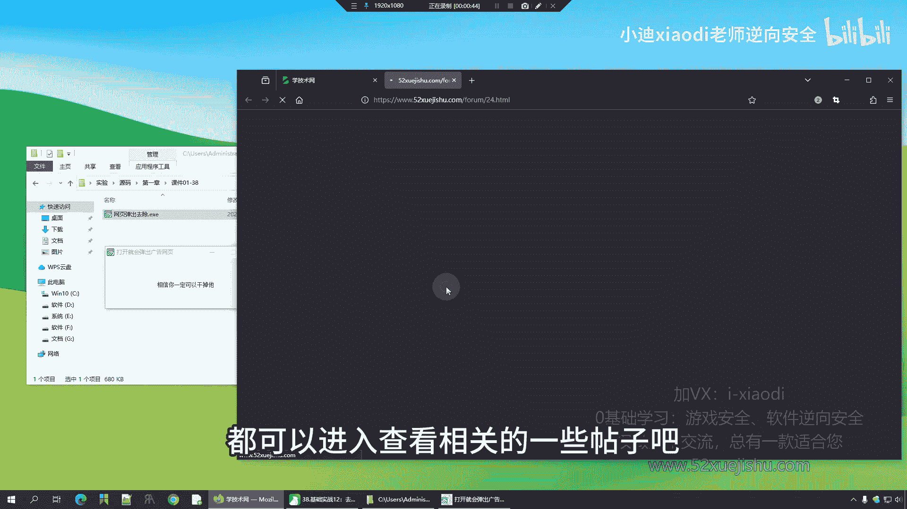
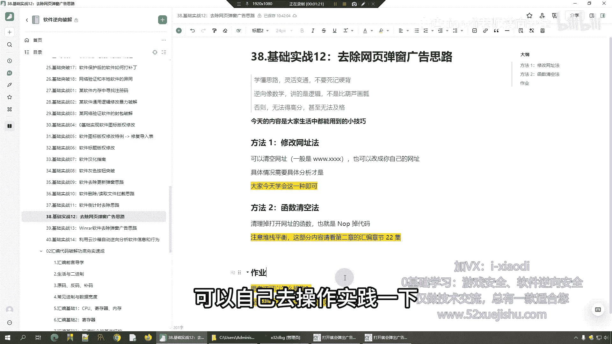

# 🛠️ 软件逆向破解实战：第1章：去除网页弹窗广告

大家好，我是小迪老师。这一节课，我们要聊一聊去除网页弹窗广告的思路。今天的内容是大家日常生活中都能用到的小技巧。如果你有一款软件，每次打开之后都会弹出一个很烦人的网页广告，那到底应该怎么处理呢？其实这个问题并不复杂，完全可以用今天讲解的内容来解决。我们先把整体思路梳理清楚，然后再通过一个具体的案例来演示整个操作过程，让大家真正熟悉其中的原理。

📌 概述

在本节课中，我们将要学习如何去掉软件中的网页弹窗。很多软件在启动时会自动调用系统函数打开一个广告网页，这种弹窗不仅影响使用体验，有时候还会反复出现，让人非常头疼。要解决这个问题，最直接的办法就是从软件本身入手，找到它打开网址的代码，然后把它修改掉。我们的目标不是简单地拦截网页，而是直接修改程序的逻辑，让它根本不会去打开那个网址。

今天的内容会涉及两个重要的概念，一个是字符串搜索，另一个是函数填充。字符串搜索可以帮我们定位到软件里保存的网址，函数填充可以帮我们把打开网址的整个功能模块直接清空。等学完这一节，大家再去处理类似的弹窗问题，就会有一个非常清晰的思路了。


🧪 案例演示

我们先来看一个具体的案例。现在我手上有一款软件，名字叫做“网页弹窗去除”。双击运行这个软件，程序首先弹出一个提示框，提示信息是：打开就会弹出广告网页。的确如此，当你点击确认之后，一个网页就自动弹出来了。这个网页是一个名为“学技术”的论坛网站，口号就是“学技术就来学技术”。



这个网站的网址是 `www.52xuejishu.com`。如果你对软件安全或者游戏安全感兴趣，可以到这个论坛中查看相关的帖子，里面有非常多优质的文章。当然，现在我们要做的事情不是逛论坛，而是分析这个弹窗是怎么产生的，然后用逆向手段把它彻底干掉。这个案例看起来简单，但它背后涉及到的分析方法，可以推广到很多类似的软件上。

这个程序到底应该怎么分析呢？我们有两种思路。第一种方法叫修改网址法，思路非常直白：既然程序要打开一个网址，那我们直接把这个网址清空，或者改成你自己的网址，程序不就找不到原来的广告页面了吗？第二种方法叫函数清空法，思路更加彻底：直接找到负责打开网址的那个函数，把整个函数都废掉，让它什么也干不了。下面我们先来看第一种方法。

🔍 方法一：修改网址法

修改网址法的核心思想非常容易理解。我们只需要在程序里找到存放网址字符串的地方，然后把这个字符串改掉就行。你也可以把它改成自己的网站，这样弹窗出来的就是你自己的页面了。不过一般情况下，我们只需要把网址清空就可以了。

需要注意的是，具体怎么处理要看具体情况。一般来说，这类弹窗网址都是 `www.` 开头的，比如百度的网址就是 `www.baidu.com`。既然我们已经知道了关键词，操作起来就非常简单了。现在我们来实际走一遍流程。

🛠️ 附加调试工具

首先，打开我们的工具包，启动调试工具 DPG。这个工具可以让我们看到程序内部运行时的真实状态。启动之后，点击“文件”菜单，再点击“附加”，然后选择目标进程。什么是附加呢？附加就是让调试器挂到正在运行的程序上，这样我们就能观察程序的内存、代码和字符串了。整个附加过程可以拆分成下面几步：

1. 打开 DPG 调试工具。
2. 点击“文件”菜单。
3. 点击“附加”。
4. 在弹出的进程列表里选择“网页弹窗去除”这个进程。
5. 点击确定，完成附加。

附加完成之后，我们需要切换到程序的主模块。什么是主模块呢？主模块就是和你的程序名字保持一致的那个模块。在调试器中打开模块列表后，你可能会看到一大堆模块，这些模块大致可以分为两类，一类是用户模块，另一类是系统模块。我们要找的是属于自己程序的用户模块。很多初学者第一次看到这么多模块时会觉得眼花缭乱，其实不用慌张，我们只需要找到名字和程序相同的那个就可以了。其他模块和我们要分析的逻辑没有太大关系，暂时不用去管它们。

找到自己程序的模块后，双击进入这个模块。进入之后，我们就在这个模块的代码区域里搜索字符串。具体操作是在代码区域点击鼠标右键，然后选择“搜索当前模块的字符串”。搜索完成之后，就可以在当前模块的所有字符串里寻找我们想要的目标了。

🔎 搜索网址字符串

在搜索结果中，最显眼的一个字符串就是 `www.52xuejishu.com`。不过这里有一个常见的问题，有的同学说结果太多了，我找不到目标怎么办？那也很简单，直接在上方搜索框里输入 `www.` 进行过滤，这样就能快速缩小范围了。如果你输入 `www.` 之后还是出现了好几个结果，也很正常，这时候就需要你动动眼睛判断一下了。比如我们的目标字符串上面写的是 `52学技术`，那你就找 `52学技术` 这一条。至于其他结果，和我们的软件没有关系，直接忽略就可以了。比如搜索结果里的 `DWT`，就跟当前程序毫无关联，不需要去看它。

这里还需要区分一个细节。有同学可能会问，搜索结果中的第一条和第三条看起来很像，它们有什么区别吗？当然有区别。你仔细看会发现，有些结果前面多了一个小符号。这个小符号是什么意思呢？它表示取地址的意思。简单来说，带这个符号的项并不直接保存网址，它保存的是网址所在的内存地址。我们需要根据这个地址再跳转一次，才能找到真正的字符串数据。而前边不带小符号的项，直接存放的就是网址字符串本身。

我们可以用下面的关系来描述这个存储结构：

```code
地址 0x47FB10 存放的内容 = "www.52xuejishu.com"
带取地址符号的项 -> 指向 0x47FB10 -> 真正的网址
```

一般来说，我们搜索字符串时，优先看前边没有取地址符号的那一项。这种项才是直接保存字符串的地址，双击它就能直接看到字符串内容。现在我们已经定位到了 `0x47FB10` 这个地址，接下来就可以正式修改了。

🧬 修改二进制数据

我们已经知道，网址字符串存放在 `0x47FB10` 这个内存地址里。在搜索结果的对应行上点击鼠标右键，选择“在内存窗口中转到”，然后内存窗口就会跳到这个地址。如果你觉得默认的显示方式不太习惯，也可以把显示模式切换一下。具体做法是点击鼠标右键，在显示模式中选择“十六进制”。切换之后，内存窗口显示的就是一堆字节了。对于做修改操作来说，十六进制显示是最方便、最直观的方式。

接下来要面对的问题就是，这么长一串网址，怎么把它清空呢？其实非常简单。我们先把光标拖到这个字符串的末尾，也就是 `.com` 结束的位置，然后点击鼠标右键，选择“二进制编辑”，再选择“填充”。填充成什么数值呢？填充成 `0x00` 就可以了。`0x00` 在内存中代表空字节，原来的网址字符串被全部覆盖成空字节之后，程序启动时就再也找不到那个广告网址了。整个修改操作实际上就是下面这一步：

```code
原始内存：www.52xuejishu.com
填充之后：00 00 00 00 00 00 00 00 00 00 00 00 00 00 00 00 00 00 00
```

修改完成之后，我们需要把改动保存到程序文件里。在调试器的工具栏上找到“补丁”按钮，这个按钮的图标看起来就像一个创可贴。点击“补丁”按钮，然后选择“修复文件”。这时会要求你给新文件起一个名字，我们把它命名为“网页弹窗去除-修改版”。保存之后，这个程序就相当于被赋予了新的生命。点击 OK，然后关掉补丁窗口。原来的程序文件先留着不要动，我们运行一下刚才保存的新程序，看看效果。

运行之后，大家会发现一个现象：网页确实不再弹出来了，但是程序又弹出了一个文件夹窗口。这个文件夹窗口是不是我们想要的？当然不是。遇到这种情况怎么办呢？这个时候就要具体情况具体分析了。有的程序被清空网址之后，弹窗就直接消失了，干干净净；有的程序把网址清空之后，可能会多出一些意外的东西，比如这里多出来的文件夹窗口。不过我们的核心目标已经实现了，广告网页确实没有了。

如果你希望做得更彻底，让程序任何多余的窗口都不要弹出来，那就需要用到第二种方法了。

🧹 方法二：函数清空法

上一小节中，我们通过清空网址字符串成功去掉了网页弹窗，但也留下了一个多余的文件窗口。为了解决这个问题，我们需要换一个思路，从更底层的地方入手。接下来介绍方法二：函数清空法。

为什么这个方法会更干净呢？因为它不是只清理网址，而是直接把打开网址的那个函数整体清空。什么是函数呢？我们在之前的课程中已经讲解过。简单来说，函数是完成某个特定功能的一段代码块。既然打开网址是一个功能，那这个功能一定藏在某个函数里，我们只要把这个函数找出来，然后把它从头到尾全部填成空指令，函数就什么也干不了了。

我们的操作位置仍然在刚才分析的那个地方。你可以看到，有一段代码是函数的入口，也就是我们常说的函数头部。在它的下面，有一段代码是函数结束的位置，也就是函数尾部。这次我们要选择的范围，就是从函数头部到函数尾部，有头有尾，把整个函数体全部框住。选中之后，点击鼠标右键，选择“二进制”，然后用 `NOP` 填充。

这里解释一下 `NOP` 是什么。`NOP` 是汇编指令中的空指令，它的机器码是 `0x90`。`NOP` 不会执行任何实际操作，它只占据一个字节的位置，相当于一个空转指令。用 `NOP` 把整个函数体填充之后，函数里的所有原始指令就全都被覆盖掉了，程序运行时不会再执行任何打开网址的操作。整个清空操作可以表示成一句话：

```code
清空范围 = [函数头部地址, 函数尾部地址]
填充内容 = 0x90 (NOP 空指令)
```

填充完成之后，我们再保存一次。还是同样操作，点击“补丁”，选择“修补文件”，把新文件命名为“网页弹窗去除2”。保存好之后，关掉调试器，然后运行这个新程序。这次你会看到，网页弹窗没有了，文件夹窗口也没有了。程序打开之后非常安静，不会弹出任何多余的东西。对比这两种方法，方法二处理起来明显更干净、更彻底。

📝 作业与总结

本节课中，我们一起学习了去除网页弹窗广告的两种方法。方法一叫做修改网址法，它的思路是通过搜索字符串找到网址存放地址，然后用 `0x00` 填充，把网址直接清空。方法二叫做函数清空法，它的思路是找到打开网址的函数，确定函数头部和函数尾部，然后用 `NOP` 指令把整个函数体覆盖掉，让这个功能彻底失效。方法一操作简单，但有时会留下一些意外的残留窗口；方法二更加彻底，适合追求干净效果的场景。



最后给大家留一个作业。你可以思考一下，除了修改网址和清空函数之外，还有哪些方法可以去掉这个网页弹窗？至少要想出一种方法。如果大家能想出两种方法，那就更好了。这个思考过程本身也是一次逆向分析训练。大家回去之后，可以自己动手操作实践一下，把今天的内容真正消化掉。我们下期再见。
