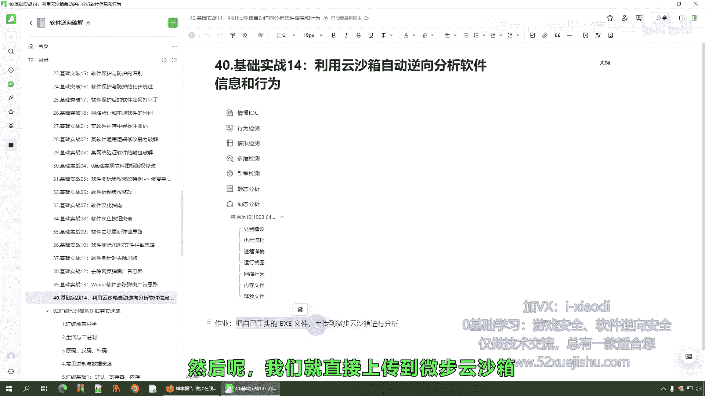
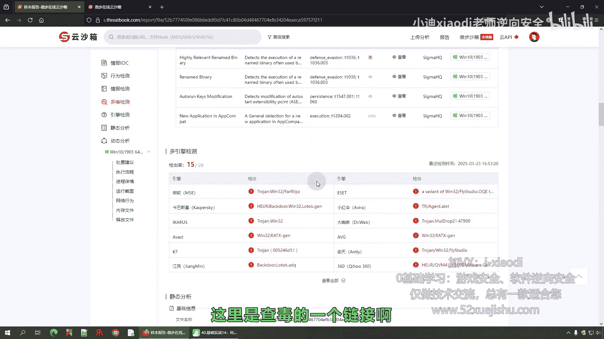
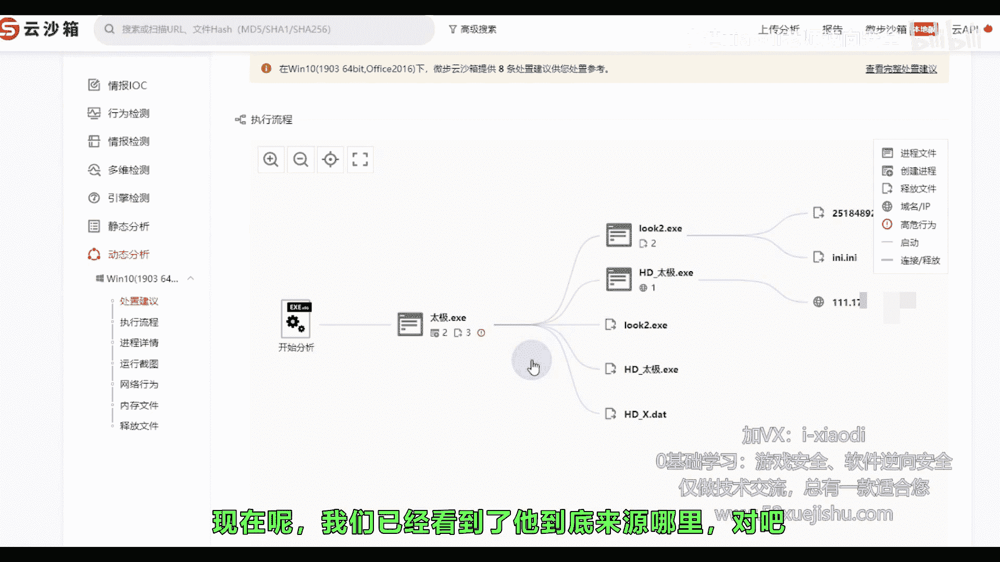
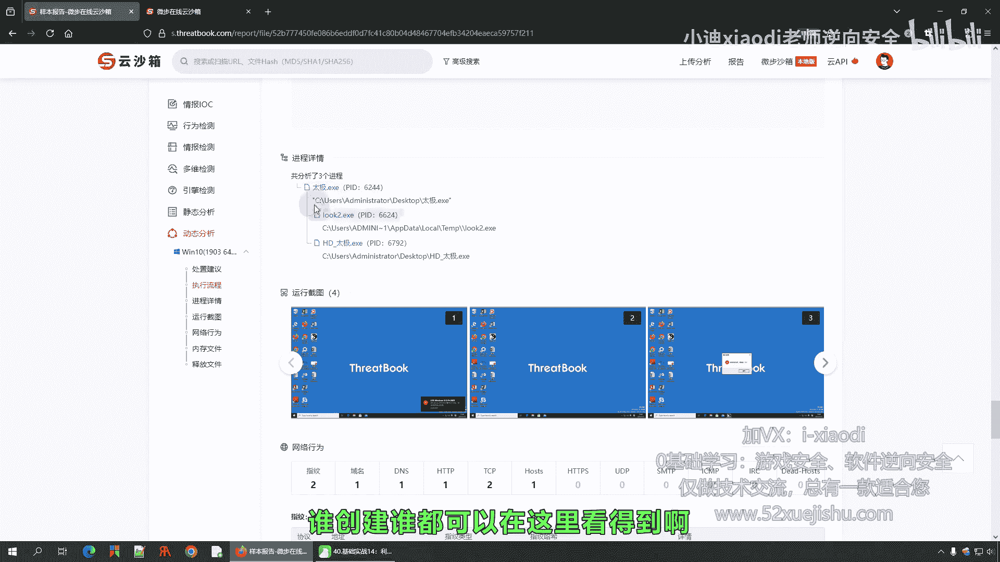
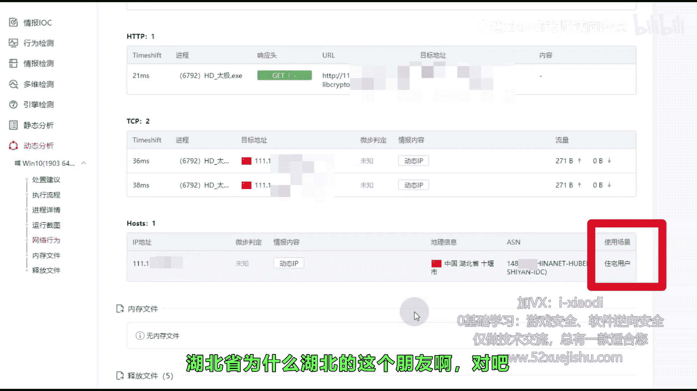
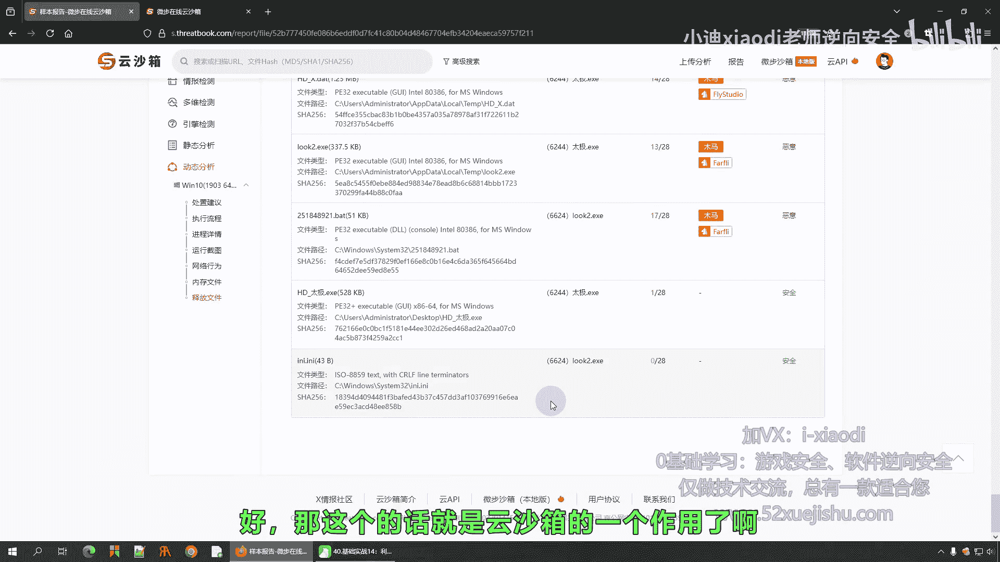
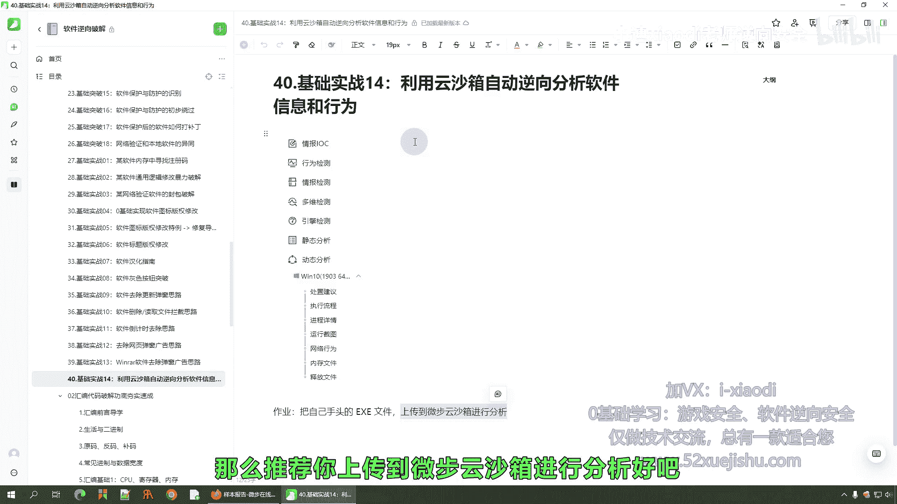

# 软件逆向分析实战：01：云沙箱自动识别恶意软件 🛡️


本节课我们学习如何利用云沙箱自动逆向分析软件的信息和行为。对于很多刚接触安全分析的朋友来说，拿到一个未知的EXE文件往往不知道如何下手。云沙箱能把分析过程自动化，大家应该都会喜欢这种省事的工具，毕竟都比较懒。


## 什么是云沙箱？☁️


先解决最基础的问题：云沙箱到底是什么？

从本质上看，云沙箱就相当于一台云电脑。只不过这台云电脑上部署了大量自动分析流程和软件程序，用来代替人工完成样本检测。用公式表示就是：


```text
云沙箱 = 云电脑 + 自动分析程序 + 威胁情报库
```


有了这套机制之后，它可以分析的内容非常丰富，包括是否包含病毒、软件的静态信息、软件的执行流程、网络行为、内存文件、有没有释放文件等等。总体上可以概括成下面这些维度：




```text
分析范围 = {
  病毒检测,
  静态信息,
  执行流程,
  网络行为,
  内存文件,
  释放文件
}
```


这些信息单独看可能比较零散，但组合起来就能对软件的可信度做一个初步判断。恶意软件的分析结果里往往会同时出现多个可疑特征。


## 上传样本到微步云沙箱 📤


上一节我们了解了云沙箱的基本概念，本节来看看具体怎么操作。假设手头有一个EXE文件，想快速知道它是不是有问题，可以直接把它上传到微步云沙箱。

微步云沙箱是一个在线云沙箱平台，不需要在本机安装复杂环境，打开浏览器注册登录就能使用。下面是具体流程：


1. 注册并登录微步云沙箱。
2. 进入控制台后点击“上传文件分析”。
3. 在弹出的窗口中点击“上传文件”，选择本地的EXE文件。
4. 等待平台自动分析完成，打开报告查看结果。


单个文件最大支持200MB，超过这个大小就没办法分析了。整体流程和平时上传文件到网盘差不多，只需要几个点击操作。




## 案例分析：一个带木马的样本 🦠


光看流程难免有点抽象，我们来看一个真实案例。我手上有一个别人传给我的软件，我也不知道最初是谁传过来的，对方只是让我帮忙分析一下。上传到微步云沙箱之后，分析结果显示这个软件实际上是一个恶意木马。


先看报告最上方的情报IOC区域。页面直接标记出了“恶意”字样，点击“解锁”之后可以看到更详细的情报，状态明确显示这是恶意软件。


继续往下拉，网络行为部分有一条“可疑的HTTP载荷下载行为”。这个行为说明软件运行后会从外部下载数据，下载请求指向一个IP地址。


再看一般行为。这一栏显示该软件存在“删除运行文件”的操作，也就是运行之后会把自己删除。这种行为在正常软件中非常少见，通常是为了抹掉痕迹，避免被追踪。




系统敏感操作部分同样值得注意。样本会在系统中创建文件，这些文件路径和名称都很可疑。把这几类行为放在一起看，可以断定这不是普通软件，而是典型的木马行为。




如果想系统地查看证据，不需要自己猜测，直接往下拉就能看到完整的执行流程。首先看到的是查毒链接，所有主流杀毒引擎的检测结果都显示为病毒，已经没有争议。


再往下看执行流程，这个软件运行后释放出了大量程序文件，释放出的程序还会继续连接外部IP。这些IP都属于攻击者的服务器，也就是隐藏在背后的黑客。通过IP定位，相当于直接把黑客的底裤扒了下来，来源地一目了然。


报告里还附带运行截图和进程分析。进程分析可以看到进程的父子关系，也就是谁创建了谁，这对理解恶意软件的启动链条很有帮助。运行截图则展示了软件运行时的实际画面。网络行为页面把所有连接过的IP都罗列了出来。


目标IP地址在报告里也能直接看到，全部是动态IP，归属地显示为湖北省。看到这里我忍不住有些感慨，为什么这个湖北的朋友要做坏事呢？当然，绝对不是说所有湖北人都做坏事，只是恰好这个样本的服务器位于湖北。


## 作业练习 📝




上面的案例演示了从样本到结论的完整流程。本节课的作业就是亲自动手练一练：把你手头现有的EXE文件上传到微步云沙箱进行分析。如果你是一个完全不知道如何分析的小白，推荐从自己的文件开始实践，好好阅读报告中的每一个模块。




## 总结 📌




本节课我们一起学习了云沙箱自动逆向分析的基础知识。先介绍了云沙箱的本质，理解它相当于一台部署了自动分析程序的云电脑，然后梳理了它能分析的内容，包括病毒检测、静态信息、执行流程、网络行为、内存文件和释放文件。接着演示了微步云沙箱的上传流程，并通过一个木马样本的案例学习了如何从IOC情报、网络行为、一般行为、系统敏感操作、执行流程、进程分析和IP归属地址这些角度判断一个软件是否危险。云沙箱的分析结论不一定全面，但对初学者来说已经是一份很明确的初步指引。今天的内容就到这里，我们下节课见。
