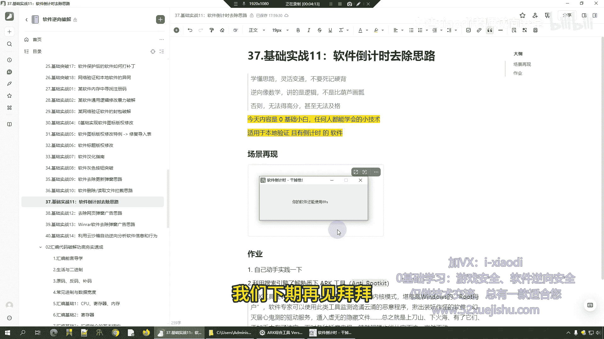

# 软件逆向破解实战：第1章：本地软件倒计时去除思路 ⏱️


## 课程概述 📖


在本节课中，我们将要学习如何去除本地验证软件中的倒计时限制。这是基础实战系列的第一课，今天这个内容是零基础小白乃至任何人都能够学会的小技术，而且操作起来非常简单。本方法适用于本地验证且有倒计时的软件。下面我们先来看看目标软件是什么样的，然后再一步步把它拿下。


## 1.1 观察目标软件 👀


首先，我们已经为大家准备好了实验用的软件。我们先把它运行起来。运行起来之后，大家可以看到它有一个30秒的计时。如果说这个计时走到了尽头，那么一般来说它就会提示"试用已到期"，然后就把你的功能给限制住了。

比如说它有什么所谓的VIP功能，或者说付费的体验功能。一旦这个倒计时时间到了之后，它就会把你的这些功能给停掉。一般来说在停掉之前还会有一个提示，我们稍等一下看一看：7、6、5、4、3、2、1。好，看到没有？软件界面显示"试用已到期"。

到了这个时候，你就只能去付费了。那么是否存在办法去绕过它？当然是有办法的，而且非常简单。


## 1.2 准备进程工具 🧰


要完成这次实验，我们需要借助工具包中的一款进程工具。打开工具包，在工具包众多的工具里边点击"进程工具"，然后在里边找到那个工具。这个名字比较特殊，你先别管它。我知道你感觉到它很奇葩，但是名字只是一个代号而已，不影响使用。我们把它运行起来。

如果说你这个程序运行不起来，你可以运行另外一个版本。这两个版本是一样的，一个支持Win10，一个支持Win11，看到没有？这两个图标都是一样的，我相信明眼人一看就能看出来。


## 1.3 核心原理：定时器与倒计时 💡


那么打开进程工具之后，映入眼帘的就是众多的进程。什么是进程？进程就是运行中的程序。在众多进程之中，你就能够看到我们的实验程序。那么怎么去操作？非常简单，直接鼠标右键，点击"查看"，再点击"查看进程定时器"。什么是定时器？你想一想，定时器有可能就是跟计时相关的功能。

这里我们先理清软件倒计时的核心原理，用公式和代码来描述就是：

```
软件倒计时的本质是定时器在做减法：
T(t) = T₀ - t

当倒计时归零时，软件触发到期逻辑：
if (T(t) <= 0):
    弹出"试用已到期"提示
    限制VIP/付费功能

破解思路：把定时器移除，让时间不再递减：
移除进程定时器 -> T(t) 不再变化 -> 永不触发到期
```

从上面的代码可以看出，整个限制机制完全依赖定时器不断把剩余时间减掉。那么我们怎么去突破、怎么去绕过？非常简单，把定时器给它干掉不就可以了。如何干掉定时器？鼠标右键，在常规操作中看有没有相关功能。有一个"移除"选项，直接点击移除，看到没有？定时器就移除了。


## 1.4 实战操作流程 🚀


不过这里有一个细节需要注意。刚才我们操作的时候，这个功能已经被限制住了，所以无法直接体现出倒计时被绕过。遇到这种情况怎么办？我们重新启动一下程序，然后重新操作一遍。

下面是完整的实战操作步骤：

1. 运行实验软件，等待倒计时出现。
2. 启动进程工具，在进程列表中找到实验程序"倒计时突破"的进程。
3. 在进程上鼠标右键，点击"刷新"，刷新一下进程列表。
4. 鼠标右键，选择"查看" → "查看进程定时器"。
5. 点击"移除"，逐个移除进程中的所有定时器。
6. 观察倒计时是否停止。如果还在走，就继续移除剩余的定时器。

我们按照这个流程来实践一下。启动程序，刷新一下进程。刷新完成之后，找到我们的"倒计时突破"进程。好，现在有20多秒的一个倒计时。然后鼠标右键，点击"查看进程定时器"，然后点击"移除"。

这里要特别注意：移除一个定时器可能没有效果。我们来看一下，看到没有？没有效果。没关系，继续把剩下的定时器也逐个移除。来，移除。看到没有？把定时器全部移除完之后，现在它就不再计时了，倒计时界面上的数字定住不动了。至此，这个软件的倒计时限制就被成功绕过了。


## 1.5 课程总结与作业 📝


最后我们来总结一下。软件的倒计时实际上就是软件中有一个所谓的定时器之类的东西在做一个减法。我们的操作手法就是利用工具有针对性地找到进程的定时器，然后鼠标右键把它移除。只要定时器被移除，倒计时就会停止，试用期的限制也就形同虚设了。

那么今天的内容就是这些。本次作业包含以下两个任务：

1. 第一个作业：自己动手去实践一下。拿这个小程序自己去操作一遍，感受一下整个流程。只有亲手做过一遍，印象才会深刻。
2. 第二个作业：利用搜索引擎，了解并熟悉一下AK工具。刚才我们所使用的那个工具就是一款AK工具。


什么是AK？AK的全称是Antrock。AK工具在Windows平台上非常强大，其中的内核模式堪称是Windows的root用户。总之就是非常强大，大家自己去搜索了解一下。



本节课中我们一起学习了本地软件倒计时去除的思路与方法。我们首先观察了目标软件的行为，发现它通过一个30秒的倒计时来限制功能；然后我们引入了进程工具，讲解了定时器的概念；最后通过移除进程定时器的操作，成功让倒计时停止，从而绕过了软件的使用限制。我们还了解了AK工具的基本概念。希望大家通过课后作业，能够自己动手复现这个过程，加深理解。我们下期再见。
