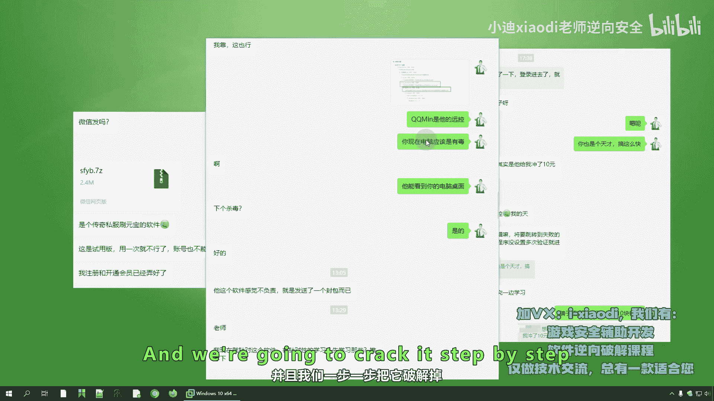
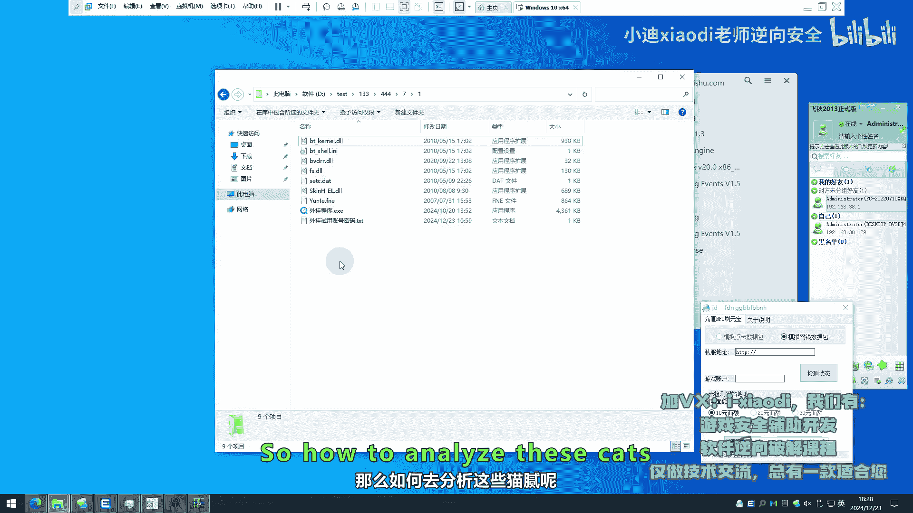
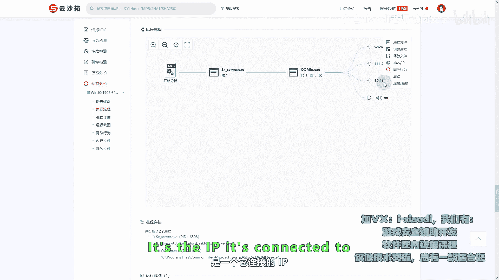
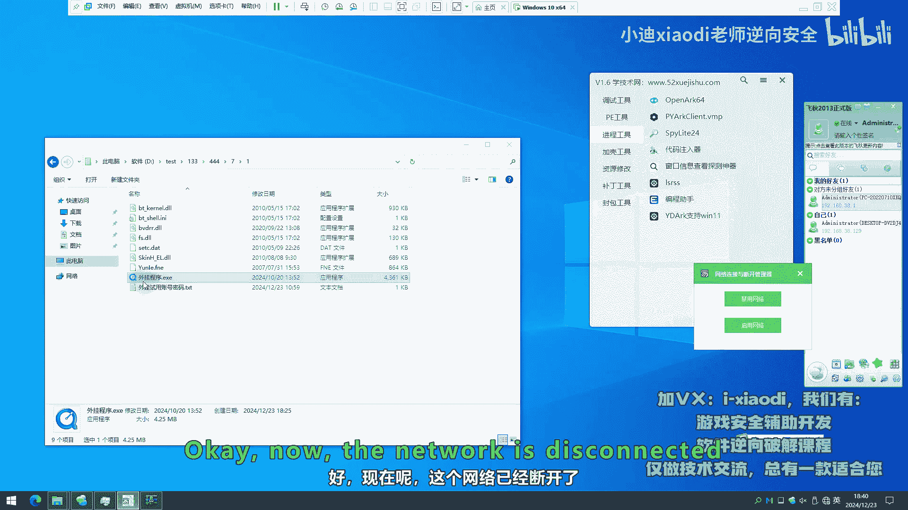
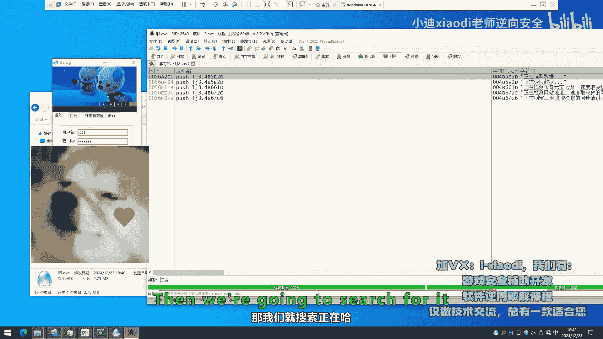
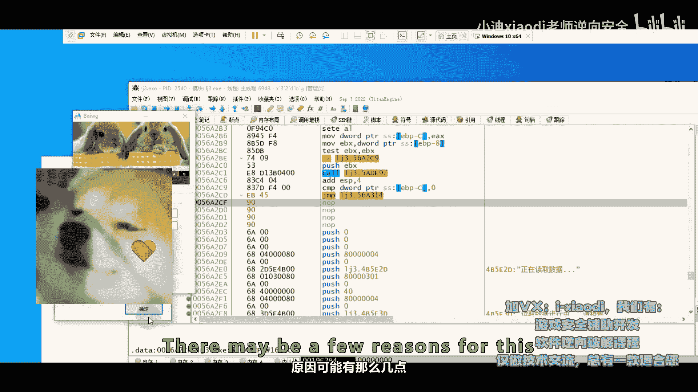
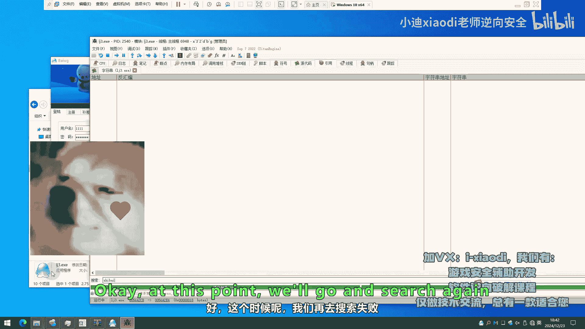
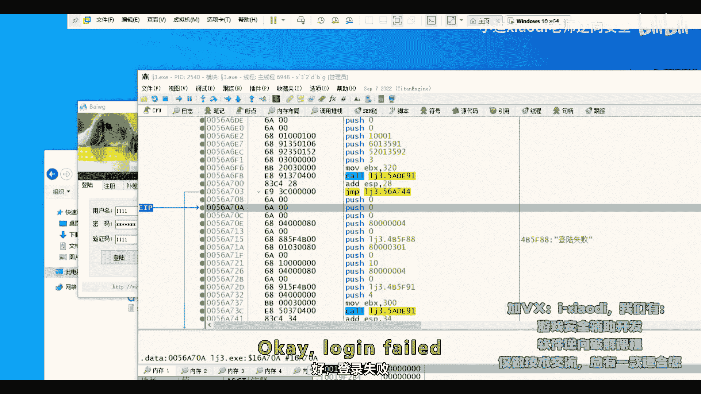
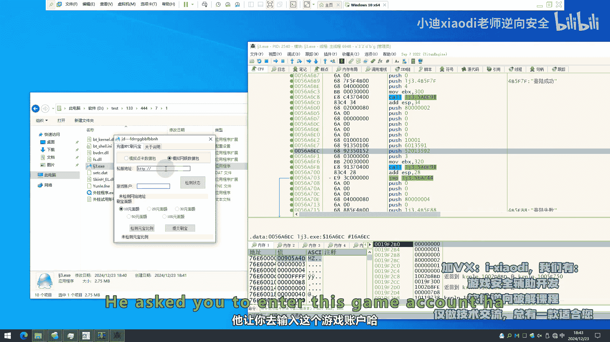
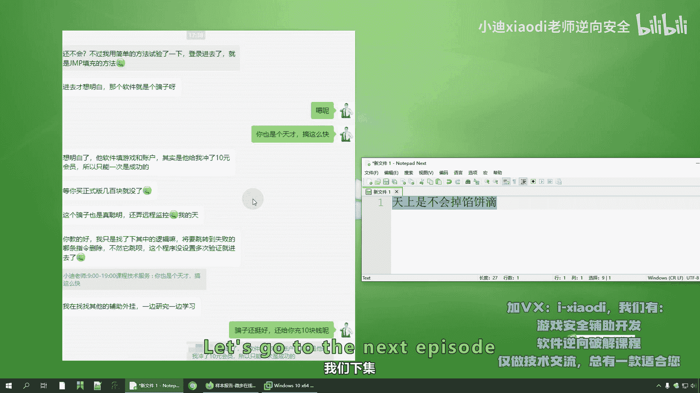

在本节课中，我们将一起学习如何分析一款号称能“刷元宝”的外挂软件。我们会先弄清楚软件逆向到底是怎么回事，然后分析一个真实的粉丝投稿案例，看看所谓的刷元宝软件背后藏着什么秘密。我们会用到微步云沙箱来检测恶意文件，再亲手用调试工具破解这个软件的登录限制。最终你会发现，这个外挂根本不是外挂，而是一个带着远程控制后门的木马程序。学完这节课，你不仅能了解软件分析的完整流程，还能明白这类骗局的真实套路，以后不会再轻易上当。

## 🛠️ 外挂卡密软件逆向破解：第1章：逆向分析与外挂骗局概览

### 1.1 什么是软件逆向

先来说说软件逆向这件事。很多人不太理解，学逆向到底能干什么？其实很简单，逆向就是让我们去分析一些程序，搞清楚程序内部是怎么运转、怎么工作的。程序在运行的时候会做很多事情，我们通过逆向把这些逻辑一点一点剥开，就能明白它背后的原理。

当我们通过分析找到了关键的代码位置之后，就可以去修改代码的逻辑。比如某个功能被限制了，我们可以把限制条件改掉，让程序按我们的想法去执行。这就是逆向的核心用途：读懂程序，然后根据自己的需求去改变程序的走向。

### 1.2 事件背景：粉丝投稿的刷元宝外挂

今天的内容来自一个粉丝的投稿。这位粉丝说，他手头有一个“传奇私服刷元宝”的软件，试用版只能用一次，第二次就不能用了，账号也登录不上去。他还说会员已经开通了，结果还是不行，于是来找我求助。

大家有没有听说过“刷元宝”这种东西？我一听就觉得不对劲。元宝是用人民币充值换来的虚拟货币，如果真能随便刷出来，那还不如直接刷人民币呢。元宝能刷，那人民币是不是也能刷？刷个十张一百张的，那不就发财了吗？所以这类号称能刷元宝、刷装备的软件，我基本上判断都是假的。

### 1.3 初步分析：发现木马与远程控制

中午的时候，我帮这位粉丝朋友简单分析了一下这个软件。不看不知道，一看吓一跳。这个软件实际上是有后门的，它带有远程控制功能，可以远程监控你的电脑桌面，甚至可能打开你的摄像头。我当时的反应就是：这个软件的作者胆子也太大了。

这里要严肃地提醒大家几点。首先，刷元宝这个东西本身是诈骗。如果软件是假的，作者收了钱却不兑现承诺，那就已经涉及诈骗罪了。其次，这个软件还释放木马，这就涉及非法控制计算机信息系统罪了。这两条罪名加在一起，不是闹着玩的。所以学到的技术一定要用在正道上，比如用来做漏洞研究、安全防护、技术交流，千万不要动歪心思。

粉丝朋友对我们这边的内容非常感兴趣，决定加入学习。经过一段时间的学习之后，他回过头去再研究这个软件，发现它实际上就是一个彻头彻尾的骗子程序。而且他通过自己学到的逆向技术，成功突破了软件的限制，直接登录了进去。登录进去之后，他发现里面根本没有什么刷元宝的功能，就是一个空壳。

### 1.4 骗子的钓鱼套路

最后我跟他调侃了一句：这个骗子还算“良心”，至少给你充了10块钱。但你想过没有，他为什么要给你充这10块钱？这叫作舍不得孩子套不着狼。他给你充10块钱，是为了吊住你，让你相信这个软件真的能用，然后等你掏几百块钱去买他的“正版”。用10块钱的诱饵，钓走你几百块钱，这个账算得太精了。

接下来我们就来详细演示一下，如何一步步分析这款所谓的“刷元宝软件”。你会发现，它其实是一个木马，而且破解过程比想象中还要简单。



## 🕵️ 外挂卡密软件逆向破解：第2章：恶意文件分析与沙箱取证

### 2.1 解压样本：明目张胆的“外挂程序”

把粉丝朋友发来的压缩包解压之后，目录里多出了好几个文件。其中一个文件的文件名非常嚣张，直接写着四个大字：“外挂程序.exe”。敢这么明目张胆地把自己叫作外挂程序，这个作者也是挺猖狂的。

当然，我们绝对不能直接双击运行这个文件。原因很简单：一个真正的“外挂”怎么可能让你白嫖？它肯定在背后做了手脚。这种来路不明的程序，运行起来可能会修改系统设置、窃取账号信息、释放恶意软件，甚至把你的电脑变成被人操控的傀儡机器。所以必须先在一个安全可控的环境里分析它，搞清楚它的行为之后再决定怎么处理。

### 2.2 使用微步云沙箱分析样本

分析这类可疑文件，我们需要借助一个非常好用的平台，叫作“微步云沙箱”。大家可以直接搜索这个名字，找到官网之后，把“外挂程序.exe”这个文件上传上去。平台会自动开启沙箱分析，等它跑完整个分析流程就可以了。

分析完成之后，界面上会展示这个程序的各项行为记录。分析结果让人非常不安，这里面的行为几乎都是高度敏感的，甚至还包括关闭操作系统的动作。一个正经的软件，正常来说根本不需要执行这种操作。

我们把页面往下拉，找到“执行流程”这个区域。这里可以看到外挂程序的具体执行过程：它运行起来之后，释放了其他软件，而这些被释放出来的软件又继续做了其他操作。这说明外挂程序本身只是一个启动器，真正的恶意代码藏在后续释放的文件里。



### 2.3 分析释放出的LG3.exe

接下来我们对释放出来的文件逐个分析。首先在电脑磁盘中找到了一个名为`LG3.exe`的程序。我们按同样的操作流程，把它上传到微步云沙箱，然后直接点击“执行流程”查看行为。

在这个执行流程里，我们看到了一个非常敏感的信息：有一个IP连接。IP连接意味着程序在运行期间会主动连接到某个远程服务器，这个行为通常和远程控制、数据回传有关。因为这个IP属于敏感信息，我在演示中做了遮挡处理。但我们可以确定，这个IP连接就是它进行远程控制的核心证据。

### 2.4 分析释放出的SX.exe

接着，我们在磁盘里又找到了另一个文件，叫`SX.exe`。用同样的方法，把它上传到微步云沙箱。这次沙箱直接给出了一个非常明确的威胁判定：后门。

后门是什么？这里给大家解释一下。后门是一类允许攻击者远程控制主机的木马病毒。攻击者通过构造隐蔽的通信通道，绕过系统的正常认证机制，从而在受害者不知情的情况下完全控制这台电脑。简单来说，有后门的电脑就像是被人悄悄配了一把钥匙，攻击者随时都可以开门进来做任何事。所以这个`SX.exe`才是真正的后门本体，其他文件都是辅助它实现恶意功能的组件。

我们点击执行流程继续看。这个后门程序会释放一个`QQmin.exe`文件，故意取一个和腾讯QQ相关的名字，让人误以为它是腾讯出品的合法程序。但实际上它和腾讯没有任何关系，只是用来伪装自己、躲避用户怀疑的幌子。在流程图的右边，还能看到它连接的IP地址。综合这些信息，可以确定这个所谓的“外挂程序套装”就是一个彻头彻尾的恶意木马。

## 🔓 外挂卡密软件逆向破解：第3章：逆向破解实操



### 3.1 实操前的环境准备

现在我们来动手演示这个软件的逆向过程。实话实说，这个软件薄得像一层纸，破解它的难度并不高。我们逐步来看是怎么做到的。

先理清一个关键概念：`外挂程序.exe`并不是真正的外挂功能主体。它扮演的角色是“释放器”，负责把真正的木马程序和界面程序释放到电脑里，然后启动它们。真正的外挂界面，其实是`LG3.exe`。

同时要注意，这个木马要生效，必须联网才能实现远程控制。所以在实操过程中，我们要使用网络连接管理工具，先把网络禁掉。这一步非常重要，和拆炸弹之前先剪信线是一个道理，我们不给它连接外部服务器的机会，就不会造成实际损失。把网络断开之后，我们就可以放心大胆地运行外挂程序了。

### 3.2 运行样本并定位目标进程



断开网络之后，我直接运行了`外挂程序.exe`。运行起来之后，打开任务管理器查看进程列表，能看到两个关键进程已经跑起来了：一个是`QQmin.exe`，这个伪装成腾讯组件的后门进程；另一个就是`LG3.exe`，它是外挂程序的界面主体。

接下来我们要确定，当前屏幕上可能弹出的那个外挂窗口到底属于哪个进程。可以通过图标的样式来辨认，工具栏里那个图标就是LG3的。我们也可以使用一个叫SpyLite的工具，把它的瞄准器拖放到窗口上，直接查看这个程序的真实身份。结果显示，这个窗口就是`LG3.exe`。

### 3.3 提取样本并观察程序行为

找到目标之后，我们把`LG3.exe`提取出来。用工具定位到它的释放路径，在磁盘目录中往下翻，就能看到`LG3.exe`。两个母体都被释放到了同一个目录下。把`LG3.exe`复制到我们自己的工作目录里，这样就可以脱离原启动器单独调试它了。

用调试工具打开这个程序，先观察它的界面。界面上有用户名输入框和验证码输入框，但目前验证码加载不出来。点击登录按钮，程序一直没有反应，好像卡住了，只显示“正在读取数据”之类的提示。这个提示其实就是程序的一个状态反馈，我们可以通过它来定位关键代码位置。

### 3.4 通过字符串搜索定位关键代码

因为程序没有加壳，也没有做任何保护措施，我们可以直接进行静态分析。在调试工具中搜索当前模块的字符串，输入“正在”这个关键词，果然找到了“正在读取数据”这个字符串所在的位置。

下一步，我们在这个位置打一个断点，然后再次点击登录。程序运行到断点时停了下来，说明它确实会走这条路。这个“正在读取数据”只是一个延迟性质的提示，并不是真正的功能逻辑。我们尝试跳过它，方法很简单：把这个位置的`JE`条件判断指令改成`JMP`，也就是跳转指令。这样不管条件成不成立，程序都会直接越过这个提示。

修改完断点之后，再点击登录。这个时候，程序又弹出另一个提示：登录失败。下面列出了可能的原因，比如“VIP期限已到期”之类的话。问题来了，我们从来没有开通过什么VIP，哪来的到期？这明显是恶心人的假提示。

### 3.5 定位登录成功判断并绕过校验



别急，我们继续搜索“失败”这个关键词。很快就能定位到“登录失败”字符串所在的位置。在这里打一个断点，再次点击登录，断点果然命中了。说明程序确实会走这个分支。

接下来要弄清楚，程序是从哪个地方跳到这个“登录失败”分支的。在调试工具中右键选择“查找引用”，选定当前地址之后，就能看到跳转来源。原来跳转来自一个逻辑判断的位置，这个位置就是登录成功与登录失败的分岔口：如果判断条件成立，就走登录成功的分支；条件不成立，就走登录失败的分支。

也就是说，只要我们找到这个判断并把它废掉，程序就会一直往下执行到登录成功。操作方法是：把这一整段校验逻辑全部用`NOP`填充。`NOP`是一条空指令，CPU执行它的时候什么都不会做，相当于把这段逻辑从程序里彻底抹去。这样一来，程序无论什么情况都会顺利走到登录成功的位置。

修改完成后，再次点击登录。这一次界面直接显示“登录成功”，心情非常舒适。然后点击“呼出外挂”按钮，外挂界面就完整地打开了。



到这里，这个自称“刷元宝”的外挂软件就被我们完全破解了。整个破解过程可以归纳为三步：搜索关键字符串，定位判断逻辑，修改汇编指令。没有任何高深莫测的技术，关键是要有条理地找到入口。



## ⚠️ 外挂卡密软件逆向破解：第4章：骗局原理与安全警示



### 4.1 骗局的真实运作原理

现在我们来把整个骗局的运作机制彻底说清楚。这个软件的“工作原理”是这样的：

你下载软件之后，软件会要求你输入游戏账户。你以为它要帮你刷元宝，但其实这个信息是被当成“鱼饵”来用的。软件的作者，也就是那个骗子，通过后门远程监控你的电脑桌面。如果你真的输入了游戏账户，或者后台真的收到了消息，他会先给你充10块钱进去，然后跑来跟你说：“你看，充值成功了吧？我的软件是能用的。”

接下来才是重点。骗子会告诉你，免费的试用版只能享受一次，想要继续用，就得购买正版激活码，正版价格要好几百块钱。很多不太懂行的小白朋友，看到对方真的给自己充了10块钱，就以为这个软件是真的，立刻掏钱买了正版。然后呢？几百块钱就再也回不来了。

我们可以用一个简洁的公式来描述这个诈骗逻辑：

```text
信任成本 = 10元
话术 = “我已经帮你充了10元，软件是能用的”
收益 = 受害者支付几百元购买“正版”
利润率 = (收益 - 信任成本) / 信任成本 = 几十倍
```

这个套路说白了就是小额诱饵换大额上钩。10块钱是鱼饵，几百块钱才是真正的目标。

### 4.2 天上不会掉馅饼

所以大家看完这个视频之后一定要记住一个道理：天上不会掉馅饼。怎么可能会有“刷元宝”这种东西存在呢？如果元宝真的能刷，那为什么不能直接刷人民币？刷个十张一百张的，那不就实现财富自由了吗？所有人都不用上班了，岂不美哉？

世界上没有免费的午餐。遇到任何打着“刷钱”“刷装备”“刷元宝”旗号的软件，先在心里打个问号：如果它真有这种本事，为什么不自己闷声发大财，反而要拿出来卖给你？

### 4.3 课程总结

本节课中，我们一起学习了软件逆向的基本概念，了解了如何通过分析程序来读懂它的行为逻辑。我们以一个真实的刷元宝外挂为案例，从解压样本开始，用微步云沙箱对恶意文件进行了动态检测，识别出了后门程序`SX.exe`和伪装进程`QQmin.exe`，确认了整个软件就是一个带有远程控制木马的诈骗工具。然后我们动手实操，通过禁用网络、字符串定位、修改汇编指令等方式，绕过了登录验证，成功打开了外挂界面。



与此同时，我们也彻底看清了这类骗局的完整链路：先用10块钱骗你再交几百块“正版费”，整个过程伴随着木马对电脑的远程监控。这节课的核心收获不只是掌握调试工具的使用方法，更重要的是建立一种怀疑精神：任何程序都可以通过逆向手段看清楚它的真面目，任何骗局都可以拆穿它的逻辑漏洞。希望你把学到的技术用在正途上，用来分析恶意软件、保护自己和他人的安全，而不是用来搞破坏或者去骗别人。



我是小迪老师，我们下节课再见。

