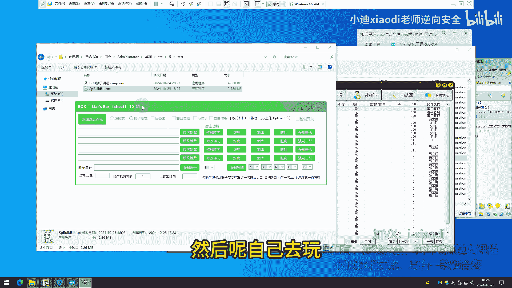

# 🔧 软件逆向破解实战：第一章：外挂卡密软件破解技术分析

大家好，我是小迪老师。很多朋友可能会问：学习逆向破解到底能干什么？生活中其实有很多可以应用的地方。比如最近有一款游戏叫《骗子酒馆》，它本质上是一个打牌游戏，竞争性并不强，但这个游戏居然出现了外挂。这个外挂的功能包括炸盘、强制击杀、必赢等等，可以说相当破坏游戏平衡，也对正常玩家造成了很差的体验。更让人无语的是，它不但收费，还内置了“反挂逼”功能——一个开挂的人去反其他开挂的人，这确实有点讽刺。当我们掌握了逆向技术以后，就可以对这类软件进行分析。至于分析之后想实现什么功能，完全可以根据自己的需求来定。比如，你可以把它的付费验证给突破掉。今天，我们就来演示这个过程。

这个案例是大家提供给我们的一个真实样本。这个辅助软件的名字大概是“Box 骗子酒吧”之类的。在加入学习之后，经过一段时间的指导和实践，我们成功把它“弄开”了。弄开之后有没有效果呢？有效，这个辅助确实可以使用。下面我们就来实际看看它的破解过程。

## 🧩 第一步：检查程序是否有壳

拿到一个目标程序，不要急着破解，先看它有没有壳。在分析任何程序之前，第一步永远是查壳。壳可以理解为包裹在程序外面的一层“保护套”，它的作用是隐藏程序的真实代码、防止直接调试或修改。我们可以用一个简单的公式来表示加壳后的程序：

`加壳后的程序 = 壳代码 + 原始程序`

这个辅助程序确实有壳。这种壳大概率是网络验证自带的那种一键壳。好消息是，这种壳通常都能脱掉。我们用 `ESEinPE` 这个工具来看一下。把程序拖进工具窗口后，可以看到它有一些附加数据。这里我们直接运行一下程序，继续下一步分析。

## 🌐 第二步：分析网络验证与本地转向

程序运行正常，接下来就要分析它的网络验证了。看到这里，经常看我们社区视频的朋友应该会觉得非常眼熟，因为这类流程在社区视频中都讲过。如果你也想完整学习这类技术，可以加入课程，我们会有更系统的讲解。学习之后你会看到什么效果？我们用自研的工具打开目标程序，就能开始分析了。我们这个软件之前已经分析过，所以这个方法是可行的。其他类似软件也可以参考这套思路，但前提是你要做足够多的技术研究和分析。

首先在工具中找到《骗子酒馆》这个进程。这里可以看到主程序是 x64 版本。接下来，把端口改成 `9003`，因为我们这边本机运行了一台本地服务器。然后启动“转向”功能，让网络验证请求不再走向官方服务器，而是全部转发到本地服务器。这一步是整个破解的关键，而这么做的基础，正是前面分析得到的验证逻辑。用伪代码来表示就是：

```python
# 官方验证流程
client -> remote_server(卡密) -> 返回验证结果

# 破解后的流程
client -> local_server(卡密) -> 始终返回成功
```


## 🎴 第三步：生成卡密并登录

转向完成后，接下来就是“开卡”。我们已经在本地服务器里把卡密规则设置好了。操作很简单：先生成一张测试卡，然后点击“所有卡号”，就能看到刚生成的卡号。复制这个卡号，回到辅助程序里点击登录。看，这样就直接登上了。登录成功后点击确定，稍等片刻，辅助程序就运行起来了，而且可以直接使用。

这里需要说明的是，整个过程并不复杂，但每一步都需要有前期的逆向分析作支撑，并不是随手就能完成的。对于初学者来说，重点在于理解“验证流程被重定向”这一核心思路。

## 🕶️ 第四步：辅助本体的隐藏与释放

这个辅助还有一个很有意思的地方。当我们把外壳破解掉之后，会发现辅助的本体可以隐藏起来。这个软件的真正主体其实带有一个“隐藏”属性。说白了，这个程序本身更像一个“释放器”：它负责把真正的辅助程序释放到系统里，然后再启动它。用公式表示就是：


`释放器 = 解压资源 + 写入临时文件 + 启动真正的辅助程序`

我觉得这个作者还是挺有趣的，当然这不是攻击，只是调侃。当我们把这个外壳程序关掉之后，会发现根本不需要那个外壳，直接运行真正的辅助程序就可以了。这个直接运行的版本才是辅助的本体，很有意思。

## 📌 总结与提醒

本节课中，我们一起学习了如何对一个带有网络验证的卡密软件进行分析。回顾整个流程，主要有以下几步：

- 第一步：用 `ESEinPE` 检查程序是否有壳。
- 第二步：找到目标进程，把网络验证转向到本地服务器。
- 第三步：在本地服务器上生成卡密，完成登录。
- 第四步：发现并运行被释放出来的辅助本体。

核心思路就是：加壳并不可怕，网络验证也可以通过转向本地服务器来绕过。



最后一定要提醒大家：掌握这些技术之后，一定要保持低调，不要到处声张。自己学习、自己研究、自己使用就好。本期内容就到这里，我们下期再见。
