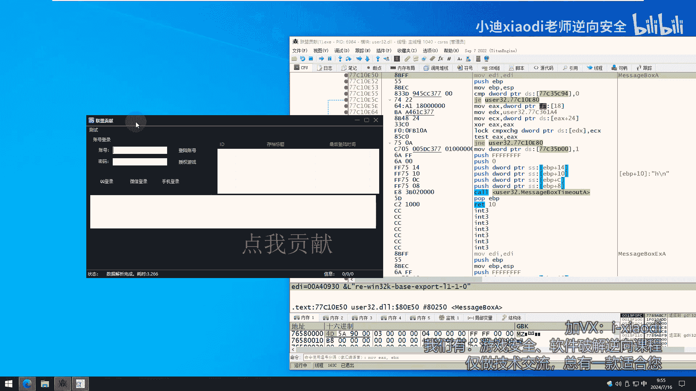

# 软件逆向破解读本：第一节：实战网络验证卡密爆破 👨‍💻

## 📖 本节概述

在本节课中，我们将要学习如何通过单步分析的方式，对一个带有网络验证卡密功能的软件进行爆破。爆破的核心思想，就是利用软件自身暴露的特征（比如弹窗提示），找到关键的代码逻辑，然后修改程序的执行流程，从而绕过验证。我们会用一个实际软件来演示整个过程，包括如何附加进程、如何下断点、如何找到关键跳转并修改它。通过本节课的学习，你能理解软件破解的基本思路，并掌握一些调试工具的基本用法。

## 🧠 什么是爆破法

爆破法，简单来说，就是程序在判断卡密是否正确时，必然有一个“是”和“否”的分岔路口。我们不去管它怎么计算卡密，直接把这个分岔路口的路标给改掉，让程序永远走“是”的那个方向。

这整个过程，主要就是靠单步分析。单步分析的意思就是根据这个软件具备的一些特征来逐步定位代码。比如说，这个软件有一个“卡密登录”的按钮，当我们点击登录时，如果卡密错误，程序就会弹出一个信息框来提示我们。这个信息框，就是程序自带的一个“信号灯”。

这个信息框在Windows编程中通常是通过一个叫`MessageBox`的函数来实现的。我们只要在调试器里给这个函数下一个断点，当程序准备弹出提示框的时候，就会立刻被我们拦截下来。

拦截下来之后，这个断点会停留在`MessageBox`函数的内部。此时，我们需要从函数内部“跳出”，返回到调用这个函数的上层代码。只要找到了这个上层代码，我们就能追根溯源，顺藤摸瓜地找到判断卡密是否正确的那条关键逻辑。

这个核心思想，可以用如下公式概括：

```text
分析关键特征(弹窗) -> 下断点拦截 -> 回溯调用位置 -> 定位验证逻辑 -> 修改跳转(爆破)
```

## 🛠️ 环境准备与附加进程


好，理论说完了，我们来看实际操作。打开我们的目标软件，可以看到界面非常简洁。我们先别急着操作，第一步要做的是把这个正在运行的程序“挂”到调试器上，这个过程叫做附加。

在调试器中，我们点击“文件”菜单，然后选择“附加”选项。这时会弹出一个进程列表，我们找到目标程序的进程，选中它，点击确定。

附加成功之后，调试器会加载这个程序的所有模块。为了更方便地分析，在“模块”窗口中，我们要切换到程序的主模块，也就是程序自己代码所在的那个模块。点击“符号”标签，就能按照模块来查看程序的导出函数和结构。我们大致浏览一下这个程序，可以看得出来，程序的主要逻辑都在这个主模块里，这就为我们的下一步分析打下了基础。

## 🎯 下断点定位信息框

接下来，就是我们的重头戏了。我们刚才提到，程序在判断卡密错误时会弹出一个信息框。这个信息框的底层实现函数是`MessageBoxA`。因为这是一个32位的程序，所以我们关注`MessageBoxA`这个版本。

在调试器的命令框中，我们输入`bp MessageBoxA`，然后回车。这个命令的意思就是在`MessageBoxA`函数的第一行代码处下一个断点。这个断点就像是在高速公路上设置了一个检查站，任何车辆（程序调用）经过这里都会被拦下来。

现在，万事俱备，只欠东风。我们回到软件界面，点击那个“登录卡密”按钮。如果卡密验证失败，程序就会调用`MessageBoxA`来提示我们，而这一调用，就会立刻触发我们设置好的断点，程序也会随之暂停下来。

此时，我们可以在调试器的代码窗口中看到，光标已经停在了`MessageBoxA`函数内部的一条指令上。这说明我们已经成功拦截到了信息框的调用。

> 备注：如果在点击登录之前不小心先触发了其他地方的信息框，可以把已经断下的断点先禁用或删除，然后重新点击登录按钮，确保我们断在的是验证卡密的信息框上。

## 🧅 单步执行与回溯调用栈

现在，我们已经断在了`MessageBoxA`里面。但这里只是信息框的实现代码，并不是我们真正要找的地方。我们需要知道是什么代码调用了`MessageBoxA`，才能找到上游的验证逻辑。程序的函数调用关系就像洋葱一样，一层包着一层。`MessageBoxA`就是洋葱最中心的那个点，我们需要一层层地往外剥。

这就要用到两个非常重要的调试快捷键了。它们并不神秘，只是调试器预先设置好的功能键，具体如下：

- **运行到返回 (`Ctrl+F9`)**：这个操作会一直往下执行代码，直到当前这个函数执行完毕遇到“返回”指令（也就是汇编中的`ret`）时才停下来。
- **单步执行 (`F8`)**：这个操作是每次只执行当前的一行代码，执行完一行，程序就暂停，然后我们再看下一行。它可以让我们像放慢镜头一样，一步一步地观察程序的行为。

> 很多初学者可能会问，`Ctrl+F9`和`F8`到底是什么意思？其实`Ctrl+F9`就是“运行到返回”，`ret`是汇编语言中“返回”的意思，如果看不懂`ret`，说明汇编基础还需要加强。`F8`就是“单步”，每次只走一步棋。这两个都是调试器自带的快捷键，我们可以通过点击调试菜单，看到对应的名称，比如“运行到返回”和“单步执行”。

那接下来我们怎么做呢？我们按下`Ctrl+F9`。程序会开始运行，直到`MessageBoxA`这个函数返回。因为代码执行到`ret`之后，会有一个信息框弹出来，这是正常的。我们关掉这个信息框，然后按一下`F8`，这个操作叫“单步跳出”。此时，我们就把“洋葱”拨开了一层，来到了“第一层”。

在这一层里，我们仔细观察代码，会发现一个问题：上面的代码中没有关于“登录失败”这一逻辑的判断跳转，也就是没有那一个跳转指令可以让我们跳过失败的信息框。所以，这一层并没有关键数据。我们姑且称它为“洋葱的第一层”，它只是一个中转站，把我们带到了上一层。

我们继续重复上述操作，再次按下`Ctrl+F9`，再按`F8`，就像剥洋葱一样，我们又来到了“上一层”。细心观察这一层的代码，你会发现，这一层实际上也没有一些大型的跳转逻辑，它可能只是处理了一些窗口消息的传递。虽然这里有一个`MessageBox`的调用，但因为我们刚才弹出了窗口，所以这里的调用已经被执行了，这一层也不是我们要找的地方。

## ⚡ 定位关键跳转：爆破

我们接着按`Ctrl+F9`和`F8`，连续拨开了两层，现在是“洋葱的第三层”。到了这一层，你会发现情况不一样了。我们仔细看，这里刚好有一个跳转指令，把我们前面看到的“登录失败”逻辑给包住了。这里有一个判断，当某个条件成立时，程序就会跳过下面“登录失败”的代码块。

你看，这边写着“登录失败”，那它上面不远处，必定有一个“登录成功”的对应代码。果然，我们看到了一个“登录成功”的字符串。那这个跳转指令就起到了决定性的作用：如果跳转不成立，程序就会走向“登录失败”；如果跳转成立，程序就会跳过失败，直奔“登录成功”。

找到这个关键的跳转指令后，我们的目标就非常明确了。我们要让它“永远成立”。在汇编里，改变指令行为最直接的方法，就是把这条跳转指令变成一条“空指令”，也就是什么都不做的指令。

这个时候我们要用到`二进制->NOP填充`功能。我们选中这条关键跳转指令，然后按空格键或者右键选择“二进制”，在子菜单中选择“NOP”。`NOP`是`No Operation`的缩写，意思是“不执行任何操作”。我们可以用如下代码来理解这个过程：

```text
修改前: 00401000  JE  00401020   ; 如果条件成立，跳转到成功分支(爆破点)
修改后: 00401000  NOP           ; 什么都不做，直接执行下一行，进入成功分支
```

这样，无论程序的条件判断是什么，它都不会再跳走了，而是会像流水一样，自然地往下执行，一直执行到“登录成功”的代码块。我们在调试器中直接对这条指令进行编辑，把它的机器码改成`90`（也就是`NOP`指令的机器码），就大功告成了。


## ✅ 验证爆破结果

现在，让我们来验证一下爆破的成果。我们可以在调试器中点击“运行”按钮，让程序继续执行。之前我们下的`MessageBoxA`断点已经没有用了，甚至可能会干扰我们验证，所以我们可以先把那个`MessageBoxA`的断点放开或者说删除掉，避免再次被拦截。

我们回到软件界面，重新输入一个错误的卡密，然后点击“登录卡密”。这次，奇迹发生了，软件竟然提示“登录成功”。爆破成功了！之后，程序就会以合法用户的状态运行，不再受卡密的限制了。



```text
爆破前: 输入错误卡密 -> 信息框提示"登录失败"
爆破后: 输入任意卡密 -> 程序提示"登录成功"
```

## 💎 总结

本节课中，我们一起学习了软件逆向破解中非常经典的一种方法：爆破法。我们以实战的方式，从一个带有网络验证卡密的软件入手，完整地走了一遍分析流程。我们首先要利用程序的特征（如弹窗），通过给`MessageBoxA`下断点来拦截程序。然后，利用`Ctrl+F9`（运行到返回）和`F8`（单步执行）这两个快捷键，像拨洋葱一样，一层层地回溯函数的调用栈。最终，我们在最核心的验证逻辑处，找到了那个控制着“登录成功”和“登录失败”的关键跳转，并使用`NOP`填充技术修改了这段逻辑，从而实现了爆破。

爆破的本质，就是去修改程序的执行走向，让条件判断永远站在对我们有利的一边。这个过程，需要我们对汇编指令和函数调用栈有一定的理解。希望同学们能够动手操作，真正掌握这个技能。这个爆破教程的源码和程序，我们都会整理好分享给大家，我们下期再见。
