# 软件逆向破解实战：01：检查壳与区段 🔍

在本节课中，我们将学习如何破解一款透视自瞄CF辅助。该辅助采用网络验证机制，我们会通过逆向分析、搭建山寨验证服务器、IP转向等手段实现登录，并修改到期时间。整个过程面向初学者，用大白话解释每一步。

首先，我们需要获取目标程序。这个辅助是一个独立的可执行文件。运行前，先检查它的壳和区段。使用PE查看工具加载该程序，查看区段信息，发现它没有加壳。这说明辅助作者可能刚学习编写辅助，还没有掌握加壳技术。无壳程序的分析难度较低，可以直接进行内存调试。

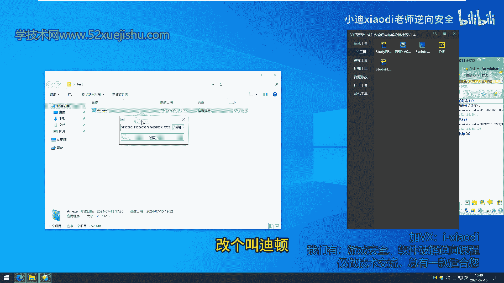

运行该程序，不输入任何卡号，直接点击登录按钮，程序提示“服务器未开始测试登录功能”。接着输入一个不存在的卡号，提示“卡号不存在”。这个登录界面非常眼熟，它类似于云盾、异之盾等网络验证系统。由于这类验证系统的源码已经开源，国内很多开发者直接抄来抄去，再改个名字，比如改叫“迪顿”之类。所以我们可以利用已知的验证协议进行破解。

整个验证流程可以描述为：

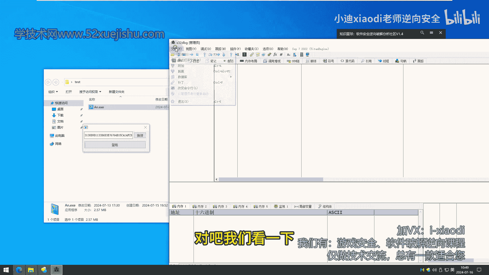

```text
客户端 -> 连接IP:端口 -> 发送软件名/版本号/卡号 -> 服务端验证 -> 返回剩余时间
```

# 软件逆向破解实战：02：定位网络验证关键信息 🎯

上一节我们确认了目标程序无壳，并了解了它的登录界面。本节中，我们来看看如何定位网络验证的关键信息。

启动目标程序后，打开调试器，点击“文件”->“附加”，选择目标进程，并切换到程序主模块。然后使用字符串搜索功能，扫描程序中的可见字符串。虽然作者对部分代码进行了VM虚拟化处理，但效果并不显著，关键字符串仍然暴露。

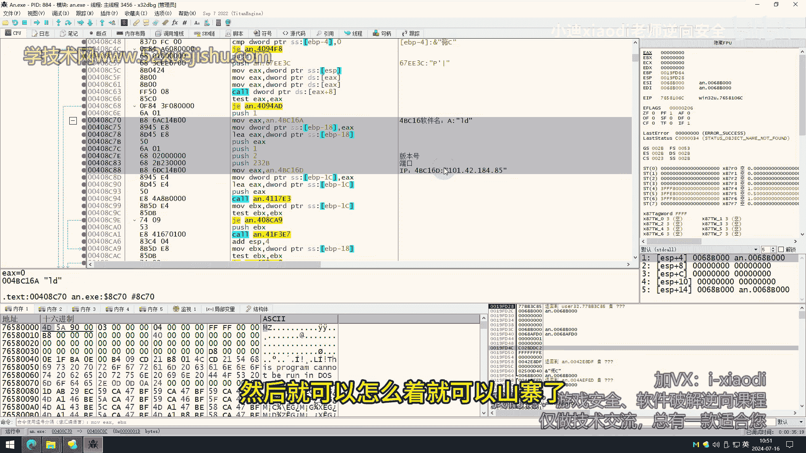

我们双击搜索到的关键字符串，跳转到对应地址，可以看到如下信息：

- IP 地址
- 端口号
- 软件名称

为了确认这是什么验证系统，我们观察到一个十六进制值 `0x232B`。使用系统计算器，输入该十六进制数，切换到程序员模式，转换为十进制为 `9003`。查询异之盾官方文档可知，端口 `9003` 对应“异之盾”验证系统。官方示例（卡模式登录）中展示了关键字段，包括 IP、端口、版本号（此处为 `2`）和软件名。因此，我们提取到了以下关键信息：

```text
IP: 待定（从程序内存中取得）
端口: 9003
软件名称: LD
版本号: 2
```

有了这些信息，我们就可以开始搭建山寨验证服务器了。

# 软件逆向破解实战：03：搭建山寨验证服务器 🏗️

上一节我们提取了验证所需的 IP、端口、软件名和版本号。本节中，我们来看看如何搭建一个与官方等价的验证服务器。

首先，在桌面找到异之盾服务端程序（网络验证服务端），它的默认端口是 `9003`。运行服务端，进入管理界面。点击“独立软件管理”，添加一个软件：

- 软件名称填写 `LD`
- 当前版本填写 `2`
- 开启试用，设置试用时间

点击“添加”即可。由于我已经添加过，这里不再重复。

接下来在“卡类型管理”中添加卡类型。点击“所属软件”，勾选 `LD`，配置软件也勾选 `LD`，其他字段随便填写，然后点击“添加”。这样我们就创建了一个名为 `LDD` 的卡类型，它归属于软件 `LD`。

然后生成卡密：选择卡类型 `LDD`，销售员设置为“老版”，生成数量填写 `5`，点击生成。在“所有卡号”中可以看到最新生成的卡号，复制其中一个备用。

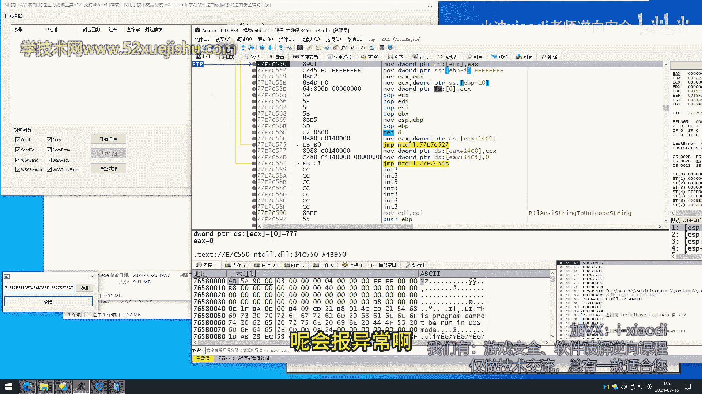

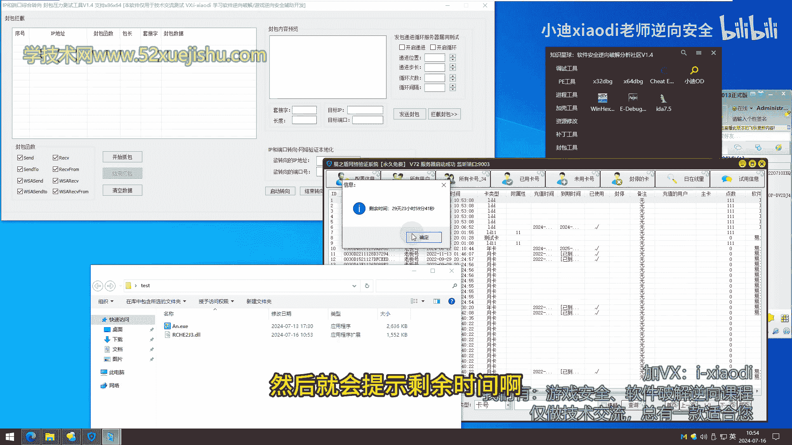

# 软件逆向破解实战：04：转向与登录 🔄

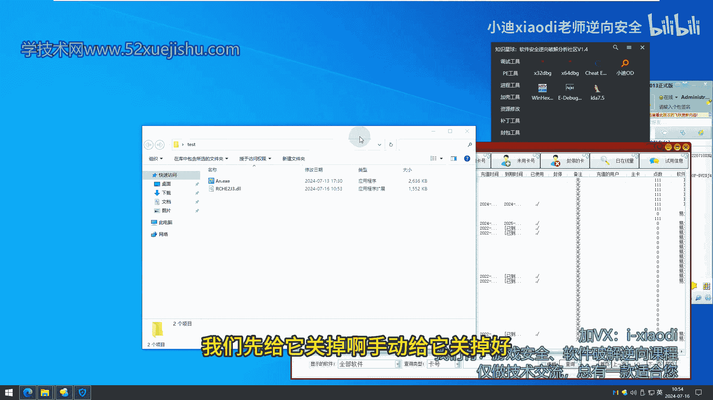

服务端搭建完成后，我们需要让目标程序连接到我们自己的服务器。本节中，我们来看看如何利用IP转向工具实现这一步。

打开IP转向综合工具，点击“注入”，选择目标进程（叉不6版本）。注入成功后，将端口修改为 `9003`，点击“启动转向”，等待提示“成功等待测试”。此时，将刚才复制的卡号粘贴到辅助的登录界面，点击登录。由于附加了进程，VIP验证会报异常，但点击“脱离”后不影响使用。

登录成功后，观察辅助的行为：它会在程序所在目录释放一个 `de` 文件；点击确定后，提示剩余时间；再点击确定，就会进入游戏。程序进程不会退出，因为窗口需要保持，它一直在等待游戏启动。我们可以先手动关闭它。

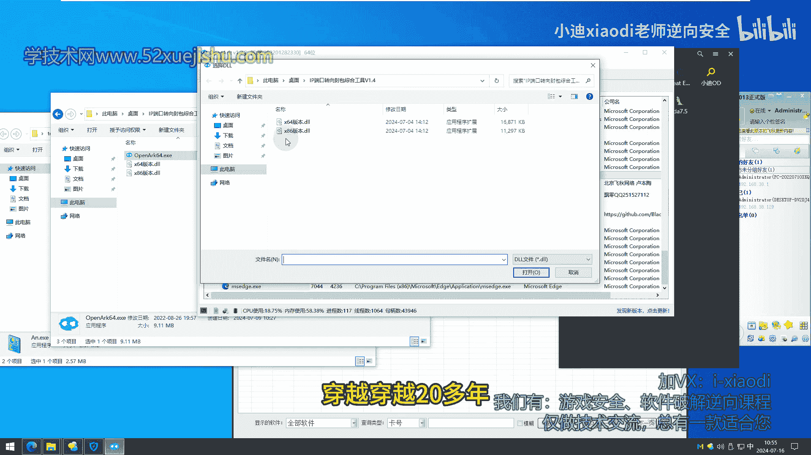

# 软件逆向破解实战：05：修改到期时间 ⏰

上一节我们成功登录了辅助，但卡密是有期限的。本节中，我们来看看如何修改到期时间。

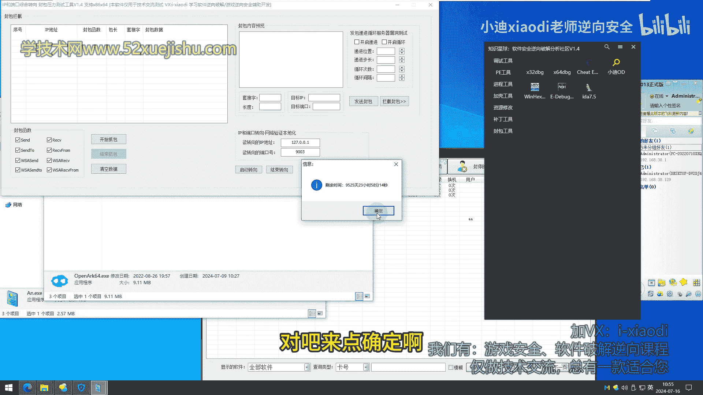

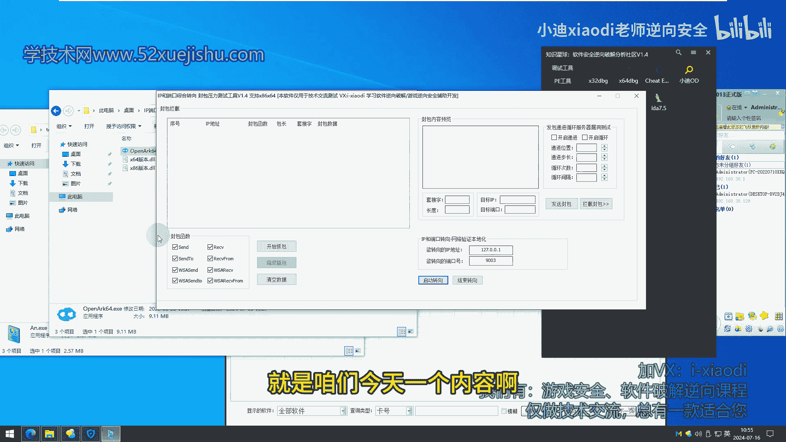

在服务端的“已用卡号”中，无法直接修改时间。但是“增减时间”功能可以增加时间；在“修改卡号信息”中，到期时间也可以直接修改，例如改为 `2050-01-01`。从当前年份穿越到2050年，跨越二十多年，归来仍是少年。这个改动颇有时代感。修改后，重新运行辅助，启动转向（端口 `9003`），点击登录，查看剩余时间，显示为 `9000多天`，足够使用半辈子。点击确定，等待上游戏即可。

# 软件逆向破解实战：06：注意事项与总结 📝

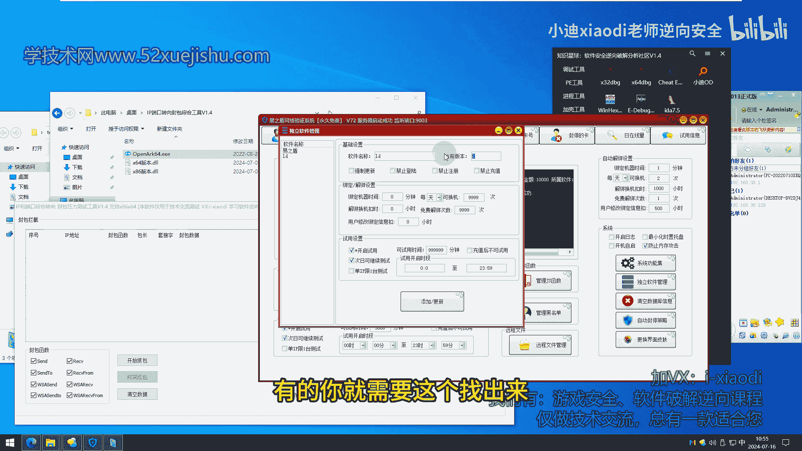

在破解过程中，有些细节需要注意：对于某些软件，必须保证软件名称和版本号都与服务器配置对应，否则无法登录；有些软件则默认就能通过。找出这些信息并不难，因为软件名称、版本号、端口等字段都在同一个大函数内调用，定位一个即可顺藤摸瓜。

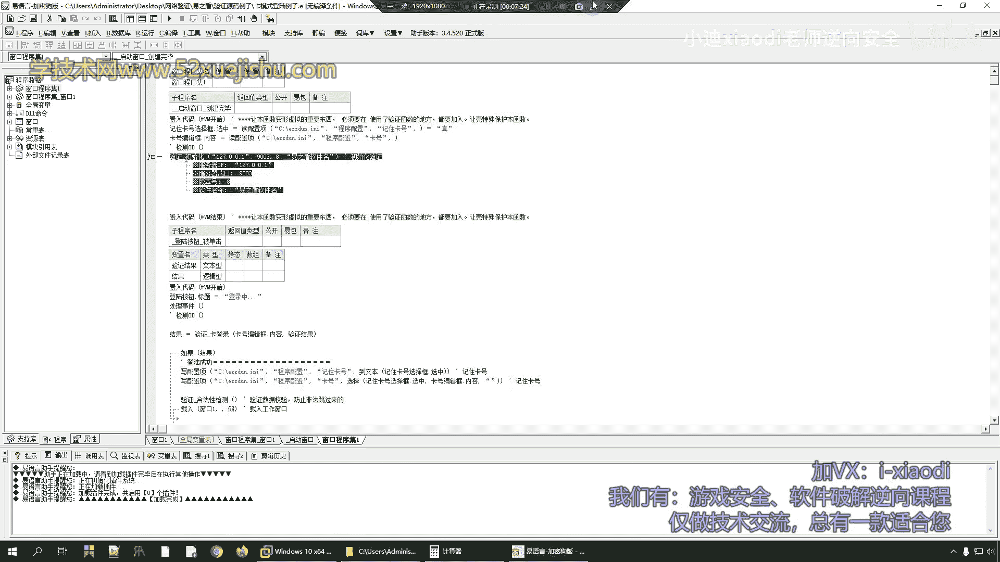

本节课中，我们一起学习了如何破解一款透视自瞄CF辅助。我们首先检查了壳，然后定位了验证关键信息，接着搭建了山寨验证服务器，并通过IP转向实现了登录，最后修改了到期时间。整个过程展示了网络验证的基本破解思路。希望你能理解原理，但请勿将其用于非法用途。我们下期再见。

